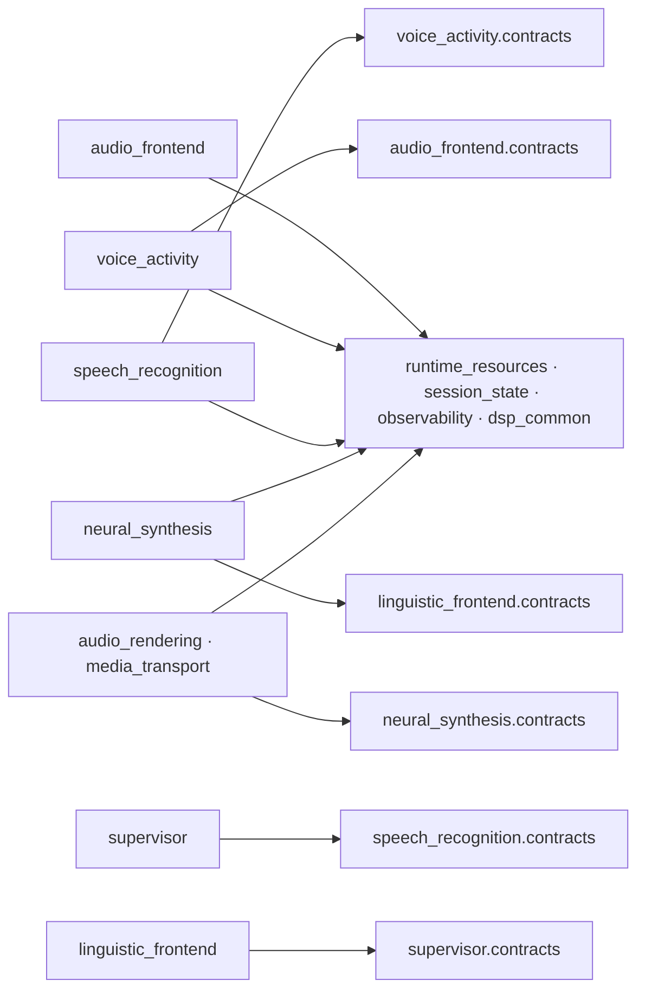

# Hedef kod düzeni (PoC reposu)

Tüm yollar [`FreyaTTS_Automotive_PoC`](https://github.com/seydivakkas/FreyaTTS_Automotive_PoC) reposundadır. Dosya adları aşama `spec.md` bölümlerinde geçen adlarla aynıdır. Mevcut modüller silinmez; yeni paketler onları uyumluluk sarmalayıcısıyla kullanır.

```text
backend/
├── audio_frontend/            F0 — CPU
│   ├── contracts.py           AudioFrame, F0Output, FrameQuality, FrameFlags, F0Processor
│   ├── input_adapter.py       PCM doğrulama, zaman damgası, çerçeveleme
│   ├── pipeline.py            F0Pipeline (oturum başına)
│   ├── echo_canceller.py      F0.02 AEC (F6 oynatma referansı)
│   ├── highpass.py            F0.03
│   ├── noise_estimator.py     F0.04 yan zincir
│   ├── spectral_denoiser.py   F0.05 (car_denoiser'dan)
│   ├── neural_denoiser.py     RNNoise adaptörü (ADR-F0-03)
│   ├── gain_controller.py     F0.06 AGC + gate
│   ├── limiter.py             F0.07 (ortak DSP yardımcıları → dsp_common/)
│   ├── resampler.py           F0.08 durumlu
│   ├── quality_analyzer.py    F0.09
│   ├── profiles.py            P0–P6
│   ├── synthetic_signals.py   laboratuvar üreteci
│   └── telemetry.py
├── voice_activity/            F1 — CPU
│   ├── contracts.py           SpeechFrame, SpeechEvent, TurnContext, PlaybackState, Utterance
│   ├── frame_synchronizer.py  F0 çerçevesi → 512 örnek blok
│   ├── vad_engine.py          oturum başına Silero durumu
│   ├── adaptive_threshold.py
│   ├── lookback_buffer.py     tek pre-roll
│   ├── speech_event_classifier.py
│   ├── endpointing.py · profiles.py
│   ├── semantic_turn.py       (semantic_turn_detector.py'den)
│   ├── double_talk.py
│   ├── backchannel.py
│   ├── bargein_controller.py
│   ├── speech_state_machine.py
│   ├── utterance_manager.py
│   ├── pipeline.py · telemetry.py
├── speech_recognition/        F2 — GPU (Whisper tek örnek)
│   ├── contracts.py           ASRResult
│   ├── whisper_engine.py · decoder_policy.py · inference_scheduler.py
│   ├── audio_window.py · streaming_asr.py · partial_transcript.py
│   ├── catalog_index.py · hotword_engine.py
│   ├── turkish_normalizer.py  ortak Türkçe sayı ayrıştırıcı (F4 ile paylaşılır)
│   ├── asr_mapper.py          (experimental/asr_mapper.py'den)
│   ├── phonetic_encoder.py · entity_resolver.py · entity_extractor.py
│   ├── confidence.py · clarification_gate.py · hallucination_guard.py
│   ├── metrics.py · benchmark.py · pipeline.py
├── supervisor/                F3 — mevcut paket genişletilir; LLM: Qwen (Ollama)
│   ├── contracts.py           ResponsePlan, ResponseSegment, SemanticTag
│   ├── runtime.py · gateway.py · policy.py (mevcut)
│   ├── context_manager.py · slot_manager.py
│   ├── intent_router.py · task_scheduler.py · orchestrator.py
│   ├── agents/                service_booking, customer_crm, workshop_operations,
│   │                          technical_knowledge, sales_parts, human_handoff
│   ├── workflows/             booking_create, booking_reschedule, booking_cancel
│   ├── tools/                 appointment, vehicle, workshop, telephony, crm
│   ├── rag/                   ingestion, chunking, embeddings (CPU), vector_index, hybrid_retriever, evidence_validator
│   ├── confirmation_manager.py · customer_verification.py (ADR-F3-01)
│   ├── memory/                customer_memory, retention_policy
│   ├── response_composer.py · response_validator.py · quality.py
│   └── synthetic.py · train.py · dataset.py
├── linguistic_frontend/       F4 — CPU, kural tabanlı
│   ├── contracts.py           SynthesisPlan, ChunkPlan, ProtectedEntity
│   ├── pipeline.py            tek normalizasyon otoritesi
│   ├── input_validator.py · semantic_tokenizer.py · protected_atoms.py
│   ├── text_normalizer.py · number_/currency_/datetime_/identifier_/unit_normalizer.py
│   ├── automotive_lexicon.py · pronunciation_mapper.py
│   ├── phonology.py · g2p_engine.py · liaison.py · stress_engine.py (morphology/ ile)
│   ├── prosody_planner.py · semantic_chunker.py
│   ├── freya_adapter.py       büyük harf kuralı, karakter sözlüğü doğrulaması
│   ├── quality_gate.py        tersine ayrıştırma, review_required
│   └── benchmark.py
├── morphology/                mevcut (heceleme, vurgu, clitic, çekimli eşleştirici)
├── neural_synthesis/          F5 — GPU (FreyaTTS tek örnek)
│   ├── contracts.py           SynthesisRequest, AudioChunk
│   ├── freya_engine.py · model_registry.py · text_encoder.py
│   ├── duration_predictor.py · duration_guard.py
│   ├── seed_manager.py · latent_initializer.py
│   ├── ode_solver.py · solver_policy.py · vae_decoder.py
│   ├── batched_inference.py · batch_scheduler.py · chunk_dispatcher.py
│   ├── voice_registry.py · audio_cache.py · prewarm_manager.py
│   ├── quality_guard.py · recovery_engine.py
│   ├── speaker_encoder.py · identity_guard.py · pitch_analyzer.py
│   └── pipeline.py · benchmark.py
├── audio_rendering/           F6 — CPU
│   ├── contracts.py           RenderedFrame, PlaybackEvent
│   ├── pipeline.py            görüşme başına durumlu zincir
│   ├── chunk_validator.py · audio_assembler.py · crossfade.py · wsola.py
│   ├── pause_renderer.py · de_esser.py · equalizer.py · loudness.py
│   ├── resampler.py · limiter.py · comfort_noise.py · codec.py
│   ├── frame_manager.py · pacer.py
│   ├── playback_queue.py      (automotive_voice/audio/queue.MediaBuffer temelli)
│   ├── backpressure.py · bargein_bridge.py · playback_receipt.py
│   └── telemetry.py
├── media_transport/           F6 — CPU
│   ├── gateway.py             TransportPort arayüzü
│   ├── websocket_adapter.py · audiosocket_adapter.py · chan_websocket_adapter.py
│   ├── network_monitor.py · jitter_monitor.py · media_clock.py
│   └── fault_recovery.py
├── runtime_resources/         Ortak — GPU yöneticisi
│   ├── gpu_scheduler.py · priority_queue.py · memory_budget.py · cancellation.py
├── session_state/             Ortak — oturum ve kimlik (automotive_voice/core temelli)
├── observability/             Ortak — EventEnvelope yayını, gecikme ölçümü, metrikler
└── dsp_common/                Ortak — F0 ve F6'nın paylaştığı limiter, durumlu filtre ve resampler yardımcıları

config/
├── linguistics/   automotive_lexicon.json (tek sözlük), phonology_rules.json, prosody_profiles.json, stress_exceptions.json
├── voices/        leyla.json, approved_models.json, cache_policy.json, duration_profiles.json, identity_baseline.json, solver_profiles.json
├── media/         rendering_profiles.json
└── resources/     gpu_budget.json (ortak katman)

contracts/         JSON Schema'lar (mevcut 31 + f0_… f6_… yeni sözleşmeler)

tests/
├── audio_frontend/ · voice_activity/ · speech_recognition/ · supervisor/ · linguistic_frontend/
├── neural_synthesis/ · audio_rendering/ · media_transport/ · runtime_resources/ · contracts/
├── fakes/         fake_llm.py, fake_freya_engine.py, fake transport (automotive_voice/telephony/transport.FakeTransport)
└── <paket>/lab/   laboratuvar testleri

data/
└── f0/ … f6/      taban ölçümler, laboratuvar raporları, ablation sonuçları (ham ses KVKK kurallarıyla)

frontend/src/
├── AudioProcessingStudioPanel.tsx (F0) · VoiceIntelligenceStudio (F1) · SpeechRecognitionStudio (F2)
├── DialogueIntelligenceStudio (F3) · TurkishLinguisticStudio (F4) · NeuralSynthesisStudio (F5)
└── TransportStudioPanel.tsx (F6) · useVoiceSession.ts (oynatma makbuzları)
```

## Paketler arası bağımlılık kuralı



- Bir paket yalnızca **kendinden önceki aşamanın `contracts.py` dosyasını** ve ortak paketleri içe aktarır. Başka aşamanın iç modülü içe aktarılmaz.
- Geri besleme (F3 → F1 `TurnContext`, F6 → F0 referans, F6 → F1 oynatma olayları) `session_state` üzerinden veya olay yoluyla taşınır; döngüsel import oluşmaz.
- `backend/session.py` orkestratördür: aşamaları bağlar, iş mantığı içermez (hedef). Bugünkü iş mantığı aşama paketlerine taşındıkça incelir.
- `automotive_voice/` milestone paketi korunur; ortak çekirdek parçaları (`core/identifiers`, `core/cancellation`, `core/events`, `core/event_bus`, `resilience/durable`, `audio/queue`, `telephony/transport`) yeni paketlerin temelidir.
