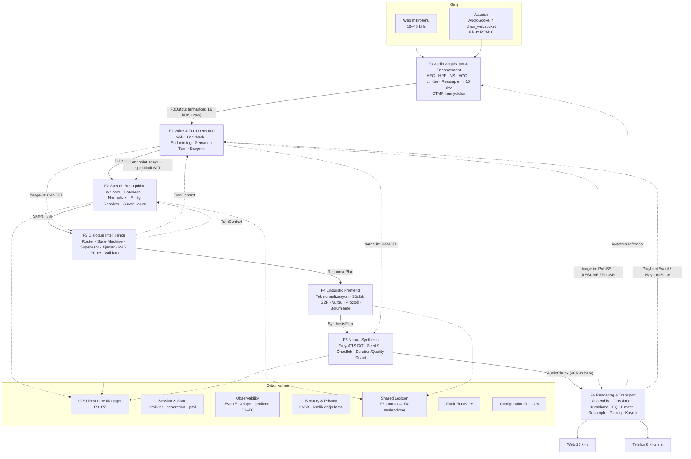

# Freya 2.0 — Ses işleme hattı v2

Bu belge yedi katmanı ve ortak katmanı tek bir bütün olarak gösterir. Her katmanın ayrıntısı kendi `spec.md` dosyasındadır; sözleşmeler [`interfaces.md`](interfaces.md) dosyasındadır.

## 1. Ana akış

## 2. Katmanlar arası geri besleme döngüleri

| Döngü | Kaynak → Hedef | Ne taşınır | Neden |
| --- | --- | --- | --- |
| Konuşma bağlamı | F3 → F1, F2 | `TurnContext` (`expected_slot`, `awaiting_confirmation`, `freya_utterance_kind`) | F1 sessizlik eşiğini, F2 hotword kümesini ve karar kapısını seçer |
| Yankı referansı | F6 → F0 | Transport'a yazılan son sesin zaman damgalı kopyası | F0 AEC ve F1 double-talk |
| Oynatma durumu | F6 → F1 | `PlaybackEvent`, `PlaybackState` (konum, cümlecik başlangıcı) | Barge-in kararı, resume konumu, duyulabilir kesilme ölçümü |
| Barge-in | F1 → F6, F5, F3 | SOFT_PAUSE / RESUME / FLUSH / CANCEL ve yeni `generation_id` | Eski sesin durması, eski sentezin iptali, F3'ün yarım kalan yanıtı bilmesi |
| Spekülatif tanıma | F1 → F2 → F1 | Endpoint adayında kısa tanıma isteği; sonuç F1.07'ye | Semantic turn kararı ve TTFA'nın kısalması |
| Varlık odağı | F3 → F4 | `ResponseSegment.tags` (marka, model, plaka, fiyat, tarih…) | F4 korumalı öbekler, vurgu, duraklama |
| Sözlük | F2 ↔ F4 | Tek otomotiv sözlüğü (tanıma ve seslendirme yönleri) | Aynı terimin iki yönde tutarlı olması |

## 3. Tasarım ilkeleri

1. **Tek sorumluluk, tek uygulama.** Normalizasyon F4'te, duraklama/fade F6'da, VAD durumu F1'de, GPU zamanlaması ortak katmanda.
2. **Değişmez veri akışı.** Katmanlar arası nesneler `frozen` dataclass'tır; bir katman kendinden öncekinin çıktısını değiştirmez, yenisini üretir.
3. **Generation kapısı her katmanda.** F2 sonucu, F3 planı, F4 planı, F5 parçası ve F6 çerçevesi `generation_id` taşır; eski olan atılır ve sayılır.
4. **Ham veri korunur.** F0 ham çerçeveyi, F2 ham transkripti, F4 kaynak metni, F5 ham sesi taşır. Hata ayıklama ve ablation için gereklidir.
5. **Bilinmeyen değer `null`'dır.** Ölçülmemiş güven, SNR veya gecikme uydurulmaz.
6. **Bayrak arkasında kademeli geçiş.** Her katmanın `fN_pipeline_v2` bayrağı vardır; legacy yol regresyon sprinti geçene kadar varsayılandır.

## 4. Çalışma kipleri

| Kip | Açıklama |
| --- | --- |
| Legacy | Tüm `fN_pipeline_v2` bayrakları kapalı; PoC davranışı + bayraktan bağımsız düzeltmeler |
| Karma | Bazı katmanlar v2. Sözleşme adaptörleri legacy ↔ v2 dönüşümünü yapar (ör. `models.transcribe() -> str` uyumluluğu) |
| Shadow | v2 hattı legacy ile paralel çalışır, çıktısı kaydedilir ama müşteriye gitmez (F3-S23) |
| V2 | Tüm katmanlar v2; legacy kod uyumluluk sarmalayıcısı olarak kalır |

## 5. Eşzamanlılık modeli

- Görüşme başına bir `Session`; F0 ve F1 durumu oturum başınadır (Silero VAD dahil — F1 S1).
- CPU ağırlıklı DSP (F0, F6) olay döngüsünü bloklamamalı; 20 ms çerçevede 1/2/4 eşzamanlı oturumla ölçülür (F0-T22), gerekirse oturum başına iş parçacığı.
- GPU işleri (STT, LLM, TTS) tek bir ortak yöneticiden geçer; öncelik P0–P7 ([gpu-resource-manager](../cross-cutting/gpu-resource-manager.md)).
- Ağ yazmaları zaman aşımlıdır; bir oturumun yavaş tüketicisi diğerlerini etkilemez.
