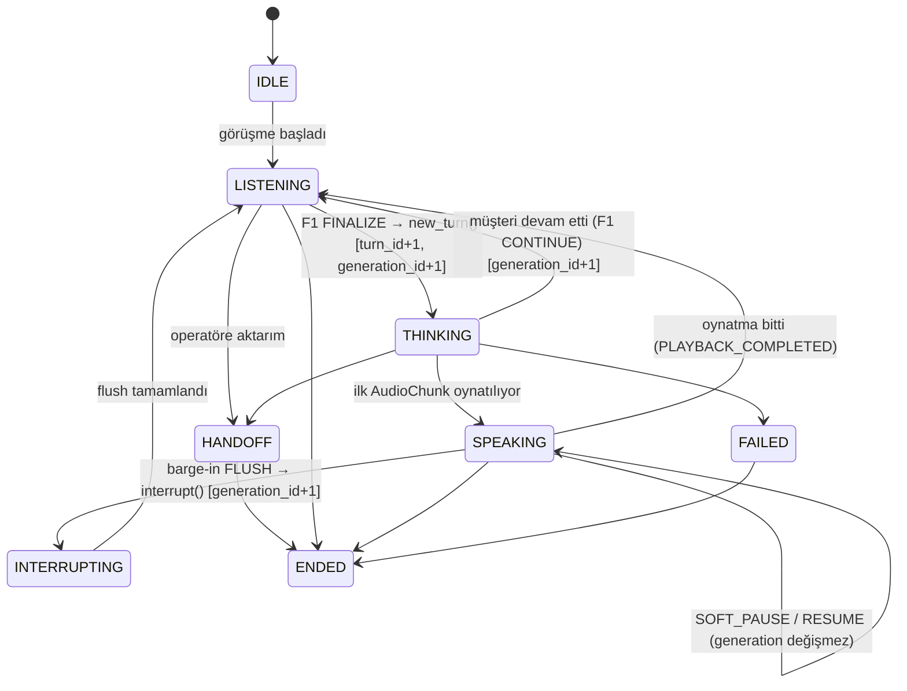

# Oturum ve durum yönetimi

**Kod:** `backend/session_state/` — PoC'taki `automotive_voice/core/` (kimlikler, durum makinesi, iptal, olay yolu, oturum yöneticisi) ve `automotive_voice/resilience/durable.py` temel alınır. Yeni bir eşdeğer yazılmaz.

## 1. PoC'taki durum

| Yapı | Nerede | Canlı yolda mı |
| --- | --- | --- |
| `self.generation` tamsayı sayacı; oynatma mesajlarında `"turn_id"` olarak gidiyor | `backend/session.py` | Evet |
| `SessionId`, `TurnId`, `GenerationId` (doğrulamalı tipler) | `automotive_voice/core/identifiers.py` | Hayır (milestone) |
| `State` durum makinesi (IDLE, LISTENING, THINKING, SPEAKING, INTERRUPTING, HANDOFF, FAILED, ENDED) ve izinli geçişler | `automotive_voice/core/session.py` | Hayır |
| `CancellationController` (monoton generation, token, `StaleGenerationError`) | `automotive_voice/core/cancellation.py` | Hayır |
| `EventEnvelope` + `EventBus` (sıra denetimi, kapasite, abonelik) | `automotive_voice/core/events.py`, `event_bus.py` | Kısmen (`backend/fqici/journal.py`) |
| `SessionManager`, `DurableJournal` (SQLite, en az bir kez olay çıkışı) | `core/session_manager.py`, `resilience/durable.py` | Milestone uçları (`backend/milestones.py`) |

Sonuç (bulgu X1, X2): Canlı oturum, milestone paketinde zaten tasarlanmış ve test edilmiş çekirdeği kullanmıyor; tur ve generation kavramlarını tek sayaçta birleştiriyor.

## 2. Hedef

`backend/session.py` içindeki `Session` sınıfı görüşme başına bir **`SessionState`** nesnesi taşır:

```python
@dataclass
class SessionState:
    session_id: SessionId
    channel: Literal["web", "audiosocket", "chan_websocket"]
    machine: Session                     # automotive_voice.core.session.Session (durum + turn_id + generation_id)
    cancellation: CancellationController
    turn_context: TurnContext | None     # F3'ten son yayımlanan (F1/F2 okur)
    playback: PlaybackState              # F6'dan (F1 okur)
    playback_paused: bool                # SOFT_PAUSE: SPEAKING durumunda kalır
    profile_ids: dict[str, str]          # F0 ortam profili, F1 konuşma profili, F6 kanal profili
    ab_variant: str | None               # A/B deneyi (X7) — telemetriye yazılır
```

## 3. Durum geçişleri ve generation kuralları



| Olay | Durum makinesi | `CancellationController` | Etkisi |
| --- | --- | --- | --- |
| F1 `FINALIZE` | `new_turn()` | `advance(new_generation)` | Önceki yanıtın kalanı (varsa) iptal; yeni F2→F3 başlar |
| F1 `CONTINUE` (Freya henüz konuşmuyor) | `THINKING → LISTENING` + generation artışı (milestone `Session`'a eklenecek yöntem) | `advance` | F2/F3/F4/F5'teki yarım iş atılır; ses birleştirilir (F1 S5 çözümü) |
| F1 `bargein_pause` | Durum aynı (`SPEAKING`), `playback_paused = True` | — | F6 gönderimi durdurur |
| F1 `bargein_resume` | `playback_paused = False` | — | F6 kaldığı yerden / cümlecik başından |
| F1 `bargein_flush` | `interrupt()` | `advance` | F6 FLUSH, F5 kuyruk iptali, GPU yöneticisi başlamamış işleri iptal eder |
| Oynatma tamamlandı | `SPEAKING → LISTENING` | — | — |

**Generation kapısı her tüketicide:** F3 yanıt üretirken, F4 plan oluştururken, F5 parça üretirken ve F6 çerçeve gönderirken `cancellation.is_current(generation_id)` kontrol eder. Eski olan atılır ve `stale_dropped` sayacına yazılır.

## 4. Eşzamanlılık ve izolasyon

- Oturumlar arası paylaşılan değiştirilebilir durum yoktur. Paylaşılan tek şey modellerin ağırlıklarıdır (F1 S1 çözümü: Silero durumu oturum başına — ADR-F1-01).
- Oturum içi yöntemler oturum kilidi altında seri çalışır (`CancellationController` belgesindeki kural).
- Oturum sonu: tüm kuyruklar boşaltılır, GPU yöneticisinde oturumun başlamamış işleri iptal edilir, halka tamponlar serbest bırakılır, `SESSION_ENDED` olayı yayımlanır.

## 5. Kalıcılık

- Kalıcı kayıt yalnızca gerektiğinde: randevu, işlem makbuzları, denetim izi (F3 Tool Gateway).
- `DurableJournal` mevcut davranışı korunur: süreç yeniden başlarsa açık görüşmeler **sürdürülmez**, `FAILED`/`ENDED` olarak kapatılır. Görüşme ortası kurtarma Freya 2.0 kapsamında değildir.
- F3'ün yazma araçlarında zaman aşımı uzlaştırması (F3 P2) aynı idempotency anahtarı ile yapılır ve makbuz anahtara bağlanır.

## 6. Görevler

| Görev | İçerik |
| --- | --- |
| AIP-08 / CC-T01 | `SessionState` + milestone çekirdeğinin canlı `Session`'a bağlanması (bayrak arkasında değil — davranış aynı, yalnızca kimlikler ayrılır); web mesajlarında `generation_id` alanı |
| AIP-08 / CC-T02 | `Session`'a `THINKING → LISTENING` generation artışı; testler |
| F1-T03, F1-T05 | VAD izolasyonu, bölüm iptali (bu belgeyle uyumlu) |
| F6-T17, F6-T18 | Oynatma kuyruğu ve barge-in köprüsü (generation kapısı) |
