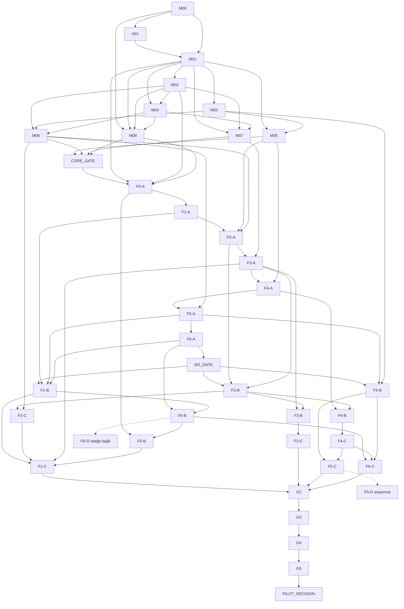

# Yürütme sırası

> Hangi paketin ne zaman başlayabileceğini gösterir. Bir paket yalnız **doğrudan önkoşullarının tümü kabul edildiyse** başlar. Aynı anda tek ajan çalışır; aşağıdaki "sırası değiştirilebilir" grupları yalnız sıra esnekliğidir. Kaynak doğruluğu paket dosyalarındaki `Önkoşullar` satırlarıdır; bu sayfa ve [registry.json](registry.json) onlardan üretilir/denetlenir (`python scripts/build_registry.py --check`).

## Önerilen seri sıra

| # | Paket / aşama | Doğrudan önkoşullar | Not |
| ---: | --- | --- | --- |
| 1 | M00 | — | Salt okunur; kod değişmez |
| 2 | H01 | M00 | Bayraktan bağımsız düzeltmeler |
| 3 | M01 | M00, H01 | |
| 4 | M02 | M01 | M02 ve M03 sırası değiştirilebilir |
| 5 | M03 | M01 | |
| 6 | M04 | M01, M02 | |
| 7 | M05 | M01, M03 | |
| 8 | M06 | M02, M03, M04 | |
| 9 | M07 | M01, M02, M04 | M05, M06, M07, M08 sırası önkoşullar izin verdikçe değiştirilebilir |
| 10 | M08 | M00, M01, M02, M04 | |
| 11 | CORE_GATE | M00, H01, M01–M08 | Bağımsız inceleme |
| 12 | F0-A | CORE_GATE, M01, M02, M08 | |
| 13 | F1-A | CORE_GATE, F0-A, M02 | |
| 14 | F2-A | CORE_GATE, F1-A, M05, M06 | |
| 15 | F3-A | CORE_GATE, F2-A, M07 | |
| 16 | F4-A | CORE_GATE, F3-A, M05 | |
| 17 | F5-A | CORE_GATE, F4-A, M06 | |
| 18 | F6-A | CORE_GATE, F5-A, M02 | |
| 19 | W2_GATE | CORE_GATE, F0-A … F6-A | Bağımsız inceleme |
| 20 | F1-B | W2_GATE, F1-A, F5-A, F6-A | |
| 21 | F6-B | W2_GATE, F6-A, F1-B | |
| 22 | F2-B | W2_GATE, F2-A, F3-A, M05 | F2-B ve F5-B, F1-B/F6-B'den bağımsızdır; sırası değiştirilebilir |
| 23 | F3-B | W2_GATE, F3-A, F2-B, M07 | |
| 24 | F4-B | W2_GATE, F4-A, F2-B, M05 | F3-B ve F4-B sırası değiştirilebilir |
| 25 | F5-B | W2_GATE, F5-A, M03, M06 | |
| 26 | F0-B | W2_GATE, F0-A, F6-B | |
| 27 | F2-C | W2_GATE, F2-B, M06 | |
| 28 | F1-C | W2_GATE, F1-B, F2-C, F3-A, F0-B | |
| 29 | F3-C | W2_GATE, F3-B | W3 sonrası herhangi bir noktada yapılabilir |
| 30 | F4-C | W2_GATE, F4-B | |
| 31 | F5-C | W2_GATE, F5-B, F4-C | |
| 32 | F6-C | W2_GATE, F6-B, F4-C, F5-B | |
| 33 | G2 | F1-C, F3-C, F5-C, F6-C (tüm zorunlu zincir) | Bağımsız inceleme |
| 34 | G3 | G2 | Bağımsız inceleme |
| 35 | G4 | G3 | Bağımsız inceleme |
| 36 | G5 | G4 | Bağımsız inceleme; ayrı izin |
| 37 | PILOT_DECISION | G5 | Kullanıcı kararı |
| — | F6-D (isteğe bağlı) | W2_GATE, F6-B | W3 sonrası herhangi bir zaman; G2 kapsamına alınırsa G2'den önce |
| — | F5-D (araştırma) | W2_GATE, F5-C + gerçek atfedilmiş hata | Normalde G5 bulgusundan sonra; ana ürünü engellemez |

## Bağımlılık grafiği

Grafikte tüm W1 paketlerinin CORE_GATE'e, tüm W2 paketlerinin W2_GATE'e ve tüm W3/W4 paketlerinin W2_GATE'e bağlı olduğu kenarlar sadelik için kısaltılmıştır.

## Ortam gereksinimi

| Ortam | Paketler |
| --- | --- |
| Yalnız CPU (bulut ajanı yeterli) | M00, H01, M01–M05, M07, M08, CORE_GATE, F0-A, F1-A, F3-A, F4-A, F6-A, W2_GATE, F1-B, F6-B, F3-B, F4-B, F0-B, F1-C, F3-C, F4-C, F6-C, G2, G3 |
| GPU'lu makinede ek duman/ölçüm | M06, F2-A, F5-A, F2-B, F5-B, F2-C, F5-C (birim testleri yine CPU'da sahte motorla) |
| GPU + gerçek modeller | G4 |
| PBX | F6-D (yalnız `@pytest.mark.pbx`), G4 isteğe bağlı PBX laboratuvarı, G5 |
| İnsan | G5 |

## Durum takibi

Her paketin `Durum` satırı ve `evidence/<PAKET>/<run_id>/decision.json` dosyası gerçek durumu taşır. Paket kabul edildiğinde plan reposunda ilgili paket dosyasının `Durum` satırı `PASS` yapılır ve kanıt yolu eklenir (ayrı küçük PR).
