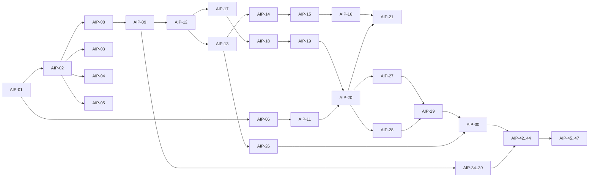

# Freya 2.0 — Master Development Plan

Bu belge yedi katmanın (F0–F6) ve ortak katmanın planlarını **tek bir uygulama sırasına** dönüştürür. Kodlama ajanı işi buradan alır: önce fazın uygulama paketini (AIP) seçer, sonra paketteki görevlerin `tasks.md` kayıtlarını okur.

| Özet | Değer |
| --- | --- |
| Katman | 7 (F0–F6) + ortak katman |
| Görev | 238 aşama görevi + 4 ortak katman görevi (CC-T01…T04) |
| Sprint | 146 (aşama planlarında) |
| Uygulama paketi | 48 (AIP-01…AIP-48) |
| Faz / kilometre taşı | 8 (Faz 0–7, M0–M7) |

## 1. Öncelik mantığı

Proje değerlendirmesinin sonucu: en büyük sorun ses üretilememesi değil, **otomotiv terimlerinin güvenilir işlenememesi** (%48,04 → %95) ve **görüşme gecikmesi**. Önerilen sıra: (1) F2 Automotive Entity Resolver, (2) F4 Türkçe telaffuz motoru, (3) Streaming STT ve konuşma sonu algılama. Bu plan o sırayı korur ve önüne iki zorunlu adım ekler:

1. **Faz 0 — Güvenli zemin.** Kod incelemesinde bulunan güvenlik açıkları ve canlı görüşmeyi bozan hatalar, hiçbir yeni özellik beklemeden düzeltilir. Testler canlı Ollama ve GPU olmadan çalışır hale gelir; taban ölçümler alınır.
2. **Faz 1 — Ortak temel.** Sözleşmeler, kimlikler, telemetri ve GPU yöneticisi. Bunlar olmadan yedi katman paralel geliştirilemez.

Sonra: **Faz 2 terim doğruluğu → Faz 3 gecikme ve kesinti → Faz 4 diyalog orkestrasyonu → Faz 5 Studio → Faz 6 laboratuvar → Faz 7 gerçek koşul kabulü.**

Faz 4 (diyalog) büyük ölçüde CPU ve sahte LLM ile çalıştığı için Faz 2–3 ile **paralel** yürütülebilir.

## 2. Fazlar ve kilometre taşları

| Faz | Amaç | Paketler | Kilometre taşı — çıkış koşulu |
| --- | --- | --- | --- |
| **0** Güvenli zemin | Güvenlik, canlı hatalar, hermetik test, taban | AIP-01…07 | **M0:** `pytest` GPU/Ollama olmadan geçer; Faz 0 düzeltmeleri canlıda; taban raporları `data/` altında; model başına VRAM ölçüldü |
| **1** Ortak temel | Sözleşmeler, kimlik, telemetri, GPU yöneticisi | AIP-08…11 | **M1:** Tüm sözleşmeler `contracts.py` + JSON Schema + test; `turn_id`/`generation_id` ayrı; olaylar `EventEnvelope`; STT ve TTS tek GPU yöneticisinden geçiyor |
| **2** Terim doğruluğu | Ortak sözlük, F2 resolver ve karar kapısı, F4 tek normalizasyon ve telaffuz, tek sentez yolu | AIP-12…21 | **M2:** Terim doğruluğu **üç ayrı sayı** olarak ölçüldü (tanıma / seslendirme / birleşik); %95 hedefine göre ilerleme raporu; F2/F4 v2 bayrakları regresyonda |
| **3** Gecikme ve kesinti | F0 düşük gecikme ve DSP, F1 endpointing/semantic turn/barge-in, pseudo-streaming STT, F5 sentez çekirdeği, F6 rendering/kuyruk/transport | AIP-22…33 | **M3:** Yol bazında TTFA p50/p95; duyulabilir kesilme ölçüldü; ADR-F1-02, F6-01…04 kararları |
| **4** Diyalog orkestrasyonu (AP13) | Bağlam, router, araçlar, ajanlar, RAG, yanıt doğrulama | AIP-34…39 | **M4:** Supervisor Shadow tüm kanallarda; doğrulanmamış başarı iddiası 0 (F3 K18); LLM çağrı oranı ve yol gecikmeleri raporlandı |
| **5** Studio | Yedi Studio sayfası gerçek backend'le | AIP-40…41 | **M5:** Her Studio gerçek veriyle; simülasyonlar etiketli |
| **6** Laboratuvar | Test kümeleri, T-testleri, ablation, uçtan uca regresyon | AIP-42…44 | **M6:** Tüm `acceptance.md` K tabloları ölçümle dolu; `fN_pipeline_v2` varsayılanları açık |
| **7** Gerçek koşul kabulü (AP11, AP12) | Gerçek mikrofon, insan sesi, Asterisk, SIP, insan dinleme | AIP-45…48 | **M7:** L0–L6 kanıtlı; `VERIFICATION.md` HOLD kalemleri kanıtla güncellendi |

## 3. Faz 0 — Bayraktan bağımsız düzeltmeler

Bu hatalar legacy yolda da düzeltilir, çünkü bugün canlı görüşmeyi veya kişisel veriyi etkiliyorlar.

| Görev | Bulgu | Etki |
| --- | --- | --- |
| F3-T05 | P4 — kimlik doğrulamasız özel kayıt paylaşımı | **Güvenlik / KVKK** |
| F3-T03 | P7 — çoklu araç randevusunda aynı idempotency anahtarı | İkinci araç randevusu başarısız |
| F1-T03 | S1 — paylaşılan Silero VAD durumu | Yeni görüşme diğerlerinin VAD'ını sıfırlıyor |
| F1-T05 | S5 — yeni bölüm önceki bölümün işlenmesini iptal ediyor | Müşterinin sözü kayboluyor |
| F0-T14 | Kalibrasyon sırasında ses VAD/STT'ye gitmiyor | Müşterinin sözü kayboluyor (**plan önerisi:** F0 planında bayraklı; aynı gerekçeyle bayraktan bağımsız yapılması önerilir) |
| F4-T04 | L5 — tek desteklenmeyen karakter yanıtı düşürüyor | "−5 °C", "Mégane" içeren yanıt hiç okunmuyor |
| F4-T05 | L3 — sıra sayısı cümleyi bölüyor | Seçenek listeleri bozuk okunuyor |
| F5-T11 | N3 — seed sessizce 9'a dönüyor | Ses kimliği sözleşmesi ihlali |
| F5-T17 (yalnızca iptal filtresi) | N5 — iptal edilen parçalar yine sentezleniyor | Boşa GPU, barge-in sonrası gecikme |
| F6-T03 | R6 — ağ yazmasında zaman aşımı yok | Gönderim ve barge-in süresiz bloklanabilir |

## 4. Uygulama paketleri (AIP)

**Ortam:** `CPU` = bulut ajanı veya herhangi bir makine · `GPU` = kullanıcının RTX 4070 makinesi · `PBX` = Asterisk ortamı · `İnsan` = dinleyici/kayıt gerektirir. Yıldızlı görev (`*`) pakette kısmen yapılır; tamamı başka pakettedir.

### Faz 0 — Güvenli zemin

| AIP | Ad | Görevler | Ön koşul | Ortam |
| --- | --- | --- | --- | --- |
| AIP-01 | Hermetik test altyapısı (LLM ve Freya sahteleri, pytest işaretleri, ağır içe aktarmaların tembelleştirilmesi — bulgu X8) | F3-T01, F5-T07 | — | CPU |
| AIP-02 | Karakterizasyon testleri | F0-T01, F1-T01, F2-T03, F3-T02, F4-T01, F5-T02, F6-T01 | 01 | CPU |
| AIP-03 | Güvenlik düzeltmeleri | F3-T05, F3-T03 | 01 | CPU |
| AIP-04 | Giriş ve tur hata düzeltmeleri | F1-T03, F1-T05, F0-T14 | 02 | CPU |
| AIP-05 | Çıkış hata düzeltmeleri | F4-T04, F4-T05, F5-T11, F5-T17*, F6-T03 | 02 | CPU (+GPU doğrulama) |
| AIP-06 | GPU taban ölçümleri ve Leyla referans kümesi | F5-T01, F5-T03, F5-T05, F2-T01, F2-T02 | 01 | GPU |
| AIP-07 | CPU taban ölçümleri ve ölçülmemiş iddiaların temizlenmesi | F0-T02, F3-T04, F4-T03, F5-T04, F6-T02 | 02 | CPU |

### Faz 1 — Ortak temel

| AIP | Ad | Görevler | Ön koşul | Ortam |
| --- | --- | --- | --- | --- |
| AIP-08 | Oturum ve kimlik çekirdeği | CC-T01, CC-T02 ([session-and-state](../cross-cutting/session-and-state.md)) | 02 | CPU |
| AIP-09 | Sözleşmeler ve JSON şemaları | F0-T04, F1-T04, F2-T04, F3-T06, F4-T06, F5-T06, F6-T04 | 08 | CPU |
| AIP-10 | Gözlemlenebilirlik | CC-T03, CC-T04 ([observability](../cross-cutting/observability.md)) | 08, 09 | CPU |
| AIP-11 | Ortak GPU yöneticisi | F5-T16, F2-T07 | 06, 08 | GPU |

### Faz 2 — Terim doğruluğu

| AIP | Ad | Görevler | Ön koşul | Ortam |
| --- | --- | --- | --- | --- |
| AIP-12 | Ortak otomotiv sözlüğü | F4-T02, F4-T13, F4-T14, F2-T08, F4-T15 | 07, 09 | CPU |
| AIP-13 | Whisper adaptörü, bağlamsal hotword, kalibrasyon/test ayrımı | F2-T05, F2-T06, F2-T09, F2-T30, F2-T33 | 11, 12 | GPU |
| AIP-14 | Türkçe ASR normalizer ve mapper | F2-T10, F2-T11, F2-T12, F2-T13 | 12, 13 | CPU |
| AIP-15 | Phonetic Entity Resolver ve varlık çıkarımı | F2-T14, F2-T15, F2-T16, F2-T17 | 14 | CPU |
| AIP-16 | Güven, belirsizlik kapısı, sahte metin koruması | F2-T18, F2-T19, F2-T20, F2-T21, F2-T22 | 15 | CPU (+GPU kalibrasyon) |
| AIP-17 | F4 tek normalizasyon otoritesi | F4-T07, F4-T08, F4-T09, F4-T10, F4-T11, F4-T12 | 05, 09, 12 | CPU |
| AIP-18 | Morfoloji, fonoloji, G2P, vurgu, ulama | F4-T16, F4-T17, F4-T18, F4-T19, F4-T20, F4-T21 | 17 | CPU |
| AIP-19 | Prozodi, bölümleme, Freya uyumluluğu, kalite kapısı | F4-T22, F4-T23, F4-T24, F4-T25, F4-T26, F4-T28 | 18 | CPU (+GPU ADR-F4-01) |
| AIP-20 | **Tek sentez yolu** (sorumluluk göçü) | F5-T08, F4-T27, F5-T09, F6-T05, F6-T06, F6-T08 | 11, 19 | GPU |
| AIP-21 | Terim doğruluğu ölçümü (ara) | F0-T03, F2-T31, F2-T32, F4-T33* (sözlük alt kümesi) | 16, 20 | GPU + İnsan |

### Faz 3 — Gecikme, kesinti ve ses kalitesi

| AIP | Ad | Görevler | Ön koşul | Ortam |
| --- | --- | --- | --- | --- |
| AIP-22 | F0/F1/F5 test derlemleri | F0-T29, F1-T02, F5-T28 | 17, 21 | CPU |
| AIP-23 | F0 giriş yolu ve düşük gecikmeli çerçeve | F0-T05, F0-T06, F0-T07, F0-T08, F0-T19, F0-T21, F0-T22, F0-T23, F0-T24 | 09, 10 | CPU |
| AIP-24 | F0 DSP zinciri | F0-T09, F0-T10, F0-T11, F0-T12, F0-T13, F0-T15, F0-T16, F0-T25, F0-T26 | 22, 23 | CPU |
| AIP-25 | F1 VAD çekirdeği ve gecikme kararı | F1-T06, F1-T07, F1-T08, F1-T09, F1-T10, F1-T11 | 04, 22, 23 | CPU |
| AIP-26 | Endpointing, semantic turn, pseudo-streaming STT | F1-T12, F1-T13, F1-T14, F1-T15, F1-T16, F1-T17, F2-T23, F2-T24, F2-T25, F2-T26, F2-T27 | 13, 25 | GPU |
| AIP-27 | F5 sentez çekirdeği | F5-T10, F5-T12, F5-T13, F5-T14, F5-T15, F5-T17, F5-T18, F5-T19, F5-T20, F5-T21 | 20, 22 | GPU |
| AIP-28 | F6 rendering zinciri | F6-T07, F6-T09, F6-T10, F6-T11, F6-T12, F6-T13, F6-T14, F6-T15, F6-T16 | 20 | CPU |
| AIP-29 | Oynatma kuyruğu ve F5→F6 akışı | F6-T17, F6-T19, F6-T21, F5-T25, F5-T26 | 27, 28 | CPU (+GPU) |
| AIP-30 | Barge-in 2.0 | F1-T18, F1-T19, F1-T20, F1-T21, F1-T22, F6-T18 | 26, 29 | CPU |
| AIP-31 | AEC ve RNNoise | F0-T17, F0-T18, F0-T20 | 24, 29 | CPU |
| AIP-32 | Transport: AudioSocket, chan_websocket, telemetri, AMI/ARI | F6-T20, F6-T22, F6-T23, F6-T24 | 29 | CPU + PBX |
| AIP-33 | Ses kimliği doğrulama | F5-T22, F5-T23, F5-T24 | 27 | GPU |

### Faz 4 — Diyalog orkestrasyonu (AP13)

| AIP | Ad | Görevler | Ön koşul | Ortam |
| --- | --- | --- | --- | --- |
| AIP-34 | Bağlam, slot ve durum makinesi | F3-T07, F3-T08, F3-T09, F3-T10, F3-T11 | 03, 09 | CPU |
| AIP-35 | Senaryo kümesi, hibrit router, görev planlayıcı | F3-T40, F3-T12, F3-T13, F3-T14, F3-T15, F3-T16 | 34 | CPU |
| AIP-36 | Tool Gateway, onay, policy, hafıza | F3-T26, F3-T27, F3-T28, F3-T29, F3-T30 | 34 | CPU |
| AIP-37 | Yanıt doğrulama ve yol bazında gecikme | F3-T31, F3-T32, F3-T33 | 11, 35 | CPU (+LLM) |
| AIP-38 | Uzman ajanlar | F3-T17, F3-T18, F3-T19, F3-T24, F3-T25 | 36 | CPU |
| AIP-39 | RAG ve teknik bilgi ajanı | F3-T20, F3-T21, F3-T22, F3-T23 | 37 | CPU (+LLM) |

### Faz 5 — Studio

| AIP | Ad | Görevler | Ön koşul | Ortam |
| --- | --- | --- | --- | --- |
| AIP-40 | Studio API'leri | F0-T27, F1-T23, F2-T28, F3-T34 | 10, Faz 3–4 özellikleri | CPU |
| AIP-41 | Studio arayüzleri | F0-T28, F1-T24, F1-T25, F2-T29, F3-T35, F4-T29, F5-T27, F6-T25 | 40 | CPU |

### Faz 6 — Laboratuvar, ablation, regresyon

| AIP | Ad | Görevler | Ön koşul | Ortam |
| --- | --- | --- | --- | --- |
| AIP-42 | Laboratuvar testleri | F4-T30, F0-T30, F0-T31, F1-T26, F1-T27, F3-T36, F4-T31, F5-T29, F6-T26 | Faz 3–4 | CPU + GPU |
| AIP-43 | Ablation deneyleri | F2-T34, F3-T37, F4-T32, F5-T30, F6-T27 | 42 | GPU |
| AIP-44 | Uçtan uca regresyon ve bayrak açılışı | F0-T32, F1-T28, F2-T35, F3-T38, F3-T39, F5-T31, F6-T28 | 43 | GPU |

### Faz 7 — Gerçek koşul kabulü

| AIP | Ad | Görevler | Ön koşul | Ortam |
| --- | --- | --- | --- | --- |
| AIP-45 | Gerçek mikrofon ve insan sesi kabulü | F0-T33, F0-T34, F1-T29, F1-T30, F2-T36, F2-T37 | 44 | GPU + İnsan |
| AIP-46 | Asterisk ve SIP kabulü | F6-T29, F6-T30, F3-T41 | 32, 44 | PBX + İnsan |
| AIP-47 | İnsan dinleme değerlendirmesi | F4-T33, F5-T32 | 44 | İnsan |
| AIP-48 | (İsteğe bağlı) Kontrollü LoRA deneyi | F5-T33 | 47 | GPU |

## 5. Kritik yol ve paralellik

**Kritik yol:** AIP-01 → 02 → 08 → 09 → 12 → 17 → 18 → 19 → 20 → 27 → 29 → 30 → 42 → 43 → 44 → 46.

**Paralel izler (Faz 1 sonrası):**
- İz A — F2 tanıma: AIP-13 → 14 → 15 → 16
- İz B — F4 dilbilim: AIP-17 → 18 → 19
- İz C — F3 diyalog: AIP-34 → 35/36 → 37 → 38 → 39
- İz D — F0/F1 giriş: AIP-23 → 24/25 (AIP-22 derlemlerinden sonra)

## 6. Tekilleştirilmiş bileşenler

Planlarda birden fazla katmanda geçen bileşenler tek sahibe bağlanır. Diğer katmanlar onu kullanır, kopyalamaz.

| Bileşen | Geçtiği yerler | Tek sahibi | Kullananlar |
| --- | --- | --- | --- |
| Zarf tabanlı limiter | F0.07, F6.10 | `backend/dsp_common/` — F0-T16 | F6-T11 |
| Durumlu filtre ve yeniden örnekleyici | F0.03/F0.08, F6.07/F6.09 | `dsp_common/` — F0-T21 | F6-T10, F6-T13 (ADR-F6-01) |
| Türkçe sayı ayrıştırma / okuma | F2 (dört ayrıştırıcı), F4 sayı/para/tarih, `normalizer_rules.py` | F2-T11 (ayrıştırma) + F4-T10 (okuma), ortak tablo | F2, F4 |
| Otomotiv sözlüğü | F2 katalog, F4 Lexicon 2.0, üç JSON kopyası | AIP-12 ([shared-lexicon](../cross-cutting/shared-lexicon.md)) | F2, F3, F4 |
| GPU zamanlaması | F2 Inference Scheduler, F3 LLM, F5 Scheduler, F1 spekülatif STT | F5-T16 (`runtime_resources/`) | F1, F2, F3, F5 |
| Generation / iptal | F1 barge-in, F2 S7, F5 N5, F6 eski çerçeve | AIP-08 (`CancellationController`) | Tüm katmanlar |
| Pre-roll / lookback | `Endpoint.pre`, iki `LookbackBuffer` | F1-T06 (tek tampon), F1-T07 (eskilerin kaldırılması) | F1, F2 |
| DTMF algılama ve tekilleştirme | F0 Goertzel, AudioSocket 0x03, F3 §5.13, F6 hata tablosu | F0-T24 | F3, F6-T20 |
| Pacing | `audio.pace`, web döngüsü, `AudioPacer` | F6-T16 | Tüm çıkış kanalları |
| Oynatma kuyruğu | `session` kuyruğu, `automotive_voice/audio/queue.MediaBuffer`, deneysel controller | F6-T17 (`MediaBuffer` temelli) | F1, F5 |
| Fade / sessizlik / duraklama | F5 `_synth`, `batched_ode`, `dsp.apply_fade_and_comfort_noise`, F4 planı | F6 (AIP-20) | — |
| Metin normalizasyonu | `text.normalize`, `AutomotiveTextNormalizer`, `automotive_voice` normalizer, `experimental/normalizer.py`, `batched_ode` | F4 `pipeline` (AIP-17) | F5 (yalnızca doğrulama), SFT veri hazırlığı |
| Semantic turn | `semantic_turn_detector.py`, F1.07 | F1-T15 | F1 |
| Backchannel | `BACKCHANNEL_WORDS`, F1.09 | F1-T19 | F1 |
| Telemetri | `pipeline_telemetry`, `EventEnvelope`, dashboard metrikleri | AIP-10 | Tüm katmanlar, Studio |
| Devre kesiciler | `models.breakers`, `gpu_health_circuit_breaker` | [fault-recovery](../cross-cutting/fault-recovery.md) | F2, F3, F5, F6 |
| Konuşmacı gömüsü (speaker encoder) | F5 kimlik doğrulama, F6 WSOLA perde/kimlik kontrolü | F5-T22 | F6-T07 |
| Leyla referans kümesi | F5 optimizasyonları, F4 ADR-F4-01, F6 kimlik kontrolü | F5-T05 | F4, F6 |
| Benchmark / Whisper geri tanıma | F2 benchmark, F4 akustik kabul, F5 Q2, F6 codec laboratuvarı | F2-T32 | F4-T33, F5, F6-T14 |

## 7. Aşamalar arası bağımlılıklar

| Bağımlılık | Açıklama |
| --- | --- |
| F0-T22 → F1-T10 | Barge-in gecikme bütçesi F0 çerçeve boyutuna bağlı (ADR-F1-02) |
| F3-T06/T07 → F1-T16, F2-T09 | `TurnContext` olmadan endpoint profili ve bağlamsal hotword seçilemez. **Geçici çözüm:** AIP-26'da `TurnContext` legacy `dialogue.awaiting` alanından üretilir |
| F4-T13 → F2-T08 | Ortak sözlük önce birleştirilir |
| F2-T11 ↔ F4-T10 | Ortak sayı tablosu |
| F1-T17 ↔ F2-T26 ↔ F5-T16 | Spekülatif STT, GPU önceliği P5 (barge-in'de P0) |
| F3-T31 → F4-T09, F4-T20 | `ResponseSegment.tags` ve `focus_entities` olmadan F4 bağlamı tahmin eder. Legacy yol için F4 etiketsiz modda da çalışır |
| F4-T27 ↔ F5-T09 ↔ F6-T08 | Duraklama sorumluluğunun F5'ten F6'ya taşınması — **AIP-20'de birlikte** |
| F6-T17 → F0-T18, F1-T18 | Oynatma referansı (AEC, double-talk) |
| F6-T21 → F1-T22 | Web oynatma makbuzları → duyulabilir kesilme ölçümü |
| F1-T20 → F6-T18 | Barge-in kararı → F6 köprüsü |
| F5-T22 → F6-T07 | WSOLA'da kimlik ve perde ölçümü |
| F5-T05 → F4-T24, F6 K14 | Leyla referans kümesi |
| F0-T03 → F1-T02, F2-T31 | Gürültü karışımları |
| F4-T07 → F5-T28 → F5-T10 | F5 kalibrasyon kümesi F4 planlarından üretilir |

## 8. Kullanıcı kararı bekleyen sorular

Ayrıntı: [ADR dizini](../01-architecture/adr/README.md).

| Karar | Etkilediği paket | Öneri |
| --- | --- | --- |
| ADR-F3-01 — Özel kayıt okumada ikinci kimlik etkeni | AIP-03 | Plaka + ad soyad; yüksek riskli değişikliklerde ek tek kullanımlık kod. Karar verilene kadar AIP-03 güvenli varsayılanı uygular: ikinci etken yoksa özel kayıt paylaşılmaz, operatör önerilir |
| ADR-F4-02 — "9:05" okuması | AIP-17 | "dokuz sıfır beş" |
| Telefon numarası okuma biçimi | AIP-17 | Gruplu; A/B dinleme |
| Sözlük onay yetkilisi | AIP-12 | Kurum içi bir uzman rolü |
| ADR-X-01 — Üretim topolojisi | AIP-32 | Önce aynı makinede (WSL/VM) loopback; ayrı makinede özel ağ/tünel |

## 9. Program riskleri

| Risk | Önlem |
| --- | --- |
| Kapsam çok büyük (242 görev) | Faz çıkış koşulları; Faz 5–7 ihtiyaca göre daraltılabilir. Faz 0–2 tek başına en büyük değeri üretir |
| GPU, PBX ve insan gerektiren işler bulut ajanında yapılamaz | Ortam sütunu; CPU işleri önden yürür, GPU işleri kullanıcının makinesinde toplu yapılır |
| Ölçümsüz ilerleme iddiası | Her AIP'nin "bitti" tanımı görevlerin "bitti" tanımlarıdır; ölçüm gerektirenler rapor dosyasına bağlıdır |
| Bayraklı iki hattın uzun süre birlikte yaşaması bakım yükü yaratır | Faz 6'da bayraklar açılır; legacy kod uyumluluk sarmalayıcısına indirgenir |
| VRAM taşması | AIP-06 ölçümü ve AIP-11 bütçesi; `num_gpu` kararı (ADR-X-02) |
| Leyla'nın sesinin fark edilmeden değişmesi | F5-T05 referans kümesi; sesi etkileyen her değişiklikte kimlik ölçümü |
| Asterisk/SIP ortamının hazır olmaması | AudioSocket loopback ve sentetik PBX (L1–L3) önden; L4–L5 ortam hazır olunca |

## 10. İlerleme takibi

- Her görev için plan reposunda bir issue açılır ([şablon](../../.github/ISSUE_TEMPLATE/task.md)); başlık `F2-T15 · Aday üretimi ve puanlama`, etiketler `faz-2`, `AIP-15`, `F2`.
- AIP tamamlandığında bu belgedeki tabloya durum sütunu eklenmez; durum issue'lardan izlenir. Kilometre taşı geçildiğinde §2 tablosuna tarih ve kanıt bağlantısı yazılır.
- `acceptance.md` kutuları yalnızca laboratuvar raporuyla işaretlenir.
