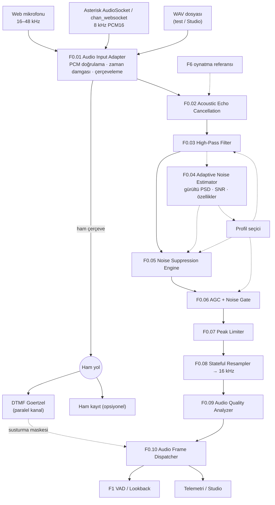

# F0 — Audio Acquisition & Enhancement (Ses Alma ve İyileştirme)

| Alan | Değer |
| --- | --- |
| Aşama | F0 — hattın giriş katmanı |
| Yol haritası modülleri | AP01 Adaptive Audio Enhancement · AP02 Echo Cancellation · AP10 Audio Quality Evaluation (F0 kısmı) |
| Girdi | Web mikrofonu (16–48 kHz PCM16) · Asterisk AudioSocket (8 kHz PCM16, 20 ms) · chan_websocket (8 kHz PCM16, 20 ms) · WAV dosyası |
| Çıktı | 16 kHz mono float32 temizlenmiş konuşma → **F1**; ham sinyal → DTMF ve kayıt; kalite ölçümleri → telemetri |
| Kod | [`FreyaTTS_Automotive_PoC`](https://github.com/seydivakkas/FreyaTTS_Automotive_PoC) reposunda `backend/audio_frontend/` |
| GPU bütçesi | **0 MB** — F0 tamamen CPU üzerinde çalışır |
| İlgili belgeler | [`tasks.md`](tasks.md) · [`acceptance.md`](acceptance.md) · [`../../01-architecture/interfaces.md`](../../01-architecture/interfaces.md) |

> **Yol kuralı:** `backend/`, `frontend/`, `tests/`, `scripts/`, `config/`, `data/`, `contracts/`, `experimental/`, `automotive_voice/`, `asterisk/` ile başlayan yollar **PoC reposundadır**. `docs/` ile başlayan yollar **bu plan reposundadır**.

---

## 1. Amaç

F0, müşterinin mikrofonundan veya telefon hattından gelen sesi alır, temizler, ölçer ve F1'e (konuşma ve tur algılama) aktarır.

**Temel hedef:** Konuşma sinyalini bozmadan STT doğruluğunu artırmak ve yanlış barge-in olaylarını azaltmak.

**Başarı ölçütü:** Bir filtrenin başarısı sesin "daha temiz duyulmasıyla" değil, **STT doğruluğuna (WER, CER, otomotiv terim doğruluğu) ve yanlış barge-in oranına etkisiyle** ölçülür. Gürültüyü azaltıp kelime doğruluğunu kötüleştiren filtre başarısız sayılır.

## 2. Kapsam

**Kapsamda:**
- Giriş adaptörleri (web, AudioSocket, chan_websocket, WAV)
- Akustik yankı giderme (AEC) ve oynatma referansının alınması
- High-pass filtre, gürültü kestirimi, gürültü bastırma (spektral / Wiener / RNNoise)
- AGC, noise gate, peak limiter
- 16 kHz'e durumlu yeniden örnekleme
- Sinyal kalitesi analizi ve F0 telemetrisi
- DTMF için ayrı (ham) sinyal yolu
- Ortam profilleri ve otomatik profil seçimi
- DSP Bypass
- Audio Processing Studio arayüzü
- F0 sentetik test laboratuvarı

**Kapsam dışı (başka aşamalara ait):**
- Konuşma başlangıcı/bitişi, lookback/pre-roll, barge-in **kararı** → F1
- Konuşma tanıma → F2
- Freya'nın çıkış sesinin üretimi ve gönderimi → F5/F6 (F0 yalnızca AEC için F6'nın gönderdiği sesi **referans** olarak okur)

## 3. Hedef mimari



**Akış kuralları:**
1. **DTMF ham sinyalden algılanır.** Gürültü bastırma, AGC ve limiter tuş seslerini bozamaz. Susturma (notch) kararı ham yoldan gelir ve temizlenmiş yola zaman damgasıyla hizalanarak uygulanır (bkz. §5.11).
2. **Aynı anda tek gürültü bastırıcı çalışır.** Spektral, Wiener ve RNNoise art arda bağlanmaz. Web yolunda tarayıcının gürültü bastırması kapatılır (bkz. §5.2).
3. **Gürültü kestirici yan zincirdir.** Sinyali değiştirmez; NS motoruna ve profil seçiciye bilgi verir.
4. **Kalite analizi birden fazla noktadan örnek alır:** ham giriş, NS sonrası ve F0 çıkışı.

### 3.1 İç örnekleme hızı (ADR adayı: ADR-F0-01)

PoC'ta DSP giriş hızında çalışıyor (telefonda 8 kHz, web'de 48 kHz), ardından 16 kHz'e dönüştürülüyor. Parametreler **örnek sayısıyla** tanımlandığı için aynı filtre 8 kHz'de ve 48 kHz'de farklı davranıyor: 256 örneklik FFT 8 kHz'de 32 ms, 48 kHz'de 5,3 ms pencere demek.

**Öneri:**
- Tüm DSP parametreleri **milisaniye ve Hz** cinsinden tanımlanır; örnek sayısı çalışma anında hesaplanır.
- DSP iç hızı `min(giriş_hızı, 16 kHz)` olur:
  - Telefon (8 kHz): DSP 8 kHz'de çalışır, F0.08'de 16 kHz'e yükseltilir. Yükseltmek bilgi eklemediği için DSP'yi 16 kHz'de çalıştırmanın faydası yoktur.
  - Web (48 kHz): F0.01 sinyali önce 16 kHz'e indirir, DSP 16 kHz'de çalışır. CPU maliyeti yaklaşık 3 kat azalır ve tek parametre seti kullanılır.
- **İstisna:** RNNoise yalnızca 48 kHz / 10 ms (480 örnek) çerçeve ile çalışır. RNNoise seçildiğinde kendi iç köprüsü 48 kHz'e çıkarır ve geri indirir. Bu ek gecikme ve CPU maliyeti ölçülerek raporlanır (bkz. §5.5).

Bu karar `docs/01-architecture/adr/ADR-F0-01-dsp-sample-rate.md` dosyasına yazılır.

## 4. Veri sözleşmeleri

Aşağıdaki tipler `backend/audio_frontend/contracts.py` içinde tanımlanır. Aşamalar arası ortak tipler daha sonra `docs/01-architecture/interfaces.md` dosyasında birleştirilir; F0 bu dosyadaki tanımlara uyar.

```python
from dataclasses import dataclass, field
from enum import IntFlag
from typing import Literal, Protocol
import numpy as np

Channel = Literal["web", "audiosocket", "chan_websocket", "file"]

class FrameFlags(IntFlag):
    NONE            = 0
    GAP_FILLED      = 1 << 0   # Eksik paket yerine dolgu üretildi
    INPUT_CLIPPED   = 1 << 1   # Ham girişte kırpılma (±32767) algılandı
    DSP_BYPASSED    = 1 << 2   # F0.02–F0.07 atlandı
    DURING_PLAYBACK = 1 << 3   # Freya konuşurken alındı (AEC / barge-in bağlamı)
    DTMF_MUTED      = 1 << 4   # DTMF nedeniyle susturuldu
    CALIBRATING     = 1 << 5   # Gürültü kalibrasyonu sürerken alındı
    INVALID_SAMPLES = 1 << 6   # NaN/Inf temizlendi

@dataclass(frozen=True, slots=True)
class AudioFrame:
    session_id: str
    seq: int                  # Oturum içinde monoton artan çerçeve numarası
    samples: np.ndarray       # float32, mono, [-1.0, 1.0]
    sample_rate: int
    t_capture_ns: int         # time.monotonic_ns() — adaptöre varış anı
    channel: Channel
    flags: FrameFlags = FrameFlags.NONE

    @property
    def duration_ms(self) -> float:
        return 1000.0 * len(self.samples) / self.sample_rate

@dataclass(frozen=True, slots=True)
class FrameQuality:
    rms_dbfs: float
    peak_dbfs: float
    clipping_ratio: float           # Kırpılmış örneklerin oranı (0–1)
    noise_floor_dbfs: float | None  # Kestirici hazır değilse None
    snr_db: float | None            # Kestirici hazır değilse None (uydurma değer yok)
    dc_offset: float
    profile_id: str                 # Örn. "phone/P3"

@dataclass(frozen=True, slots=True)
class F0Output:
    enhanced: AudioFrame            # 16 kHz, F1'e gider
    raw: AudioFrame                 # Giriş hızında ham çerçeve
    quality_in: FrameQuality        # Ham giriş kalitesi
    quality_out: FrameQuality       # F0 çıkış kalitesi
    stage_us: dict[str, int]        # Bileşen başına işlem süresi (mikrosaniye)
    algorithmic_delay_ms: float     # Zincirin toplam algoritmik gecikmesi

@dataclass(slots=True)
class FrameContext:
    session_id: str
    sample_rate: int
    playback_active: bool           # F6'dan: Freya şu an konuşuyor mu
    speech_active: bool             # F1'den geri besleme: kullanıcı konuşuyor mu
    profile_id: str
    bypass: bool

class F0Processor(Protocol):
    """Her F0 bileşeni bu arayüzü uygular."""
    name: str
    def process(self, x: np.ndarray, ctx: FrameContext) -> np.ndarray:
        """Giriş ile aynı uzunlukta float32 çıktı döndürür. Yan etkisi yalnızca kendi durumudur."""
    def reset(self) -> None: ...
    @property
    def algorithmic_delay_samples(self) -> int: ...
```

**Bileşen kuralları:**
- Her bileşen **oturum başına** örneklenir. Modül düzeyinde değişebilir durum (global state) yasaktır.
- `process()` girişle aynı uzunlukta çıktı döndürür. Gecikme, çıktı uzunluğunu değiştirerek değil, `algorithmic_delay_samples` ile bildirilir.
- Hiçbir bileşen GPU kullanmaz ve asenkron olay döngüsünü bloklayan G/Ç yapmaz.
- NaN/Inf üretmek yasaktır. Girişte NaN/Inf varsa F0.01 temizler ve `INVALID_SAMPLES` bayrağını koyar.

## 5. Bileşenler

Her bileşen şu başlıklarla tanımlanır: **PoC'ta mevcut olan**, **Yapılacaklar**, **Varsayılan parametreler**, **Riskler**.

### 5.1 F0.01 — Audio Input Adapter (`input_adapter.py`)

**PoC'ta mevcut olan:**
- `session.py → Session.input(data, rate)`: Gelen baytları **100 ms'lik** bloklarda topluyor (`size = rate // 10 * 2`). Tek bayt eksikse `ValueError("Eksik PCM örneği")` fırlatıyor.
- `audiosocket_server.py`: 8 kHz, 20 ms, 320 bayt çerçeve sabitleri; paket türleri `0x10` ses, `0x03` DTMF, `0x00` kapatma.
- `websocket_adapter.py`: chan_websocket için aynı 20 ms / 320 bayt.
- `main.py` web WebSocket: 192 000 bayttan büyük paketi reddediyor.

**Yapılacaklar:**
1. PCM16 little-endian doğrulama. Mevcut tek bayt kontrolü korunur.
2. int16 → float32 dönüşümü (`/ 32768.0`).
3. Yapılandırılabilir çerçeve süresi: **10 / 20 / 32 ms** (varsayılan 20 ms). 100 ms yalnızca PoC ile karşılaştırma için "legacy" seçeneği olarak kalır.
4. Her çerçeveye `seq` ve `t_capture_ns` verilir.
5. **Boşluk algılama:** AudioSocket TCP olduğu için paket kaybolmaz ama gecikebilir veya takılabilir. Beklenen varış aralığı 1,5 çerçeveden fazla aşılırsa olay kaydedilir. Gerçek veri eksikliği varsa (ör. dosya kesintisi) sıfırla doldurulur, `GAP_FILLED` bayrağı konur ve sayaç artırılır.
6. NaN/Inf temizleme.
7. Ham kırpılma algılama: ardışık ±32767/−32768 örnekleri `INPUT_CLIPPED` bayrağıyla işaretlenir. Kırpılmış ses düzeltilemez ama raporlanmalıdır ("müşteri mikrofonu kırpıyor" uyarısı).
8. İzin verilen örnekleme hızları: `{8000, 16000, 24000, 44100, 48000}`. Diğerleri reddedilir.
9. Oturum ortasında örnekleme hızı değişirse **açık bir reset olayı** üretilir; filtreler sessizce yeniden kurulmaz (PoC'ta `InboundCarDenoiser.process_bytes` bunu sessizce yapıyor).
10. Web yolunda (§3.1) 48 kHz → 16 kHz ön dönüşüm burada yapılır.

**Riskler:** Çerçeve süresinin 100 ms'den 20 ms'ye inmesi, Python olay döngüsündeki çağrı sayısını 5 katına çıkarır. Eşzamanlı oturumlarda olay döngüsü yükü ölçülmelidir (bkz. F0-T22).

### 5.2 F0.02 — Acoustic Echo Cancellation (`echo_canceller.py`)

**PoC'ta mevcut olan:**
- Web: `frontend/src/useVoiceSession.ts` içinde `getUserMedia` kısıtları `echoCancellation: true`, **`noiseSuppression: true`, `autoGainControl: true`**. Yani web yolunda tarayıcı gürültü bastırma ve AGC uyguluyor, ardından sunucudaki `car_denoiser` aynı işleri bir kez daha yapıyor. Bu, planın "iki yöntemi ölçmeden arka arkaya uygulama" kuralına aykırı.
- Telefon: AEC yok ve ihtiyaç ölçülmemiş.

**Yapılacaklar:**
1. **Önce ölçüm.** AEC eklemeden önce telefon yolunda yankının gerçek bir sorun olup olmadığı ölçülür:
   - Freya konuşurken (`DURING_PLAYBACK`) müşteri susuyorsa VAD tetiklenme oranı
   - Yankı geri dönüş kaybı (ERLE)
   
   Çoğu telefon ve mobil şebeke yankıyı uçta giderir. Kalan yankı sorun yaratmıyorsa telefon AEC'si eklenmez.
2. **Oynatma referansı:** F6'nın kanala gönderdiği PCM (`session.play_wave` içindeki `send(frame)` noktası) zaman damgasıyla bir halka tampona yazılır. AEC bu tampondan referans okur.
3. **Adaptör arayüzü:** `EchoCanceller` bir `F0Processor`'dür; referans yoksa (Freya konuşmuyorsa) bypass çalışır.
4. **Aday uygulamalar** (F0-S05'te değerlendirilir, sonuç ADR'ye yazılır):
   - WebRTC Audio Processing (AEC3) için bir Python bağlayıcısı
   - SpeexDSP yankı gidericisi
   
   Değerlendirme ölçütleri: **Windows desteği (hazır derlenmiş paket var mı?)**, 8 kHz desteği, CPU maliyeti, ERLE, çift konuşma (double-talk) davranışı.
5. **Web yolu varsayılanı:** Tarayıcı AEC'si **açık**, tarayıcı NS ve AGC'si **kapalı**. Gürültü bastırma ve AGC tek yerde (sunucuda) yapılır; böylece web ve telefon yolları aynı DSP zincirini kullanır. Bu varsayılan A/B ölçümüyle doğrulanır (F0-T19).

**Riskler:** Gecikme kestirimi yanlışsa AEC konuşmayı bozar. Çift konuşma sırasında müşterinin sesinin bastırılması WER'i kötüleştirir; T11 bunu ölçer.

### 5.3 F0.03 — High-Pass Filter (`highpass.py`)

**PoC'ta mevcut olan:** `car_denoiser.py → CarNoiseFilter`. 4. derece Butterworth, SOS yapısı, 120 Hz, çerçeveler arası durum (`zi`) korunuyor, ilk çerçevede `zi` ilk örnekle ölçekleniyor. **Bu yapı korunur.**

**Yapılacaklar:**
1. Sınıf `highpass.py`'ye taşınır. `car_denoiser.py` geriye dönük uyumluluk için yeniden dışa aktarır (§9).
2. **Adaptif kesim frekansı:** Profile göre 80–180 Hz aralığında. Üst sınır 180 Hz'dir; daha yükseği erkek sesinin temel frekansını zayıflatır.
3. Kesim frekansı değişirken tıklama oluşmamalı. Eski ve yeni filtre çıktıları bir çerçeve boyunca çapraz geçişle (crossfade) birleştirilir.
4. Telefon hattı zaten yaklaşık 300 Hz altını kestiği için 8 kHz yolunda HPF'nin etkisi düşüktür. Bu, ölçümle doğrulanır.

### 5.4 F0.04 — Adaptive Noise Estimator (`noise_estimator.py`)

**PoC'ta mevcut olan:** `SpectralNoiseSuppressor` içine gömülü bir kestirici. Yorum satırı "IMCRA tabanlı" diyor ama uygulama, konuşma bandı SNR'ı 1,8'in altındayken güncellenen rekürsif ortalama ve hızlı düşüş takibi. Bu bir IMCRA değil.

**Bilinen sorunlar:**
- **Isınma:** İlk 12 analiz çerçevesindeki (8 kHz'de yaklaşık 190 ms) her şey gürültü kabul ediliyor. Müşteri hemen "Alo" derse konuşması gürültü profiline giriyor.
- **Kalibrasyon akışı bloklıyor:** `InboundCarDenoiser` kalibrasyonu yalnızca web'den `recalibrate` mesajıyla başlıyor. Kalibrasyon sürerken `Session.input()` `return` ediyor; bu 1,5 saniyede gelen ses VAD/STT'ye **hiç gitmiyor**.

**Yapılacaklar:**
1. Kestirici ayrı modüle alınır ve adı doğru konur: minimum istatistik (minimum statistics) veya MCRA ailesinden bir yöntem.
2. Çıktılar: gürültü güç spektrumu, gürültü tabanı (dBFS), konuşma bandı SNR'ı ve profil seçici için özellikler:
   - 300 Hz altı enerji oranı
   - Spektral düzlük (spectral flatness)
   - Spektral ağırlık merkezi (centroid)
   - Gürültü seviyesinin zamansal varyansı
3. Kestirici hazır değilken SNR alanı `None` döner; uydurma değer üretilmez.
4. **Bloklamayan kalibrasyon:** Kalibrasyon arka planda sürer, ses akışı VAD/STT'ye gitmeye devam eder. Kalibrasyon yalnızca F1'in "konuşma yok" dediği çerçevelerden beslenir.
5. Otomatik başlangıç kalibrasyonu: Çağrının ilk saniyelerinde Freya karşılama yaparken müşteri genellikle susar. Bu aralık (`DURING_PLAYBACK` ve konuşma yok) gürültü profilini ısıtmak için kullanılır. AEC yoksa Freya'nın sesi gürültü sanılmasın diye yankı seviyesi kontrol edilir.

### 5.5 F0.05 — Noise Suppression Engine (`spectral_denoiser.py`, `neural_denoiser.py`)

**PoC'ta mevcut olan:** `SpectralNoiseSuppressor`. 256 FFT, 128 atlama, sinüs pencere, %50 örtüşmeli overlap-add, aşırı çıkarma 1,5, spektral taban −18 dB, çerçeveler arası kazanç yumuşatma (0,65 / 0,35).

**Bu incelemede simülasyonla ölçülen sorunlar** (PoC kodu doğrudan çalıştırıldı):

| Sorun | Ölçülen | Etki |
| --- | --- | --- |
| Algoritmik gecikme hiçbir yerde raporlanmıyor | 8 kHz'de 100 ms blokla **192 örnek (24 ms)**, 20 ms blokla **224 örnek (28 ms)** | Gecikme bütçesinde görünmeyen 24–28 ms |
| Başlangıçta çıkışa sıfır boşlukları ekleniyor | İlk 160 örnek sıfır, ardından 32 örneklik iki boşluk | Çağrı başında ve her `reset()` sonrasında tık sesi |
| Parametreler örnek sayısıyla tanımlı | 48 kHz'de pencere 5,3 ms, frekans çözünürlüğü 187 Hz | Web ve telefon yolunda farklı davranış |
| Kazanç yumuşatma simetrik | Kazanç her iki yönde aynı hızla değişiyor | Konuşma başlangıcındaki ilk ses (fonem) bastırılıyor; STT için risk |

**Yapılacaklar:**
1. **Sabit gecikmeli FIFO:** Çıkış tamponu oturum başında bir kez `n_fft − hop` sıfırla doldurulur. Sonrasında çıkış her zaman sabit gecikmeyle akar; araya sıfır eklenmez.
2. Pencere ve atlama süreleri ms cinsinden tanımlanır (varsayılan pencere 32 ms, atlama 16 ms).
3. **Asimetrik kazanç yumuşatma:** Kazanç artarken hızlı (konuşma başlangıcı korunur), azalırken yavaş.
4. Motor seçenekleri (`ns_engine`):
   - `spectral`: PoC algoritmasının düzeltilmiş hali
   - `wiener`: Karar yönlendirmeli (decision-directed) a priori SNR ile Wiener kazancı
   - `rnnoise`: §3.1'deki 48 kHz köprüsüyle RNNoise
   - `off`
5. Bastırma miktarı profilden gelir; üst sınır **24 dB**.
6. **RNNoise değerlendirmesi:** Windows'ta hazır derlenmiş paket var mı, 8 kHz giriş için 48 kHz köprüsünün ek gecikmesi ve CPU maliyeti, T04–T08 ve T18'de spektral yöntemle karşılaştırma. Sonuç ADR'ye yazılır.

### 5.6 F0.06 — Automatic Gain Control + Noise Gate (`gain_controller.py`)

**PoC'ta mevcut olan:** `SoftAGC`. Hedef −16 dBFS, gate −42 dBFS, en fazla +12 dB yükseltme ve −6 dB kısma, gate altında −30 dB'ye kadar zayıflatma (downward expander).

**Bu incelemede bulunan sorunlar:**

| Sorun | Kanıt | Etki |
| --- | --- | --- |
| **Kazanç rampası çalışmıyor** | `g_start = self.current_gain` ve `g_end = self.current_gain` aynı değer; `np.linspace` sabit dizi üretiyor. Simülasyonda kazanç 1,149 → 1,291 → 1,425 şeklinde her 20 ms'de basamakla değişiyor | Çerçeve sınırlarında "zipper" gürültüsü ve tıklar |
| Zaman sabitleri çerçeve katsayısı olarak yazılmış | 0,80/0,20 ve 0,95/0,05 katsayıları 20 ms çerçevede yaklaşık **90 ms attack, 390 ms release** demek; docstring 50/300 ms diyor | Çerçeve süresi değişirse davranış da değişir |
| Gate −30 dB'ye kadar zayıflatıyor | Eşik altındaki çerçeveler sert biçimde bastırılıyor | Zayıf ünsüzler ve Türkçe ek sonları ("-tı", "-k") kesilebilir; STT için risk |
| `false_barge_in_prevented` metriği yanıltıcı | Ham seviye > −22 dBFS ve gate kapalıysa artan bir **çerçeve** sayacı | Gerçek barge-in olayı değil; adı yanlış yorumlanabilir |

**Yapılacaklar:**
1. Rampa düzeltmesi: `g_start` = önceki çerçevenin son kazancı, `g_end` = yeni kazanç.
2. Attack, release ve hold süreleri ms cinsinden tanımlanır; katsayı çerçeve süresinden hesaplanır.
3. **Gate hold süresi** (varsayılan 150 ms): Konuşma bittikten sonra gate hemen kapanmaz, kelime sonları korunur. Varsayılan zayıflatma −12 dB'dir; daha sert değerler yalnızca T18'de WER kötüleşmediği gösterilirse kullanılır.
4. Limiter bu sınıftan çıkarılır ve F0.07'ye taşınır.
5. Metrik yeniden adlandırılır: `loud_nonspeech_frames`. Gerçek yanlış barge-in oranı F1'de ölçülür.
6. Varsayılan değerler: Plan arayüzündeki değerler (hedef −18 dBFS, gate −45 dBFS) ile PoC değerleri (−16 / −42) **aday değerlerdir**. Kesin varsayılanlar F0-S01 taban ölçümü ve T09/T18 sonuçlarıyla belirlenir.

### 5.7 F0.07 — Peak Limiter (`limiter.py`)

**PoC'ta mevcut olan:** `SoftAGC` içinde, 0,90 genliğin üstüne uygulanan tanh dalga şekillendirici (waveshaper). Simülasyonda ölçülen tavan **−0,04 dBFS** (plan hedefi −1 dBFS). Dalga şekillendirme harmonik bozulma yaratır.

**Yapılacaklar:**
1. Kazanç zarfı (gain envelope) kullanan ayrı bir limiter. Tavan **−1 dBFS**.
2. İsteğe bağlı ileri bakış (look-ahead, 2–5 ms). Seçilirse gecikmeye eklenir ve raporlanır.
3. Kazanç düşürme (gain reduction) miktarı telemetriye yazılır.
4. Son güvenlik olarak sert kırpma (hard clip) kalır; ama her tetiklenmesi sayılır ve uyarı üretir.

### 5.8 F0.08 — Stateful Resampler (`resampler.py`)

**PoC'ta mevcut olan:**
- `session.py`: `soxr.ResampleStream(rate, 16000, 1, dtype="float32", quality="HQ")`. İlk gelen hızla **bir kez** kuruluyor; oturum ortasında hız değişirse yeniden kurulmuyor.
- `audiosocket_server.LookbackBuffer.get_samples`: tek seferlik `soxr.resample`.
- `audio.resample`: durumsuz `resample_poly`.

**Yapılacaklar:**
1. soxr akış sarmalayıcısı. Hız değişince açıkça sıfırlanır.
2. Algoritmik gecikme raporlanır.
3. Kalite ayarı (`HQ` / `VHQ` / `MQ`) yapılandırılabilir; her biri için gecikme ölçülür.
4. Çıktı: 16 kHz mono float32.

### 5.9 F0.09 — Audio Quality Analyzer (`quality_analyzer.py`)

**PoC'ta mevcut olan:** `InboundCarDenoiser.process_frame` teşhis sözlüğü (ham / HPF / temizlenmiş / çıkış dBFS, kestirilen SNR) ve `get_summary_stats()`. `session.py`, `pipeline_telemetry.make_pipeline_event(..., "F0", "completed")` olayını yalnızca konuşma başladığında gönderiyor; bu olay gerçek F0 süresini ölçmüyor.

**Yapılacaklar:**
1. **Her çerçevede** (ucuz ölçümler): RMS, tepe değeri, kırpılma oranı, DC ofset, NaN/Inf sayısı, bileşen başına işlem süresi.
2. **1 saniyelik pencerede:** gürültü tabanı, SNR, spektral düzlük, düşük frekans enerji oranı, aktif profil.
3. Üç ölçüm noktası: ham giriş, NS sonrası, F0 çıkışı.
4. Çerçeve başına ölçümler bir halka tamponda tutulur. Arayüze **saniyede 4 kez** özet gönderilir.
5. Kestirici hazır değilse değer `None` olur ve arayüz "Ölçüm bekleniyor" gösterir.

### 5.10 F0.10 — Audio Frame Dispatcher (`pipeline.py` içinde)

**PoC'ta mevcut olan:**
- İki ayrı `LookbackBuffer` var (`session.py` ve `audiosocket_server.AudioSocketOrchestrator`). İkisine de çerçeve yazılıyor ama **STT için hiçbiri okunmuyor**. Gerçekte kullanılan ön tampon `audio.Endpoint.pre`: 10 × 512 örnek = 320 ms.
- Kayıt yalnızca işlenmiş sesi yazıyor (`self.recording.writeframes(pcm(feed_samples))`).

**Yapılacaklar:**
1. **Çıkışlar:**
   - (a) Temizlenmiş 16 kHz sinyal → F1. Silero VAD 16 kHz'de tam **512 örnek** (32 ms) blok ister. Yeniden bloklama **F1.01 Audio Frame Synchronizer**'ın işidir; F0 çerçeveleri olduğu gibi iletir. Planın arayüzündeki 32 ms çerçeve seçeneği bu yüzden önemlidir: F0 32 ms çerçeve kullanırsa F1'de ek bekleme olmaz.
   - (b) Ham çerçeve → DTMF algılayıcı ve ham kayıt.
   - (c) Kalite ölçümleri → telemetri.
2. Lookback/pre-roll **F1'e aittir**. F0 tek bir sinyal kaynağı sağlar; kullanılmayan iki `LookbackBuffer` F1 kapsamında temizlenir.
3. **Geri basınç (backpressure):** Giriş asla bloklanmaz. Tüketici yavaşsa sınırlı kuyruk en eski çerçeveyi düşürür ve `f0.overrun` olayı yazılır.
4. **Çift kayıt (A/B için):** Ham ve işlenmiş ses ayrı dosyalara yazılabilir. Kayıt açma/kapama, mevcut `audio_archive_compliance.py` ve `kvkk_compliance.py` kurallarına bağlıdır.

### 5.11 DTMF paralel yolu (`dtmf.py` korunur, çağrı noktası taşınır)

**PoC'ta mevcut olan:** `dtmf.GoertzelDetector`. Baskınlık, enerji oranı ve twist testleri var; 2 ardışık çerçeve ile debounce yapıyor; algılanan tuşun çerçevesini STT girdisinden susturuyor. Ancak:
- Algılayıcı **gürültü bastırma, AGC ve yeniden örnekleme sonrasında** 16 kHz'de çalışıyor (`session.py`). DSP zinciri tuş seslerini bozabilir; durağan tonlar bir süre sonra gürültü olarak öğrenilip bastırılabilir.
- Çerçeve boyuna tam bölünmeyen giriş kuyruğu (tail) bir sonraki çağrıya taşınmıyor.
- AudioSocket ayrıca bant dışı DTMF paketi (`0x03`) gönderiyor ve bu da `session.handle_dtmf` ile işleniyor. Aynı tuş hem bant içi hem bant dışı algılanırsa **iki kez sayılabilir**.

**Yapılacaklar:**
1. Algılayıcı **ham sinyalde, giriş hızında** çalışır (telefonda 8 kHz için Goertzel katsayıları 8 kHz'e göre hesaplanır).
2. Kuyruk örnekleri için iç FIFO eklenir.
3. **Tekilleştirme:** Aynı tuş, farklı kaynaklardan 150 ms içinde gelirse tek olay sayılır.
4. **Susturma maskesi hizalaması:** Maske ham yolda üretilir, temizlenmiş yola `seq` ve toplam algoritmik gecikme hesaba katılarak uygulanır. Gürültü bastırıcının 24–28 ms gecikmesi hesaba katılmazsa tuş sesinin bir kısmı STT'ye sızar.

### 5.12 DSP Bypass

- **Genel bypass:** F0.02–F0.07 atlanır; F0.01 (adaptör) ve F0.08 (resampler) her zaman çalışır.
- **Bileşen bazında bypass:** Studio'daki zincir anahtarları.
- Çalışma sırasında açılıp kapatılırken 10 ms'lik çapraz geçiş kullanılır.
- Bypass durumundaki çerçeveler `DSP_BYPASSED` bayrağı taşır.
- Doğrulama: Bypass çıktısı, yalnızca adaptör + resampler çıktısıyla en fazla 1 LSB farklı olabilir (T15).

### 5.13 Oturum izolasyonu

- Tüm F0 bileşenleri oturum başına örneklenir. PoC'ta `InboundCarDenoiser` zaten oturum başına oluşturuluyor; bu korunur.
- T16, iç içe çalışan 2–4 oturumun çıktılarının, aynı sinyallerin tek başına çalıştırıldığı durumdaki çıktılarla aynı olduğunu doğrular.
- Not: Paylaşılan Silero VAD durumu F1 sorunudur ve F1 belgesinde ele alınır.

## 6. Ortam profilleri

Plandaki P0–P6 listesinde **P5 (Telefon hattı) bir ortam değil, bir kanaldır.** Hareket halindeki bir araçtan yapılan telefon görüşmesi hem dar bant ayarlarına hem de araç gürültüsü profiline ihtiyaç duyar. Bu yüzden profiller **iki eksene** ayrılır:

**Kanal ön ayarı** (çağrı başında bilinir, değişmez):

| Kanal | İç hız | Özel ayar |
| --- | --- | --- |
| `web` | 16 kHz | Tarayıcı AEC açık, tarayıcı NS/AGC kapalı |
| `phone` (eski P5) | 8 kHz | Dar bant optimizasyonu: HPF etkisi düşük, NS konuşma bandı 300–3400 Hz |

**Ortam profili** (otomatik veya manuel):

| Profil | Ortam | HPF | NS motoru / miktarı | AGC hedefi | Gate |
| --- | --- | --- | --- | --- | --- |
| P0 | Sessiz oda | 80 Hz | `off` veya 6 dB | −18 dBFS | Kapalı |
| P1 | Ofis | 100 Hz | `spectral` 10 dB | −18 dBFS | Hafif |
| P2 | Park halindeki araç | 120 Hz | `spectral` 15 dB | −18 dBFS | Hafif |
| P3 | Hareket halindeki araç | 150 Hz | `spectral`/`wiener` 18 dB | −18 dBFS | Orta |
| P4 | Yoğun trafik | 150 Hz | Adaptif, en fazla 24 dB | −18 dBFS | Orta |
| P6 | Özel | Manuel | Manuel | Manuel | Manuel |

> Tablodaki sayılar **başlangıç değerleridir**; F0-S03'te T03–T08 ve T18 sonuçlarına göre ayarlanır. Değişiklikler `profiles.py` içinde ve bu tabloda birlikte güncellenir.

**Otomatik profil seçimi** (ilk aşamada yapay zekâ gerektirmez):
- Girdi özellikleri: gürültü tabanı, 300 Hz altı enerji oranı, spektral düzlük, zamansal varyans, SNR (F0.04'ten).
- Karar: Kural tabanlı eşikler.
- **Histerezis:** Yeni koşul en az 2 saniye sürmeden profil değişmez; iki değişiklik arasında en az 5 saniye geçer.
- Kullanıcı konuşurken (`speech_active = True`) profil değişmez.
- Parametreler yeni değerlerine rampa ile geçer.
- Her değişiklik `f0.profile_changed` olayıyla kaydedilir (eski profil, yeni profil, tetikleyen özellikler).

## 7. Performans bütçesi

| Ölçüt | Hedef | Durum |
| --- | --- | --- |
| F0 işlem süresi p95 (20 ms çerçeve başına) | < 10 ms | Plan hedefi |
| Klasik zincirin işlem süresi p95 (RNNoise hariç) | < 3 ms | **Öneri** — Python olay döngüsünde başka işler de çalıştığı için |
| Toplam algoritmik gecikme (RNNoise hariç) | ≤ 40 ms | **Öneri** — PoC'ta raporlanmayan ölçüt; mevcut NS tek başına 24–28 ms |
| Ek GPU belleği | 0 MB | Plan hedefi |
| Düşen örnek (normal çalışma) | 0 | Plan hedefi |

**İşlem süresi ve algoritmik gecikme ayrı ölçütlerdir.** İşlem süresi CPU'nun çerçeveyi ne kadar sürede işlediğidir. Algoritmik gecikme, sinyalin zincirden kaç ms geç çıktığıdır (FFT penceresi, look-ahead, resampler filtresi). İkisi de bileşen bazında raporlanır.

**Olay döngüsü riski:** PoC'ta DSP, asenkron `Session.input()` içinde eşzamanlı çalışıyor. Çerçeve süresi 20 ms'ye indiğinde ve oturum sayısı arttığında olay döngüsü gecikebilir. F0-T22'de 1, 2 ve 4 eşzamanlı oturumla ölçülür; gerekirse F0 oturum başına bir iş parçacığına (thread) taşınır. numpy ve scipy işlemleri GIL'i büyük ölçüde serbest bıraktığı için bu seçenek uygulanabilir.

## 8. Yapılandırma

`backend/config.py` içindeki mevcut `car_denoiser_*` ayarları korunur ve yeni `F0Settings` alanlarına eşlenir. Böylece mevcut `.env` dosyaları çalışmaya devam eder.

```python
class F0Settings(BaseSettings):
    f0_pipeline_v2: bool = False           # Yeni hat; S10 regresyonu geçene kadar kapalı
    f0_frame_ms: Literal[10, 20, 32, 100] = 20
    f0_bypass: bool = False
    f0_aec_mode: Literal["off", "auto", "on"] = "auto"
    f0_ns_engine: Literal["spectral", "wiener", "rnnoise", "off"] = "spectral"
    f0_ns_max_db: float = 24.0
    f0_hpf_cutoff_hz: float = 120.0        # ← car_denoiser_hpf_cutoff
    f0_ns_suppression_db: float = 18.0     # ← car_denoiser_suppression_db
    f0_agc_target_dbfs: float = -16.0      # ← car_denoiser_target_dbfs (S01 sonrası güncellenecek)
    f0_gate_dbfs: float = -42.0            # ← car_denoiser_noise_gate_dbfs
    f0_gate_attenuation_db: float = 12.0   # PoC 30 dB; bkz. §5.6
    f0_gate_hold_ms: float = 150.0
    f0_agc_max_boost_db: float = 12.0      # ← car_denoiser_max_boost_db
    f0_limiter_ceiling_dbfs: float = -1.0
    f0_limiter_lookahead_ms: float = 0.0
    f0_resampler_quality: Literal["MQ", "HQ", "VHQ"] = "HQ"
    f0_profile: str = "auto"               # "auto" | "P0".."P4" | "P6"
    f0_record_raw: bool = False            # KVKK kurallarına tabi
```

## 9. PoC'tan taşıma

Mevcut kodlar silinmez. Yeni yapı mevcut testleri kırmadan kurulur.

| PoC'taki öğe | Yeni konum | İşlem |
| --- | --- | --- |
| `car_denoiser.CarNoiseFilter` | `audio_frontend/highpass.py` | Taşı, adaptif kesim ekle |
| `car_denoiser.SpectralNoiseSuppressor` | `audio_frontend/spectral_denoiser.py` + `noise_estimator.py` | Kestiriciyi ayır, §5.5 düzeltmelerini uygula |
| `car_denoiser.SoftAGC` | `audio_frontend/gain_controller.py` + `limiter.py` | Rampa hatasını düzelt, limiter'ı ayır |
| `car_denoiser.InboundCarDenoiser` | `audio_frontend/pipeline.py → F0Pipeline` | Orkestrasyon yeni hatta |
| `car_denoiser.py` dosyası | Yerinde kalır | Uyumluluk katmanı: eski sınıf adlarını yeni modüllerden dışa aktarır; `tests/test_car_denoiser.py` geçmeye devam eder |
| `car_denoiser.process_audio_stream` | `audio_frontend/pipeline.py` | Studio ve laboratuvar için çevrimdışı işleme fonksiyonu |
| `dtmf.GoertzelDetector` | `dtmf.py` (yerinde) | FIFO ve hız parametresi ekle; çağrı noktası ham yola taşınır |
| `Session.input()` | `session.py` | `f0_pipeline_v2` bayrağı açıkken `F0Pipeline`'ı çağırır; kapalıyken eski yol aynen çalışır |
| `audiosocket_server.LookbackBuffer` (×2) | F1 | F1 kapsamında karar verilir |
| `config.py → car_denoiser_*` | `F0Settings` | Eski adlar takma ad olarak korunur |

**Korunması gereken mevcut testler:** `tests/test_car_denoiser.py`, `test_dtmf.py`, `test_dtmf_false_positive.py`, `test_audiosocket_server.py`, `test_chan_websocket.py`, `test_isolation.py`, `test_voice_path_honesty.py`, `test_pipeline_telemetry.py`.

## 10. API ve Audio Processing Studio

### 10.1 Backend API

| Uç nokta | Açıklama |
| --- | --- |
| `GET /api/f0/config` | Etkin F0 yapılandırması |
| `PUT /api/f0/config` | Genel varsayılanları güncelle (yönetici yetkisi) |
| `GET /api/f0/profiles` | Profil tanımları |
| `POST /api/f0/sessions/{id}/bypass` | Oturum için bypass aç/kapat |
| `POST /api/f0/sessions/{id}/profile` | Oturum için manuel profil |
| `POST /api/f0/sessions/{id}/recalibrate` | Kalibrasyon (mevcut WS `recalibrate` mesajı da korunur) |
| `POST /api/f0/lab/run` | Bir WAV veya sentetik senaryoyu F0'dan geçir; ham/işlenmiş ses ve ölçümleri döndür |
| WS olayı `f0_metrics` | Saniyede 4 kez kalite özeti |

### 10.2 Studio arayüzü (`frontend/src/AudioStudioPanel.tsx`)

Plandaki taslağın bileşenleri:

- **Giriş seçimi:** Mikrofon / Telefon / WAV
- **Signal Analyzer:** Dalga formu / Spektrum / Spektrogram; DSP Bypass anahtarı
- **Noise Environment kartı:** Etkin profil ve seçim nedeni
- **DSP Processing Chain:** Echo Cancellation, High-Pass Filter, Noise Suppression, AGC, Noise Gate, Peak Limiter anahtarları
- **Filter Configuration:**
  - NS motoru (Spectral Subtraction / Wiener / RNNoise / Kapalı)
  - HPF kesimi (80–180 Hz)
  - NS miktarı (0–24 dB)
  - AGC hedefi
  - Gate eşiği
  - En yüksek kazanç
  - Giriş çerçeve süresi (10 / 20 / 32 / 100 ms)
- **Metrik kutuları:** Input RMS, Output RMS, Estimated SNR, Clipping Rate, DSP Latency, CPU Load
- **Sıfırla** ve **Yapılandırmayı kopyala** düğmeleri

**Plana eklenen öneriler:**
- **A/B dinleme:** Aynı kaydın ham ve işlenmiş halini art arda dinleme.
- **STT etkisi paneli:** Seçili kaydı DSP açık ve kapalı olarak STT'den geçirip WER ve otomotiv terim doğruluğunu yan yana gösterme. F0'ın temel başarı ölçütü bu olduğu için Studio'da doğrudan görünmelidir.
- DSP Latency kutusu, işlem süresi ile algoritmik gecikmeyi ayrı gösterir.

**Dürüstlük kuralı:** Metrik kutuları gerçek ölçüm gelene kadar "Ölçüm bekleniyor" gösterir. Demo modunda sinyal üretiliyorsa ekranda açıkça "Temsili sinyal · Gerçek ölçüm değil" yazar. Demo değerleri hiçbir zaman gerçek ölçüm gibi gösterilmez (bkz. PoC `test_voice_path_honesty.py`).

## 11. Telemetri olayları

| Olay | Ne zaman | Alanlar |
| --- | --- | --- |
| `f0.frame_timing` | 1 s özet | Bileşen başına p50/p95 µs, algoritmik gecikme |
| `f0.gap_filled` | Dolgu üretildiğinde | Süre, kaynak |
| `f0.overrun` | Kuyruk taştığında | Düşen çerçeve sayısı |
| `f0.input_clipping` | Ham girişte kırpılma | Oran, süre |
| `f0.limiter_engaged` | Kazanç düşürme > 3 dB | En yüksek kazanç düşürme miktarı |
| `f0.hard_clip` | Son güvenlik kırpması tetiklendiğinde | Örnek sayısı |
| `f0.profile_changed` | Profil değişiminde | Eski, yeni, özellikler |
| `f0.calibration` | Kalibrasyon bittiğinde | Gürültü tabanı, gate, bastırma |
| `f0.dtmf` | Tuş algılandığında | Tuş, kaynak (bant içi / bant dışı), tekilleştirildi mi |
| `f0.aec_reference_missing` | Freya konuşurken referans yoksa | Süre |
| `f0.rate_changed` | Hız değiştiğinde | Eski, yeni |

Olaylar mevcut `pipeline_telemetry.make_pipeline_event` biçimiyle uyumlu üretilir.

## 12. Riskler

| Risk | Önlem |
| --- | --- |
| Aşırı filtreleme STT'yi kötüleştirir | Her değişiklik T18 ile DSP kapalı tabana karşı ölçülür |
| Gate Türkçe ek sonlarını keser | Hold süresi, hafif varsayılan zayıflatma, T09/T18 |
| AEC çift konuşmada müşteriyi bastırır | T11 double-talk senaryosu; telefon AEC'si yalnızca ölçülmüş ihtiyaçta |
| 20 ms çerçeve olay döngüsünü yorar | F0-T22 yük ölçümü; gerekirse iş parçacığına taşıma |
| RNNoise Windows'ta derleme sorunu çıkarır | ADR ile değerlendirme; spektral motor her zaman yedek |
| Profil seçici sık değişir (flapping) | Histerezis, konuşma sırasında değişiklik yok |
| DTMF maskesi hizasız uygulanır | Gecikme telafili hizalama, T14 |

## 13. Açık sorular

1. Telefon yolunda kalan yankı gerçek bir sorun mu? F0-T17 ölçümü cevaplayacak.
2. RNNoise'un 8 kHz telefon sesinde spektral yönteme üstünlüğü var mı? T18 cevaplayacak.
3. Gate, STT'ye giden yolda tamamen kapatılıp yalnızca barge-in kararına mı uygulanmalı? Bu, F0'ın iki ayrı çıkış üretmesini gerektirir; F1 tasarımıyla birlikte karar verilecek.
