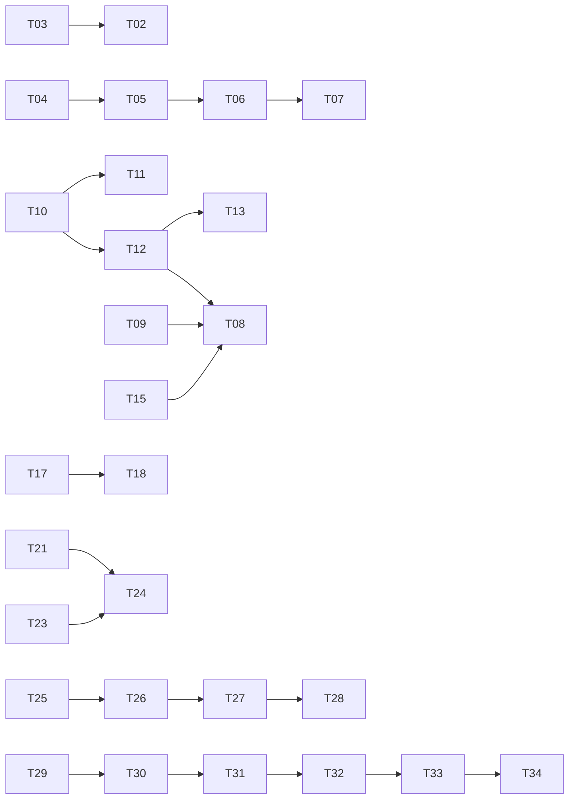

# F0 — Görevler

> **Yürütme notu (25.11.2026):** Bu dosya teknik görev ayrıntısıdır; **yürütme birimi değildir**. Ajan iş olarak paket alır ([yürütme planı](../../execution/README.md)). Bu aşamanın görevlerinin uygulandığı paketler: [H01](../../execution/packages/W0/H01-guvenli-zemin.md), [M01](../../execution/packages/W1/M01-cekirdek-sozlesmeler.md), [M08](../../execution/packages/W1/M08-test-altyapisi.md), [F0-A](../../execution/packages/W2/F0-A-ses-girisi.md), [F0-B](../../execution/packages/W4/F0-B-uyarlanir-dsp.md), [G3](../../execution/stages/G3-arayuz.md), [G4](../../execution/stages/G4-sentetik-kabul.md), [G5](../../execution/stages/G5-gercek-insan-sip.md). Görev başına eşleme: [legacy-mapping.md](../../execution/legacy-mapping.md). Bu dosyadaki AIP, faz ve sprint atıfları eski plana aittir.

Bu dosya F0'ın uygulanabilir iş listesidir. Her görevin bir kimliği (`F0-Txx`), ait olduğu sprint (`F0-Sxx`), dokunacağı dosyalar, bağımlılıkları ve "bitti" tanımı vardır. Kodlama ajanı bir görevi alırken önce [`spec.md`](spec.md) dosyasının ilgili bölümünü okur.

**Boyut:** S = yarım gün veya daha az · M = 1–2 gün · L = 3 gün veya daha fazla

**Yol kuralı:** `backend/`, `frontend/`, `tests/`, `scripts/`, `config/`, `data/`, `contracts/`, `experimental/`, `automotive_voice/`, `asterisk/` → PoC reposu ([`FreyaTTS_Automotive_PoC`](https://github.com/seydivakkas/FreyaTTS_Automotive_PoC)). `docs/` → bu plan reposu.

**Genel kurallar:**
- Mevcut testler her görevden sonra geçmeye devam etmelidir (`pytest tests/`).
- Yeni hat `f0_pipeline_v2` bayrağı arkasında geliştirilir. F0-S10 regresyonu geçene kadar varsayılan kapalıdır.
- Ölçüm sonucu gerektiren hiçbir kabul maddesi, ölçüm çalıştırılmadan "tamam" işaretlenmez.

---

## F0-S01 — Mevcut DSP envanteri ve taban ölçümleri

### F0-T01 · PoC DSP davranışını sabitleyen karakterizasyon testleri · M
- **Dosyalar:** `tests/audio_frontend/test_poc_characterization.py`
- **İş:** Mevcut `car_denoiser.py` davranışını test olarak kaydet: NS algoritmik gecikmesi (8 kHz'de 20 ms blokta 224 örnek, 100 ms blokta 192 örnek), başlangıç sıfır boşlukları, AGC çerçeve sınırındaki kazanç basamakları, soft limiter tavanı (≈ −0,04 dBFS).
- **Neden:** Sonraki düzeltmelerin bilinçli yapıldığı görülsün. Düzeltme yapılan her görev ilgili karakterizasyon testini "beklenen yeni davranış" olarak günceller.
- **Bitti:** Testler mevcut kodla geçer.

### F0-T02 · Taban ölçüm betiği · M
- **Dosyalar:** `scripts/f0_baseline.py`, `data/f0/baseline-<tarih>.json`
- **Bağımlılık:** F0-T03
- **İş:** Test derlemini üç koşulda çalıştır: (a) DSP kapalı, (b) PoC DSP, (c) yeni hat (sonradan). Her koşul için WER, CER, otomotiv terim doğruluğu, çerçeve başına işlem süresi (p50/p95) ve algoritmik gecikmeyi ölç.
- **Bitti:** JSON çıktısı üretilir; değerler `docs/00-overview/current-state.md` dosyasına kaynağıyla birlikte yazılır.

### F0-T03 · F0 test derlemi · M
- **Dosyalar:** `data/f0/corpus/manifest.json`, `scripts/f0_build_corpus.py`
- **İş:** Mevcut test cümlelerinden (`FreyaTTS_Otomotiv_Turkce_Telaffuz_Sezer_ve_Test_Cumleleri.xlsx`) temiz konuşma kayıtları üret veya mevcutları kullan. Her kaydı sentetik gürültülerle 20 / 10 / 5 / 0 dB SNR'da karıştır. Manifest her dosyanın kaynağını, SNR değerini, gürültü türünü ve beklenen metni tutar.
- **Not:** Sentetik konuşma FreyaTTS ile üretiliyorsa bu bir GPU adımıdır ve çevrimdışı bir kez yapılır; sonuç önbelleğe alınır. Manifestte "sentetik ses" olarak işaretlenir.
- **Bitti:** Manifest ve karışımlar tekrarlanabilir biçimde (sabit seed) üretilir.

## F0-S02 — AudioFrame sözleşmesi ve modüler işleme hattı

### F0-T04 · Veri sözleşmeleri · S
- **Dosyalar:** `backend/audio_frontend/__init__.py`, `contracts.py`
- **İş:** spec §4'teki `AudioFrame`, `FrameFlags`, `FrameQuality`, `F0Output`, `FrameContext`, `F0Processor` tiplerini tanımla.
- **Bitti:** Tip denetimi (mypy/pyright) geçer; birim testleri temel kısıtları doğrular (float32, mono, sample_rate kümesi).

### F0-T05 · Giriş adaptörü · M
- **Dosyalar:** `backend/audio_frontend/input_adapter.py`, `tests/audio_frontend/test_input_adapter.py`
- **Bağımlılık:** F0-T04
- **İş:** spec §5.1 maddeleri 1–10.
- **Bitti:** T13 (eksik/düzensiz paket) ve T12'nin adaptör kısmı geçer.

### F0-T06 · F0Pipeline iskeleti · M
- **Dosyalar:** `backend/audio_frontend/pipeline.py`, `tests/audio_frontend/test_pipeline.py`
- **Bağımlılık:** F0-T04, F0-T05
- **İş:** Bileşenleri sıralı çalıştıran, bileşen başına süre ölçen, toplam algoritmik gecikmeyi hesaplayan, genel ve bileşen bazında bypass ile `reset()` destekleyen hat. Oturum başına fabrika fonksiyonu: `create_f0_pipeline(session_id, channel, settings)`.
- **Bitti:** Bileşenler yerine kimlik (identity) işlemcilerle çalışan hat uçtan uca test edilir.

### F0-T07 · Session entegrasyonu (bayrak arkasında) · M
- **Dosyalar:** `backend/session.py`, `backend/config.py`
- **Bağımlılık:** F0-T06
- **İş:** `f0_pipeline_v2=True` iken `Session.input()` sesi `F0Pipeline`'dan geçirir. `False` iken eski yol **değiştirilmeden** çalışır. `F0Settings` eklenir ve eski `car_denoiser_*` ayarları eşlenir.
- **Bitti:** Bayrak kapalıyken mevcut tüm testler geçer; bayrak açıkken kimlik hattıyla bir AudioSocket test çağrısı tamamlanır.

### F0-T08 · `car_denoiser.py` uyumluluk katmanı · S
- **Dosyalar:** `backend/car_denoiser.py`
- **Bağımlılık:** F0-T09, F0-T12, F0-T15
- **İş:** Sınıflar yeni modüllere taşındıktan sonra eski adlar buradan dışa aktarılır.
- **Bitti:** `tests/test_car_denoiser.py` değiştirilmeden geçer. Davranış değişikliği gerektiren testler varsa gerekçesiyle güncellenir.

## F0-S03 — HPF, gürültü profili ve adaptif bastırma

### F0-T09 · Adaptif HPF · S
- **Dosyalar:** `backend/audio_frontend/highpass.py`
- **İş:** spec §5.3. Kesim 80–180 Hz, değişimde çapraz geçiş.
- **Bitti:** T02 HPF kısmı geçer (120 Hz kesimde 50 Hz'de ≥ 28 dB zayıflama; 4. derece Butterworth için teorik değer ≈ 30,4 dB). Kesim değişiminde ardışık örnekler arası sıçrama, sinyal genliğinin %5'ini aşmaz.

### F0-T10 · Gürültü kestirici · M
- **Dosyalar:** `backend/audio_frontend/noise_estimator.py`
- **İş:** spec §5.4. Minimum istatistik veya MCRA; özellik çıkarımı; hazır değilken `None`.
- **Bitti:** T06'da gürültü tabanı değişiminden sonra en geç 2 s içinde ±3 dB doğrulukla takip edilir.

### F0-T11 · Profiller ve profil seçici · M
- **Dosyalar:** `backend/audio_frontend/profiles.py`
- **Bağımlılık:** F0-T10
- **İş:** spec §6. Kanal × ortam ön ayarları, kural tabanlı seçici, histerezis, konuşma sırasında kilit, parametre rampaları.
- **Bitti:** Sentetik ortam geçişlerinde doğru profil seçilir; 60 s'lik dalgalı gürültüde 5 s'den sık değişim olmaz.

### F0-T12 · Spektral gürültü bastırıcı düzeltmeleri · M
- **Dosyalar:** `backend/audio_frontend/spectral_denoiser.py`
- **Bağımlılık:** F0-T10
- **İş:** spec §5.5 maddeleri 1–3 ve 5: sabit gecikmeli FIFO, ms tabanlı parametreler, asimetrik kazanç yumuşatma, algoritmik gecikme raporu.
- **Bitti:** Başlangıçta sıfır boşluğu yok; gecikme çerçeve boyundan bağımsız ve sabit; karakterizasyon testi yeni davranışla güncellenir.

### F0-T13 · Wiener modu · M
- **Dosyalar:** `backend/audio_frontend/spectral_denoiser.py`
- **İş:** Karar yönlendirmeli a priori SNR ile Wiener kazancı; `f0_ns_engine="wiener"`.
- **Bitti:** T04–T08'de spektral modla karşılaştırma tablosu üretilir.

### F0-T14 · Bloklamayan kalibrasyon · S
- **Dosyalar:** `backend/session.py`, `noise_estimator.py`
- **İş:** spec §5.4 maddeleri 4–5. Kalibrasyon sırasında ses VAD/STT'ye gitmeye devam eder.
- **Bitti:** Kalibrasyon sırasında söylenen bir cümle STT çıktısında görünür (entegrasyon testi).

## F0-S04 — AGC, Noise Gate ve Limiter

### F0-T15 · AGC ve gate · M
- **Dosyalar:** `backend/audio_frontend/gain_controller.py`
- **İş:** spec §5.6. Rampa düzeltmesi, ms tabanlı attack/release/hold, gate hold, hafif varsayılan zayıflatma, `loud_nonspeech_frames` metriği.
- **Bitti:** Ardışık iki örnek arasındaki kazanç değişimi 0,1 dB'yi aşmaz (zipper testi); T09 geçer.

### F0-T16 · Peak limiter ve giriş kırpılma algılayıcı · M
- **Dosyalar:** `backend/dsp_common/limiter.py` (ortak çekirdek), `backend/audio_frontend/limiter.py` (F0 sarmalayıcısı), `input_adapter.py`
- **İş:** spec §5.7 ve §5.1 madde 7. Zarf tabanlı limiter çekirdeği F6 ile ortaktır (F6-T11 aynı çekirdeği kullanır — [ownership.md §Tekilleştirilmiş bileşenler](../../execution/ownership.md#tekilleştirilmiş-bileşenler)).
- **Bitti:** T10 geçer (tavan −1 dBFS ± 0,1 dB; kırpılmış çerçevelerin en az %95'i işaretlenir).

## F0-S05 — AEC ve alternatif RNNoise adaptörü

### F0-T17 · Yankı ölçüm düzeneği · M
- **Dosyalar:** `backend/audio_frontend/echo_canceller.py` (referans tamponu), `scripts/f0_echo_probe.py`
- **İş:** F6'nın gönderdiği PCM'i zaman damgalı halka tampona yaz. Freya konuşurken müşteri susarken VAD tetiklenme oranını ve ERLE'yi ölç.
- **Bitti:** Web ve telefon yolu için ölçüm raporu `data/f0/echo-probe-<tarih>.json`. Telefon AEC'sinin gerekip gerekmediği bu rapora göre ADR'ye yazılır.

### F0-T18 · AEC adaptörü ve aday değerlendirmesi · L
- **Dosyalar:** `backend/audio_frontend/echo_canceller.py`, `docs/01-architecture/adr/ADR-F0-02-aec.md`
- **Bağımlılık:** F0-T17
- **İş:** spec §5.2 madde 3–4. Adayların Windows kurulumu, 8 kHz desteği, CPU, ERLE ve çift konuşma ölçümü.
- **Bitti:** T11 geçer veya ADR "telefon AEC'si gerekli değil" kararını ölçümle gerekçelendirir.

### F0-T19 · Web getUserMedia ayarları · S
- **Dosyalar:** `frontend/src/useVoiceSession.ts`
- **İş:** `noiseSuppression` ve `autoGainControl` yapılandırılabilir olur; varsayılan `false`. `echoCancellation: true` kalır. A/B ölçümü yapılır.
- **Bitti:** A/B raporu; varsayılan seçim rapora dayanır.

### F0-T20 · RNNoise adaptörü · M
- **Dosyalar:** `backend/audio_frontend/neural_denoiser.py`, `docs/01-architecture/adr/ADR-F0-03-rnnoise.md`
- **İş:** 48 kHz köprüsü, CPU ve gecikme ölçümü, Windows kurulum kontrolü.
- **Bitti:** `f0_ns_engine="rnnoise"` çalışır veya ADR neden kullanılamadığını açıklar. T18'de spektral yöntemle karşılaştırma yapılır.

## F0-S06 — Yeniden örnekleme ve düşük gecikmeli tampon

### F0-T21 · Durumlu resampler · S
- **Dosyalar:** `backend/dsp_common/resampler.py` (ortak durumlu çekirdek), `backend/audio_frontend/resampler.py`
- **İş:** spec §5.8. Durumlu yeniden örnekleme çekirdeği F6 ile ortaktır (F6-T13, ADR-F6-01).
- **Bitti:** T12 geçer.

### F0-T22 · Çerçeve süresinin küçültülmesi ve olay döngüsü yükü · M
- **Dosyalar:** `backend/session.py`, `scripts/f0_loop_load.py`
- **İş:** 100 ms blok yerine 10/20/32 ms seçenekleri. 1, 2 ve 4 eşzamanlı oturumla olay döngüsü gecikmesini (event loop lag), CPU'yu ve F1 barge-in algılama süresini ölç. Gerekirse F0'ı oturum başına bir iş parçacığına taşı.
- **Bitti:** Ölçüm raporu ve varsayılan çerçeve süresi kararı.

### F0-T23 · Dispatcher · M
- **Dosyalar:** `backend/audio_frontend/pipeline.py`
- **İş:** spec §5.10. Sınırlı kuyruklar, `f0.overrun`, ham ve işlenmiş çift kayıt (KVKK kurallarına bağlı). 512 örnek yeniden bloklama F1-T04'tedir.
- **Bitti:** Yavaş tüketici simülasyonunda giriş bloklanmaz ve düşen çerçeveler sayılır.

### F0-T24 · DTMF ham yol · M
- **Dosyalar:** `backend/dtmf.py`, `backend/session.py`
- **İş:** spec §5.11. Ham ve giriş hızında algılama, FIFO, bant içi/bant dışı tekilleştirme, gecikme telafili susturma maskesi.
- **Bitti:** T14 geçer; mevcut `test_dtmf.py` ve `test_dtmf_false_positive.py` geçer.

## F0-S07 — F0 kalite ölçümleri ve API

### F0-T25 · Kalite analizörü · M
- **Dosyalar:** `backend/audio_frontend/quality_analyzer.py`
- **İş:** spec §5.9.
- **Bitti:** Bilinen sinyallerde (sinüs, sessizlik, kırpılmış sinüs) RMS/tepe/kırpılma değerleri analitik değerlere ±0,1 dB yakın.

### F0-T26 · Telemetri · S
- **Dosyalar:** `backend/audio_frontend/telemetry.py`, `backend/pipeline_telemetry.py`
- **İş:** spec §11 olayları. `make_pipeline_event(..., "F0", ...)` artık gerçek F0 süresini taşır.
- **Bitti:** `test_pipeline_telemetry.py` geçer; yeni olaylar için birim testleri.

### F0-T27 · REST ve WS API · M
- **Dosyalar:** `backend/routers/f0.py`
- **İş:** spec §10.1. Yönetici uç noktaları mevcut yetkilendirme yapısını kullanır.
- **Bitti:** API testleri; `/api/f0/lab/run` bir WAV için ham/işlenmiş ses ve ölçümleri döndürür.

## F0-S08 — Audio Processing Studio arayüzü

### F0-T28 · Studio paneli · L
- **Dosyalar:** `frontend/src/AudioStudioPanel.tsx`, ilgili stil dosyaları
- **Bağımlılık:** F0-T27
- **İş:** spec §10.2: tüm bileşenler, A/B dinleme, STT etkisi paneli, dürüstlük kuralı.
- **Bitti:** Arayüz gerçek backend'e bağlıdır; ölçüm yokken "Ölçüm bekleniyor" görünür; demo modu açıkça etiketlidir.

## F0-S09 — Sentetik test laboratuvarı

### F0-T29 · Sentetik sinyal üreteci · M
- **Dosyalar:** `backend/audio_frontend/synthetic_signals.py`
- **İş:** Motor (20–120 Hz harmonikler + geniş bant), beyaz, pembe (1/f), fan ve klima (periyodik + geniş bant, genlik modülasyonu), rüzgâr (alçak geçiren gürültü + rastgele patlamalar), akustik yankı (gecikme + zayıflatma), kırpılma, frekans taraması, DTMF, paket boşlukları. Hepsi sabit seed ile tekrarlanabilir.
- **Bitti:** Her üretecin spektral özelliği birim testle doğrulanır (ör. pembe gürültünün eğimi ≈ −3 dB/oktav).

### F0-T30 · T01–T18 testlerinin uygulanması · L
- **Dosyalar:** `tests/audio_frontend/lab/test_t01_*.py` … `test_t18_*.py`
- **Bağımlılık:** F0-T29
- **İş:** [`acceptance.md`](acceptance.md) içindeki her senaryo. pytest işaretleri: `unit`, `lab`, `slow`, `gpu` (STT gerektiren T18 `gpu`).
- **Bitti:** Testler çalışır; geçme/kalma durumu rapora yazılır.

### F0-T31 · Laboratuvar raporu · S
- **Dosyalar:** `scripts/f0_lab_report.py`, `data/f0/lab-report-<tarih>.json` ve `.md`
- **İş:** T01–T18 sonuçlarını, ham / işlenmiş / telefon bandı ayrımıyla raporla.
- **Bitti:** Rapor üretilir; `acceptance.md` içindeki kutular yalnızca bu rapora dayanılarak işaretlenir.

## F0-S10 — F1–F6 regresyon testleri

### F0-T32 · Uçtan uca regresyon · M
- **İş:** Mevcut test paketinin tamamı, sentetik AudioSocket çağrıları ve gecikme ölçümleri (`docs/measured-latency.json` biçiminde) `f0_pipeline_v2` açık ve kapalı olarak çalıştırılır.
- **Bitti:** Hiçbir mevcut test kırılmaz; tur gecikmeleri kötüleşmez (fark raporlanır); T18 geçer. Bu koşullar sağlanırsa `f0_pipeline_v2` varsayılanı `True` yapılır.

## F0-S11 — Gerçek mikrofon ve SIP kabul testleri

### F0-T33 · Gerçek koşul kayıt protokolü · M
- **Dosyalar:** `docs/testing/f0-field-protocol.md`
- **İş:** Sessiz oda, park halindeki araç, motor çalışırken, klima açık, rüzgâr (cam açık), trafik koşulları için kayıt protokolü. Kişilerden onay alınır ve KVKK kurallarına uyulur.
- **Bitti:** Protokol onaylanır; kayıtlar ham ve işlenmiş olarak saklanır.

### F0-T34 · DSP açık/kapalı kabul değerlendirmesi · M
- **Bağımlılık:** F0-T33
- **İş:** Web mikrofonu ve Asterisk hattı üzerinden her koşulda DSP açık/kapalı WER, CER, otomotiv terim doğruluğu ve yanlış barge-in oranı.
- **Bitti:** `acceptance.md` AŞAMA 4 tablosu ölçülmüş değerlerle doldurulur. Gürültü azalırken kelime doğruluğu kötüleşen koşullarda filtre başarısız kabul edilir ve o profil için ayar geri alınır.

---

## Bağımlılık özeti

