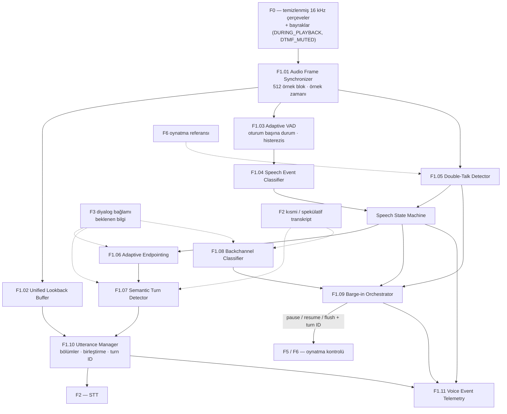
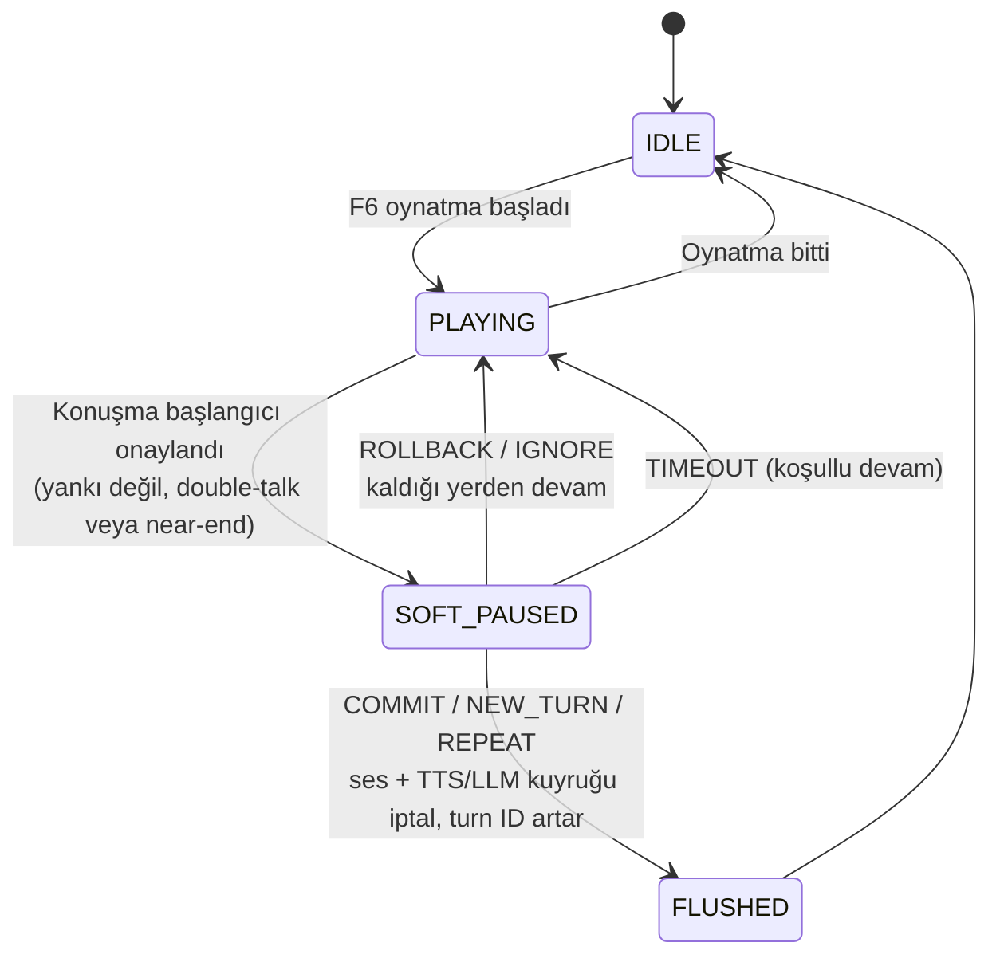
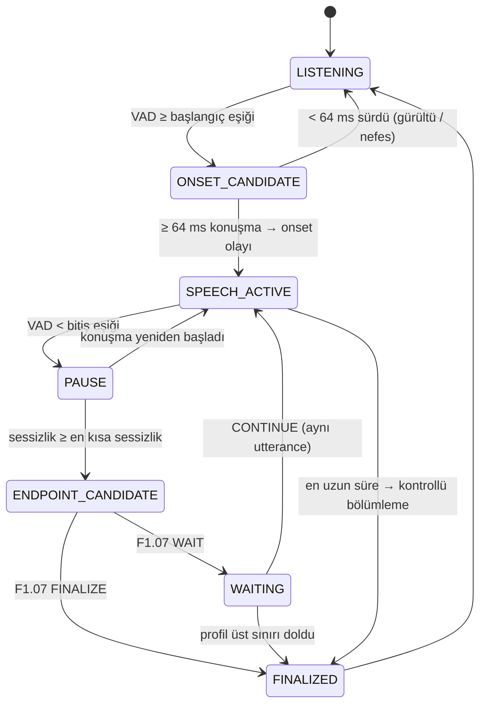

# F1 — Voice Activity & Turn Detection (Konuşma ve Tur Algılama)

| Alan | Değer |
| --- | --- |
| Aşama | F1 — F0 ile F2 arasındaki karar katmanı |
| Yol haritası modülleri | AP03 Semantic Turn Detection · AP09 Telephony Media Reliability (barge-in kısmı) · AP10 Audio Quality Evaluation (F1 kısmı) |
| Girdi | F0'dan 16 kHz mono temizlenmiş çerçeveler (`F0Output`) · F2'den kısmi transkriptler · F3'ten diyalog bağlamı · F5/F6'dan oynatma durumu ve referans ses |
| Çıktı | Konuşma bölümleri (`Utterance`) → **F2** · Barge-in komutları (pause / resume / flush) → **F5/F6** · Olaylar → telemetri |
| Kod | [`FreyaTTS_Automotive_PoC`](https://github.com/seydivakkas/FreyaTTS_Automotive_PoC) reposunda `backend/voice_activity/` |
| GPU bütçesi | **0 MB** — Silero VAD CPU'da çalışır. Spekülatif STT (§5.7) F2'nin GPU bütçesinden kullanır |
| İlgili belgeler | [`tasks.md`](tasks.md) · [`acceptance.md`](acceptance.md) · [`../F0-audio-acquisition/spec.md`](../F0-audio-acquisition/spec.md) |

> **Yol kuralı:** `backend/`, `frontend/`, `tests/`, `scripts/`, `config/` ve `data/` ile başlayan yollar **PoC reposundadır**. `docs/` ile başlayan yollar **bu plan reposundadır**.

---

## 1. Amaç

F1 şu üç soruyu cevaplar:
1. Müşteri **ne zaman konuşmaya başladı?**
2. Müşteri konuşmasını **ne zaman tamamladı?**
3. Freya konuşurken müşteri araya girdiyse Freya **durmalı mı, devam mı etmeli?**

F1, Freya'nın mekanik bir sesli asistandan doğal bir konuşma sistemine dönüşmesinde kritik rol oynar. Erken kesilen bir cümle F2'ye yarım transkript, F3'e yanlış niyet olarak yansır. Geç kapanan bir tur ise her yanıta gereksiz bekleme ekler.

**F1 önceliği:** VAD oturum izolasyonu, pre-roll tamponlarının birleştirilmesi, adaptif endpointing ve barge-in güvenilirliği. Bunlar tamamlanmadan karmaşık semantik modeller eklenmez.

## 2. Kapsam

**Kapsamda:**
- Çerçeve senkronizasyonu (512 örnek / 32 ms VAD blokları)
- Birleşik lookback / pre-roll / post-roll tamponu
- Oturum bazlı adaptif VAD
- Konuşma olayı sınıflandırma (konuşma, sessizlik, gürültü, nefes, yankı, DTMF)
- Double-talk algılama
- Adaptif endpointing
- Semantik tur algılama
- Backchannel sınıflandırma
- Barge-in orkestrasyonu
- Utterance yönetimi ve turn ID
- F1 telemetrisi
- Voice Intelligence Studio arayüzü
- F1 sentetik test laboratuvarı

**Kapsam dışı:**
- Ses temizleme ve AEC → F0. F1, F0'ın yankı bayraklarını ve oynatma referansını kullanır ama sinyali değiştirmez.
- Transkripsiyon → F2. F1, F2'den kısmi transkript ister ve kullanır.
- Diyalog kararı → F3. F1, F3'ün "hangi bilgi bekleniyor" bağlamını okur.
- Sesin gerçekten durdurulması → F6. F1 yalnızca komut üretir.

## 3. PoC'taki mevcut durum (doğrulanmış)

Bu bölüm PoC kodunun okunması ve PoC modüllerinin doğrudan çalıştırılmasıyla hazırlandı. Planın tespit ettiği dört sorun doğrulandı; ayrıca aşağıdaki ek sorunlar bulundu.

### 3.1 Konuşma algılama (`backend/audio.py → Endpoint`)

| Özellik | PoC'taki değer | Kod |
| --- | --- | --- |
| VAD | Silero, 16 kHz, 512 örnek blok | `Endpoint.feed` |
| Eşik | Tek eşik **0,55** (başlangıç ve bitiş aynı) | `float(self.model(...)) > 0.55` |
| Konuşma başlangıcı | **Tek bir** 32 ms blok yeterli; en kısa konuşma süresi yok | `if voiced and not self.active` |
| Konuşma sonu | 10 sessiz blok = **320 ms** (kod `>= 4800` diyor ama sayaç 512'şer arttığı için 5120 örnekte tetikleniyor) | `self.silence >= 4800` |
| En uzun konuşma | 625 blok = **20 s**, ardından kelimenin ortasında da olsa sert kesim | `len(self.speech) >= 625` |
| Pre-roll | 10 blok = 320 ms (`self.pre`) | `self.pre = (self.pre + [block])[-10:]` |
| Post-roll | Sondaki 320 ms sessizlik konuşmaya ekleniyor | `self.speech.append(block)` |
| Giriş tamponu | `Session.input` 100 ms'lik bloklar | F0 spec §5.1 |

### 3.2 Doğrulanan sorunlar

| # | Sorun | Kanıt | Etki |
| --- | --- | --- | --- |
| S1 | **VAD modeli oturumlar arasında paylaşılıyor** | `Session.__init__`: `self.endpoint = Endpoint(models.vad)` ve `models.vad.reset_states()` | Silero durumlu (RNN) bir model. Eşzamanlı oturumlar birbirinin durumunu bozar; yeni oturum açılması diğer oturumların VAD durumunu sıfırlar |
| S2 | **Üç ayrı pre-roll uygulaması var, STT yalnızca birini kullanıyor** | `Endpoint.pre` (kullanılıyor); `LookbackBuffer` ×2 (`session.py` ve `AudioSocketOrchestrator`; dolduruluyor, okunmuyor); `experimental/five_cuts_bargein_controller.PreOnsetRingBuffer` | Bakım yükü; hangi tamponun ilk heceyi koruduğu belirsiz |
| S3 | **`check_pause_timeout()` hiç çağrılmıyor** | Kod tabanında çağrı noktası yok | VAD başladığında oynatma duraklatılıyor ve Stage-2 kararı ancak konuşma bitip STT tamamlandığında geliyor. Gürültü VAD'ı sürekli açık tutarsa Freya **20 saniyeye kadar** sessiz kalabilir |
| S4 | **Sabit 320 ms sessizlik** | `Endpoint` | "Benim aracım… 2021 model… Passat" üç ayrı tura bölünür |
| S5 | **Yeni bölüm, önceki bölümün işlenmesini iptal ediyor** | `Session.input`: `if self.task and not self.task.done(): self.task.cancel()` | Müşteri 320 ms'den uzun durakladığında ilk bölümün STT/diyalog işlemi iptal edilir ve **ilk bölümdeki sözcükler kaybolur**. Bölümler birleştirilmez |
| S6 | **Barge-in gecikme metriği yanlış ölçülüyor** | `signal_started` konuşma algılandıktan sonra alınıyor; `barge_in_signal_ms` yalnızca olay gönderme süresini ölçüyor | Gerçek gecikme (100 ms giriş tamponu + VAD bloğu + F0 gecikmesi) raporda görünmüyor |
| S7 | **Backchannel listesi cevapları içeriyor** | `BACKCHANNEL_WORDS`: "evet", "tamam", "olur", "peki", **"efendim"** | `session.process` içindeki `not self.dialogue.awaiting` koşulu bunu kısmen önlüyor. Ancak "efendim?" Türkçede çoğunlukla "anlamadım, tekrar eder misiniz" anlamına gelir; dinleme teyidi sayılıp Freya'nın devam etmesine yol açar |
| S8 | **Oynatma yokken de duraklatma olayı gönderiliyor** | `if started:` bloğu `self.playing` kontrol etmeden `playback pause` yayınlıyor | Gereksiz olay trafiği; telemetride sahte barge-in |

### 3.3 Mevcut semantik tur algılayıcı (`backend/semantic_turn_detector.py`)

Plan semantik tur algılamayı "eksik" olarak tanımlıyor. Aslında 579 satırlık bir `SemanticTurnDetector` mevcut, ancak **canlı oturum akışına bağlı değil**; yalnızca `routers/audio_dsp.py` içinde global bir örnekle API üzerinden kullanılıyor.

Algılayıcı planın örnek cümleleriyle doğrudan çalıştırıldı (akustik eğim kapalı, 400 ms sessizlik):

| Girdi | Planın beklediği | PoC kararı | Sorun |
| --- | --- | --- | --- |
| Benim aracım… | Bekle | WAIT (800 ms) | ✓ |
| İki bin yirmi… | Bekle | WAIT (800 ms) | ✓ |
| **İki bin yirmi bir** | Bağlama göre | **COMMIT (250 ms)** | "bir" geniş zaman fiil kalıbına (`[ıiuüae]r$`) uyuyor; "iki bin yirmi" ile tutarsız |
| Nissan Qashqai | Bağlamı kontrol et | WAIT (800 ms) | Araç sorulmuşsa bile her marka/model cevabı 800 ms bekletiliyor |
| Toyota Corolla | Bağlamı kontrol et | WAIT (800 ms), işaret: `askıda_duraksama` | "-a" ile biten her sözcük askıda kalma sayılıyor |
| Birinci seçeneği istiyorum. | Sonlandır | COMMIT (250 ms) | ✓ |
| Evet, onaylıyorum. | Sonlandır | COMMIT (250 ms) | ✓ |
| **Bir de size şunu soracaktım…** | Bekle | **COMMIT (250 ms)** | Dilbilgisel olarak tamam ama devam duyurusu; erken kesilir |
| "kedi", "şimdi" | — | COMMIT | `[dt][ıiuü]$` geçmiş zaman kalıbı fiil olmayan sözcükleri de yakalıyor |

Ek kod hataları:
- Karakter sınıflarında `|` sembolü literal olarak eşleşiyor: `[e|a]`, `[d|t]` yazılmış, `[ea]` ve `[dt]` olmalı.
- Diyalog bağlamı (beklenen bilgi) kararda kullanılmıyor.

**Sonuç:** Kural tabanı başlangıç için değerli; F1.07'de **düzeltilerek ve F3 bağlamıyla birleştirilerek** kullanılır.

### 3.4 Deneysel barge-in modülü (`experimental/five_cuts_bargein_controller.py`)

`BackchannelEchoFilter.evaluate` anahtar sözcükleri `clean_text.startswith(kw)` ile eşliyor ve listede `"ha"` var. Bu yüzden:
- **"hayır"** → "ha" ile başladığı için **backchannel** (dinleme teyidi) sayılır.
- **"evet ama randevuyu değiştirmek istiyorum"** → "evet" ile başladığı için backchannel sayılır.

Bu modül **olduğu gibi entegre edilmemeli**. Ancak `AsteriskMediaBridge` içindeki chan_websocket XOFF/XON akış kontrolü fikri F6 için değerlendirilebilir.

## 4. Hedef mimari



**Mimari ilkeler:**

1. **Her görüşme kendi F1 örneğine sahiptir:** durum makinesi, VAD durumu, tamponlar, zamanlayıcılar. Modül düzeyinde değişebilir durum yasaktır.
2. **Kararlar örnek zamanına göre verilir, duvar saatine göre değil.** Sessizlik süresi "kaç blok geçti" ile ölçülür. Böylece sentetik testler deterministik olur ve olay döngüsü gecikmesi kararları etkilemez. Duvar saati yalnızca gecikme ölçümü için kullanılır.
3. **Konuşma durum makinesi ile barge-in denetleyicisi ayrıdır.** İkisi olaylarla haberleşir (plandaki "paralel denetleyici").
4. **F1 sinyali değiştirmez.** Yalnızca okur, sınıflandırır ve karar verir.

## 5. Bileşenler

### 5.1 F1.01 — Audio Frame Synchronizer (`frame_synchronizer.py`)

- F0'ın 10/20/32 ms çerçevelerini **512 örneklik (32 ms) bloklara** dönüştürür. F0 32 ms çerçeve kullanıyorsa doğrudan geçirir.
- Her bloğa şunları ekler: blok sırası, ilk örneğin oturum içindeki örnek indeksi, `t_capture_ns`, F0 bayraklarının birleşimi.
- Örnek indeksi, lookback tamponundan kesin aralık almak için kullanılır.
- F0'ın toplam algoritmik gecikmesini (`F0Output.algorithmic_delay_ms`) bilir. Oynatma referansıyla hizalama ve gecikme ölçümü buna göre düzeltilir.

### 5.2 F1.02 — Unified Lookback Buffer (`lookback_buffer.py`)

Üç ayrı pre-roll uygulamasının (§3.2 S2) yerini alan **tek** halka tampon.

| Parametre | Varsayılan | Not |
| --- | --- | --- |
| Kapasite | 2 s | Pre-roll, başlangıcın yeniden taranması ve barge-in değerlendirmesi için |
| Pre-roll | 320 ms | PoC değeri korunur |
| Post-roll | 160 ms | Planın önerisi. PoC tüm 320 ms sessizliği ekliyordu |
| Örnek biçimi | 16 kHz float32, F0 çıkışı | |

**Kurallar:**
- Konuşma, örnek indeksiyle `[başlangıç − pre_roll, bitiş + post_roll]` aralığı olarak kesilir. Pre-roll ile konuşma arasında **çift örnek veya boşluk olmaz** (T05, K "pre-roll kaynaklı örnek kaybı 0").
- Pre-roll içinde DTMF ile susturulmuş bölümler korunur (sıfır kalır); yeniden doldurulmaz.
- Kullanılmayan `LookbackBuffer` örnekleri ve `PreOnsetRingBuffer` kaldırılır. Mevcut testlerin içe aktardığı sınıf adları uyumluluk için yeni modülden dışa aktarılır (§10).

### 5.3 F1.03 — Adaptive Voice Activity Detection (`vad_engine.py`, `adaptive_threshold.py`)

**Oturum izolasyonu (S1 çözümü, ADR-F1-01):**

| Seçenek | Açıklama | Değerlendirme |
| --- | --- | --- |
| A | Her oturum için ayrı Silero model örneği | Basit. Model küçük, oturum başına bellek maliyeti düşük |
| **B (önerilen)** | Silero'nun ONNX sürümü: ağırlıklar tek bir ONNX Runtime oturumunda paylaşılır, **RNN durumu her görüşmenin kendi nesnesinde** tutulur ve her çağrıda modele girdi olarak verilir | Ağırlıklar bir kez yüklenir, durum tamamen izoledir, CPU'da çalışır |

Karar F1-S02'de verilir ve `docs/01-architecture/adr/ADR-F1-01-vad-isolation.md` dosyasına yazılır. Her iki seçenekte de `models.vad.reset_states()` çağrısı kaldırılır.

**Histerezis:**

| Parametre | Başlangıç değeri | PoC |
| --- | --- | --- |
| Speech Start Threshold | 0,60 | 0,55 |
| Speech End Threshold | 0,35 | 0,55 |
| En kısa konuşma başlangıcı | 64 ms (2 blok) | 32 ms (1 blok) |
| VAD penceresi | 32 ms | 32 ms |
| Pre-roll | 320 ms | 320 ms |
| Post-roll | 160 ms | 320 ms |
| En kısa sessizlik | 320 ms | 320 ms |
| En uzun beklenen sessizlik | 1 200 ms | — |

> Bu değerler **başlangıç ayarıdır**; F1-S04'te T02–T08 sonuçlarıyla kalibre edilir.

**Adaptif eşik** (`adaptive_threshold.py`):
- Konuşma olmayan bloklardaki VAD olasılık dağılımı oturum boyunca izlenir. Başlangıç eşiği `max(taban_eşik, gürültü_p95 + pay)` olarak güncellenir. Gürültülü ortamda eşik yükselir, sessiz ortamda tabana döner.
- F0 profili (P0–P4) ve SNR kestirimi başlangıç değerini belirler.
- Freya konuşurken (`DURING_PLAYBACK`) ve AEC yoksa veya yakınsamamışsa başlangıç eşiği yükseltilir (yankı kaynaklı tetiklenmeye karşı).
- Eşik değişimleri sınırlıdır: en fazla 0,1 adım, en az 1 s aralık.

### 5.4 F1.04 — Speech Event Classifier (`speech_event_classifier.py`)

Her blok veya kısa olay için bir sınıf üretir: `speech`, `silence`, `noise`, `breath`, `echo`, `dtmf`, `unknown`.

İlk sürüm **kural tabanlıdır, yeni model yüklenmez**. Girdiler:
- VAD olasılığı
- Blok enerjisi
- F0'dan spektral düzlük ve düşük frekans oranı
- F0'dan `DTMF_MUTED` bayrağı
- F1.05'ten yankı ve double-talk sonucu

| Sınıf | Kural (başlangıç) |
| --- | --- |
| `dtmf` | F0 bayrağı |
| `echo` | Oynatma sırasında, F1.05 "yalnızca yankı" diyor |
| `breath` | < 300 ms, düşük enerji, yüksek spektral düzlük, VAD 0,3–0,6 arası |
| `noise` | VAD < bitiş eşiği ve enerji gürültü tabanının belirgin üstünde |
| `speech` | Histerezis kurallarına göre konuşma |
| `unknown` | Hiçbir kurala uymayan; karar mekanizmaları bunu konuşma gibi değil, belirsiz olarak ele alır |

Öksürük gibi kısa ve yüksek enerjili patlamalar ilk sürümde `noise` sınıfına girer.

### 5.5 F1.05 — Double-Talk Detector (`double_talk.py`)

Freya konuşurken mikrofondaki sesin **yalnızca yankı mı, müşteri mi, yoksa ikisi birden mi** olduğunu belirler.

- **Girdi:** F6'nın gönderdiği PCM (F0 AEC ile aynı zaman damgalı halka tampon), F0 çıkışı, F0 gecikme bilgisi.
- **Temel yöntem:** Geigel double-talk algılayıcısı. Mikrofon tepe değeri, yankı penceresindeki referans tepe değerinin belirli bir oranını aşarsa yakın uçta konuşma vardır.
- **İkinci kanıt:** Referans ile mikrofon arasında, kestirilen yankı gecikmesinde normalize çapraz korelasyon. Yüksek korelasyon "yankı", düşük korelasyon ve yüksek enerji "müşteri" demektir.
- **Çıktı:** `idle` / `echo_only` / `near_end_only` / `double_talk`.
- Web yolunda tarayıcı AEC'si yankının çoğunu giderdiği için algılayıcı çoğunlukla `near_end_only` üretir. Telefon yolunda F0-T17 yankı ölçümünün sonucuna göre önemi belirlenir.

### 5.6 F1.06 — Adaptive Endpointing (`endpointing.py`, `profiles.py`)

Sessizlik eşiği tek bir sabit değil, **F3'ün beklediği bilgi türüne** göre seçilir.

| Beklenen bilgi (`expected_slot`) | Sessizlik eşiği |
| --- | --- |
| `yes_no` (evet / hayır) | 250–350 ms |
| `option_number` (seçenek numarası) | 250–350 ms |
| `customer_name` (müşteri adı) | 400–600 ms |
| `vehicle_make_model` (araç marka/modeli) | 500–800 ms |
| `phone_number` (telefon numarası) | 800–1 200 ms |
| `plate` (plaka) | 600–1 000 ms |
| `free_text` (serbest konuşma) | 600–1 200 ms |

**Karar akışı:**
1. Sessizlik profilin **alt sınırına** ulaşınca → **endpoint adayı** ve F1.07'ye sorulur. Alt sınır `yes_no` ve `option_number` için 250 ms, diğer profillerde en kısa sessizlik olan 320 ms'den az değildir.
2. F1.07 `FINALIZE` derse tur kapanır.
3. F1.07 `WAIT` derse profilin üst sınırına kadar beklenir. Bu sürede konuşma yeniden başlarsa `CONTINUE`.
4. Üst sınır (en fazla 1 200 ms) dolarsa tur kapanır. Kapanma nedeni `silence_max` olarak kaydedilir.

**Konuşma hızına uyum:** Müşterinin bu görüşmedeki cümle içi duraklamalarının 90. yüzdeliği izlenir. Eşik `clamp(p90 × 1,2, profil_alt, profil_üst)` olarak ayarlanır. Yavaş konuşan müşteriye daha uzun süre tanınır.

**Kontrollü bölümleme:** 20 saniyeye yaklaşan konuşma sert kesilmez. Son 2 saniye içindeki en düşük VAD olasılıklı noktadan (doğal duraklama) bölünür ve bölümler `continuation` bayrağıyla zincirlenir. F2 bunları birleşik bir transkript olarak ele alır.

### 5.7 F1.07 — Semantic Turn Detector (`semantic_turn.py`)

**Karar motoru:** `WAIT` (bekle) · `FINALIZE` (sonlandır) · `CONTINUE` (dinlemeye devam et)

| Karar | Anlamı |
| --- | --- |
| `WAIT` | Sessizlik sürüyor ama tur henüz kapanmadı. Uzatılmış eşik bekleniyor |
| `CONTINUE` | Müşteri yeniden konuştu. Yeni ses **aynı utterance'a** eklenir |
| `FINALIZE` | Tur kapanır; utterance F2 final tanımaya ve F3'e gider |

**Girdiler:**

| Kaynak | Kullanılan bilgi |
| --- | --- |
| Akustik | VAD, sessizlik süresi, enerji; isteğe bağlı perde eğimi (PoC'taki `estimate_f0_pitch_slope`) |
| Semantik | F2 kısmi transkripti |
| Diyalog | F3 `expected_slot`, `awaiting_confirmation`, son soru |
| Zamanlama | Duraklama süresi, toplam konuşma süresi |

**F2 bağımlılığı ve ilk sürüm stratejisi:** Gerçek akışlı kısmi transkript F2'nin AP04 (Streaming ASR) işidir. O hazır olana kadar F1.07 **spekülatif STT** kullanır: endpoint adayı oluştuğunda o ana kadarki ses F2'ye kısa bir tanıma isteği olarak gönderilir. Karar `WAIT` olur ve müşteri konuşmaya devam ederse bu sonuç atılmaz; birleştirme için saklanır.

> Spekülatif STT GPU kullanır. Barge-in sırasında TTS de GPU'da çalıştığı için **GPU Resource Scheduler'da STT önceliği, iptal edilebilecek TTS işinden yüksek olmalıdır.** Bu, ortak katman belgesine bağımlılık olarak yazılır.

**Kural tabanının düzeltilmesi (§3.3):**
1. Regex karakter sınıfı hataları (`[e|a]` → `[ea]`, `[d|t]` → `[dt]`).
2. Fiil kalıpları yalnızca fiil olabilecek sözcüklere uygulanır. Sayı sözcükleri (bir, iki, … dokuz yüz) ve sık geçen isim/zarf istisnaları (şimdi, kedi, kadar, bir…) ayrı listede tutulur.
3. **Devam duyurusu kalıpları** eklenir: "şunu soracaktım", "bir şey diyeceğim", "şöyle ki", "bir de", "ayrıca"… Bu kalıplarla biten cümleler dilbilgisel olarak tam olsa da `WAIT` alır.
4. **Bağlama göre slot doluluğu:**

| Beklenen bilgi | Hızlı `FINALIZE` koşulu |
| --- | --- |
| `yes_no` | Tek başına evet/hayır sözcüğü, ardından içerik yok |
| `option_number` | Bir seçenek numarası çözümlendi |
| `vehicle_make_model` | Marka + model çözümlendi (yıl isteniyorsa yıl da) |
| `phone_number` | 10 veya 11 hane tamamlandı (eksikse `WAIT`) |
| `plate` | Türk plaka biçimi tamamlandı (PoC `turkish_plate.py` ile doğrulama) |

5. Marka/model/yıl çözümlemesi F2'nin Automotive Entity Resolver'ından (AP05) gelir. O hazır olana kadar katalog sözlüğüyle basit eşleştirme yapılır.

**Plandaki örneklerin hedef kararları** (T07, T08 ve semantik birim testlerinin beklenen değerleri):

| Kısmi transkript | `expected_slot` | Hedef karar |
| --- | --- | --- |
| Benim aracım… | `vehicle_make_model` | WAIT |
| İki bin yirmi… | `vehicle_make_model` | WAIT (marka/model yok) |
| Nissan Qashqai | `vehicle_make_model` (yıl istenmiyor) | FINALIZE |
| Nissan Qashqai | `vehicle_make_model` (yıl isteniyor) | WAIT |
| Birinci seçeneği istiyorum. | `option_number` | FINALIZE |
| Evet, onaylıyorum. | `yes_no` | FINALIZE |
| Bir de size şunu soracaktım… | herhangi | WAIT |

İlk sürümde ayrı bir LLM yüklenmez.

### 5.8 F1.08 — Backchannel Classifier (`backchannel.py`)

Müşterinin Freya konuşurken söylediği kısa ifadeyi **bağlama göre** sınıflandırır.

**Sınıflar:**

| Sınıf | Sonuç |
| --- | --- |
| `ROLLBACK` | Dinleme teyidi. Freya kaldığı yerden devam eder |
| `NEW_TURN` | Bir soruya cevap. Eski oynatma iptal edilir, cevap F3'e gider |
| `COMMIT` | Gerçek kesinti. Eski oynatma iptal edilir |
| `REPEAT` | **(Plana eklendi)** Tekrar isteği. Eski oynatma iptal edilir, F3 son cümleyi yeniden söyletir |
| `IGNORE` | Gürültü, yankı, boş transkript. Duraklatma geri alınır |

**Karar tablosu:**

| Müşteri girdisi | Bağlam | Karar |
| --- | --- | --- |
| Hı hı | Freya bilgi veriyor | ROLLBACK |
| Anlıyorum | Freya açıklama yapıyor | ROLLBACK |
| Evet | Randevu onayı bekleniyor | NEW_TURN |
| Hayır | Onay bekleniyor | NEW_TURN |
| Bir dakika | Freya konuşuyor | COMMIT |
| Durun | Freya konuşuyor | COMMIT |
| Rüzgâr sesi | Konuşma yok | IGNORE |
| Freya'nın yankısı | Geri besleme | IGNORE |
| **Efendim? / Anlamadım / Pardon** | Freya konuşuyor | **REPEAT** (eklendi) |
| **Evet ama …** | Herhangi | **COMMIT** — teyit sözcüğünden sonra içerik geliyor (eklendi) |
| **Hayır** | Freya bilgi veriyor | **COMMIT** — müşteri itiraz ediyor (eklendi) |

**Uygulama kuralları:**
- Eşleştirme **sözcük dizisinin tamamıyla** yapılır; `startswith` kullanılmaz (§3.4).
- Teyit sözcüğünden sonra içerik sözcüğü geliyorsa ifade backchannel değildir.
- Bağlam F3'ten gelir: `awaiting_confirmation`, Freya'nın konuştuğu içeriğin türü (`info`, `question`, `confirmation`).
- Süre ve enerji ikincil kanıttır (PoC deneysel modülündeki 400 ms sınırı gibi).
- Liste ve kurallar `backchannel.py` içinde tek yerde tutulur. `BACKCHANNEL_WORDS` bu modülden dışa aktarılır.

### 5.9 F1.09 — Barge-in Orchestrator (`bargein_controller.py`)

Mevcut iki aşamalı yapı korunur ve genişletilir.



**Aşamalar:**
1. **SOFT PAUSE:** Oynatma geçici durdurulur. Sentez kuyruğu korunur; duraklatma noktası (örnek konumu) kaydedilir.
2. **Karar:** F1.08 sınıfı + F3 bağlamı → `ROLLBACK`, `COMMIT`, `NEW_TURN`, `REPEAT` veya `IGNORE`.
3. **TIMEOUT:** `pause_timeout` (varsayılan 3 500 ms) dolarsa ve konuşma olayı `breath`, `noise` veya `unknown` ise oynatma devam eder. Gerçek konuşma devam ediyorsa zaman aşımı karar beklenen duruma uzatılır. **Zaman aşımı canlı döngüye bağlanır (S3 çözümü):** blok zamanına göre çalışan bir zamanlayıcı.

**Ek kurallar:**
- Duraklatma yalnızca **Freya gerçekten konuşurken** gönderilir (S8).
- 1 s'den uzun duraklamadan sonra `ROLLBACK` yapılırsa oynatma, kesilen cümleciğin başından tekrar başlar (kelimenin ortasından devam etmek doğal duyulmaz). Daha kısa duraklamalarda tam kaldığı yerden devam eder.
- **Turn ID:** Her ses çerçevesi turn ID taşır. F6, mevcut turn ID'den küçük turn ID'li çerçeveleri oynatmaz. PoC'ta `play_wave.send()` içinde `turn == self.generation` kontrolü var; bu kural F6 sözleşmesine yazılır ve T19 ile doğrulanır.
- **Titreme önleme:** İki soft pause arasında en az 300 ms; aynı oynatma içinde art arda 3 `IGNORE` sonrası başlangıç eşiği geçici yükseltilir.
- **DTMF önceliği:** Freya konuşurken DTMF gelirse barge-in sınıflandırması beklenmeden doğrudan `COMMIT` yapılır.

**Taşıma katmanları** (komutlar F6 tarafından uygulanır):

| Kanal | Pause | Resume | Flush |
| --- | --- | --- | --- |
| AudioSocket | Sunucu gönderimi durdurur (`play_wave.send` bekleme döngüsü) | Gönderim sürer | Çerçeveler atılır |
| chan_websocket | `PAUSE_MEDIA` | `CONTINUE_MEDIA` | `FLUSH_MEDIA` |
| Web | `playback pause` olayı | `playback resume` | `playback flush` |

**Gecikme tanımları** (plandaki ayrım):
- **Barge-in kontrol sinyali gecikmesi** = komutun taşıma katmanına yazıldığı an − müşterinin ilk konuşma örneğinin adaptöre ulaştığı an
- **Duyulabilir ses kesilmesi** = Freya'nın sesinin müşteri tarafında gerçekten durduğu an − aynı başlangıç anı

Duyulabilir kesilme ölçümü:
- Web: tarayıcı `AudioContext` zaman damgasıyla geri bildirir.
- Telefon: Asterisk tarafında giden kanalın kaydı (MixMonitor) alınır ve sesin durduğu an kayıttan bulunur.

### 5.10 F1.10 — Utterance Manager (`utterance_manager.py`)

**S5 çözümü:** Yeni bölüm, önceki bölümün işlenmesini **iptal etmez**.

| Durum | Davranış |
| --- | --- |
| Önceki bölüm henüz `FINALIZE` edilmemiş | Bölümler **birleştirilir** (`CONTINUE`). Spekülatif STT sonucu saklanır; final tanıma birleşik ses üzerinde yapılır |
| Önceki tur `FINALIZE` edilmiş ama F3 henüz yanıt üretmeye başlamamış | Yeni bölüm aynı tura eklenir; F3'e "tur güncellendi" olayı gider |
| F3 yanıt üretiyor veya Freya konuşuyor | Barge-in akışı (§5.9) uygulanır; yeni bölüm yeni tur olur ve `follows_turn` ile önceki tura bağlanır |

**Diğer görevler:**
- Turn ID üretimi ve sıralama. Turn ID, PoC'taki `Session.generation` sayacının yerini alır ve ondan türetilir.
- `Utterance` sözleşmesinin (§6) doldurulması: kapanma nedeni (`silence`, `semantic`, `silence_max`, `max_length`, `dtmf`, `hangup`), birleştirilen bölümler, pre-roll ve post-roll.
- Kontrollü bölümleme (§5.6) zincirleri.

### 5.11 F1.11 — Voice Event Telemetry (`telemetry.py`)

| Olay | İçerik |
| --- | --- |
| `f1.vad_onset` | Konuşma başlangıç örnek zamanı, algılama anı, gecikme, kullanılan eşik |
| `f1.endpoint_candidate` | Sessizlik süresi, profil, beklenen bilgi |
| `f1.turn_decision` | WAIT / CONTINUE / FINALIZE, gerekçeler, transkript parçası |
| `f1.utterance` | Süre, bölüm sayısı, kapanma nedeni, pre/post-roll |
| `f1.bargein` | Aşama, karar, sınıf, kontrol sinyali gecikmesi, duyulabilir kesilme (ölçülebildiyse) |
| `f1.double_talk` | Durum geçişleri |
| `f1.threshold_changed` | Eski/yeni eşik ve nedeni |
| `f1.vad_trace` | Arayüz için saniyede 4 kez örneklenmiş VAD olasılığı; tam iz halka tamponda |

**Studio metrikleri:** Speech Onset Latency, Endpoint Latency, False Trigger Rate, Barge-in Latency, Rollback Rate, Speech Detection F1, Missed Speech Rate, Buffer Utilization. Gerçek ölçüm gelene kadar "Ölçüm bekleniyor" gösterilir.

Olaylar mevcut `pipeline_telemetry.make_pipeline_event` biçimiyle uyumludur. PoC'taki `barge_in_signal_ms` metriği §5.9'daki tanıma göre yeniden hesaplanır (S6).

## 6. Veri sözleşmeleri (`contracts.py`)

```python
from dataclasses import dataclass, field
from enum import Enum
from typing import Literal
import numpy as np

class SpeechClass(str, Enum):
    SPEECH = "speech"; SILENCE = "silence"; NOISE = "noise"
    BREATH = "breath"; ECHO = "echo"; DTMF = "dtmf"; UNKNOWN = "unknown"

class DoubleTalkState(str, Enum):
    IDLE = "idle"; ECHO_ONLY = "echo_only"
    NEAR_END_ONLY = "near_end_only"; DOUBLE_TALK = "double_talk"

@dataclass(frozen=True, slots=True)
class SpeechFrame:
    session_id: str
    block_index: int          # 512 örneklik blok sırası
    sample_index: int         # Bloğun ilk örneğinin oturum içi indeksi (16 kHz)
    samples: np.ndarray       # 512 örnek, float32
    t_capture_ns: int
    f0_flags: int             # F0 FrameFlags
    vad_prob: float
    speech_class: SpeechClass
    double_talk: DoubleTalkState

@dataclass(frozen=True, slots=True)
class SpeechEvent:
    session_id: str
    kind: Literal["onset", "endpoint_candidate", "continue", "finalize",
                  "bargein_pause", "bargein_resume", "bargein_flush", "timeout"]
    sample_index: int
    t_detect_ns: int
    turn_id: int
    details: dict = field(default_factory=dict)

@dataclass(frozen=True, slots=True)
class TurnContext:            # F3 → F1
    expected_slot: Literal["yes_no", "option_number", "customer_name",
                           "vehicle_make_model", "phone_number", "plate",
                           "free_text", "none"]
    awaiting_confirmation: bool
    freya_utterance_kind: Literal["info", "question", "confirmation", "none"]
    require_year: bool = False

@dataclass(frozen=True, slots=True)
class PlaybackState:          # F5/F6 → F1
    playing: bool
    turn_id: int
    position_samples: int
    clause_start_samples: int

@dataclass(slots=True)
class Utterance:              # F1 → F2
    utterance_id: str
    session_id: str
    turn_id: int
    follows_turn: int | None
    start_sample: int         # pre-roll dahil
    end_sample: int           # post-roll dahil
    audio: np.ndarray         # 16 kHz float32
    segments: list[tuple[int, int]]   # Birleştirilen konuşma bölümleri
    end_reason: Literal["silence", "semantic", "silence_max", "max_length", "dtmf", "hangup"]
    continuation: bool        # Kontrollü bölümlemeyle devam ediyor mu
    during_playback: bool
    speculative_transcript: str | None
```

Bu tipler F2 ve F3 belgeleriyle birlikte `docs/01-architecture/interfaces.md` dosyasında birleştirilir.

## 7. Konuşma durum makinesi (`speech_state_machine.py`)



Barge-in durumları (§5.9) ayrı bir denetleyicide tutulur. İki makine olaylarla haberleşir: `onset` olayı barge-in denetleyicisini tetikler; barge-in kararı Utterance Manager'a "bu utterance barge-in sırasında başladı" bilgisini verir.

## 8. Gecikme bütçesi

Plan iki sıkı hedef koyuyor: **barge-in kontrol sinyali p95 ≤ 100 ms** ve **en kısa konuşma başlangıcı 64 ms**. Bu iki hedef mevcut F0 gecikmesiyle birlikte ele alındığında çatışıyor:

| Gecikme kaynağı | PoC (en kötü) | Hedef yapı (en kötü) | Not |
| --- | --- | --- | --- |
| Giriş tamponu | 100 ms | 32 ms (F0 32 ms çerçeve) | F0-T22 |
| F0 algoritmik gecikme | ≈ 24 ms | ≈ 28 ms (mevcut NS) | F0 spec §5.5 |
| VAD blok hizalama | 32 ms | Giriş tamponuyla aynı bekleme | 32 ms çerçevede örtüşür |
| En kısa konuşma başlangıcı | 0 (1 blok) | 64 ms | Plan parametresi |
| İşlem ve olay gönderimi | birkaç ms | ≈ 5 ms | |
| **Toplam** | **≈ 160 ms** | **≈ 129 ms** | Silero'nun tepki gecikmesi hariç |

**Sonuç:** Mevcut NS gecikmesi ve 64 ms en kısa başlangıçla p95 ≤ 100 ms hedefi karşılanamaz. F1-S04'te ölçümle karar verilecek seçenekler:

| Seçenek | Açıklama | Bedel |
| --- | --- | --- |
| A | F0 NS penceresini 16 ms'ye indirmek (gecikme ≈ 8–12 ms) | Frekans çözünürlüğü düşer; T18 ile doğrulanmalı |
| B | Barge-in için VAD'ı F0'ın **NS öncesi** düşük gecikmeli çıkışından beslemek; STT NS sonrası sesi kullanır | Gürültüde yanlış tetiklenme artabilir; F0'ın iki çıkış üretmesi gerekir |
| C | İki adımlı tepki: ilk konuşma bloğunda sesi kıs (duck, −12 dB), 64 ms'de onaylanırsa duraklat | Müşteri sesin kısıldığını hemen duyar; yanlış alarmda kısa bir ses düşüşü olur |
| D | Hedefi "p95 ≤ 130 ms" olarak güncellemek | Doğallık hedefinden taviz |

## 9. Profiller

| Profil türü | İçerik | Kaynak |
| --- | --- | --- |
| Konuşma profili | `expected_slot` → sessizlik eşikleri (§5.6) | F3 |
| Kanal profili | Web / telefon: başlangıç eşiği ve en kısa başlangıç | Çağrı başında |
| Ortam profili | F0 P0–P4 → adaptif eşiğin başlangıç değeri | F0 |

Studio'daki "Conversation Profiles" kartı aktif profili ve değerlerini gösterir (örnek: Otomotiv marka/model · Pre-roll 320 ms · Endpoint Silence 480 ms · Barge-in Pause Timeout 3 500 ms).

## 10. PoC'tan taşıma

| PoC'taki öğe | Yeni konum | İşlem |
| --- | --- | --- |
| `audio.Endpoint` | `voice_activity/pipeline.py` + `speech_state_machine.py` | Yeniden yaz; `Endpoint` adı eski testler için uyumluluk sarmalayıcısı olarak kalır |
| `models.vad` + `reset_states()` | `voice_activity/vad_engine.py` | Oturum başına durum (ADR-F1-01) |
| `audiosocket_server.LookbackBuffer` (×2) | `voice_activity/lookback_buffer.py` | Tek tampon; eski ad dışa aktarılır |
| `experimental/...PreOnsetRingBuffer` | — | Kaldırılır; yerini birleşik tampon alır |
| `audiosocket_server.TwoStageBargeInController` | `voice_activity/bargein_controller.py` | Genişlet; zaman aşımını canlı döngüye bağla; eski ad dışa aktarılır |
| `audiosocket_server.BACKCHANNEL_WORDS` | `voice_activity/backchannel.py` | Bağlamsal sınıflandırıcı; "efendim" `REPEAT` sınıfına taşınır |
| `experimental/...BackchannelEchoFilter` | — | **Olduğu gibi entegre edilmez** (§3.4) |
| `backend/semantic_turn_detector.py` | `voice_activity/semantic_turn.py` | Regex düzeltmeleri, devam duyurusu kalıpları, F3 bağlamı; `routers/audio_dsp.py` global örneği oturum başına örnekle değiştirilir |
| `Session.input` (utterance döngüsü, `task.cancel()`) | `voice_activity/utterance_manager.py` | İptal yerine birleştirme |
| `Session.process` (`stage2_evaluate` çağrısı) | `bargein_controller.py` | Karar F1'de; `session.py` yalnızca sonucu uygular |
| `Session.generation` | `utterance_manager.py` turn ID | Kaynak tek yerde |

**Korunması gereken mevcut testler:** `tests/test_session.py`, `test_audiosocket_server.py`, `test_chan_websocket.py`, `test_semantic_turn_detector.py`, `test_madde3_customer_experience.py`, `test_analytics.py`, `test_qa_telemetry_operator.py`, `tests/milestones/test_m02.py`, `test_m05.py`, `test_m08.py`, `test_m09.py`, `experimental/tests/test_five_cuts_bargein_controller.py`.

Davranış değişikliği nedeniyle güncellenmesi gereken testler (ör. "efendim" artık rollback değil) gerekçesiyle birlikte değiştirilir; test silinmez.

## 11. API ve Voice Intelligence Studio

### 11.1 Backend API

| Uç nokta | Açıklama |
| --- | --- |
| `GET /api/f1/config` | Etkin F1 parametreleri |
| `PUT /api/f1/config` | Varsayılanları güncelle (yönetici) |
| `GET /api/f1/profiles` | Konuşma, kanal ve ortam profilleri |
| `GET /api/f1/sessions/{id}/timeline` | Oturumun olay zaman çizelgesi |
| `GET /api/f1/sessions/{id}/buffer` | Lookback tamponu anlık görüntüsü (Buffer Inspector) |
| `POST /api/f1/lab/run` | Sentetik senaryo veya WAV'ı F0+F1'den geçir; olayları ve kararları döndür |
| WS olayı `f1_metrics` | Saniyede 4 kez VAD izi ve durum |

### 11.2 Studio arayüzü

**Ana sayfa (`frontend/src/VoiceStudioPanel.tsx`):** VAD Engine (Silero), Sample Rate (16 kHz), VAD Window (32 ms), test senaryosu seçimi (Konuşma / Gürültü / Barge-in), anlık durum (ör. `SPEECH_ACTIVE`), Detection Modules anahtarları (Silero VAD, Adaptive Endpointing, Semantic Turn Detection, Two-Stage Barge-in, Backchannel Classification), Conversation Profiles kartı, Runtime Metrics kutuları, Sıfırla ve Yapılandırmayı kopyala.

**Alt sayfalar:**

| Sayfa | İçerik |
| --- | --- |
| VAD Monitor | VAD olasılığı, başlangıç ve bitiş eşikleri, konuşma olayları |
| Turn Detection | Endpoint adayları, WAIT/CONTINUE/FINALIZE kararları ve gerekçeleri |
| Barge-in Lab | Kayıtlı veya sentetik kesme senaryolarını çalıştırma; karar ve gecikmeler |
| Buffer Inspector | Pre-roll ve konuşma tamponları; kesilen aralıkların dalga formu |
| Speech Timeline | Oturum bazlı olay zaman çizelgesi (F0 + F1 + oynatma) |
| Profile Manager | Konuşma profillerinin düzenlenmesi |
| Synthetic Test Lab | T01–T22 senaryolarını çalıştırma |
| Quality Gate | Kabul kriterleri ve son ölçümler |

**Dürüstlük kuralı:** Metrik kutuları gerçek ölçüm gelene kadar "Ölçüm bekleniyor" gösterir. Simülasyon görünümleri "Temsili sinyal ve olay görünümü" etiketi taşır.

## 12. Riskler

| Risk | Önlem |
| --- | --- |
| Spekülatif STT GPU'yu TTS ile paylaşır, gecikme artar | GPU Resource Scheduler önceliği; spekülatif istek yalnızca endpoint adayında |
| Semantik kurallar Türkçe çeşitliliğinde yanılır | Kural başına birim testleri; `WAIT` hiçbir zaman profil üst sınırını aşamaz |
| Adaptif eşik gürültüde aşırı yükselir, kısık konuşma kaçar | Eşik üst sınırı; Missed Speech Rate metriği (T06) |
| Bölüm birleştirme yanlış konuşmaları birleştirir | Birleştirme yalnızca `FINALIZE` öncesinde; sonrası `follows_turn` ile bağlanır |
| Barge-in hedefi gecikme bütçesiyle çatışıyor | §8 seçenekleri; F1-S04 ölçüm kararı |
| Taşıma katmanı tamponları duyulabilir kesilmeyi geciktirir | Kanal bazında ölçüm (§5.9) |

## 13. Açık sorular

1. §8'deki barge-in gecikme seçeneklerinden hangisi kabul edilecek? (F1-S04 ölçümüne bağlı)
2. Spekülatif STT, F2'nin pseudo-streaming çözümü gelince tamamen kaldırılacak mı? (F2 planıyla birlikte karar verilecek)
3. `ROLLBACK`'te cümlecik başından yeniden başlama eşiği 1 s mi olmalı? (İnsan değerlendirmesiyle, AŞAMA 4)
