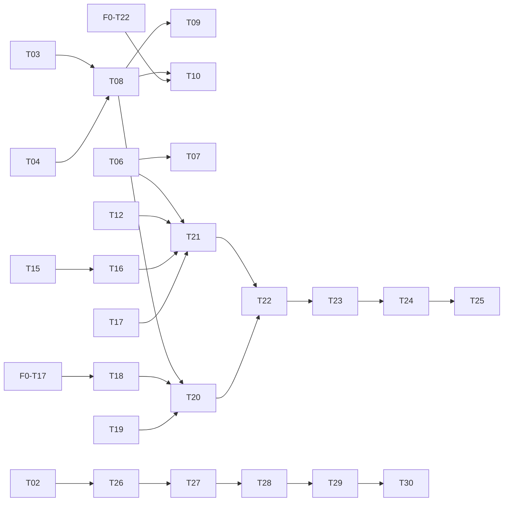

# F1 — Görevler

Her görevin bir kimliği (`F1-Txx`), sprinti (`F1-Sxx`), dosyaları, bağımlılıkları ve "bitti" tanımı vardır. Kodlama ajanı görevi almadan önce [`spec.md`](spec.md) dosyasının ilgili bölümünü okur.

**Boyut:** S = yarım gün veya daha az · M = 1–2 gün · L = 3 gün veya daha fazla

**Yol kuralı:** `backend/`, `frontend/`, `tests/`, `scripts/`, `config/`, `data/` → PoC reposu ([`FreyaTTS_Automotive_PoC`](https://github.com/seydivakkas/FreyaTTS_Automotive_PoC)). `docs/` → bu plan reposu.

**Genel kurallar:**
- Yeni hat `f1_pipeline_v2` bayrağı arkasında geliştirilir; F1-S13 regresyonu geçene kadar varsayılan kapalıdır. Bayrak kapalıyken PoC davranışı değişmez.
- **İstisna:** S1 (paylaşılan VAD durumu) ve S5 (bölüm iptali) **hata düzeltmesidir**. Bayraktan bağımsız olarak düzeltilir (F1-T03, F1-T05).
- Mevcut testler her görevden sonra geçmelidir. Davranış değişikliği gerektiren test güncellemeleri gerekçeyle yapılır; test silinmez.
- Ölçüm gerektiren kabul maddeleri, ölçüm çalıştırılmadan işaretlenmez.

**Bağımlılık:** F1-S04 ve sonrası, F0'ın düşük gecikmeli çerçeve kararına (F0-T22) bağlıdır. F0 hazır değilse F1 geliştirmesi F0'ın eski yoluyla (100 ms blok) sürer; gecikme ölçümleri F0-T22 sonrasında tekrarlanır.

---

## F1-S01 — Mevcut VAD ve barge-in kodlarının envanteri

### F1-T01 · Karakterizasyon testleri · M
- **Dosyalar:** `tests/voice_activity/test_poc_characterization.py`
- **İş:** PoC davranışını test olarak kaydet:
  - `Endpoint`: tek blokla başlangıç, 10 blok (5 120 örnek) sessizlikte bitiş, 625 blokta sert kesim, 320 ms pre-roll
  - Paylaşılan VAD durumu (iki `Endpoint` aynı modeli kullanınca çıktıların değiştiğini gösteren test)
  - `TwoStageBargeInController` kararları
  - `semantic_turn_detector` için spec §3.3 tablosundaki kararlar
  - `BackchannelEchoFilter`'ın "hayır" ve "evet ama…" için yanlış sonucu
- **Bitti:** Testler mevcut kodla geçer. Düzeltme yapan her görev ilgili testi yeni beklenen davranışla günceller.

### F1-T02 · F1 test derlemi ve etiketleri · M
- **Dosyalar:** `data/f1/corpus/manifest.json`, `scripts/f1_build_corpus.py`
- **Bağımlılık:** F0-T03 (gürültü karışımları)
- **İş:** Konuşma sınırları etiketli sentetik senaryolar (temiz konuşma + sessizlik/gürültü). Etiketler temiz sinyalden enerji tabanlı hizalamayla üretilir ve blok düzeyinde (32 ms) saklanır. Duraklama senaryoları (450 / 800 ms), telefon numarası ve plaka okuma, backchannel cümleleri (bağlam etiketiyle) eklenir.
- **Bitti:** Manifest, her dosya için konuşma aralıklarını, beklenen tur sayısını ve (varsa) beklenen barge-in kararını içerir.

## F1-S02 — Oturum izolasyonu ve SpeechFrame sözleşmesi

### F1-T03 · VAD oturum izolasyonu (hata düzeltmesi) · M
- **Dosyalar:** `backend/voice_activity/vad_engine.py`, `backend/models.py`, `backend/session.py`, `docs/01-architecture/adr/ADR-F1-01-vad-isolation.md`
- **İş:** spec §5.3 seçenek A veya B. `models.vad.reset_states()` çağrısını kaldır. Eski `Endpoint` de oturum başına durum kullanacak şekilde güncellenir (bayraktan bağımsız).
- **Bitti:** T20 geçer. ADR yazılır.

### F1-T04 · Sözleşmeler ve çerçeve senkronizörü · M
- **Dosyalar:** `backend/voice_activity/contracts.py`, `frame_synchronizer.py`
- **Bağımlılık:** F0-T04
- **İş:** spec §6 tipleri; spec §5.1 (512 örnek bloklama, örnek indeksi, F0 gecikme bilgisi).
- **Bitti:** T21 (F0–F1 sözleşmesi) birim kısmı geçer; 10/20/32/100 ms girişlerde örnek kaybı veya tekrarı yok.

### F1-T05 · Bölüm iptalinin kaldırılması (hata düzeltmesi) · M
- **Dosyalar:** `backend/session.py`
- **İş:** `Session.input` içindeki `self.task.cancel()` davranışı değiştirilir: yeni bölüm gelirse ve önceki tur henüz F3'e iletilmediyse bölümler birleştirilir. Tam Utterance Manager (F1-T21) gelene kadar bu minimal bir düzeltmedir.
- **Bitti:** "Benim aracım" [450 ms] "2021 model Passat" senaryosunda her iki bölümün sözcükleri de F3'e ulaşır (entegrasyon testi).

## F1-S03 — Birleşik Lookback Buffer

### F1-T06 · Birleşik tampon · M
- **Dosyalar:** `backend/voice_activity/lookback_buffer.py`
- **İş:** spec §5.2. Örnek indeksiyle kesin aralık alma, pre-roll 320 ms, post-roll 160 ms.
- **Bitti:** T05 geçer; pre-roll ile konuşma sınırında çift örnek veya boşluk olmadığı birim testle doğrulanır.

### F1-T07 · Eski tamponların kaldırılması · S
- **Dosyalar:** `backend/session.py`, `backend/audiosocket_server.py`, `experimental/five_cuts_bargein_controller.py`
- **Bağımlılık:** F1-T06
- **İş:** Kullanılmayan iki `LookbackBuffer` örneğini ve `PreOnsetRingBuffer` kullanımını kaldır. Sınıf adları uyumluluk için yeni modülden dışa aktarılır.
- **Bitti:** `test_audiosocket_server.py` ve deneysel testler geçer; canlı yolda tek pre-roll kaynağı kalır.

## F1-S04 — Adaptive VAD ve Histerezis

### F1-T08 · Histerezisli VAD · M
- **Dosyalar:** `backend/voice_activity/vad_engine.py`, `speech_state_machine.py`
- **Bağımlılık:** F1-T03, F1-T04
- **İş:** spec §5.3 başlangıç/bitiş eşikleri, en kısa başlangıç 64 ms, spec §7 durum makinesinin `LISTENING → SPEECH_ACTIVE → PAUSE` kısmı.
- **Bitti:** T01–T06 çalıştırılır ve sonuçlar raporlanır.

### F1-T09 · Adaptif eşik · M
- **Dosyalar:** `backend/voice_activity/adaptive_threshold.py`
- **İş:** spec §5.3 adaptif eşik kuralları.
- **Bitti:** T02 ve T03'te yanlış alarm oranı sabit eşiğe göre düşer; T06'da (düşük enerjili konuşma) kaçırılan konuşma oranı artmaz.

### F1-T10 · Gecikme bütçesi ölçümü ve karar · M
- **Dosyalar:** `scripts/f1_latency_budget.py`, `docs/01-architecture/adr/ADR-F1-02-bargein-latency.md`
- **Bağımlılık:** F0-T22, F1-T08
- **İş:** spec §8 tablosunu ölçülmüş değerlerle doldur. A/B/C/D seçeneklerinden hangisinin uygulanacağına karar ver.
- **Bitti:** ADR, ölçüm verisi ve seçilen seçenek.

## F1-S05 — Speech Event Classification

### F1-T11 · Olay sınıflandırıcı · M
- **Dosyalar:** `backend/voice_activity/speech_event_classifier.py`
- **İş:** spec §5.4 kuralları.
- **Bitti:** Etiketli derlemde sınıf bazında karışıklık matrisi raporlanır; `dtmf` sınıfı %100, `speech` duyarlılığı ≥ %95.

## F1-S06 — Adaptive Endpointing

### F1-T12 · Profil tabanlı endpointing · M
- **Dosyalar:** `backend/voice_activity/endpointing.py`, `profiles.py`
- **İş:** spec §5.6: `expected_slot` → eşik, endpoint adayı akışı, en uzun sessizlik.
- **Bitti:** T07, T08, T09 geçer.

### F1-T13 · Konuşma hızına uyum · S
- **İş:** Cümle içi duraklama yüzdeliğine göre eşik ayarı.
- **Bitti:** Yavaş konuşma senaryosunda erken sonlandırma sayısı azalır, hızlı konuşmada endpoint gecikmesi artmaz.

### F1-T14 · Kontrollü bölümleme · S
- **İş:** 20 s sınırına yaklaşan konuşmanın doğal duraklamadan bölünmesi ve `continuation` zinciri.
- **Bitti:** T10 geçer; bölüm sınırında sözcük kesilmez (bölme noktası VAD olasılığı en düşük blokta).

## F1-S07 — Semantic Turn Detection

### F1-T15 · Kural tabanının düzeltilmesi ve taşınması · M
- **Dosyalar:** `backend/voice_activity/semantic_turn.py`, `backend/semantic_turn_detector.py` (uyumluluk)
- **İş:** spec §5.7 düzeltmeler 1–3 (regex, sayı/isim istisnaları, devam duyurusu kalıpları).
- **Bitti:** spec §3.3 tablosundaki hatalı satırlar düzelir; `tests/test_semantic_turn_detector.py` geçer (gerekçeli güncellemeyle).

### F1-T16 · Diyalog bağlamı ve slot doluluğu · M
- **Bağımlılık:** F1-T15; F3 tarafında `TurnContext` üretimi (geçici olarak `dialogue.awaiting` alanından türetilir)
- **İş:** spec §5.7 madde 4–5; hedef karar tablosu.
- **Bitti:** Hedef karar tablosunun tamamı birim testlerde geçer.

### F1-T17 · Spekülatif STT köprüsü · M
- **Dosyalar:** `backend/voice_activity/semantic_turn.py`, `backend/models.py`
- **İş:** Endpoint adayında kısa STT isteği; `WAIT` sonrası sonucun saklanması; GPU önceliği için ortak katmana kanca.
- **Bitti:** Endpoint gecikmesine eklenen STT süresi p50/p95 olarak raporlanır.

## F1-S08 — Double-Talk Detection

### F1-T18 · Double-talk algılayıcı · M
- **Dosyalar:** `backend/voice_activity/double_talk.py`
- **Bağımlılık:** F0-T17 (oynatma referans tamponu)
- **İş:** spec §5.5 Geigel + korelasyon.
- **Bitti:** T12 ve T13 geçer.

## F1-S09 — Barge-in 2.0 ve Backchannel

### F1-T19 · Bağlamsal backchannel sınıflandırıcı · M
- **Dosyalar:** `backend/voice_activity/backchannel.py`
- **İş:** spec §5.8; tam dizi eşleştirme, `REPEAT` sınıfı, F3 bağlamı.
- **Bitti:** T15 ve T16 geçer; etiketli backchannel setinde doğruluk ≥ %95.

### F1-T20 · Barge-in orkestratörü · L
- **Dosyalar:** `backend/voice_activity/bargein_controller.py`, `backend/session.py`, `backend/websocket_adapter.py`
- **Bağımlılık:** F1-T08, F1-T18, F1-T19
- **İş:** spec §5.9: durum makinesi, canlı zaman aşımı, yalnızca oynatma sırasında duraklatma, cümlecik başından devam, titreme önleme, DTMF önceliği, turn ID kuralı, taşıma katmanı komutları.
- **Bitti:** T14, T17, T18, T19 geçer.

## F1-S10 — Utterance Manager ve telemetri

### F1-T21 · Utterance Manager · M
- **Dosyalar:** `backend/voice_activity/utterance_manager.py`, `pipeline.py`
- **Bağımlılık:** F1-T06, F1-T12
- **İş:** spec §5.10: birleştirme kuralları, turn ID, `Utterance` doldurma, F1-T05'teki minimal düzeltmenin yerini alma.
- **Bitti:** T11 geçer.

### F1-T22 · F1 telemetrisi ve gecikme ölçümünün düzeltilmesi · M
- **Dosyalar:** `backend/voice_activity/telemetry.py`, `backend/pipeline_telemetry.py`
- **İş:** spec §5.11 olayları; `barge_in_signal_ms`'in spec §5.9 tanımıyla yeniden hesaplanması; duyulabilir kesilme ölçümü (web: AudioContext geri bildirimi; telefon: MixMonitor kaydı).
- **Bitti:** `test_pipeline_telemetry.py` geçer; yeni olaylar için birim testleri.

### F1-T23 · API · M
- **Dosyalar:** `backend/routers/f1.py`
- **İş:** spec §11.1.
- **Bitti:** API testleri; `/api/f1/lab/run` bir senaryo için olay listesi döndürür.

## F1-S11 — Voice Intelligence Studio arayüzü

### F1-T24 · Ana sayfa · M
- **Dosyalar:** `frontend/src/VoiceStudioPanel.tsx`
- **Bağımlılık:** F1-T23
- **İş:** spec §11.2 ana sayfa bileşenleri.
- **Bitti:** Gerçek backend'e bağlı; dürüstlük kuralı sağlanıyor.

### F1-T25 · Alt sayfalar · L
- **İş:** VAD Monitor, Turn Detection, Barge-in Lab, Buffer Inspector, Speech Timeline, Profile Manager, Synthetic Test Lab, Quality Gate.
- **Bitti:** Her sayfa ilgili API'den beslenir; demo verisi açıkça etiketlenir.

## F1-S12 — Sentetik test laboratuvarı

### F1-T26 · T01–T22 testleri · L
- **Dosyalar:** `tests/voice_activity/lab/test_t01_*.py` … `test_t22_*.py`
- **Bağımlılık:** F1-T02, F0-T29
- **İş:** [`acceptance.md`](acceptance.md) senaryoları. pytest işaretleri: `unit`, `lab`, `slow`, `gpu`.
- **Bitti:** Testler çalışır; sonuçlar rapora yazılır.

### F1-T27 · Laboratuvar raporu · S
- **Dosyalar:** `scripts/f1_lab_report.py`, `data/f1/lab-report-<tarih>.json` ve `.md`
- **Bitti:** `acceptance.md` kutuları yalnızca bu rapora dayanılarak işaretlenir.

## F1-S13 — F0–F6 regresyon testleri

### F1-T28 · Uçtan uca regresyon · M
- **İş:** Mevcut test paketi, sentetik AudioSocket çağrıları ve tur gecikmeleri `f1_pipeline_v2` açık/kapalı. `docs/measured-latency.json` biçiminde karşılaştırma.
- **Bitti:** Mevcut testler kırılmaz; tur sayısı ve gecikmeler raporlanır. Koşullar sağlanırsa `f1_pipeline_v2` varsayılanı `True` yapılır.

## F1-S14 — Gerçek ses ve SIP kabulü

### F1-T29 · Gerçek konuşma kayıt protokolü · M
- **Dosyalar:** `docs/testing/f1-field-protocol.md`
- **İş:** Hızlı ve yavaş konuşma, düşünme araları, farklı Türkçe ağızlar, kısa onaylar, nefes, öksürük, araç gürültüsü, yankı, aynı anda konuşma senaryoları. Onay ve KVKK kuralları.
- **Bitti:** Protokol ve etiketleme kılavuzu hazır.

### F1-T30 · Kabul değerlendirmesi · M
- **Bağımlılık:** F1-T29
- **İş:** Web ve Asterisk üzerinden gerçek konuşmalarla kalite kapısı metrikleri; insan değerlendiricilerle barge-in doğallığı (doğal mı, kaba mı).
- **Bitti:** `acceptance.md` AŞAMA 4 tablosu ölçülmüş değerlerle dolar.

---

## Bağımlılık özeti

