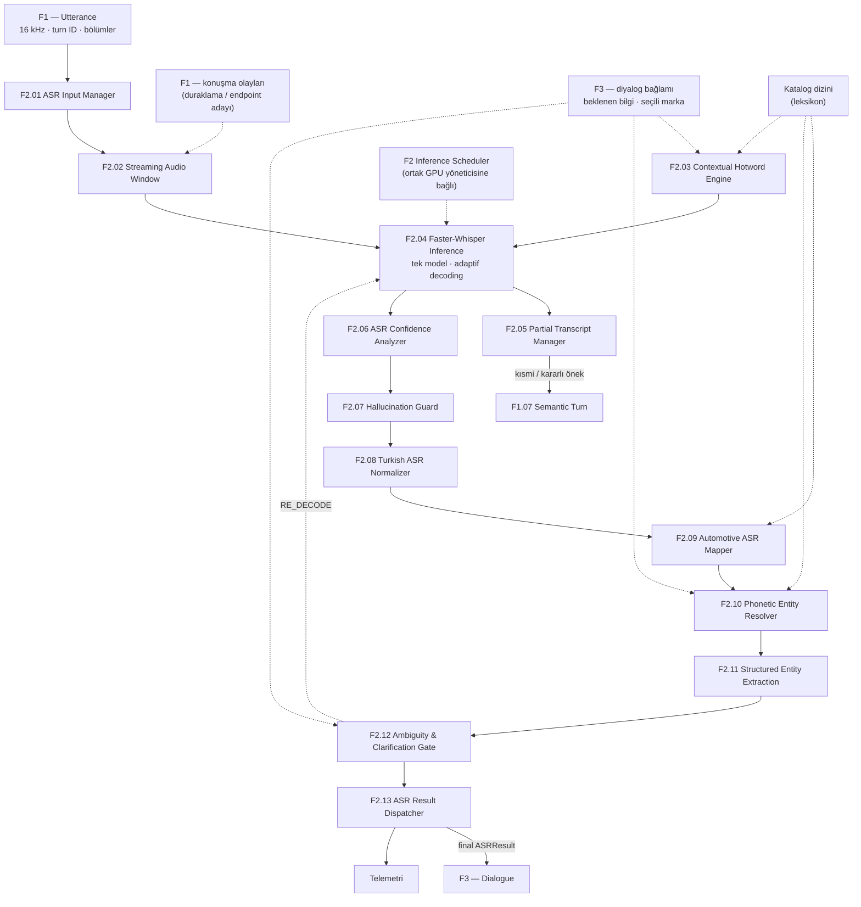

# F2 — Speech Recognition & Understanding (Konuşma Tanıma ve Anlamlandırma)

| Alan | Değer |
| --- | --- |
| Aşama | F2 — konuşmayı metne ve yapılandırılmış varlıklara dönüştüren katman |
| Yol haritası modülleri | AP04 Streaming ASR · AP05 Automotive Entity Resolver · AP10 Audio Quality Evaluation (F2 kısmı) |
| Girdi | F1'den `Utterance` (16 kHz ses, turn ID, bölümler) · F1'den konuşma olayları (partial tetikleme) · F3'ten diyalog bağlamı (`TurnContext`, seçili marka) · F0'dan SNR |
| Çıktı | `ASRResult` → **F3** (yalnızca final sonuç işlem başlatır) · Kısmi transkript → **F1.07** · Telemetri |
| Kod | [`FreyaTTS_Automotive_PoC`](https://github.com/seydivakkas/FreyaTTS_Automotive_PoC) reposunda `backend/speech_recognition/` |
| GPU bütçesi | Mevcut tek Faster-Whisper Large V3 Turbo örneği (FP16). **Yeni model yüklenmez.** STT, TTS ve LLM ile aynı GPU'yu paylaşır |
| İlgili belgeler | [`tasks.md`](tasks.md) · [`acceptance.md`](acceptance.md) · [`../F1-voice-turn-detection/spec.md`](../F1-voice-turn-detection/spec.md) |

> **Yol kuralı:** `backend/`, `frontend/`, `tests/`, `scripts/`, `config/`, `data/`, `contracts/`, `experimental/`, `automotive_voice/`, `asterisk/` ile başlayan yollar **PoC reposundadır**. `docs/` ile başlayan yollar **bu plan reposundadır**.

---

## 1. Amaç

F0 sesi temizler, F1 konuşma sınırlarını belirler, **F2 müşterinin ne söylediğini güvenilir biçimde ortaya çıkarır** ve F3'e mümkün olduğunca doğru, yapılandırılmış bilgi gönderir.

**F2 önceliği:** Faster-Whisper modelini değiştirmeden ASR Mapper'ı canlı hatta almak, otomotiv fonetik çözümleme motorunu kurmak ve güven skoruyla yanlış düzeltmeleri önlemek. Streaming STT optimizasyonu bunlardan sonra gelir.

**Temel ayrım:** F2 bilgiyi **çıkarır**, F3 bilgiyi **değerlendirir** ve işlem kararını verir. Ses tanıma katmanı hiçbir zaman doğrudan veritabanında işlem yapamaz.

## 2. Kapsam

**Kapsamda:**
- ASR girdi yönetimi ve kayan ses pencereleri
- Faster-Whisper çıkarımı ve adaptif decoding
- Kısmi transkriptler
- Güven analizi
- Hallucination koruması
- Türkçe ASR normalizasyonu
- Otomotiv ASR Mapper
- Fonetik varlık çözümleme
- Yapılandırılmış varlık çıkarımı
- Belirsizlik kapısı
- STT GPU zamanlaması
- Speech Recognition Studio
- F2 veri kümesi, benchmark ve ablation deneyleri

**Kapsam dışı:**
- Konuşma sınırları → F1
- Niyet kararı, saat belirsizliğinin çözümü (02.00 / 14.00), takvim uygunluğu, işlem onayı → F3
- Telaffuz sözlüğünün TTS tarafı → F4. Aynı leksikon kaynağı paylaşılır ama F2 yalnızca **tanıma yönünü** (söylenen → kanonik) kullanır.

## 3. Mevcut durum

### 3.1 Ölçülmüş performans

| Metrik | Değer | Kaynak |
| --- | --- | --- |
| WER | %18,7 | `docs/VERIFICATION.md` (PoC), 6 Kasım 2026 |
| CER | %7,6 | Aynı |
| Otomotiv terim doğruluğu | %48,04 (hedef %95) | Aynı |
| STT işlem süresi | 0,3–1,5 s | Tek çalıştırma örneği |

**Ölçümün niteliği:** Bu değerler `scripts/acoustic_benchmark.py` ile 320 örnekli `data/fixtures/legacy_320_cases.json` üzerinde **FreyaTTS → 8 kHz telefon bandı → STT** zinciriyle elde edildi. Terim doğruluğu, sözlükteki terimin transkriptte söylenen veya kanonik biçimde bulunup bulunmadığıyla ölçülüyor (`acoustic_evaluation.evaluate_transcript`). Hatalar TTS ve STT'nin **birleşik** sonucudur; tamamı Whisper'a atfedilemez.

**Belirsiz nokta:** Benchmark, hotword'ler açık veya kapalı çalıştırılabiliyor (`--catalog-hotwords`). Sonuç dosyası (`data/acoustic/latest.json`) repoya dahil olmadığı için %48,04 ölçümünde hotword'lerin açık olup olmadığı bu incelemede doğrulanamadı. F2-T01 bunu netleştirir.

### 3.2 Kod incelemesi (`backend/models.py → Models.transcribe`)

| Özellik | PoC'taki durum |
| --- | --- |
| Model | `large-v3-turbo`, `cuda`, `float16` (`config.py`) |
| Dil | `language="tr"` sabit |
| Beam | `beam_size=1` |
| Decode filtreleri | `no_speech_threshold=0.50`, `log_prob_threshold=-0.80`, `compression_ratio_threshold=2.2`, `repetition_penalty=1.2`, `no_repeat_ngram_size=3`, `hallucination_silence_threshold=2.0`, `condition_on_previous_text=False` |
| Segment filtresi | `no_speech_prob > 0.40`, `avg_logprob < -0.85` veya `compression_ratio > 2.2` olan segment **sessizce atılıyor** |
| Dönüş tipi | Yalnızca `str` |
| GPU erişimi | `stt_lock` (threading.Lock) |
| İptal | `asyncio.shield(work)`: görev iptal edilse bile STT sonuna kadar çalışıyor, sonuç atılıyor |

**İncelemede bulunan sorunlar:**

| # | Sorun | Kanıt | Etki |
| --- | --- | --- | --- |
| S1 | **"Katalog hotword'leri" aslında katalog değil** | `_catalog_hotwords()`: `select(Vehicle.description).order_by(Vehicle.id).limit(50)`. `vehicles` tablosu müşteri araç kayıtlarını (açıklama, plaka, şasi) tutuyor ve `id` rastgele UID | Hotword listesi marka/model kataloğu değil, rastgele sıralanmış ilk 50 müşteri aracının açıklaması |
| S2 | **Hotword'ler varsayılan olarak kapalı** | `config.py`: `stt_catalog_hotwords: bool = False` | Plandaki "ilk 50 araç kaydı hotword olarak veriliyor" ifadesi yalnızca bu ayar açıksa geçerli |
| S3 | **Hotword prompt uzunluğu denetlenmiyor** | 50 açıklama `", "` ile birleştiriliyor | Faster-Whisper hotword'leri prompt token'ı olarak ekler; prompt bütçesi (yaklaşık 224 token) aşılırsa fazlası kırpılır. 50 kayıt bu sınırı aşabilir — F2-T05'te tokenize edilerek ölçülecek |
| S4 | **Sıcaklık geri dönüşü (temperature fallback) açık** | `temperature` parametresi verilmemiş; Faster-Whisper varsayılanı 0,0'dan 1,0'a kadar bir sıcaklık listesidir. `log_prob_threshold=-0.80` ve `compression_ratio_threshold=2.2` bu geri dönüşü tetikler | Düşük güvenli segmentler daha yüksek sıcaklıklarla (örneklemeli) **birkaç kez yeniden çözülür**: gecikme sıçrar ve sonuç deterministik olmaz. 0,3–1,5 s'lik değişkenliğin olası bir nedeni; F2-T02'de ölçülecek |
| S5 | **Düşük güvenli segmentler sessizce atılıyor** | Segment filtresi | Yabancı marka adı içeren kısa bir cümlede tek segmentin `avg_logprob` değeri düşükse **tüm cümle boş döner**. F1'de boş transkript `rollback` sayıldığı için müşteri hiç konuşmamış gibi işlem görür |
| S6 | **Tanıma bilgisi kayboluyor** | Dönüş tipi `str` | Segment olasılıkları, no-speech değeri, sözcük zamanları F3'e ulaşmıyor (planın tespiti) |
| S7 | **İptal edilen STT GPU'yu meşgul etmeye devam ediyor** | `asyncio.shield` | F1'deki bölüm iptali (F1 spec §3.2 S5) ile birleşince hem iş boşa gidiyor hem sözcükler kayboluyor |
| S8 | **Türkçe Whisper sahte metinlerine karşı liste yok** | Kod tabanında arama | Whisper sessizlikte Türkçe altyazı kalıpları üretebilir ("Altyazı M.K.", "İzlediğiniz için teşekkürler" vb.). Kalıp listesi yok |

### 3.3 Deneysel ASR Mapper (`experimental/asr_mapper.py`)

Mapper, `config/freyatts_automotive_lexicon.json` dosyasından **2 979 eşleme kuralı** ve **151 marka** yüklüyor. Tam alias eşleştirmesi yapıyor: regex, en uzun eşleşme önce. Plandaki örneklerle doğrudan çalıştırıldı:

| ASR girdisi | Mapper çıktısı | Değerlendirme |
| --- | --- | --- |
| Pejo üç bin sekiz | Peugeot üç bin sekiz | ✓ marka |
| Reno Megan | Renault Megane | ✓ marka + model |
| Şkoda Oktavya | Škoda Octavia | ✓ |
| Tog te on iks | Togg T10X | ✓ |
| Porşe Kayen | Porsche Cayenne | ✓ |
| Folksvagen Passat | Volkswagen Passat | Marka ✓, **model algılanmadı** (`detected_model=None`) |
| Sitroen Ce dört | Citroën Ce dört | Marka ✓, **C4 çözülmedi** |
| **Nisan kaş kay iki bin yirmi** | *değişmedi* | ✗ Planın ana örneği eşleşmiyor. Sözlükte yalnızca tam "Nissan Kaşkay" biçimi var |
| Hundai i yirmi | *değişmedi* | ✗ |
| Blue HDI motor | *değişmedi* | ✗ |
| **fiyat ne kadar** | **Fiat ne kadar** (marka = Fiat) | ✗ **Yanlış düzeltme.** Sözlükte "Fiyat → Fiat" bağlamsız alias olarak tanımlı; fiyat sorusu Fiat markasına dönüşüyor |
| **mini bir sorun var** | **MINI bir sorun var** (marka = MINI) | ✗ Yanlış düzeltme |
| seat belt | Seat belt (marka = Seat) | ✗ Yanlış düzeltme |
| nisan ayında geleceğim | *değişmedi* | ✓ Ancak "Nisan → Nissan" eklenirse tarih ifadeleri bozulur |

**Sonuç:**
- Mapper değerli bir başlangıç. Doğru eşleşmelerin kaynağı zengin leksikon.
- **Olduğu gibi canlıya alınmamalı.** İki eksiği var:
  1. **Bulanık/fonetik eşleştirme yok.** Whisper'ın parçalı yazımları ("kaş kay") yakalanmıyor.
  2. **Bağlam kapısı yok.** "fiyat", "mini", "seat", "nisan" gibi gündelik sözcükler marka sanılıyor.
- Türkçe fonetik anahtarda **"Nissan" ve "nisan" (ay adı) aynı sese indirgenir.** Ayrımı yalnızca diyalog bağlamı (D bileşeni) yapabilir. Plandaki S = w₁L + w₂P + w₃C + w₄D formülünde D'nin neden zorunlu olduğunu gösteren tipik örnek budur.

### 3.4 Varlık ayrıştırıcıları

| Bileşen | Yer | Gözlem |
| --- | --- | --- |
| Plaka | `backend/turkish_plate.py → extract_plate` | Rakam ve sözlü biçim çalışıyor ("otuz dört a be ce yüz yirmi üç" → 34 ABC 123). Ancak "34 abc 12 3" → **34 ABC 12** (son hane kayboluyor) ve dört haneli sözlü grup ("on altı ka el **iki bin beş yüz**") → **çözülemiyor** |
| Telefon | `backend/dialogue.py → extract_phone_number` | Rakam ve sözlü biçim; F3 içinde |
| Sözlü sayı | `turkish_plate._words_to_number`, `dialogue.extract_phone_number`, `vin_ruhsat_decoder.parse_spoken_number`, `redaction_kvkk_guard.redact_spoken_numbers` | **Dört ayrı Türkçe sayı ayrıştırıcısı** var. F2'de tek bir ortak ayrıştırıcıda birleştirilir |
| Şasi (VIN) | `backend/vin.py`, `vin_ruhsat_decoder.py` | Mevcut; F2 varlık çıkarımına bağlanır |

### 3.5 Pseudo-streaming maliyeti hakkında teknik not

Whisper kodlayıcısı (encoder) girişi her zaman **30 saniyelik** bir pencereye doldurarak işler. Large V3 Turbo'da çözücü (decoder) 4 katmana indirilmiştir; kodlayıcı 32 katmanlıdır. Bu nedenle kısa bir pencereyi çözmenin maliyeti, uzun bir pencereyi çözmenin maliyetine yakındır: **her kısmi çözümleme kodlayıcının neredeyse tam maliyetini öder.**

500 ms aralıklı sabit kısmi çözümleme, konuşan her müşteri için GPU'yu sürekli meşgul edebilir ve aynı GPU'daki TTS'i yavaşlatabilir. Bu yüzden §5.2'de **olay tetiklemeli** kısmi çözümleme ana yöntem olarak önerilir. Sabit aralık, ablation deneyinde (A7) ölçülerek değerlendirilir. Bu çıkarım F2-T30 ölçümüyle doğrulanmalıdır.

## 4. Hedef mimari



**Mimari ilkeler:**
1. **Tek Whisper örneği.** `speech_recognition` paketi modeli yeniden yüklemez; `models.stt` örneğini adaptör üzerinden kullanır.
2. **Ham metin kutsaldır.** `raw_transcript` hiçbir zaman üzerine yazılmaz. Her düzeltme kaynağı ve skoruyla ayrı kaydedilir (`corrections` listesi).
3. **Yalnızca final sonuç işlem başlatır.** Kısmi sonuçlar F1'e konuşma sonu değerlendirmesi için gider; F3 bunlarla randevu oluşturamaz.
4. **Ölçülmeyen değer `null`'dır.** Güven skoru kalibre edilene kadar olasılık olarak sunulmaz.
5. **Bağlamsız düzeltme yok.** Gündelik sözcüklerle çakışan alias'lar (fiyat/Fiat, nisan/Nissan, mini/MINI, seat/Seat) yalnızca diyalog bağlamı araç bilgisini beklerken veya güçlü katalog kanıtı varken uygulanır.

## 5. Bileşenler

### 5.1 F2.01 — ASR Input Manager (`input_manager.py`)

- F1 `Utterance` nesnesini alır; örnekleme hızını (16 kHz), uzunluğu ve NaN/Inf durumunu doğrular.
- `turn_id` kontrolü: Mevcut turdan eski bir utterance gelirse işlenmez (T24).
- Kontrollü bölümleme zincirlerini (`continuation`) birleşik transkript için sıraya koyar.
- Pre-roll ve post-roll dahil sesi olduğu gibi kullanır; kırpma yapmaz.
- F0 SNR'ını ve F1 `during_playback` bilgisini güven analizine iletir.

### 5.2 F2.02 — Streaming Audio Window (`audio_window.py`, `streaming_asr.py`)

**Plandaki başlangıç yapılandırması:**

| Parametre | Başlangıç değeri |
| --- | --- |
| Örnekleme frekansı | 16 000 Hz |
| En kısa ilk çözümleme süresi | 800 ms |
| Analiz penceresi | 2–5 s |
| Örtüşme | 500 ms |
| Kısmi çözümleme aralığı | 500 ms |
| Kararlılık kontrolü | 2 ardışık sonuç |
| Final çözümleme | F1 endpoint olayı |
| Bekleyen kısmi görev | Oturum başına en fazla 1 |

**Kısmi çözümleme tetikleme modları** (§3.5 nedeniyle):

| Mod | Tetikleyici | Kullanım |
| --- | --- | --- |
| `event` (**varsayılan önerisi**) | F1 `PAUSE` ve `ENDPOINT_CANDIDATE` olayları; ayrıca uzun konuşmada her 2 s | F1.07 spekülatif STT'nin yerini alır |
| `interval` | Her 500 ms | Ablation A7 ve GPU yükü ölçümü |
| `off` | Yalnızca final | Düşük GPU modu |

**Kurallar:**
- Oturum başına en fazla 1 bekleyen kısmi görev. Yeni tetikleme gelirse bekleyen görev **atlanır**, iptal edilip yeniden kuyruğa alınmaz.
- **Final çözümleme her zaman tüm utterance üzerinde** yapılır. Kısmi sonuçlar birleştirilerek final üretilmez. Böylece pencere sınırında sözcük bölünmesi finali etkilemez (T07, T08).
- GPU yükü yüksekken (Inference Scheduler bildirir) kısmi çözümlemeler kendiliğinden azaltılır.

### 5.3 F2.03 — Contextual Hotword Engine (`hotword_engine.py`, `catalog_index.py`)

**S1–S3 çözümü:**
- Hotword kaynağı müşteri araç tablosu değil, **leksikon kataloğudur:** `config/freyatts_automotive_lexicon.json` → `brands`, `full_models`, `standalone_models`, `terms`.
- Liste diyalog bağlamına göre seçilir (planın tablosu):

| Diyalog durumu | Öncelikli hotword'ler |
| --- | --- |
| Marka belirleme | Peugeot, Nissan, Renault, Volkswagen… (bölgesel sıklığa göre ilk N marka) |
| Nissan seçildi | Qashqai, Juke, X-Trail, Micra |
| Volkswagen seçildi | Passat, Golf, Polo, Tiguan |
| Motor bilgisi | TDI, TSI, BlueHDi, dCi |
| Ekspertiz işlemi | Tramer, şasi, boya, kaporta, değişen |
| Randevu | Bugün, yarın, saat, sabah, öğleden sonra |
| Onay | Evet, hayır, onaylıyorum, iptal |

- **Token bütçesi:** Liste tokenize edilir ve en fazla `hotword_token_budget` (varsayılan 120 token; F2-T05 ölçümüyle belirlenir) içinde öncelik sırasıyla kesilir. Kesilen kısım telemetriye yazılır.
- Önbellek anahtarı `(diyalog durumu, seçili marka)` olur. Zaman tabanlı 60 s TTL yerine leksikon sürümü değişince geçersiz kılınır.
- **Hotword kesin sonuç değildir:** Katalog dışı araç söylenebilmelidir (T14). Hotword kaynaklı yanlış yönlendirme T10'da ölçülür. Hotword'ler açık ve kapalıyken aynı sesin transkriptleri karşılaştırılır; yalnızca hotword açıkken ortaya çıkan katalog adı "hotword bias şüphesi" olarak işaretlenir.

### 5.4 F2.04 — Faster-Whisper Inference (`whisper_engine.py`, `decoder_policy.py`)

**Adaptör:** `WhisperEngine.transcribe(audio, profile, hotwords) -> RawASR`. Mevcut `models.stt` örneğini kullanır. Segmentleri, segment metriklerini ve (istenirse) sözcük zamanlarını ve olasılıklarını döndürür.

**Decoding profilleri** (planın tablosu):

| Profil | Beam | Kullanım |
| --- | --- | --- |
| `FAST` | 1 | `yes_no`, `option_number`, kısa cevaplar |
| `BALANCED` | 3 | Varsayılan |
| `ACCURATE` | 5 | `vehicle_make_model`, `plate`, `phone_number` |
| `RECOVERY` | 5 + farklı hotword seti | F2.12 `RE_DECODE` kararıyla, oturum başına sınırlı |

Profil F3'ün `expected_slot` bilgisinden ve önceki sonucun güveninden seçilir. Her profilin gecikmesi ve doğruluğu ablation'da (A5) ölçülür.

**Decode ayarları (S4 ve S5 çözümü):**
- Sıcaklık geri dönüşü **varsayılan olarak kapalı**: `temperature=0.0`. Geri dönüş yalnızca `RECOVERY` profilinde, sınırlı bir listeyle açılabilir.
- Segment filtreleri metni **atmaz**; segmenti `low_confidence` olarak işaretler ve F2.06'ya bırakır. Boş sonuç yalnızca F2.07 Hallucination Guard kararıyla üretilir.
- `word_timestamps`: Final çözümlemede açık (sözcük olasılıkları güven analizi için gerekli). Maliyeti F2-T09'da ölçülür; kısmi çözümlemede kapalı.

**N-best hakkında:** Faster-Whisper'ın `transcribe()` arayüzü yalnızca en iyi hipotezi döndürür; beam genişliğini artırmak N-best listesi üretmez (planın uyarısı doğru). Seçenekler:
1. **Önerilen:** N-best'i **varlık düzeyinde** üretmek. F2.10 her varlık için sıralı aday listesi döndürür.
2. Alt seviye CTranslate2 `generate` arayüzündeki çoklu hipotez desteğinin denenmesi (F2-T10'da yalnızca doğrulama).
3. `RECOVERY` profilinde farklı hotword setleriyle ikinci çözümleme ve sonuçların karşılaştırılması.

### 5.5 F2.05 — Partial Transcript Manager (`partial_transcript.py`)

Üç seviye:

| Seviye | Tanım |
| --- | --- |
| `PARTIAL` | Son kısmi çözümlemenin metni; değişebilir |
| `STABLE_PREFIX` | Ardışık 2 kısmi sonuçta aynı kalan sözcük öneki (sözcük zamanı ile hizalı) |
| `FINAL` | F1 endpoint sonrası tüm utterance üzerinde yapılan çözümleme |

- Kısmi metin F1.07'ye gönderilir (`WAIT` / `FINALIZE` kararı için).
- **Yalnızca `FINAL` F3'te işlem başlatabilir.** Tamamlanmamış bir cümleden yanlış randevu oluşturulması böylece önlenir.
- **Kararlılık metriği:** Kararlı önekte sonradan değişen sözcük oranı (`stable_prefix_revision_rate`). Partial Stability kutusunun değeri budur.

### 5.6 F2.06 — ASR Confidence Analyzer (`confidence.py`)

**Özellikler:**

| Özellik | Kaynak | Amaç |
| --- | --- | --- |
| Ortalama log olasılık | Whisper segment | Token tahmin sinyali |
| No-speech olasılığı | Whisper segment | Konuşma olmayan ses |
| Sıkıştırma oranı | Whisper segment | Tekrarlı ve anormal metin |
| Sözcük olasılığı | Whisper sözcük | Sözcük düzeyinde belirsizlik; özellikle varlık sözcükleri |
| Kısmi kararlılık | F2.05 | Ardışık transkript tutarlılığı |
| SNR | F0 | Sinyal kalitesi |
| Varlık eşleşme skoru | F2.10 | Otomotiv eşleşme kalitesi |
| Aday farkı | F2.10 | İlk iki aday arasındaki fark |
| Diyalog uyumu | F3 bağlamı | Beklenen bilgiye uyum |

**Kurallar:**
- Ham özellikler her zaman `ASRResult.confidence_features` içinde taşınır.
- Birleşik skor, **kalibrasyon kümesiyle** (izotonik regresyon veya Platt) kalibre edilene kadar `confidence: null` olur. Kalibrasyon ve test kümeleri ayrıdır. Kalibrasyon kalitesi beklenen kalibrasyon hatasıyla (ECE) raporlanır.
- Kalibrasyon öncesi kararlar F2.12'de kural tabanlı eşiklerle verilir ve `decision_basis: "rules"` olarak işaretlenir.

### 5.7 F2.07 — Hallucination Guard (`hallucination_guard.py`)

| Hata türü | Kontrol |
| --- | --- |
| Sessizlikten metin üretme | F1 VAD konuşma oranı + no-speech olasılığı |
| Tekrarlanan sözcükler | N-gram tekrarı + sıkıştırma oranı. **Doğal tekrarlar korunur** (ör. "evet evet", "hayır hayır"); en fazla 2 tekrar doğal kabul edilir |
| Freya'nın kendi sesini tanıma | F1 `during_playback` + F1.05 `echo_only` + transkriptin Freya'nın son cümlesiyle benzerliği |
| Gerçekte söylenmeyen araç adı | Hotword bias kontrolü (§5.3) |
| **Bilinen Türkçe Whisper kalıpları** (eklendi) | "Altyazı M.K.", "İzlediğiniz için teşekkürler", "Abone olmayı unutmayın" vb.; yalnızca utterance'ın tamamı bu kalıptan oluşuyorsa |
| Yanlış telefon numarası | Biçim doğrulama + müşteri teyidi (F3) |
| Yanlış plaka | Plaka doğrulayıcı + müşteri teyidi (F3) |
| Eski transkriptin işlenmesi | Session ID + turn ID |
| Boş veya düşük güvenli sonuç | `RE_DECODE` veya `REPROMPT` |

Her müdahale `hallucination_flags` alanına gerekçesiyle yazılır. Metin silinirse ham metin yine `raw_transcript` içinde kalır.

### 5.8 F2.08 — Turkish ASR Normalizer (`turkish_normalizer.py`)

- Türkçe büyük/küçük harf (İ/ı) ve kesme işaretleri (mevcut `normalize_apostrophes`, `tr_lower` yardımcıları).
- **Tek ortak sayı ayrıştırıcı** (§3.4'teki dört ayrıştırıcının yerini alır): rakam ↔ sözlü sayı, yıl ("iki bin yirmi" → 2020), saat ("saat iki", "on dört otuz" ve Freya'nın kendi okuduğu doğal biçimler: "öğleden sonra iki buçuk", "sabah ona çeyrek var" — [ADR-F4-02](../../01-architecture/adr/ADR-F4-02-saat-tarih-okuma.md); gün dilimsiz "iki buçuk" belirsiz işaretlenir), kilometre, telefon haneleri (ikili, üçlü veya rakam rakam — [ADR-F4-03](../../01-architecture/adr/ADR-F4-03-telefon-numarasi-okuma.md)), plaka grupları.
- Kısaltmalar (TDI, ABS, ESP) ve harf okunuşları ("te de i" → TDI).
- Çıktı: `normalized_transcript` + karakter aralığı eşlemesi (ham ↔ normalize). Varlıkların ham metindeki yerini göstermek için gerekir.

### 5.9 F2.09 — Automotive ASR Mapper (`asr_mapper.py`)

`experimental/asr_mapper.py` taşınır ve şu değişikliklerle canlıya alınır:
1. **Bağlam kapısı (§4 ilke 5):** Leksikonda gündelik sözcüklerle çakışan alias'lar işaretlenir (`ambiguous_with_common_word: true`). Doğrulanmış çakışmalar: fiyat, mini, seat. Leksikonda varsa işaretlenecek adaylar: nisan, polo, golf, kartal, doğan, şahin… Bu alias'lar yalnızca `expected_slot ∈ {vehicle_make_model, free_text içinde araç bağlamı}` iken veya aynı cümlede güçlü katalog kanıtı varken (ör. ardından model adı) uygulanır.
2. **Model algılama:** Marka alias'ı ile model ayrı ayrı eşleştiğinde de `detected_model` doldurulur ("Folksvagen Passat" → Volkswagen + Passat).
3. Her uygulanan eşleme `corrections` listesine yazılır: eşleşen metin, kanonik metin, kural türü, kaynak satır.
4. Mapper yalnızca **kesin alias** eşleştirmesi yapar. Bulanık ve fonetik eşleştirme F2.10'un işidir.

### 5.10 F2.10 — Phonetic Entity Resolver (`phonetic_encoder.py`, `entity_resolver.py`)

**Türkçe fonetik anahtar** (`phonetic_encoder.py`): Yabancı yazımı Türkçe sese indirger. Örnek kurallar: `qu/q → k`, `sh/sch → ş`, `ch → ş/ç` (dile göre), `ou → u`, `eu → ö`, `x → ks`, `w → v`, `c+e/i → s` (Fransızca), `ë/é → e`, çift ünsüz → tek ünsüz (Nissan → nisan), sözcük aralarındaki boşluk yok sayılır (kaş kay → kaşkay). Leksikondaki `spoken` ve `tts_2026` alanları da anahtar üretiminde kullanılır.

**Aday üretimi:** Bitişik 1–3 sözcüklük pencereler katalog dizinindeki marka/model anahtarlarıyla karşılaştırılır.

**Aday puanlama** (planın formülü):

S = w₁·L + w₂·P + w₃·C + w₄·D

| Değişken | Açıklama | Başlangıç ağırlığı |
| --- | --- | --- |
| L | Metinsel benzerlik (normalize Levenshtein / Jaro-Winkler) | 0,30 |
| P | Fonetik benzerlik (fonetik anahtarlar arası) | 0,40 |
| C | Katalog uyumu (marka–model–yıl tutarlılığı, model yılı aralığı) | 0,20 |
| D | Diyalog bağlamı (beklenen bilgi, önceden seçilen marka) | 0,10 |

> Ağırlıklar **başlangıç değeridir** ve kalibrasyon kümesinde ayarlanır. Simülasyondaki skorlar gerçek Whisper güven olasılığı değildir.

**Karar kuralları:**
- İlk aday skoru yüksek olsa bile **ilk iki aday arasındaki fark küçükse** F2.12 `CONFIRM` önerir.
- Fonetik benzerlik tek başına araç seçmek için yeterli değildir. P yüksek ama C veya D düşükse (ör. "on beş nisanda" → Nissan) aday elenir.
- Çıktı: Varlık başına sıralı aday listesi (varlık düzeyinde N-best), her aday için L/P/C/D bileşenleri.

### 5.11 F2.11 — Structured Entity Extraction (`entity_extractor.py`)

| Varlık türü | Kaynak / yöntem | Örnek |
| --- | --- | --- |
| `VEHICLE_BRAND` | F2.09 + F2.10 | Volkswagen |
| `VEHICLE_MODEL` | F2.09 + F2.10 | Passat |
| `MODEL_YEAR` | Ortak sayı ayrıştırıcı + makul aralık (ör. 1960 – bu yıl + 1) | 2021 |
| `ENGINE` | Terim sözlüğü + normalizer | 1.6 TDI |
| `PLATE` | `turkish_plate` (2–4 haneli grup düzeltmesiyle) | 34 ABC 123 |
| `PHONE` | Ortak telefon ayrıştırıcı (dialogue.py'den taşınır) | 05321234567 |
| `VIN` | `vin.py` | — |
| `DATE_EXPRESSION` | Normalizer; **çözülmez**, ifade olarak aktarılır | yarın |
| `TIME_EXPRESSION` | Normalizer; 02.00/14.00 belirsizliği F3'te çözülür | saat iki |
| `MILEAGE` | Ortak sayı ayrıştırıcı | 120 000 km |
| `SERVICE` | Terim sözlüğü | Ekspertiz |
| `OPTION_NUMBER` | Sıra sayısı ("birinci", "ikinci") | 1 |
| `YES_NO` | Onay/ret sözcükleri | evet |
| `INTENT_HINT` | Anahtar sözcük ipucu; **karar değildir** | Randevu talebi |

Her varlık şunları taşır: ham ve normalize metindeki karakter aralığı, kaynak (raw/mapper/resolver/parser), skor bileşenleri, alternatifler, `catalog_verified`.

### 5.12 F2.12 — Ambiguity & Clarification Gate (`clarification_gate.py`)

| Karar | Koşul (başlangıç) | F3'e öneri |
| --- | --- | --- |
| `ACCEPT` | Yüksek güven, aday farkı yeterli, katalog doğrulandı | Kanonik sonucu kullan |
| `CONFIRM` | Orta güven veya aday farkı küçük | İlk 1–2 adayla teyit sorusu |
| `RE_DECODE` | Düşük güven ve bu utterance için yeniden çözümleme hakkı var | F2 `RECOVERY` profiliyle yeniden çözer (en fazla 1 kez) |
| `REPROMPT` | Düşük güven ve yeniden çözümleme hakkı yok | Müşteriden tekrar iste |

- Sayısal eşikler **doğrulama kümesiyle** belirlenir; bu belgede sabitlenmez.
- Kapı, teyit sorusunun metnini üretmez; yalnızca karar ve adayları verir. Metin F3'ün işidir.
- **Aşırı soru riski:** Her şeyi teyit etmek de bir başarısızlıktır. Teyit/yeniden sorma oranı ayrı bir metrik olarak izlenir (acceptance K17).

### 5.13 F2.13 — ASR Result Dispatcher (`pipeline.py`)

- `ASRResult` nesnesini F3'e, kısmi sonuçları F1'e, olayları telemetriye gönderir.
- Turn ID son kez kontrol edilir; eski turn ID'li sonuç **gönderilmez** (T24).
- **KVKK:** Telemetri ve loglara giden metin, mevcut `redaction_kvkk_guard` ile maskelenir (telefon, plaka, ad). Ham metin yalnızca oturum kaydında, mevcut arşiv kurallarına bağlı olarak saklanır.

### 5.14 Inference Scheduler (`inference_scheduler.py`)

- STT istekleri öncelik sınıflarına ayrılır:
  1. Barge-in kararı için final STT
  2. Normal final STT
  3. `RE_DECODE`
  4. Kısmi STT
- Mevcut `stt_lock` korunur. Kuyruk, öncelik ve iptal bu kilidin önünde yönetilir. **Başlamamış iş iptal edilebilir; başlamış iş tamamlanır** (S7: iptal edilen işin sonucu atılmaz, birleştirme için Utterance Manager'a verilir).
- GPU belleği yetersizse (CUDA OOM): önbellek boşaltılır ve iş bir kez `FAST` profiliyle yeniden denenir. Yine başarısız olursa `REPROMPT` kararı verilir ve olay kaydedilir. **Oturum düşmez** (T25).
- Ortak katmandaki GPU Resource Manager ile arayüz: STT önceliği, iptal edilebilir TTS işinden yüksektir (F1 spec §5.7 notu).

## 6. F2–F3 veri sözleşmesi (`contracts.py`)

Planın önerdiği sözleşme genişletilerek kullanılır. Ölçülmeyen değerler `null` kalır.

```json
{
  "schema_version": "f2.asr_result.v1",
  "session_id": "session-001",
  "turn_id": 4,
  "utterance_id": "utt-004",
  "status": "final",
  "language": "tr",
  "raw_transcript": "Nisan kaş kay iki bin yirmi",
  "normalized_transcript": "Nisan kaş kay 2020",
  "canonical_transcript": "Nissan Qashqai 2020",
  "corrections": [
    {"from": "Nisan kaş kay", "to": "Nissan Qashqai", "source": "resolver",
     "span_raw": [0, 13], "score": null, "components": {"L": null, "P": null, "C": null, "D": null}}
  ],
  "entities": [
    {"type": "VEHICLE_BRAND", "value": "Nissan", "span_raw": [0, 5], "source": "resolver",
     "catalog_verified": true, "alternatives": []},
    {"type": "VEHICLE_MODEL", "value": "Qashqai", "span_raw": [6, 13], "source": "resolver",
     "catalog_verified": true, "alternatives": [{"value": "Juke", "score": null}]},
    {"type": "MODEL_YEAR", "value": 2020, "span_raw": [14, 27], "source": "parser",
     "catalog_verified": false, "alternatives": []}
  ],
  "segments": [
    {"start_s": 0.0, "end_s": 1.9, "avg_logprob": null, "no_speech_prob": null,
     "compression_ratio": null, "low_confidence": false}
  ],
  "words": null,
  "confidence": null,
  "confidence_features": {"avg_logprob": null, "min_entity_word_prob": null, "snr_db": null,
                          "candidate_margin": null, "partial_stability": null},
  "decision": "CONFIRM",
  "decision_basis": "rules",
  "requires_confirmation": true,
  "catalog_verified": false,
  "hallucination_flags": [],
  "decode": {"profile": "ACCURATE", "beam_size": 5, "temperature": 0.0,
             "hotword_set": "vehicle_make_model:v1", "hotword_tokens": null, "retries": 0},
  "metrics": {"stt_ms": null, "queue_ms": null, "rtf": null, "audio_s": null}
}
```

**Kurallar:**
- `raw_transcript` her zaman doludur (boş konuşmada `""`).
- `canonical_transcript` yalnızca uygulanan `corrections` ile üretilir; tüm düzeltmeler listede görünür.
- F3, `status != "final"` olan sonuçla işlem başlatamaz.
- Eski `models.transcribe(audio) -> str` arayüzü uyumluluk için kalır ve `ASRResult.raw_transcript` döndürür. Mevcut çağıranlar kırılmaz.

## 7. Speech Recognition Studio

### 7.1 Ana sayfa (`frontend/src/SpeechStudioPanel.tsx`)

- STT Engine (Whisper), Language (TR), Precision (FP16)
- 16 kHz giriş görünümü ve kayan pencere gösterimi
- Örnek otomotiv senaryoları (Nissan / Peugeot / Volkswagen)
- **Transcript Inspector:** ham → normalize → kanonik, uygulanan düzeltmeler vurgulu
- **Entity Resolution:** Brand / Model / Year ve adaylar
- **Recognition Modules anahtarları:** Pseudo-Streaming ASR, Partial Transcripts, Contextual Hotwords, Automotive ASR Mapper, Phonetic Entity Resolver, Hallucination Guard
- **Decoding Configuration:** Beam (Fast 1 / Balanced 3 / Accurate 5), Window Duration, Overlap, Partial Interval (ve `event` / `interval` / `off` modu), No-Speech Threshold, Log Probability Threshold
- **Recognition Metrics:** STT Latency, Real-Time Factor, WER, CER, Entity Accuracy, Partial Stability, GPU Memory, Hallucination Rate
- Sıfırla, Yapılandırmayı kopyala

### 7.2 Alt sayfalar

| Sayfa | İçerik |
| --- | --- |
| Live ASR Monitor | Anlık ses, kısmi ve final transkriptler |
| Transcript Inspector | Ham, kısmi, final; düzeltme geçmişi |
| Automotive Resolver | Marka/model adayları, L/P/C/D bileşenleri |
| Phonetic Dictionary | Telaffuz varyantları ve alias yönetimi; **gündelik sözcük çakışması** işaretleme |
| Hotword Manager | Bağlamsal listeler, token bütçesi kullanımı |
| Entity Inspector | Plaka, yıl, telefon, tarih |
| Confidence Analyzer | Güven özellikleri, kalibrasyon eğrisi (kalibre edildiyse) |
| Decoding Studio | Whisper ve beam ayarları; aynı sesi farklı profillerle çözme |
| ASR Benchmark | WER, CER, terim doğruluğu; ablation sonuçları |
| GPU Monitor | STT kuyruğu, öncelikler, VRAM |
| Error Analysis | Yanlış tanımalar ve **yanlış düzeltmeler** |
| Quality Gate | F2 kabul kriterleri |

**Dürüstlük kuralı:** Gerçek ölçüm yoksa "Ölçüm bekleniyor" gösterilir; örnek senaryolar "Temsili" olarak etiketlenir.

## 8. Veri kümesi ve deney tasarımı

### 8.1 1 000 örnekli sentetik küme (planın dağılımı)

| Kategori | Örnek |
| --- | --- |
| Marka/model ifadeleri | 250 |
| Motor ve otomotiv teknik terimleri | 150 |
| Plaka | 100 |
| Telefon numarası | 100 |
| Tarih ve saat | 100 |
| Randevu / onay ifadeleri | 100 |
| Belirsiz ve katalog dışı araçlar | 100 |
| Sessizlik / gürültü / negatif örnek | 100 |

**Eklenen alt küme — gündelik sözcük çakışmaları:** "fiyat", "nisan", "mini", "polo", "golf", "Doğan", "Kartal" gibi sözcüklerin araç dışı anlamlarıyla kullanıldığı cümleler. "Belirsiz" kategorisinin içinde, en az 50 örnek. Yanlış otomatik düzeltme metriği (K07) bu alt kümede ayrıca raporlanır.

### 8.2 Ölçümün ayrıştırılması

Planın uyarısı doğrultusunda üç ayrı test hattı:

| Hat | Girdi | Ne ölçer |
| --- | --- | --- |
| **Metin hattı** | Elle yazılmış ve gerçekçi ASR hatası enjekte edilmiş metinler | Normalizer + Mapper + Resolver + Extraction; Whisper ve TTS etkisi yok |
| **Akustik hat (sentetik)** | FreyaTTS sesleri; farklı seed'ler, konuşma hızları, 8 kHz dönüşüm, kontrollü gürültü | Whisper + tüm F2; TTS etkisi içerir |
| **Akustik hat (insan)** | Gerçek kayıtlar (AŞAMA 4) | Gerçek performans |

- Kalibrasyon kümesi ile nihai test kümesi ayrıdır; ağırlık ve eşik ayarı yalnızca kalibrasyon kümesinde yapılır.
- Mevcut `legacy_320_cases.json` karşılaştırma tabanı olarak korunur.

### 8.3 Metrikler

- **WER** = (S + D + I) / N
- **CER** = (S_c + D_c + I_c) / N_c
- **Entity Accuracy** = N_doğru / N_referans × 100 (varlık türü başına ayrı)
- **Yanlış otomatik düzeltme oranı** = doğru ham sözcüğün yanlış kanoniğe çevrildiği durum sayısı / uygulanan düzeltme sayısı
- Ham WER ile düzeltme sonrası WER ayrı raporlanır.

### 8.4 Ablation deneyleri

| Deney | Yapılandırma |
| --- | --- |
| A0 | Mevcut Freya STT tabanı |
| A1 | A0 + F0 adaptif ses temizleme |
| A2 | A1 + Contextual Hotwords |
| A3 | A2 + ASR Mapper |
| A4 | A3 + Phonetic Entity Resolver |
| A5 | A4 + Adaptive Beam Search |
| A6 | A5 + Confidence Gate |
| A7 | A6 + Pseudo-Streaming (`event` ve `interval` modları ayrı) |

Her deney aynı veri kümesi ve donanımda çalıştırılır. Streaming'in doğruluğu artırması beklenmez; gecikmeyi azaltırken doğruluk kaybı olup olmadığı ölçülür.

## 9. PoC'tan taşıma

| PoC'taki öğe | Yeni konum | İşlem |
| --- | --- | --- |
| `models.transcribe` | `speech_recognition/whisper_engine.py` + `pipeline.py` | `ASRResult` döndüren yeni arayüz; eski fonksiyon `raw_transcript` döndüren uyumluluk sarmalayıcısı olur |
| Decode parametreleri | `decoder_policy.py` | Profillere taşınır; sıcaklık geri dönüşü varsayılan kapalı |
| Segment filtreleri | `confidence.py` + `hallucination_guard.py` | Sessiz atma yerine işaretleme |
| `_catalog_hotwords` (Vehicle tablosu) | `hotword_engine.py` + `catalog_index.py` | Leksikon kataloğu; bağlamsal seçim; token bütçesi |
| `stt_catalog_hotwords` ayarı | `F2Settings` | Yeni bağlamsal motorun anahtarı |
| `experimental/asr_mapper.py` | `speech_recognition/asr_mapper.py` | Bağlam kapısı + model algılama düzeltmesi; testler `tests/` altına taşınır |
| `turkish_plate.py` | Yerinde kalır | 2–4 haneli grup ve bölünmüş hane düzeltmesi; `entity_extractor` kullanır |
| `dialogue.extract_phone_number` | `speech_recognition/entity_extractor.py` | Ortak bileşen; `dialogue.py` yeni modülü çağırır |
| Dört sözlü sayı ayrıştırıcısı | `speech_recognition/turkish_normalizer.py` | Tek ayrıştırıcı; eski fonksiyonlar ona yönlendirilir |
| `acoustic_evaluation.evaluate_transcript`, `find_terms` | `speech_recognition/metrics.py` | Yeniden kullanılır; varlık türü bazında genişletilir |
| `scripts/acoustic_benchmark.py` | `speech_recognition/benchmark.py` + script | Ablation ve üç test hattı desteği |

**Korunması gereken mevcut testler:** `tests/test_acoustic_evaluation.py`, `test_poc_spoken_plate_and_intent.py`, `test_voice_path_honesty.py`, `test_p5_latency.py`, `test_technician_dictation.py`, `test_madde2_real_world_integration.py`, `test_whatsapp_webhook.py`, `test_session.py`, `experimental/tests/test_tts_normalization.py`.

## 10. Riskler

| Risk | Önlem |
| --- | --- |
| Fonetik çözümleme gündelik sözcükleri araç sanar | Bağlam kapısı, D bileşeni, çakışma alt kümesi, K07 |
| Beam 5 ve sözcük zamanları gecikmeyi artırır | Profil bazlı decoding; A5 ölçümü |
| Kısmi çözümleme GPU'yu TTS ile çatıştırır | `event` modu, scheduler öncelikleri, yük altında otomatik azaltma |
| Güven skoru kalibre edilmeden olasılık sanılır | `null` kuralı, ECE raporu |
| Fazla teyit sorusu görüşmeyi uzatır | Teyit oranı metriği (K17) |
| Sentetik veri TTS hatalarını ölçüme karıştırır | Üç ayrı test hattı |
| Leksikon değişiklikleri F4 (TTS) tarafını bozar | Leksikon sürümlenir; F2 yalnızca tanıma yönündeki alanları okur |

## 11. Açık sorular

1. %48,04 ölçümünde hotword'ler açık mıydı? (F2-T01)
2. Sıcaklık geri dönüşü gecikme değişkenliğinin ne kadarını açıklıyor? (F2-T02)
3. Olay tetiklemeli kısmi çözümleme, F1'in endpoint gecikmesi hedefini (K05) karşılamaya yetiyor mu? (F2-T30, F1-T10 ile birlikte)
4. Gündelik sözcük çakışma listesi nasıl bakım görecek: leksikonda alan olarak mı, ayrı dosyada mı? (F2-T13)
