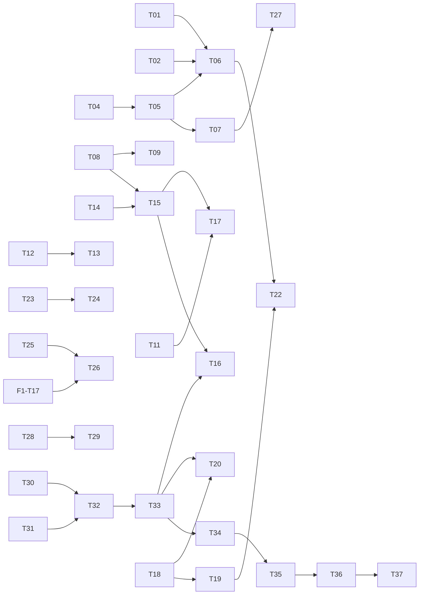

# F2 — Görevler

> **Yürütme notu (25.11.2026):** Bu dosya teknik görev ayrıntısıdır; **yürütme birimi değildir**. Ajan iş olarak paket alır ([yürütme planı](../../execution/README.md)). Bu aşamanın görevlerinin uygulandığı paketler: [M01](../../execution/packages/W1/M01-cekirdek-sozlesmeler.md), [M05](../../execution/packages/W1/M05-ortak-sozluk.md), [M06](../../execution/packages/W1/M06-gpu-zamanlayici.md), [M08](../../execution/packages/W1/M08-test-altyapisi.md), [F2-A](../../execution/packages/W2/F2-A-final-asr.md), [F2-B](../../execution/packages/W3/F2-B-baglamsal-duzeltme.md), [F2-C](../../execution/packages/W4/F2-C-akis-tanima.md), [G3](../../execution/stages/G3-arayuz.md), [G4](../../execution/stages/G4-sentetik-kabul.md), [G5](../../execution/stages/G5-gercek-insan-sip.md). Görev başına eşleme: [legacy-mapping.md](../../execution/legacy-mapping.md). Bu dosyadaki AIP, faz ve sprint atıfları eski plana aittir.

Her görevin bir kimliği (`F2-Txx`), sprinti (`F2-Sxx`), dosyaları, bağımlılıkları ve "bitti" tanımı vardır. Kodlama ajanı görevi almadan önce [`spec.md`](spec.md) dosyasının ilgili bölümünü okur.

**Boyut:** S = yarım gün veya daha az · M = 1–2 gün · L = 3 gün veya daha fazla

**Yol kuralı:** `backend/`, `frontend/`, `tests/`, `scripts/`, `config/`, `data/`, `contracts/`, `experimental/`, `automotive_voice/`, `asterisk/` → PoC reposu ([`FreyaTTS_Automotive_PoC`](https://github.com/seydivakkas/FreyaTTS_Automotive_PoC)). `docs/` → bu plan reposu.

**Genel kurallar:**
- Yeni hat `f2_pipeline_v2` bayrağı arkasında geliştirilir. Bayrak kapalıyken `models.transcribe` davranışı değişmez.
- Whisper modeli yeniden yüklenmez; tek örnek (`models.stt`) kullanılır.
- Ham transkript hiçbir adımda üzerine yazılmaz.
- Ağırlık ve eşik ayarı yalnızca **kalibrasyon kümesinde** yapılır; **test kümesi** ayar için kullanılmaz.
- Ölçüm gerektiren kabul maddeleri, ölçüm çalıştırılmadan işaretlenmez.

**Önerilen uygulama sırası** (planın önceliğine göre önce mapper, fonetik çözümleme ve güven; streaming sonra):

S01 → S02 → S03 → S05 → S06 → **S16'nın metin hattı ve küme ayrımı (T30, T33)** → S07 → S08 → S09 → S10 → S04 → S11 → S16'nın kalanı (T31, T32) → S17 → S12 → S13 → S14 → S15 → S18 → S19

Kalibrasyon gerektiren görevler (T16, T20) kalibrasyon/test ayrımı (T33) yapılmadan başlamaz.

---

## F2-S01 — Mevcut STT envanteri ve taban ölçümü

### F2-T01 · Taban ölçümünün yeniden üretilmesi · M
- **Dosyalar:** `scripts/acoustic_benchmark.py`, `data/f2/baseline-<tarih>.json`
- **İş:** `legacy_320_cases.json` üzerinde hotword'ler **kapalı** ve **açık** olarak iki ayrı çalıştırma. Her biri için WER, CER, terim doğruluğu (kategori bazında), STT süresi p50/p95, boş transkript oranı.
- **Bitti:** Sonuçlar `docs/00-overview/current-state.md` dosyasına kaynağıyla yazılır; %48,04 ölçümünün hangi koşulda alındığı netleşir (spec §11 soru 1).

### F2-T02 · Sıcaklık geri dönüşü ve segment filtresi analizi · S
- **Dosyalar:** `scripts/f2_decode_probe.py`
- **İş:** Aynı derlemi `temperature=0.0` ile ve varsayılan geri dönüş listesiyle çöz. Gecikme dağılımı, deterministiklik (aynı girişte aynı çıktı) ve segment filtresi yüzünden boşalan transkript sayısı raporlanır.
- **Bitti:** Rapor; spec §3.2 S4 ve S5'in etkisi sayısal olarak bilinir.

### F2-T03 · PoC karakterizasyon testleri · S
- **Dosyalar:** `tests/speech_recognition/test_poc_characterization.py`
- **İş:** spec §3.3 mapper tablosu ve §3.4 plaka gözlemleri test olarak kaydedilir (GPU gerektirmez).
- **Bitti:** Testler mevcut kodla geçer; düzeltme yapan görevler bunları yeni beklenen davranışla günceller.

## F2-S02 — ASRResult veri sözleşmesi

### F2-T04 · Sözleşmeler · M
- **Dosyalar:** `backend/speech_recognition/contracts.py`, `docs/01-architecture/interfaces.md` (F2 bölümü)
- **İş:** spec §6 JSON şeması; `ASRResult`, `Correction`, `EntityCandidate`, `Segment`, `Word`, `DecodeInfo`. JSON Schema dosyası üretilir ve testlerde doğrulanır.
- **Bitti:** Şema doğrulama testi; `null` kuralı ve `raw_transcript` zorunluluğu test edilir.

## F2-S03 — Whisper adaptörünün modülerleştirilmesi

### F2-T05 · Whisper adaptörü ve hotword token ölçümü · M
- **Dosyalar:** `backend/speech_recognition/whisper_engine.py`, `backend/models.py`
- **İş:** `models.stt` üzerinden segment metrikleri, isteğe bağlı sözcük zamanları ve olasılıkları döndüren adaptör. Hotword metninin token sayısını ölçen yardımcı; mevcut 50 kayıtlık listenin prompt bütçesini aşıp aşmadığı raporlanır.
- **Bitti:** `models.transcribe` uyumluluk sarmalayıcısı olarak çalışır; mevcut testler geçer.

### F2-T06 · Decode politikası · M
- **Dosyalar:** `backend/speech_recognition/decoder_policy.py`
- **İş:** spec §5.4 profilleri; `temperature=0.0` varsayılanı; segmentlerin atılması yerine işaretlenmesi.
- **Bitti:** Profil seçimi birim testleri; F2-T02 raporuna göre varsayılanlar gerekçelendirilir.

### F2-T07 · Inference Scheduler · M
- **Dosyalar:** `backend/speech_recognition/inference_scheduler.py`
- **İş:** spec §5.14 öncelik sınıfları, başlamamış işin iptali, başlamış işin sonucunun korunması, OOM kurtarma.
- **Bitti:** T25 ve T27 birim kısımları geçer.

## F2-S04 — Contextual Hotword Engine

### F2-T08 · Katalog dizini · M
- **Dosyalar:** `backend/speech_recognition/catalog_index.py`
- **İş:** `config/freyatts_automotive_lexicon.json` dosyasından marka, model, terim dizini; fonetik anahtarlar (F2-T16 ile); leksikon sürüm kimliği.
- **Bitti:** Dizin 151 markayı ve tüm `full_models` kayıtlarını yükler; yükleme süresi raporlanır.

### F2-T09 · Bağlamsal hotword motoru · M
- **Dosyalar:** `backend/speech_recognition/hotword_engine.py`
- **Bağımlılık:** F2-T05, F2-T08
- **İş:** spec §5.3; diyalog durumu → liste; token bütçesi; leksikon sürümüyle geçersiz kılınan önbellek; hotword bias işaretleme. Sözcük zamanlarının maliyeti de bu görevde ölçülür.
- **Bitti:** T09 ve T10 geçer.

## F2-S05 — Türkçe ASR Normalizer

### F2-T10 · Normalizer ve N-best doğrulaması · M
- **Dosyalar:** `backend/speech_recognition/turkish_normalizer.py`
- **İş:** spec §5.8; karakter aralığı eşlemesi. Ayrıca CTranslate2 alt seviye çoklu hipotez desteği bir betikle denenir ve sonuç ADR'ye yazılır (`docs/01-architecture/adr/ADR-F2-01-nbest.md`).
- **Bitti:** Normalizer birim testleri; ADR.

### F2-T11 · Ortak Türkçe sayı ayrıştırıcı · M
- **Dosyalar:** `backend/speech_recognition/turkish_normalizer.py`, `backend/turkish_plate.py`, `backend/dialogue.py`, `backend/vin_ruhsat_decoder.py`, `backend/redaction_kvkk_guard.py`
- **İş:** Dört ayrıştırıcının tek fonksiyona bağlanması; yıl, saat, kilometre, hane dizisi, plaka grubu (2–4 hane).
- **Bitti:** Eski fonksiyonların tüm testleri geçer; "on altı ka el iki bin beş yüz" → 16 KL 2500 ve "34 abc 12 3" → 34 ABC 123 çözülür.

## F2-S06 — Mevcut ASR Mapper entegrasyonu

### F2-T12 · Mapper'ın taşınması · M
- **Dosyalar:** `backend/speech_recognition/asr_mapper.py`, `experimental/asr_mapper.py` (yönlendirme), `tests/speech_recognition/test_asr_mapper.py`
- **İş:** Taşıma; `corrections` kaydı; marka ve model ayrı eşleştiğinde `detected_model` doldurulması.
- **Bitti:** "Folksvagen Passat" → Volkswagen + Passat; mevcut deneysel testler yeni konumda geçer.

### F2-T13 · Gündelik sözcük çakışması ve bağlam kapısı · M
- **Dosyalar:** `backend/speech_recognition/asr_mapper.py`, `config/` altında çakışma listesi (konum ADR ile belirlenir)
- **İş:** spec §5.9 madde 1. Leksikondaki tüm alias'lar Türkçe sözlük sıklık listesine karşı taranır; çakışanlar işaretlenir ve bağlam kapısına bağlanır.
- **Bitti:** "fiyat ne kadar", "mini bir sorun var", "seat belt" değişmeden kalır; aynı sözcükler araç bağlamında doğru eşlenir. T23 geçer.

## F2-S07 — Phonetic Entity Resolver

### F2-T14 · Türkçe fonetik kodlayıcı · M
- **Dosyalar:** `backend/speech_recognition/phonetic_encoder.py`
- **İş:** spec §5.10 kuralları; leksikonun `spoken` / `tts_2026` alanlarından anahtar üretimi.
- **Bitti:** Planın fonetik sözlük tablosundaki tüm çiftler (Pejo/Peugeot … Tog te on iks/Togg T10X) aynı veya yakın anahtara düşer.

### F2-T15 · Aday üretimi ve puanlama · L
- **Dosyalar:** `backend/speech_recognition/entity_resolver.py`
- **Bağımlılık:** F2-T08, F2-T14
- **İş:** 1–3 sözcük pencereleri, L/P/C/D bileşenleri, varlık düzeyinde N-best, aday farkı.
- **Bitti:** "Nisan kaş kay iki bin yirmi" → Nissan Qashqai 2020 (`vehicle_make_model` bağlamında); "on beş nisanda" → araç adayı yok (tarih bağlamında). T11–T14 geçer.

### F2-T16 · Ağırlık kalibrasyonu · S
- **Bağımlılık:** F2-T15, F2-T33
- **İş:** w₁…w₄ ağırlıklarının kalibrasyon kümesinde ayarlanması.
- **Bitti:** Ayar sonuçları ve seçilen ağırlıklar raporlanır; test kümesi kullanılmamıştır.

## F2-S08 — Structured Entity Extraction

### F2-T17 · Varlık çıkarıcı · L
- **Dosyalar:** `backend/speech_recognition/entity_extractor.py`
- **Bağımlılık:** F2-T11, F2-T15
- **İş:** spec §5.11 tablosu; karakter aralıkları; `extract_phone_number`'ın taşınması.
- **Bitti:** T15–T19 geçer; `dialogue.py` yeni ortak bileşeni çağırır ve mevcut testleri geçer.

## F2-S09 — Confidence ve Clarification Gate

### F2-T18 · Güven özellikleri · M
- **Dosyalar:** `backend/speech_recognition/confidence.py`
- **İş:** spec §5.6 özellik tablosu; `confidence: null` kuralı.
- **Bitti:** Her `ASRResult` tüm özellikleri (ölçülemeyenler `null`) taşır.

### F2-T19 · Belirsizlik kapısı (kural tabanlı) · M
- **Dosyalar:** `backend/speech_recognition/clarification_gate.py`
- **İş:** spec §5.12; `decision_basis: "rules"`; `RE_DECODE` hakkı (utterance başına 1).
- **Bitti:** T22 geçer; teyit oranı raporlanır.

### F2-T20 · Güven kalibrasyonu · M
- **Bağımlılık:** F2-T18, F2-T33
- **İş:** İzotonik veya Platt kalibrasyonu; ECE raporu; eşiklerin kalibrasyon kümesinde belirlenmesi. Kalibre skor yalnızca bu görevden sonra `confidence` alanına yazılır.
- **Bitti:** K16 ölçülür; kapı `decision_basis: "calibrated"` moduna geçebilir.

## F2-S10 — Hallucination Guard

### F2-T21 · Çok aşamalı koruma · M
- **Dosyalar:** `backend/speech_recognition/hallucination_guard.py`
- **İş:** spec §5.7 tablosu; bilinen Türkçe kalıplar; doğal tekrarın korunması; yankı benzerliği.
- **Bitti:** T20 ve T21 geçer; negatif örneklerde hallucination ≤ %1.

## F2-S11 — Adaptive Beam Search

### F2-T22 · Profil seçimi ve RECOVERY · M
- **Dosyalar:** `backend/speech_recognition/decoder_policy.py`
- **Bağımlılık:** F2-T06, F2-T19
- **İş:** `expected_slot` → profil; `RE_DECODE` ile `RECOVERY` profilinde ikinci çözümleme.
- **Bitti:** A5 deneyi profil bazında gecikme ve doğruluk tablosu üretir.

## F2-S12 — Pseudo-Streaming ASR

### F2-T23 · Kayan pencere · M
- **Dosyalar:** `backend/speech_recognition/audio_window.py`, `streaming_asr.py`
- **İş:** spec §5.2; `event` / `interval` / `off` modları; oturum başına tek bekleyen görev.
- **Bitti:** T07 geçer.

### F2-T24 · Kısmi çözümleme maliyet ölçümü · S
- **Dosyalar:** `scripts/f2_partial_cost.py`
- **İş:** 1, 2, 3 ve 5 s pencerelerde tek çözümleme süresi (kodlayıcı ve çözücü ayrı, mümkünse); TTS eşzamanlıyken STT ve TTS gecikmesi.
- **Bitti:** spec §3.5'teki çıkarım doğrulanır veya düzeltilir; varsayılan mod seçimi rapora dayanır.

## F2-S13 — Partial Transcript ve F1 entegrasyonu

### F2-T25 · Partial Transcript Manager · M
- **Dosyalar:** `backend/speech_recognition/partial_transcript.py`
- **İş:** spec §5.5 üç seviye; kararlı önek; revizyon oranı metriği.
- **Bitti:** T06 geçer.

### F2-T26 · F1.07 bağlantısı · M
- **Bağımlılık:** F2-T25, F1-T17
- **İş:** F1'in spekülatif STT köprüsünün F2 `event` moduna bağlanması; yalnızca `FINAL` sonucun F3'e işlem olarak gitmesi.
- **Bitti:** T26 geçer; F3'e `status != final` ile işlem başlatılamadığı entegrasyon testiyle doğrulanır.

## F2-S14 — STT GPU Scheduler

### F2-T27 · Ortak GPU yöneticisiyle entegrasyon · M
- **Bağımlılık:** F2-T07; ortak katman GPU Resource Manager
- **İş:** Öncelik sınıflarının ortak yöneticiye bağlanması; yük altında kısmi çözümlemenin azaltılması; VRAM izleme.
- **Bitti:** T25, T27, T28 geçer.

## F2-S15 — Speech Recognition Studio arayüzü

### F2-T28 · API · M
- **Dosyalar:** `backend/routers/f2.py`
- **İş:** Yapılandırma, oturum transkript geçmişi, `POST /api/f2/lab/run` (ses veya metin girdisi; metin girdisi Whisper'ı atlar), resolver aday sorgusu, hotword listesi görüntüleme.
- **Bitti:** API testleri.

### F2-T29 · Ana sayfa ve alt sayfalar · L
- **Dosyalar:** `frontend/src/SpeechStudioPanel.tsx` ve alt sayfa bileşenleri
- **Bağımlılık:** F2-T28
- **İş:** spec §7.
- **Bitti:** Gerçek backend'e bağlı; dürüstlük kuralı sağlanıyor; Error Analysis yanlış düzeltmeleri listeliyor.

## F2-S16 — Sentetik veri kümesi ve benchmark

### F2-T30 · Metin hattı veri kümesi · M
- **Dosyalar:** `data/f2/text_set/`, `scripts/f2_build_text_set.py`
- **İş:** 1 000 örneklik dağılımın metin karşılıkları; gerçekçi ASR hatası enjeksiyonu (bölünmüş sözcük, Türkçeleştirilmiş yazım, harf düşmesi); gündelik sözcük çakışması alt kümesi (≥ 50).
- **Bitti:** Kalibrasyon ve test bölümleri ayrı dosyalarda.

### F2-T31 · Akustik sentetik veri kümesi · L
- **Dosyalar:** `data/f2/acoustic_set/`, `scripts/f2_build_acoustic_set.py`
- **Bağımlılık:** F0-T03 (gürültü karışımları)
- **İş:** FreyaTTS ile farklı seed, hız ve gürültü seviyelerinde ses; 8 kHz telefon dönüşümü; manifest. GPU'da çevrimdışı üretilir ve önbelleğe alınır.
- **Bitti:** Manifest her örnek için metin, varlık etiketleri, ses parametrelerini içerir.

### F2-T32 · Benchmark aracı · M
- **Dosyalar:** `backend/speech_recognition/benchmark.py`, `metrics.py`, `scripts/f2_benchmark.py`
- **İş:** Üç test hattı; WER, CER, varlık türü bazında doğruluk, yanlış düzeltme oranı, ham ve düzeltme sonrası WER ayrımı.
- **Bitti:** `legacy_320_cases.json` sonuçları F2-T01 ile tutarlı.

### F2-T33 · Kalibrasyon / test ayrımı · S
- **İş:** Kalibrasyon ve test kümelerinin dondurulması (hash ile).
- **Bitti:** Ayar betikleri test kümesine erişirse hata verir.

## F2-S17 — Ablation deneyleri

### F2-T34 · A0–A7 · L
- **Bağımlılık:** F2-T32 ve ilgili bileşenler
- **İş:** spec §8.4; aynı veri ve donanım; sonuç tablosu.
- **Bitti:** `data/f2/ablation-<tarih>.json` ve `docs/stages/F2-speech-recognition/ablation-results.md` (yalnızca ölçülmüş değerler).

## F2-S18 — F0–F6 regresyon testleri

### F2-T35 · Uçtan uca regresyon · M
- **İş:** Mevcut test paketi, sentetik AudioSocket çağrıları ve tur gecikmeleri `f2_pipeline_v2` açık ve kapalı.
- **Bitti:** Mevcut testler kırılmaz; gecikme ve doğruluk farkı raporlanır. Koşullar sağlanırsa bayrak varsayılanı `True` yapılır.

## F2-S19 — Gerçek insan sesi ve SIP kabulü

### F2-T36 · İnsan sesi kayıt protokolü · M
- **Dosyalar:** `docs/testing/f2-field-protocol.md`
- **İş:** Farklı konuşmacılar, Türkçe ağızlar, yabancı marka telaffuzları (Qashqai, Peugeot, Citroën, Volkswagen, Hyundai, Škoda…), araç içi ortamlar, gerçek telefon hatları. Onay ve KVKK.
- **Bitti:** Protokol ve etiketleme kılavuzu.

### F2-T37 · Kabul değerlendirmesi · M
- **Bağımlılık:** F2-T36
- **Bitti:** `acceptance.md` AŞAMA 4 tablosu ölçülmüş değerlerle dolar.

---

## Bağımlılık özeti

