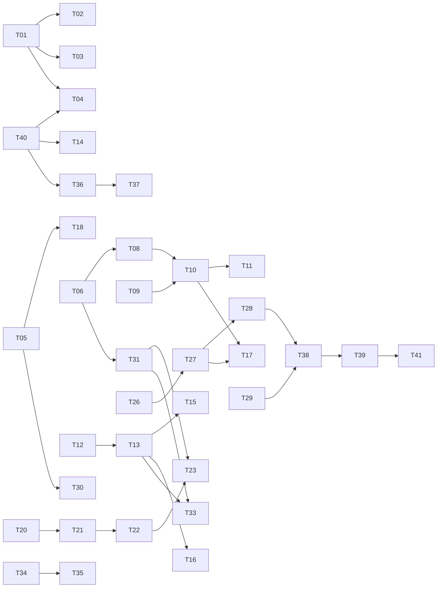

# F3 — Görevler

> **Yürütme notu (25.11.2026):** Bu dosya teknik görev ayrıntısıdır; **yürütme birimi değildir**. Ajan iş olarak paket alır ([yürütme planı](../../execution/README.md)). Bu aşamanın görevlerinin uygulandığı paketler: [H01](../../execution/packages/W0/H01-guvenli-zemin.md), [M01](../../execution/packages/W1/M01-cekirdek-sozlesmeler.md), [M07](../../execution/packages/W1/M07-guvenlik-politika.md), [M08](../../execution/packages/W1/M08-test-altyapisi.md), [F3-A](../../execution/packages/W2/F3-A-diyalog-durumu.md), [F3-B](../../execution/packages/W3/F3-B-yonlendirme-onay.md), [F3-C](../../execution/packages/W4/F3-C-coklu-niyet-rag.md), [G3](../../execution/stages/G3-arayuz.md), [G4](../../execution/stages/G4-sentetik-kabul.md), [G5](../../execution/stages/G5-gercek-insan-sip.md). Görev başına eşleme: [legacy-mapping.md](../../execution/legacy-mapping.md). Bu dosyadaki AIP, faz ve sprint atıfları eski plana aittir.

Her görevin bir kimliği (`F3-Txx`), sprinti (`F3-Sxx`), dosyaları, bağımlılıkları ve "bitti" tanımı vardır. Kodlama ajanı görevi almadan önce [`spec.md`](spec.md) dosyasının ilgili bölümünü okur.

**Boyut:** S = yarım gün veya daha az · M = 1–2 gün · L = 3 gün veya daha fazla

**Yol kuralı:** `backend/`, `frontend/`, `tests/`, `scripts/`, `config/`, `data/`, `contracts/`, `experimental/`, `automotive_voice/`, `asterisk/` → PoC reposu ([`FreyaTTS_Automotive_PoC`](https://github.com/seydivakkas/FreyaTTS_Automotive_PoC)). `docs/` → bu plan reposu.

**Genel kurallar:**
- Supervisor geçişi spec §6'daki sırayı izler; `supervisor_mode` varsayılanı her geçiş kapısı geçilmeden değişmez.
- `dialogue.py` içindeki fonksiyonlar silinmez; iş akışına taşınan her parça için legacy adaptör aynı sonucu verdiğini regresyon testiyle kanıtlar.
- **Güvenlik düzeltmeleri bayraktan bağımsızdır:** F3-T05 (kimlik doğrulamasız özel kayıt paylaşımı) ve F3-T03 (çoklu araç idempotency) legacy yolda da uygulanır.
- LLM hiçbir görevde yazma yetkisi üretemez.
- Ölçüm gerektiren kabul maddeleri ölçülmeden işaretlenmez.

---

## F3-S01 — Supervisor ve Dialogue envanteri

### F3-T01 · Hermetik test altyapısı (LLM fake) · M
- **Dosyalar:** `tests/fakes/fake_llm.py`, `tests/conftest.py`, `backend/sft_leyla.py`, `backend/routers/text_speech.py`
- **İş:** `models.chat` yerine senaryo bazında JSON döndüren sahte; canlı Ollama gerektiren testlerin (ör. `test_multi_vehicle_preplanned_booking`) fake'e geçirilmesi; gerçek LLM testleri için `llm`, GPU testleri için `gpu`, Asterisk testleri için `pbx` işareti. **Ek (genel belgeler hazırlanırken bulundu — X8):** `sft_leyla.py` modül düzeyinde `import torch` yaptığı için `backend.main`'i içe aktaran 43 test dosyası torch olmadan toplanamıyor; torch içe aktarması fonksiyon içine taşınır (tembel), router yalnızca SFT uçları çağrıldığında yükler.
- **Bitti:** `pytest -m "not llm and not gpu and not pbx"` torch, CUDA ve Ollama kurulu olmayan bir ortamda toplama hatası olmadan tamamen geçer.

### F3-T02 · Karakterizasyon testleri · M
- **Dosyalar:** `tests/supervisor/test_poc_characterization.py`
- **Bağımlılık:** F3-T01
- **İş:** spec §3.3 yönlendirme tablosu; P1 (yazma `unavailable`); P2 (zaman aşımında makbuz sorgusu yok); P4 (garanti/bakım yanıtı yalnızca arayan numarasıyla) davranışları test olarak kaydedilir.
- **Bitti:** Testler mevcut kodla geçer; düzeltme görevleri bunları yeni beklenen davranışla günceller.

### F3-T03 · Çoklu araç idempotency doğrulaması ve düzeltmesi (hata düzeltmesi) · S
- **Dosyalar:** `backend/dialogue.py`, `tests/test_madde3_customer_experience.py`
- **Bağımlılık:** F3-T01
- **İş:** Önce mevcut testi ikinci aracın onayına kadar uzatarak P7'yi doğrula. Hata doğrulanırsa her araç işlemine ayrı idempotency anahtarı ver.
- **Bitti:** İki araçlı senaryoda iki randevu da oluşur; aynı onayın tekrarı ikinci kayıt üretmez.

### F3-T04 · Legacy taban ölçümü (A0) · M
- **Bağımlılık:** F3-T40 (senaryo kümesinin ilk sürümü), F3-T01
- **İş:** 2 000 senaryo üzerinde legacy `Dialogue`: niyet doğruluğu, görev başarısı, LLM çağrı sayısı, tur gecikmesi (yol bazında), hatalı işlem.
- **Bitti:** `data/f3/baseline-a0-<tarih>.json`; özet `docs/00-overview/current-state.md` dosyasına.

### F3-T05 · Kimlik doğrulamasız özel kayıt paylaşımının kapatılması (güvenlik düzeltmesi) · M
- **Dosyalar:** `backend/dialogue.py`, `backend/caller_memory.py`, `docs/01-architecture/adr/ADR-F3-01-customer-verification.md`
- **İş:** Garanti ve geçmiş bakım yanıtlarının doğrulama iş akışına bağlanması; ikinci etkenin ADR ile seçilmesi; arama başında otomatik profil oluşturmanın kaldırılması (P5). **ADR kararı verilene kadar güvenli varsayılan:** ikinci etken yoksa özel kayıt içeriği söylenmez, müşteriye operatöre aktarım veya şubeye başvuru önerilir. Bu varsayılan ilk PR'da canlıya alınır; ikinci etken ADR sonrası eklenir.
- **Bitti:** T19 geçer; doğrulanmamış arayana özel kayıt içeriği hiçbir yoldan söylenmez.

## F3-S02 — F2–F3–F4 veri sözleşmeleri

### F3-T06 · Sözleşmeler · M
- **Dosyalar:** `backend/supervisor/contracts.py`, `docs/01-architecture/interfaces.md` (F3 bölümü)
- **İş:** F2 `ASRResult` girişi; `TurnContext` (F1 ile ortak); `ResponsePlan`, `ResponseSegment`, `SemanticTag` (F4'e); katalog `intent-v2`.
- **Bitti:** JSON Schema doğrulama testleri; T30 birim kısmı.

## F3-S03 — Context Manager ve Slot Manager

### F3-T07 · Context Manager · M
- **Dosyalar:** `backend/supervisor/context_manager.py`
- **İş:** spec §5.1: final kontrolü, turn ID, minimum bağlam (P6).
- **Bitti:** Eski turn ID ve `status != final` girdileri reddedilir ve kaydedilir.

### F3-T08 · Slot Manager · M
- **Dosyalar:** `backend/supervisor/slot_manager.py`
- **Bağımlılık:** F3-T06
- **İş:** `missing → candidate → confirmed → verified` durumları; kritik slot teyit kuralı; F2 kararına göre davranış.
- **Bitti:** Slot geçiş birim testleri; mevcut `contracts.Slot` doğrulayıcısı korunur.

## F3-S04 — Dialogue State Machine refactoring

### F3-T09 · BookingStateMachine genişletmesi · M
- **Dosyalar:** `automotive_voice/dialogue/booking_state.py`, `automotive_voice/dialogue/models.py`
- **İş:** spec §5.5 durumları; eski durumların eşlenmesi; düzeltme/iptal/zaman aşımı/hata geçişleri.
- **Bitti:** Geçiş tablosu testleri; `tests/milestones/test_m03_contracts.py` geçer.

### F3-T10 · İş akışı modülleri · L
- **Dosyalar:** `backend/supervisor/workflows/booking_create.py`, `booking_cancel.py`, `booking_reschedule.py`, `customer_verification.py`, `operator_transfer.py`
- **Bağımlılık:** F3-T08, F3-T09
- **İş:** `Dialogue.answer()` mantığının iş akışlarına taşınması.
- **Bitti:** Her iş akışı için legacy adaptör eşdeğerlik testi (aynı girdi → aynı yanıt ve DB durumu).

### F3-T11 · LegacyDialogueAdapter · M
- **Dosyalar:** `backend/dialogue.py`
- **Bağımlılık:** F3-T10
- **İş:** `Dialogue` sınıfının dış arayüzünü koruyarak iş akışlarını çağırması.
- **Bitti:** spec §9'daki mevcut testlerin tamamı geçer.

## F3-S05 — Hybrid Intent Router

### F3-T12 · Katman 0 ve kural kapsamı · M
- **Dosyalar:** `backend/supervisor/intent_router.py`, `backend/supervisor/policy.py`
- **İş:** Aktif iş akışı yönlendirmesi (onay, seçim, beklenen slot, DTMF); §3.3'te kaçan kalıplar (erteleme, parça).
- **Bitti:** spec §3.3 tablosunun tüm satırları beklenen sonucu verir.

### F3-T13 · Katman 2–4 entegrasyonu · M
- **Bağımlılık:** F3-T12
- **İş:** `ApprovedRanker`, bağlamsal sınıflandırma, `local_proposal`; Policy Validation.
- **Bitti:** T01, T03, T04, T23 geçer; kural yönlendirme p95 ≤ 50 ms, sınıflandırıcı p95 ≤ 100 ms ölçülür.

### F3-T14 · Sınıflandırıcı eğitimi · M
- **Dosyalar:** `backend/supervisor/train.py`, `synthetic.py`
- **Bağımlılık:** F3-T40
- **İş:** Eğitim kümesinde eğitim, SHA-256 manifesti, eşikler; test kümesinde değerlendirme.
- **Bitti:** Onaylı model dosyası ve değerlendirme raporu.

## F3-S06 — Multi-Intent Detection

### F3-T15 · Çoklu niyet ve görev ayrıştırma · M
- **Bağımlılık:** F3-T13
- **İş:** En fazla 3 niyet; görevlerin ajanlara bölünmesi; güvenlik önceliği.
- **Bitti:** T02 geçer; Multi-Intent F1 ölçülür.

## F3-S07 — Supervisor Task Planner

### F3-T16 · Görev planlayıcı ve zaman aşımları · M
- **Dosyalar:** `backend/supervisor/task_scheduler.py`, `orchestrator.py`
- **İş:** Salt okunur paralel görevler, sıralı yazma, görev başına zaman aşımı, kısmi sonuçla dürüst yanıt.
- **Bitti:** Paralel okuma ve sıralı yazma testleri; zaman aşımında uydurma sonuç yok.

## F3-S08 — Service & Booking Agent

### F3-T17 · A01 · L
- **Dosyalar:** `backend/supervisor/agents/service_booking.py`
- **Bağımlılık:** F3-T10, F3-T27
- **Bitti:** T06, T07, T09, T10, T15 geçer.

## F3-S09 — Customer & CRM Agent

### F3-T18 · A04 · M
- **Dosyalar:** `backend/supervisor/agents/customer_crm.py`
- **Bağımlılık:** F3-T05, F3-T27
- **Bitti:** T19 geçer; şikâyet kaydı onaylı yazma ile oluşur.

## F3-S10 — Workshop Operations Agent

### F3-T19 · A05 · M
- **Dosyalar:** `backend/supervisor/agents/workshop_operations.py`, `tools/workshop_tools.py`
- **İş:** Mevcut lift ve kuyruk modüllerinin salt okunur araç olarak sarılması. Ajanın müşteriyle konuşup konuşmayacağı spec §11 soru 3'e göre belirlenir.
- **Bitti:** Kapasite bilgisi A01'in seçenek sunumunda kullanılabilir.

## F3-S11 — Automotive RAG Engine

### F3-T20 · Belge kaynağı ve lisans kaydı · S
- **Dosyalar:** `docs/stages/F3-dialogue-intelligence/rag-sources.md`
- **İş:** Kullanılacak belgelerin listesi, kaynak ve kullanım hakkı.
- **Bitti:** Lisansı doğrulanmamış belge ingestion'a alınmaz.

### F3-T21 · Ingestion ve indeksler · L
- **Dosyalar:** `backend/supervisor/rag/ingestion.py`, `chunking.py`, `bm25_index.py`, `embeddings.py`, `vector_index.py`
- **Bağımlılık:** F3-T20
- **İş:** PDF → metin → chunk → metadata (marka, model, yıl, motor, kaynak, lisans, tarih); BM25; CPU gömme; FAISS.
- **Bitti:** İndeks oluşturma betiği; gömme gecikmesi CPU'da ölçülür.

### F3-T22 · Hibrit arama ve kanıt doğrulama · M
- **Dosyalar:** `backend/supervisor/rag/hybrid_retriever.py`, `evidence_validator.py`
- **İş:** RRF, metadata filtreleri, güncellik ve çelişki kontrolü.
- **Bitti:** T17 ve T18 geçer.

## F3-S12 — Technical Knowledge Agent

### F3-T23 · A02 · M
- **Dosyalar:** `backend/supervisor/agents/technical_knowledge.py`
- **Bağımlılık:** F3-T22, F3-T31
- **İş:** Kaynağa dayalı yanıt; kaynak yoksa kesin teşhis yok; acil durum işaretleri Policy'ye.
- **Bitti:** RAG grounding ölçülür (K07).

## F3-S13 — Sales & Parts Agent

### F3-T24 · A03 · M
- **Dosyalar:** `backend/supervisor/agents/sales_parts.py`, `tools/vehicle_tools.py`
- **İş:** Katalog araması (F2 `catalog_index`), parça uyumluluğu; fiyat ve stok yalnızca DB'den.
- **Bitti:** Katalog dışı araç ve fiyatı bulunmayan ürün senaryoları dürüst yanıtlanır.

## F3-S14 — Human Handoff Agent

### F3-T25 · A06 · M
- **Dosyalar:** `backend/supervisor/agents/human_handoff.py`, `tools/telephony_tools.py`
- **İş:** AMI gerçek/değil ayrımı; görüşme özeti (mevcut `get_transfer_summary`); geri arama kuyruğu; kanal bazında yanıt (P9).
- **Bitti:** T26 geçer.

## F3-S15 — Tool Gateway ve işlem araçları

### F3-T26 · Araç kayıt defteri ve izinler · M
- **Dosyalar:** `backend/supervisor/gateway.py`, `tools/*.py`
- **İş:** spec §5.7 araç tablosu; araç başına Pydantic şeması ve ajan izni; okuma araçlarının da Gateway'den geçmesi.
- **Bitti:** İzinsiz araç çağrısı `denied` döner ve kaydedilir.

### F3-T27 · Yazma araçları ve reconcile · L
- **Dosyalar:** `backend/supervisor/gateway.py`, `tools/appointment_tools.py`, `crm_tools.py`
- **Bağımlılık:** F3-T26
- **İş:** `create/reschedule/cancel_appointment`, `create_complaint` araçlarının mevcut fonksiyonları sarması; `reconcile(idempotency_key)`.
- **Bitti:** T11, T12, T25 geçer.

## F3-S16 — Confirmation ve Policy Engine

### F3-T28 · Confirmation Manager · M
- **Dosyalar:** `backend/supervisor/confirmation_manager.py`
- **Bağımlılık:** F3-T08, F3-T27
- **İş:** Digest'e bağlı onay; slot değişince geçersizlik; `ConfirmedWrite` üretimi (tek üretici); açık onay kuralları.
- **Bitti:** T08 ve T13 geçer.

### F3-T29 · Policy Engine'in merkezileştirilmesi · M
- **Dosyalar:** `backend/supervisor/policy.py`
- **İş:** spec §5.6 tablosunun tamamı; dağınık iş kurallarının taşınması.
- **Bitti:** Tablonun her satırı için en az bir test; T14, T15, T20, T21, T26, T27 geçer.

## F3-S17 — Memory ve veri saklama politikaları

### F3-T30 · Hafıza düzeyleri ve saklama · M
- **Dosyalar:** `backend/supervisor/memory/*.py`
- **Bağımlılık:** F3-T05
- **İş:** M1–M4; saklama süreleri; KVKK modülleriyle entegrasyon.
- **Bitti:** T32 geçer; saklama süreleri `docs/` altında belgelenir.

## F3-S18 — Response Validator

### F3-T31 · Composer ve Validator · L
- **Dosyalar:** `backend/supervisor/response_composer.py`, `response_validator.py`
- **Bağımlılık:** F3-T06
- **İş:** Şablon öncelikli yanıt; KNOWLEDGE yolunda cümle bazında doğrulama ve akış; işlem sonucu doğrulaması; anlamsal etiketler; `TurnContext` üretimi.
- **Bitti:** "Oluşturuldu/aktarıldı/SMS gönderildi" cümleleri yalnızca doğrulanmış sonuçla üretilir (T26, T27); `ResponsePlan` şemaya uyar.

## F3-S19 — Quality Evaluation

### F3-T32 · Değerlendiriciler · M
- **Dosyalar:** `backend/supervisor/evaluation/*.py`, `quality.py`
- **İş:** spec §5.11 denetleyicileri; Gateway'de araç izni olmaması; eğitim adayı akışı.
- **Bitti:** Değerlendirme raporu ablation'da kullanılır.

## F3-S20 — LLM ve GPU optimizasyonu

### F3-T33 · Yol bazında gecikme ve LLM azaltma · M
- **Bağımlılık:** F3-T13, F3-T31
- **İş:** FAST/STANDARD yollarında LLM'siz yanıt; bağlam kırpma; zaman aşımları; bekleme cümlesi (öneri); ortak GPU yöneticisi öncelikleri.
- **Bitti:** LLM dışı basit tur p95 ≤ 300 ms; LLM çağrı oranı A0'a göre raporlanır.

## F3-S21 — Dialogue Intelligence Studio

### F3-T34 · API · M
- **Dosyalar:** `backend/routers/f3.py` (mevcut `supervisor/views.py` genişletilir)
- **Bitti:** Simülatör, durum, araç çağrıları, makbuzlar, RAG arama uç noktaları.

### F3-T35 · Arayüz · L
- **Dosyalar:** `frontend/src/IntelligenceCenterPanel.tsx` ve alt sayfalar
- **Bağımlılık:** F3-T34
- **Bitti:** spec §7; gerçek backend; dürüstlük kuralı.

## F3-S22 — Sentetik test laboratuvarı

### F3-T40 · 2 000 senaryoluk küme · L
- **Dosyalar:** `data/f3/scenarios/`, `scripts/f3_build_scenarios.py`
- **İş:** spec §8 dağılımı; çok turlu senaryolar; beklenen niyet/slot/araç/son durum ve **yasak eylemler**; eğitim ve test bölümleri. Erken sürümü F3-T04 için gerekir.
- **Bitti:** Manifest ve bölüm hash'leri.

### F3-T36 · T01–T32 testleri · L
- **Dosyalar:** `tests/supervisor/lab/test_t01_*.py` … `test_t32_*.py`
- **Bitti:** Testler çalışır; sonuçlar `data/f3/lab-report-*.json`.

### F3-T37 · Ablation A0–A8 · L
- **Bağımlılık:** F3-T36
- **Bitti:** `docs/stages/F3-dialogue-intelligence/ablation-results.md` (yalnızca ölçülmüş değerler).

## F3-S23 — Shadow ve Guarded kabul testleri

### F3-T38 · Shadow'un tüm kanallara açılması ve karşılaştırma · M
- **Dosyalar:** `backend/session.py`, `backend/supervisor/runtime.py`
- **İş:** `WebSupervisor` → `SupervisorRuntime`; telefon ve outbound kanalları; shadow kararlarının yanıt yolunu bloklamaması; legacy/shadow karşılaştırma raporu.
- **Bitti:** T28 ve T29 geçer; spec §6 aşama 2–4 kapıları belgelenir.

## F3-S24 — F0–F6 regresyon testleri

### F3-T39 · Uçtan uca regresyon · M
- **Bitti:** Mevcut test paketi, sentetik AudioSocket çağrıları ve tur gecikmeleri; T31 eşzamanlı görüşmeler.

## F3-S25 — Gerçek insan sesi ve SIP kabulü

### F3-T41 · Gerçek görüşme kabulü · M
- **Dosyalar:** `docs/testing/f3-field-protocol.md`
- **İş:** spec §6 aşama 5; onay ve KVKK.
- **Bitti:** `acceptance.md` AŞAMA 4 tablosu dolar.

---

## Bağımlılık özeti

