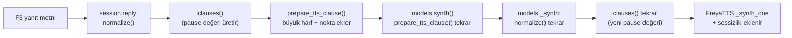
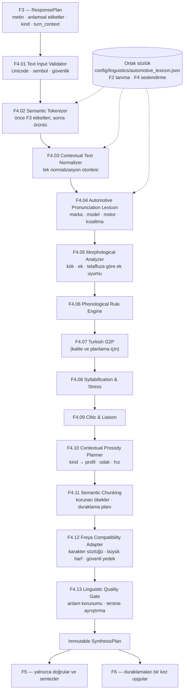

# F4 — Turkish Linguistic Frontend & Prosody Intelligence (Türkçe Dilbilimsel Ön İşleme ve Prozodi)

| Alan | Değer |
| --- | --- |
| Aşama | F4 — yanıt metnini sentez planına dönüştüren dilbilim katmanı |
| Yol haritası modülleri | AP06 Turkish Linguistic Frontend · AP07 Prosody & Audio Stitching (planlama kısmı) |
| Girdi | F3'ten `ResponsePlan` (doğrulanmış metin + anlamsal etiketler + `kind` + `turn_context`) |
| Çıktı | Değişmez `SynthesisPlan` → **F5** (model metni, cümlecikler, prozodi hedefleri) · duraklama planı → **F6** |
| Kod | [`FreyaTTS_Automotive_PoC`](https://github.com/seydivakkas/FreyaTTS_Automotive_PoC) reposunda `backend/linguistic_frontend/` (yeni) + `backend/morphology/` (korunur) + `config/linguistics/` |
| GPU bütçesi | **0 MB** — F4 tamamen CPU'da, kural tabanlı |
| İlgili belgeler | [`tasks.md`](tasks.md) · [`acceptance.md`](acceptance.md) · [`../F3-dialogue-intelligence/spec.md`](../F3-dialogue-intelligence/spec.md) §5.10 · [`../F2-speech-recognition/spec.md`](../F2-speech-recognition/spec.md) §5.8 |

> **Yol kuralı:** `backend/`, `frontend/`, `tests/`, `scripts/`, `config/`, `data/`, `contracts/`, `experimental/`, `automotive_voice/`, `asterisk/` ile başlayan yollar **PoC reposundadır**. `docs/` ile başlayan yollar **bu plan reposundadır**.

---

## 1. Amaç

F3 hangi cevabın verileceğini belirler. F4 bu cevabın Türkçede şu açılardan nasıl seslendirileceğini planlar:
- Nasıl telaffuz edileceği
- Nerede vurgulanacağı
- Nasıl bölüneceği
- Hangi tonlamayla okunacağı

Yabancı otomotiv marka ve modellerinin Türkçe cümle içinde doğru seslendirilmesi, sayıların okunması, ek uyumu ve doğal konuşma ritmi bu katmanda çözülür.

**F4 önceliği:** Önce tekrarlı normalizasyonu ortadan kaldırmak, mevcut morfoloji bileşenlerini canlı hatta bağlamak ve tek bir değişmez sentez planı oluşturmak. Türkçe fonetik ve prozodi özellikleri bundan sonra genişletilir.

**Değişmez kurallar:**
1. **F4 tek normalizasyon otoritesidir.** F5 metni dönüştürmez, yalnızca doğrular.
2. **Her duraklama tek kez ve tek yerde (F6) uygulanır.**
3. Bir yanıt, tek bir karakter yüzünden **hiçbir zaman tamamen sessiz kalmaz** (§3.2 L5).
4. Prozodi hedefi (hız, vurgu) ile modelin bu hedefi gerçekleştirmesi ayrı başarı kriterleridir. Gerçekleşme ölçülmeden `verified` işaretlenmez.

## 2. Kapsam

**Kapsamda:**
- Metin girdisi doğrulama
- Anlamsal parçalama (semantic tokenization)
- Bağlama duyarlı normalizasyon
- Otomotiv telaffuz sözlüğü
- Morfoloji, fonolojik kurallar, G2P
- Heceleme, vurgu, clitic ve ulama analizi
- Prozodi planlama
- Anlamsal cümlecik bölümleme
- Model uyumluluk adaptörü
- Dilbilimsel kalite kapısı
- Turkish Linguistic Studio
- 3 000 örneklik dilbilimsel test kümesi

**Kapsam dışı:**
- Model çıkarımı, ses kimliği, seed yönetimi → F5
- Duraklamanın sese uygulanması, WSOLA, crossfade, telefon EQ → F6
- Tanıma yönündeki sözlük kullanımı (söylenen → kanonik) → F2. **Aynı sözlük kaynağı** paylaşılır.

## 3. PoC'taki mevcut durum (doğrulanmış)

Bu bölüm kod okumasıyla ve PoC'un canlı normalizasyon fonksiyonlarının (`backend/text.py`) planın örnekleriyle doğrudan çalıştırılmasıyla hazırlandı.

### 3.1 Canlı sentez yolu



Toplu (batched) sentez yolu da (`backend/batched_ode.py`) kendi `normalize` / `clauses` / `prepare_tts_clause` çağrılarını yapıyor.

### 3.2 Bulgular

| # | Bulgu | Kanıt | Etki |
| --- | --- | --- | --- |
| L1 | **Normalizasyon ve bölümleme iki kez uygulanıyor** | §3.1 akışı | Denenen örneklerde `normalize` iki geçişte aynı sonucu verdi (idempotent görünüyor). Asıl sorun ikinci bölümleme ve noktalama ekleme (L2) |
| L2 | **Duraklama planı atılıyor, cümle ortasındaki parçalar cümle sonu gibi okunuyor** | `session.reply` içinde `for raw_part, pause in clause_list` döngüsünde `pause` kullanılmıyor. Uzun cümle bölündüğünde ara parça 0,08 s duraklama almalıyken `prepare_tts_clause` sonuna **nokta** ekliyor, ikinci `clauses()` çağrısı 0,28 s veriyor. Örnek: "…Pejo üç bin sekiz aracınız için yarın." / "Saat on dört otuzda … tutarında." / "Standart ekspertiz…" | Cümle ortasında düşen tonlama ve 280 ms duraklama. Ayrıca "yarın" ile "saat on dört otuz" ayrı parçalara düşüyor |
| L3 | **Sıra sayıları cümleyi bölüyor** | F3'ün seçenek listesi `f"{i + 1}. seçenek {label}."` biçiminde. Canlı yol: "Bir." / "Seçenek yirmi beş Kasım on." / "İki." / "Seçenek … on dört otuz." | Seçenek okuma, randevu akışının çekirdeği. "Bir." tek başına sentezleniyor; koddaki yorum, çok kısa parçaların modelde tekrar ürettiğini zaten belirtiyor |
| L4 | **Zengin otomotiv sözlüğü canlı TTS yolunda kullanılmıyor** | Canlı normalizer `config/lexicon.json` dosyasını okuyor: **tek kayıt** (Qashqai → kaşkay). Geri kalan telaffuzlar `normalizer_rules.py` içindeki yaklaşık 189 sabit kuraldan geliyor. Derlenmiş sözlük (`config/freyatts_automotive_lexicon.json`: 102 marka, 1 505 tam model, 1 456 tek model, 1 664 ASR alias, 201 kısaltma/terim, `tts_2026` okunuş alanı) yalnızca deneysel ASR Mapper tarafından okunuyor. Aynı 2,5 MB dosya üç kez kopyalanmış (`config/freyatts_automotive_lexicon.json`, `config/automotive_compiled_lexicon.json`, repo kökü) | Sözlükteki 1 505 tam model ifadesi canlı normalizerden geçirildi: **408'i (%27)** sözlüğün okunuş alanıyla aynı çıktı. 1 071'inde yabancı sözcükler özgün yazımıyla kaldı ("Hatchback", "All-Terrain", "Range Rover Classic"); **26'sı hata** verdi; **95'inde** rakam kaldı ("300d", "8C"). Not: Sözlüğün okunuş alanı da uzman incelemesinden geçmemiş; bu oran "doğru telaffuz oranı" değil, iki kaynağın uyumsuzluğudur |
| L5 | **Tek karakter tüm yanıtı düşürüyor** | `normalize` desteklenmeyen karakterde `ValueError` fırlatıyor: "−5 °C" (°, −), "Mégane", "Coupé" (é), "Town & Country" (&) | Yanıt hiç seslendirilmez. Model sözlüğünde (`freya_vocab.json`, 92 sembol) `&` var ama normalizer reddediyor; küçük `q`, `é`, `°` ve büyük `Ğ` yok |
| L6 | **Planın tablosuna göre normalizasyon hataları** | Doğrudan çalıştırma | Aşağıdaki tablo |
| L7 | **İki normalizer birbirinden ayrışıyor** | Canlı `text.normalize` ile `AutomotiveTextNormalizer` (SFT eğitim verisi hazırlama `sft_leyla.py` ve `routers/text_speech.py`) farklı sonuç veriyor: "61 ABC 123" → "altmış bir a be ce…" / "altmış bir ABC…"; "ABS'nin" → "ABSın" / "absın" | **Eğitim verisi ile canlı çıkarım farklı normalize ediliyor** |
| L8 | **Morfoloji bileşenleri canlı yolda değil** | `MorphologicalPreChecker`, `backend/morphology/*` (heceleme, vurgu, clitic, çekimli eşleştirici) ve `EmotionProsodyAdapter` yalnızca API router'larında (`text_speech.py`, `audio_dsp.py`) kullanılıyor | Planın "canlı hatta entegrasyonu doğrula" maddesi: entegre değil |
| L9 | **Model girdisi karakter tabanlı** | `char_to_id` sözlüğü; 92 sembol (`<FILL>`, `<UNK>` dahil); PoC çağrısı `_synth_one(part, steps=32, seed=…)` | IPA, SSML, perde/vurgu komutu desteklenmiyor (planın uyarısı doğru). Hız parametresi PoC çağrısında görünmüyor; FreyaTTS kaynak kodu repoda olmadığı için F5'te doğrulanmalı |
| L10 | **Büyük harf kuralı bir model kısıtıdır** | `prepare_tts_clause` belgesi: model büyük harfle başlamayan cümlelerde sesi kalın bölgeye (130–170 Hz) düşürüyor | Korunacak bir bilgi. Ancak noktalama ekleme kısmı L2'ye yol açıyor |
| L11 | **Kısa parça koruması eksik** | `clauses()` yalnızca virgülle biten ≤ 15 karakterlik parçayı birleştiriyor | "Bir." gibi noktayla biten kısa parçalar korunmuyor (L3) |

**L6 — Planın tablosuyla karşılaştırma** (canlı `normalize` çıktısı):

| Girdi | Canlı çıktı | Plan hedefi | Durum |
| --- | --- | --- | --- |
| 3008 adet | üç bin sekiz adet | Üç bin sekiz adet | ✓ |
| Peugeot 3008 | Pejo üç bin sekiz | Pejo üç bin sekiz | ✓ |
| 2020 model | iki bin yirmi model | İki bin yirmi model | ✓ |
| 1.6 TDI | bir nokta altı te de i | Bir nokta altı Te De İ | ✓ |
| **1,6 litre** | **bir nokta altı litre** | Bir virgül altı litre | ✗ |
| 1.250.000 TL | bir milyon iki yüz elli bin Türk lirası | aynı | ✓ |
| 150,50 TL | yüz elli lira elli kuruş | aynı | ✓ |
| 14:30 | on dört otuz | aynı | ✓ |
| 24.11.2026 | yirmi dört kasım iki bin yirmi altı | aynı | ✓ |
| %18 | yüzde on sekiz | aynı | ✓ |
| **120 km/h** | **yüz yirmi kilometre/h** | Saatte yüz yirmi kilometre | ✗ `/h` kalıyor |
| 150 HP | yüz elli beygir | aynı | ✓ |
| 61 ABC 123 | altmış bir a be ce yüz yirmi üç | aynı | ✓ |
| **2. sıra** | **iki. sıra** | İkinci sıra | ✗ (L3) |
| **−5 °C** | **Hata** | Eksi beş santigrat derece | ✗ (L5) |
| Peugeot'ya / Qashqai'nin / Volkswagen'de | Pejoya / kaşkayın / Folksvagende | aynı | ✓ |
| **ABS'nin** | **ABSın** | A Be Senin | ✗ ünlü uyumu ve kısaltma |
| **DSG'li** | **DSGli** | De Se Geli | ✗ |
| 14:30'da / 2.000 TL'ye | on dört otuzda / iki bin Türk lirasına | aynı | ✓ |
| **Togg T10X** | **Tog T10Ks** | Tog Te on iks | ✗ |
| **Hyundai i20** | **Hunday i20** | doğrulanmış varyant | ✗ rakam kalıyor |
| **EcoBoost** | **EcoBoost** | Eko Bust | ✗ |
| **Mégane** | **Hata** | Megan | ✗ (L5) |
| Kısaltmalar | "ESP" → e se pe; **"ABS", "DSG", "ADAS" olduğu gibi** | Tutarlı okunuş | ✗ tutarsız |
| Telefon | Rakam rakam, gruplama yok ("sıfır beş üç iki bir iki üç…") | Gruplu okuma | ✗ telefonda takibi zor |
| e-208 / ID.4 | e-iki yüz sekiz / ID.dört | sözlükten | ✗ |
| Planın birleşik örneği | "iki bin yirmi model Pejo üç bin sekiz için on dört otuzda iki bin beş yüz Türk lirası tutarında randevu." | aynı | ✓ |

**L12 — Üçüncü bir normalizer ve prozodi planlayıcısı milestone paketinde duruyor (genel belgeler hazırlanırken eklendi).**
`automotive_voice/nlp/normalizer.TurkishAutomotiveNormalizer` ve `automotive_voice/prosody/planner.ProsodyClausePlanner` yalnızca `backend/milestones.py` (milestone uçları) tarafından kullanılıyor; canlı yolda değiller. Doğrudan çalıştırma sonuçları:

| Girdi | Çıktı | `review_required` / uyarı |
| --- | --- | --- |
| Peugeot 3008 için 2.500 TL. | Peugeot 3008 için iki bin beş yüz Türk lirası. | Evet · `unexpanded_numeric_token` |
| Nissan Qashqai 2020 model | Nissan Qashqai iki bin yirmi model | Evet · `unsupported_freya_characters` |
| Saat 14:30, 1.6 TDI | Saat on dört otuz, bir nokta altı TDI | Hayır |
| Citroën C4 −5 °C | (değişmeden) | Evet · iki uyarı |
| 1. seçenek 25 Kasım 10.00 | (değişmeden) | Evet · `ambiguous_numeric_notation` |

Planlayıcı "Fiyat 1.250.000 TL, tamam mı?" için iki parça üretiyor: `PAUSE / 110 ms / continuation` ve `FINAL / 0 ms / question`. Çıktısı PoC'taki `contracts/tts_input.schema.json` şemasına uyuyor.

Değerlendirme: Bu modül marka/model telaffuzunu çözmüyor (onaylanmamış sözlük adayını bilinçli olarak uygulamıyor), ama iki değerli davranışı var: (1) desteklenmeyen karakterde **çökmek yerine `review_required` ve uyarı kodu döndürüyor** (L5'in çözüm modeli), (2) parça başına `break_kind` / `pause_after_ms` / `delivery_hint` taşıyor (L2'nin çözüm modeli). F4 tek normalizasyon otoritesine geçerken bu iki davranış ve `tts_input` şeması korunur; modülün kendisi ayrı bir motor olarak yaşatılmaz.

### 3.3 Korunacak mevcut bileşenler

- `normalizer_rules.py`: Para, kuruş, tarih, saat, plaka, sonek uyumu (`harmonize_suffix`), sayı okuma (`spell_tr_int`). Tablodaki doğru sonuçların kaynağı burası.
- `text.protected_atoms()` ve `LETTERS` harf okunuş tablosu.
- `prepare_tts_clause` içindeki **büyük harf kuralı** (L10).
- `backend/morphology/`: `TurkishSyllabifier`, `MorphologicalStressEngine`, `CliticLookaheadAnalyzer`, `InflectedLexiconMatcher`, `contracts.py`, `config/stress_exceptions.json`.
- `experimental/streaming_chunker_guard.py`: `AtomicTokenStreamingChunker` (LLM token akışını bölünmez öbeklere ayırır; F3 KNOWLEDGE yolu için değerli) ve `AntiDoubleNormalizationGuard`.

## 4. Hedef mimari



**İki çıktı katmanı:** Her sözcük için iki ayrı gösterim tutulur:
- `model_text`: Modele giden, telaffuz odaklı Türkçe yazım (ör. "Pejo")
- `phonetic_guide`: G2P, hece ve vurgu bilgisi; **modele gitmez**, kalite denetimi ve Studio içindir

Fonolojik kurallar `model_text`'i kontrolsüz değiştirmez (planın uyarısı).

## 5. Bileşenler

### 5.1 F4.01 — Text Input Validator (`input_validator.py`)

- Unicode NFC normalizasyonu; görünmez karakterlerin temizlenmesi.
- Tipografik işaretler: `’` → `'`, `−` → `-`, `…` → `...`.
- Uzunluk sınırları ve kontrol karakteri reddi.
- **Hiçbir karakter tüm yanıtı düşürmez** (L5). Bilinmeyen karakter F4.12'nin güvenli yedek tablosuna gider.

### 5.2 F4.02 — Semantic Tokenizer (`semantic_tokenizer.py`)

- **Önce F3'ün anlamsal etiketleri** (`ResponseSegment.tags`): F3 "bu aralık fiyat, bu plaka, bu model" diyorsa F4 tahmin etmez (planın ilkesi).
- Etiket yoksa örüntü ile tür belirlenir: `CARDINAL`, `DECIMAL`, `ORDINAL`, `CURRENCY`, `DATE`, `TIME`, `PERCENTAGE`, `SPEED`, `POWER`, `TEMPERATURE`, `UNIT`, `LICENSE_PLATE`, `PHONE`, `VEHICLE` (marka + model), `VEHICLE_MODEL`, `MODEL_YEAR`, `ENGINE_CODE`, `DTC_CODE` (P0420), `ACRONYM`, `WORD`.
- **Çok sözcüklü varlıklar tek token olur:** "Peugeot 3008", "1.6 TDI", "yarın saat 14:30".
- Belirsiz durumlar (3008 = sayı mı model mi?) bağlamla çözülür: önceki sözcük marka mı, sonraki sözcük "adet" mi, F3 etiketi var mı?

### 5.3 F4.03 — Contextual Text Normalizer (`text_normalizer.py` + alt modüller)

Tek normalizasyon otoritesidir. Mevcut `normalizer_rules.py` fonksiyonları alt modüllere taşınır:

| Modül | Türler | L6 düzeltmeleri |
| --- | --- | --- |
| `number_normalizer.py` | CARDINAL, DECIMAL, ORDINAL | "1,6" → **bir virgül altı**; "1. / 2." → **birinci / ikinci** |
| `currency_normalizer.py` | CURRENCY | Mevcut davranış korunur |
| `datetime_normalizer.py` | DATE, TIME | "9:05" → ADR ile seçilen biçim ("dokuz sıfır beş" veya "dokuzu beş geçe"); saat profili tek yerde |
| `identifier_normalizer.py` | PHONE, LICENSE_PLATE, DTC_CODE | **Telefon gruplu okunur:** "sıfır beş yüz otuz iki, yüz yirmi üç, kırk beş, altmış yedi" (grup arası kısa duraklama); plaka mevcut biçim |
| `unit_normalizer.py` | SPEED, POWER, TEMPERATURE, UNIT | "120 km/h" → **saatte yüz yirmi kilometre**; "−5 °C" → **eksi beş santigrat derece**; Nm, kW, kWh |

**F2 ile paylaşım:** Sayı okuma (değer → söz) F4'te, sayı ayrıştırma (söz → değer) F2'de (`turkish_normalizer`). İki yön **aynı tablo ve kurallardan** üretilir ve birbirinin tersi olduğu testle doğrulanır (§5.13).

### 5.4 F4.04 — Automotive Pronunciation Lexicon 2.0 (`automotive_lexicon.py`, `pronunciation_mapper.py`)

**Tek kaynak (L4 çözümü):** `config/linguistics/automotive_lexicon.json`
- Üç kopya tek dosyada birleştirilir.
- `normalizer_rules.py` içindeki sabit marka kuralları ile `config/lexicon.json` kayıtları bu dosyaya `source: "normalizer_rules"` etiketiyle taşınır.
- F2 aynı dosyanın tanıma alanlarını okur.

**Kayıt şeması:**

```json
{
  "canonical": "Nissan Qashqai",
  "category": "vehicle_model",
  "brand": "Nissan",
  "synth_text": "Nissan Kaşkay",
  "suffix_base": "kay",
  "asr_variants": ["Nisan kaşkay", "Nisan kaş kay", "Kaşkay"],
  "phonetic_guide": "kaʃ-kaj",
  "stress": null,
  "ambiguous_with_common_word": false,
  "pronunciation_source": "tts_2026",
  "review_status": "needs_expert_review",
  "acoustic_status": "not_measured",
  "lexicon_version": "2026.2"
}
```

| Alan | Kullanan | Anlamı |
| --- | --- | --- |
| `synth_text` | F4 | Modele gidecek telaffuz odaklı yazım |
| `suffix_base` | F4.05 | Ek uyumunun hesaplanacağı **okunan** son hece ("ABS" → "se", "Peugeot" → "jo") |
| `asr_variants` | F2 | Tanıma yönü |
| `ambiguous_with_common_word` | F2 | Bağlam kapısı (F2 spec §5.9) |
| `review_status` | Studio | `needs_expert_review` / `approved` / `rejected` |
| `acoustic_status` | Studio | `not_measured` / `pass` / `fail`: FreyaTTS'in gerçekten doğru okuyup okumadığı |

**Sözlük kategorileri:** markalar, araç modelleri, motor teknolojileri (TDI, TSI, BlueHDi, EcoBoost), şanzıman (DSG, CVT, EDC), donanım paketleri (GT Line, Comfortline, Highline), elektrikli araçlar (T10X, e-208, ID.4), güvenlik sistemleri (ABS, ESP, ADAS), arıza kodları (P0300, P0420), teknik birimler (Nm, kW, HP, kWh), servis terminolojisi (Tramer, şasi, rot-balans).

**Kısaltma politikası:** Her kısaltma için sözlükte açık bir okunuş bulunur (harf harf: "A Be Se", sözcük gibi: "Adas" vb.). Sözlükte olmayan büyük harfli kısaltma **varsayılan olarak harf harf** okunur ve Studio'da "sözlükte yok" uyarısı üretir. Bugünkü tutarsızlık (ESP okunuyor, ABS okunmuyor) böylece kalkar.

**Telaffuz kararı:** Üreticinin telaffuzu, Türkiye'deki yaygın kullanım ve Freya'nın akustik çıktısı birlikte değerlendirilir. `Hyundai` gibi tartışmalı kayıtlar Pronunciation A/B Lab'da karşılaştırılır.

### 5.5 F4.05 — Morphological Analyzer (`backend/morphology/` + `linguistic_frontend/pipeline.py`)

- Mevcut bileşenler (`MorphologicalPreChecker`, `TurkishSyllabifier`, `MorphologicalStressEngine`, `InflectedLexiconMatcher`, `CliticLookaheadAnalyzer`) **canlı hatta bağlanır** (L8). Yeniden yazılmaz.
- **Yabancı sözcüğe gelen ekler telaffuza göre uyumlanır:** Ek, `suffix_base` üzerinden mevcut `harmonize_suffix` ile hesaplanır.

| Girdi | `suffix_base` | Çıktı |
| --- | --- | --- |
| Peugeot'ya | jo | Pejoya |
| Qashqai'nin | kay | Kaşkayın |
| Volkswagen'de | gen | Folksvagende |
| ABS'nin | se | A Be Senin |
| DSG'li | ge | De Se Geli |
| 14:30'da | otuz | On dört otuzda |
| 2.000 TL'ye | lira(sı) | İki bin Türk lirasına |

- Morfem ayrıştırma çıktısı (kök, yapım/çekim ekleri) `phonetic_guide`'a yazılır; `model_text`'i değiştirmez.

### 5.6 F4.06 — Phonological Rule Engine (`phonology.py`, `config/linguistics/phonology_rules.json`)

Büyük ve küçük ünlü uyumu, ünsüz yumuşaması/sertleşmesi, ünlü düşmesi, ünlü daralması, kaynaştırma, ulama.

**Kullanım alanı:**
1. Ek üretimi (F4.05)
2. Telaffuz rehberi
3. Kalite denetimi

**Mevcut yazıyı kendiliğinden değiştirmez.** F3'ün doğrulanmış Türkçe metni dilbilgisel olarak doğru kabul edilir; F4 yalnızca normalize ettiği ve sözlükten getirdiği parçalara ek uygular.

### 5.7 F4.07 — Turkish G2P Engine (`g2p_engine.py`)

- Kural tabanlı, CPU. Türkçe grafem → geniş fonetik gösterim (planın tablosu: c → /dʒ/, ç → /tʃ/, ş → /ʃ/, j → /ʒ/, ı → /ɯ/, ö → /œ/, ü → /y/, r → /ɾ/ ve varyantları). `ğ` bağlamsal: ünlü uzaması, geçiş veya kayma.
- **Model IPA desteklemediği için (L9) G2P çıktısı modele gitmez.** Kullanım alanları:
  1. Studio'daki Phoneme Studio
  2. **Yaklaşık fonem hata oranı (PER):** Freya'nın sentezlediği ses Whisper ile tanınır; hem hedef metin hem transkript G2P'den geçirilir ve fonem dizileri karşılaştırılır. Bu, gerçek fonem tanıma değildir; acceptance'ta "yaklaşık PER" olarak raporlanır
  3. Yabancı terimlerin `synth_text` önerisi için yardımcı

### 5.8 F4.08 — Syllabification & Stress (`backend/morphology/syllabifier.py`, `stress_engine.py`)

- Mevcut heceleyici korunur. Geliştirmenin odağı otomotiv terimleri, özel kelimeler ve istisnalardır.
- Vurgu motoru şunları üretir: hece yapısı, birincil vurgu adayı, istisna ve kaynağı, eklerin etkisi, cümle odağı, karşılaştırmalı/düzeltici vurgu.
- **Cümle odağı F3'ten gelir:** `ResponseSegment.kind` ve odak varlıkları (`focus_entities`). Alan F3 sözleşmesinde `ResponseSegment.focus_entities` olarak tanımlıdır (F3 spec §5.10; F4-T06 tüketir).
- Vurgu **hedefi** üretmek ile FreyaTTS'in bu hedefi akustik olarak **gerçekleştirmesi** ayrı kriterlerdir.

### 5.9 F4.09 — Clitic & Liaison Analyzer (`liaison.py`, `backend/morphology/clitics.py`)

| Yapı | Örnek | İşlem |
| --- | --- | --- |
| Soru parçacığı | Geldiniz mi? | Önceki sözcükle prozodik ilişki |
| Bağlaç de/da | Bugün de gelebilirsiniz. | Bağlama duyarlı vurgu |
| Bulunma eki | Serviste bekliyor. | Sözcükten ayrılmaz |
| Bağlaç ki | Demek ki sorun var. | Anlamsal öbekleme |
| Ek olan -ki | Araçtaki sorun | Morfolojik bütünlük |
| Ulama | Araç açık alanda. | Sözcük sınırında akıcı geçiş |

Mevcut `MorphologicalPreChecker` clitic öncesine 35 ms mikro duraklama öneriyor. Bu duraklama **varsayılan olarak kapalıdır**. Hangi bağlamda faydalı olduğu Pronunciation A/B Lab'da akustik testle belirlenir.

### 5.10 F4.10 — Contextual Prosody Planner (`prosody_planner.py`, `config/linguistics/prosody_profiles.json`)

**Profil seçimi:** F3 `ResponseSegment.kind` + içerik türü.

| Profil | Hedef hız | Amaç | F3 `kind` eşlemesi |
| --- | --- | --- | --- |
| GREETING | 1,02× | Doğal karşılama | `info` (açılış) |
| INFORMATION | 1,00× | Dengeli bilgilendirme | `info` |
| PRICING | 0,93× | Sayı ve fiyat anlaşılabilirliği | `info` + CURRENCY etiketi |
| QUESTION | 1,00× | Doğal soru tonlaması | `question` |
| CONFIRMATION | 0,94× | Kritik bilgilerin net okunması | `confirmation` |
| APOLOGY | 0,95× | Sakin konuşma | `info` + hata bağlamı |
| WARNING | 0,90× | Açık ve dikkatli uyarı | `safety` |
| FAREWELL | 0,98× | Doğal kapanış | `info` (kapanış) |

> Hızlar **başlangıç profilleridir**. Temel frekans ve konuşmacı kimliği korunarak uygulanabilirlikleri F5 ve F6'da sınanır.

**Gerçekleştirme yolu** (L9 nedeniyle):

| Hedef | Olası gerçekleştirme | Sorumlu |
| --- | --- | --- |
| Hız | (a) Modelin süre/hız parametresi varsa onu kullanmak (F5'te doğrulanacak); (b) yoksa F6'da perdeyi koruyan zaman ölçekleme (WSOLA) | F5 / F6 |
| Duraklama | Sessizlik ekleme | F6 |
| Vurgu / odak | Model desteklemiyorsa cümlecik sınırı ve duraklamayla dolaylı | F4 + F6 |
| Soru tonlaması | Noktalama ("?") — modelin eğitildiği biçim | F4.12 |

`SynthesisPlan.validation.prosody_realization_verified`, gerçek ölçüm yapılana kadar `null` kalır.

### 5.11 F4.11 — Semantic Chunking Engine (`semantic_chunker.py`, `protected_atoms.py`)

**Bölme kuralları:**
1. **Korunan öbekler hiç bölünmez:** marka + model, motor kodu, para miktarı, tarih, saat, **tarih + saat ("yarın saat on dört otuz")**, plaka, telefon numarası grubu, olumsuzluk, kritik işlem koşulu. Mevcut `protected_atoms()` genişletilir.
2. Bölme noktası önceliği: cümle sonu > noktalı virgül/iki nokta > virgül > bağlaç ("ve", "ama", "çünkü") > öbek sınırı.
3. **Ara parçalar cümle sonu noktalaması almaz (L2).** Devam eden parça virgülle veya noktalamasız biter. Hangi biçimin modelde doğal devam tonlaması verdiği ADR-F4-01 ile akustik olarak seçilir. Büyük harf kuralı (L10) uygulanmaya devam eder; bu kuralın ara parçalarda gerekip gerekmediği de aynı ADR'de test edilir.
4. **İlk parça kısa tutulur** (ilk ses gecikmesi için) ama **en kısa parça sınırının** altına inmez: varsayılan ≥ 3 sözcük ve ≥ 16 karakter. Kısa parçalar noktalamasından bağımsız olarak komşusuyla birleştirilir (L11).
5. Üst sınırlar: en fazla 15 sözcük, en fazla 270 karakter (mevcut model sınırı).

**Duraklama planı:** Her parçanın `post_pause_ms` değeri burada üretilir ve **yalnızca F6 uygular**. Başlangıç değerleri:

| Sınır | Süre |
| --- | --- |
| Virgül | 140 ms |
| Öbek içi bölme | 80 ms |
| Noktalı virgül / iki nokta | 200 ms |
| Cümle sonu | 280 ms |
| Soru | 320 ms |
| Telefon grubu arası | 120 ms |

Değerler akustik testlerle ayarlanır.

### 5.12 F4.12 — Freya Compatibility Adapter (`freya_adapter.py`)

- **Karakter sözlüğü:** Çalışma zamanında modelin gerçek `char_to_id` sözlüğü ile `config/freya_vocab.json` karşılaştırılır; fark varsa başlatma uyarısı verilir.
- **Büyük harf kuralı:** Her parça Türkçe kurala uygun büyük harfle başlar (`turkish_capitalize`; model sözlüğünde `Ğ` yok, `ğ` korunur).
- **Güvenli yedek tablosu (L5 çözümü):**
  - Sözlükte kaydı olanlar sözlükten okunur (Mégane → Megan)
  - Diğerleri harf çevirisiyle: é/è/ë → e, â → a, ° → " derece", − → "eksi", & → " ve ", küçük q → k
  - Tablo dışında kalan karakter **atılır**, `f4.char_dropped` olayı yazılır ve yanıt seslendirilmeye devam eder
- **Sonuç:** Model sözlüğü dışı karakter sayısı 0 olur (acceptance K10) ve tek karakter yüzünden sessiz kalan yanıt olmaz (K17).

### 5.13 F4.13 — Linguistic Quality Gate (`quality_gate.py`)

- **Anlam korunumu (tersine ayrıştırma):** Kaynak metindeki kritik değerler (fiyat, tarih, saat, plaka, telefon, yıl, model kodu) çıkarılır. `model_text`, **F2'nin sayı ayrıştırıcısıyla** geri değere çevrilir; iki taraf eşit olmalıdır. Örnek: "2.500 TL" → "iki bin beş yüz Türk lirası" → 2500 TL ✓. Eşit değilse plan reddedilir ve olay yazılır. Bu sayede "Kritik sayı ve fiyat anlam korunumu %100" otomatik ölçülebilir.
- Protected atom ihlali, çifte normalizasyon (plan üzerinde `normalization_passes == 1` ve F5 tarafında dönüşüm yapılmaması), model sözlüğü dışı karakter, çok kısa parça kontrolleri.
- Uyarılar: sözlükte olmayan büyük harfli kısaltma, `review_status = needs_expert_review` olan terim, rakam kalan `model_text`.

## 6. Immutable SynthesisPlan (`contracts.py`)

Planın sözleşmesi şu eklerle kullanılır:

```json
{
  "schema_version": "f4.synthesis_plan.v1",
  "plan_id": "sha256:…",
  "session_id": "session-001",
  "turn_id": 8,
  "utterance_id": "utt-008",
  "language": "tr-TR",
  "source_text": "Peugeot 3008 için 2.500 TL.",
  "normalized_text": "Pejo üç bin sekiz için iki bin beş yüz Türk lirası.",
  "speech_act": "pricing",
  "lexicon_version": "2026.2",
  "normalizer_version": "f4-1.0.0",
  "normalization_passes": 1,
  "voice_profile": "Leyla",
  "seed": 9,
  "chunks": [
    {
      "chunk_id": "chunk-001",
      "model_text": "Pejo üç bin sekiz için iki bin beş yüz Türk lirası.",
      "source_span": [0, 27],
      "target_speed": 0.93,
      "post_pause_ms": 280,
      "emphasis_targets": ["iki bin beş yüz Türk lirası"],
      "protected_entities": [
        {"type": "vehicle_model", "span": [0, 17]},
        {"type": "currency", "span": [23, 50], "value": {"amount": 2500, "currency": "TRY"}}
      ],
      "cacheable": false,
      "interruptible": true
    }
  ],
  "warnings": [],
  "validation": {
    "model_vocab_valid": true,
    "semantic_integrity_valid": true,
    "prosody_realization_verified": null
  }
}
```

- **`plan_id`**: `model_text` dizisi, ses profili, seed, sözlük sürümü ve normalizer sürümünün hash'i. F5 önbellek anahtarı budur. Sözlük değişince önbellek kendiliğinden geçersiz olur (T36).
- Plan **değişmezdir** (frozen). F5 ve F6 yalnızca okur.
- `target_speed` ve `emphasis_targets` hedeftir; modelin bunları doğrudan desteklediği anlamına gelmez.

**Sorumluluk ayrımı:**

| Katman | Sorumluluk | Yapmaz |
| --- | --- | --- |
| F4 | Metin, dilbilim, fonetik, prozodi planı, duraklama **planı** | Ses üretmez |
| F5 | Model çıkarımı; `model_text`'in sözlük doğrulaması (yalnızca kontrol) | Normalize etmez, bölmez, noktalama eklemez, **sessizlik eklemez** |
| F6 | Birleştirme, WSOLA, duraklamanın **uygulanması**, aktarım | Metne dokunmaz |

## 7. Arayüz — Turkish Linguistic Studio

### 7.1 Ana sayfa: F4 / Linguistic Intelligence Studio (`frontend/src/LinguisticStudioPanel.tsx`)

- Language (TR), Voice (Leyla), Seed (9), örnek metin seçimi
- F3 / Source Text
- Semantic Tokenizer görünümü (tür renkleriyle)
- Normalized Text ve parça bazında `model_text`
- Syllable Inspector
- Prozodi planı görünümü (temsili olduğu etiketli)
- Linguistic Modules anahtarları: Semantic Normalization, Automotive Lexicon, Morphological Analysis, G2P Analysis, Syllabification, Stress Planning, Clitic Analysis, Protected Atoms
- Prosody & Chunk Configuration: Target Speech Rate, Post Pause, Maximum Chunk Words
- Linguistic Metrics: Normalization Accuracy, Pronunciation Accuracy, Stress Accuracy, Phoneme Error Rate (yaklaşık), Chunk Integrity, F4 Latency, Vocabulary Coverage, Prosody Realization
- Sıfırla, Yapılandırmayı kopyala

### 7.2 Alt sayfalar

| Sayfa | İçerik |
| --- | --- |
| Text Normalization Lab | Sayı, tarih, para, sembol dönüşümleri; tersine ayrıştırma sonucu |
| Automotive Lexicon | Kayıtlar, `review_status`, `acoustic_status`, F2 varyantları |
| Morphology Inspector | Kök, gövde, ek; `suffix_base` |
| Phoneme Studio | G2P ve fonetik rehber |
| Syllable Inspector | Heceleme |
| Stress Analyzer | Sözcük ve cümle vurgusu |
| Prosody Studio | Profil, hız, duraklama |
| Semantic Chunker | Parçalar, korunan öbekler, duraklama planı |
| Pronunciation A/B Lab | Aynı terimin alternatif `synth_text` değerlerini FreyaTTS ile sentezleyip dinleme ve Whisper geri tanıma ile karşılaştırma; sonuç `acoustic_status` alanına yazılır |
| Vocabulary Inspector | Model karakter uyumu; güvenli yedek tablosu |
| Linguistic Benchmark | 3 000 örneklik küme sonuçları |
| Quality Gate | Kabul kriterleri |

**Dürüstlük kuralı:** Temsili perde eğrileri ve önceden hazırlanmış örnekler etiketlenir. "Ölçüm bekleniyor" gerçek ölçüme kadar kalır.

## 8. Test veri kümesi

**3 000 örnek** (planın dağılımı):

| Kategori | Örnek |
| --- | --- |
| Otomotiv marka/model telaffuzu | 600 |
| Teknik terim ve kısaltmalar | 350 |
| Türkçe morfoloji ve ekler | 450 |
| Sayı, para, tarih ve saat | 400 |
| G2P ve fonetik kurallar | 250 |
| Heceleme ve vurgu | 250 |
| Clitic ve ulama | 150 |
| Prozodi ve cümlecik bölümleme | 250 |
| Belirsiz ve hatalı girdiler | 300 |

- İlk test aşaması **ses üretmez**. Girdi metinleri, beklenen normalizasyonlar, fonetik rehberler, korunması gereken varlıklar ve beklenen cümlecik sınırları üzerinden otomatik doğrulama yapılır.
- Kaynaklar: mevcut `FreyaTTS_Otomotiv_Turkce_Telaffuz_Sezer_ve_Test_Cumleleri.xlsx`, `FreyaTTS_Otomotiv_Turkce_Telaffuz_Sozlugu_2026.xlsx`, `data/fixtures/legacy_320_cases.json` ve **F3'ün gerçek yanıt şablonları** (seçenek listeleri, fiyat cümleleri, onay özetleri). L3 gibi hatalar ancak gerçek şablonlarla yakalanır.
- Akustik sonuçlar F5 ile ortak test edilir.

## 9. Ablation deneyleri

| Deney | Yapılandırma |
| --- | --- |
| A0 | Mevcut normalizasyon sistemi |
| A1 | A0 + Tek normalizasyon otoritesi |
| A2 | A1 + Semantic Tokenizer |
| A3 | A2 + Genişletilmiş Automotive Lexicon |
| A4 | A3 + Morphological Engine |
| A5 | A4 + G2P ve fonetik rehber |
| A6 | A5 + Heceleme ve vurgu |
| A7 | A6 + Contextual Prosody |
| A8 | A7 + Semantic Chunking |
| A9 | A8 + F5/F6 prozodi gerçekleştirme |

Her bileşenin etkisi ayrı ölçülür. Örneğin yalnızca G2P rehberi eklemek, FreyaTTS bu rehberi kullanamadığı için akustik telaffuz doğruluğunu artırmayabilir (A5 ≈ A4 beklenir; bu bir başarısızlık değil, beklenen sonuçtur).

**Ölçüm:** Metin düzeyi metrikler (normalizasyon, sözlük, ek, hece) + akustik metrikler (F5 ile: Whisper geri tanıma terim doğruluğu, yaklaşık PER, uzman dinlemesi).

## 10. PoC'tan taşıma

Paralel çalışan yeni bir normalizasyon motoru oluşturulmaz. Mevcut özellikler kaybedilmeden ortak pakete bağlanır.

| PoC'taki öğe | Yeni konum | İşlem |
| --- | --- | --- |
| `text.normalize` | `linguistic_frontend/text_normalizer.py` | Taşınır; `text.normalize` uyumluluk sarmalayıcısı olarak kalır |
| `text.clauses`, `protected_atoms` | `semantic_chunker.py`, `protected_atoms.py` | L2, L3, L11 düzeltmeleri |
| `text.prepare_tts_clause` | `freya_adapter.py` | Büyük harf kuralı korunur; noktalama ekleme kaldırılır (ADR-F4-01) |
| `normalizer_rules.py` | `number_/currency_/datetime_/identifier_/unit_normalizer.py` | Fonksiyonlar taşınır; sabit marka kuralları sözlüğe |
| `config/lexicon.json`, `lexicon_categories.json` | `config/linguistics/automotive_lexicon.json` | Birleştirilir |
| `config/freyatts_automotive_lexicon.json` (×3) | `config/linguistics/automotive_lexicon.json` | Tek dosya; diğer kopyalar kaldırılır |
| `config/automotive_foreign_lexicon.json`, `stress_exceptions.json` | `config/linguistics/` | Taşınır |
| `automotive_frontend.AutomotiveTextNormalizer` | — | `pipeline`'a yönlendirilir (L7) |
| `sft_leyla.py` normalizasyonu | `linguistic_frontend.pipeline` | **Eğitim verisi canlı ile aynı F4 hattından geçer** (L7) |
| `morphological_pre_checker.py`, `backend/morphology/*` | Yerinde; `pipeline` çağırır | L8 |
| `emotion_prosody_adapter.py` | `prosody_planner.py` tarafından değerlendirilir | Canlıya alınmadan önce A7 ile ölçülür |
| `experimental/streaming_chunker_guard.py` | `semantic_chunker.py` (token akışı modu) | F3 KNOWLEDGE yolu için |
| `experimental/normalizer.py` | — | Arşiv; davranışı testlerle karşılaştırılıp kapatılır |
| `automotive_voice/nlp/normalizer.TurkishAutomotiveNormalizer` (L12) | `linguistic_frontend/quality_gate.py` | Uyarı kodu ve `review_required` davranışı alınır; milestone uçları F4 `pipeline`'ı çağırır |
| `automotive_voice/prosody/planner.ProsodyClausePlanner` (L12) | `semantic_chunker.py` + `prosody_planner.py` | `break_kind` / `pause_after_ms` / `delivery_hint` alanları `SynthesisPlan` parçalarına eşlenir; `contracts/tts_input.schema.json` sürümlenerek korunur |
| `session.reply` içindeki normalize/clauses/prepare çağrıları | F4 `pipeline` → `SynthesisPlan` | Session yalnızca planı F5'e verir |
| `models._synth` ve `batched_ode` içindeki normalize/clauses/sessizlik | F5 (yalnızca doğrulama) + F6 (duraklama) | F5 planındaki görevlerle birlikte |
| `dialogue.format_options` içindeki `"{i+1}. seçenek"` | F3 `ResponsePlan` ORDINAL etiketi | F3 ile ortak düzeltme |

**Korunması gereken mevcut testler:** `tests/test_core.py`, `test_api.py`, `test_automotive_frontend.py`, `test_morphological_pre_checker.py`, `test_short_clause_synthesis.py`, `test_e2e_automotive_cockpit.py`, `test_madde4_operation_panel.py`, `test_qa_telemetry_operator.py`, `experimental/tests/test_tts_normalization.py`, `experimental/tests/test_streaming_chunker_guard.py`. Davranış değişikliği gerektiren güncellemeler (ör. "1,6" artık "virgül") gerekçelendirilir.

## 11. Riskler

| Risk | Önlem |
| --- | --- |
| Sözlük birleştirmesi mevcut doğru okunuşları bozar | A0 ile karşılaştırma; `legacy_320_cases.json` regresyonu |
| Ara parçada nokta kaldırmak sesi kalınlaştırır (L10) | ADR-F4-01 akustik testi; ölçülmeden değiştirilmez |
| Sözlükteki okunuşlar yanlış | `review_status` ve `acoustic_status`; A/B Lab; uzman incelemesi |
| Telefon gruplu okuma müşteriyi şaşırtır | A/B dinleme; F3 onay cümlelerinde test |
| Eğitim/çıkarım normalizer birleşmesi eski LoRA'ları etkiler | Mevcut adaptörlerle önce ölçüm; yeniden eğitim kararı F5'te |
| F4 gecikmesi artar | p95 ≤ 50 ms hedefi; sözlük dizini önceden derlenir |

## 12. Açık sorular

1. Ara parçalar virgülle mi, noktalamasız mı bitmeli? Büyük harf ara parçalarda da gerekli mi? (ADR-F4-01, akustik test)
2. "9:05" gibi saatler "dokuz sıfır beş" mi, "dokuzu beş geçe" mi okunacak? Kurumsal tercih gerekiyor.
3. Telefon numarası gruplu mu (0532 · 123 · 45 · 67), rakam rakam mı okunacak? A/B dinleme ile karar verilecek.
4. `Hyundai` ve benzeri tartışmalı markaların okunuşunu kim onaylayacak?
