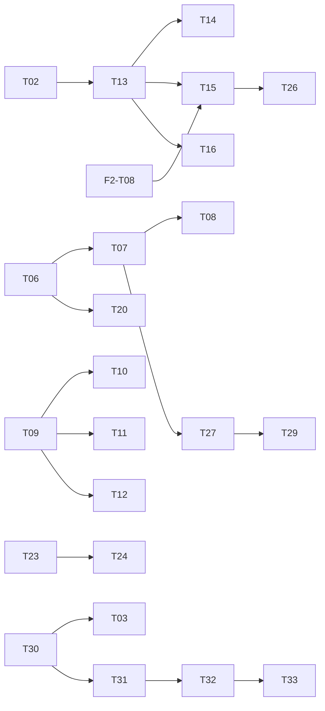

# F4 — Görevler

> **Yürütme notu (25.11.2026):** Bu dosya teknik görev ayrıntısıdır; **yürütme birimi değildir**. Ajan iş olarak paket alır ([yürütme planı](../../execution/README.md)). Bu aşamanın görevlerinin uygulandığı paketler: [H01](../../execution/packages/W0/H01-guvenli-zemin.md), [M01](../../execution/packages/W1/M01-cekirdek-sozlesmeler.md), [M05](../../execution/packages/W1/M05-ortak-sozluk.md), [M08](../../execution/packages/W1/M08-test-altyapisi.md), [F4-A](../../execution/packages/W2/F4-A-normalizasyon-plan.md), [F5-A](../../execution/packages/W2/F5-A-sentez-cekirdegi.md), [F4-B](../../execution/packages/W3/F4-B-fonoloji-g2p.md), [F4-C](../../execution/packages/W4/F4-C-prozodi.md), [G3](../../execution/stages/G3-arayuz.md), [G4](../../execution/stages/G4-sentetik-kabul.md), [G5](../../execution/stages/G5-gercek-insan-sip.md). Görev başına eşleme: [legacy-mapping.md](../../execution/legacy-mapping.md). Bu dosyadaki AIP, faz ve sprint atıfları eski plana aittir.

Her görevin bir kimliği (`F4-Txx`), sprinti (`F4-Sxx`), dosyaları, bağımlılıkları ve "bitti" tanımı vardır. Kodlama ajanı görevi almadan önce [`spec.md`](spec.md) dosyasının ilgili bölümünü okur.

**Boyut:** S = yarım gün veya daha az · M = 1–2 gün · L = 3 gün veya daha fazla

**Yol kuralı:** `backend/`, `frontend/`, `tests/`, `scripts/`, `config/`, `data/`, `contracts/`, `experimental/`, `automotive_voice/`, `asterisk/` → PoC reposu ([`FreyaTTS_Automotive_PoC`](https://github.com/seydivakkas/FreyaTTS_Automotive_PoC)). `docs/` → bu plan reposu.

**Genel kurallar:**
- Yeni hat `f4_pipeline_v2` bayrağı arkasında geliştirilir. Bayrak kapalıyken `text.normalize` / `clauses` davranışı değişmez.
- **İstisna — bayraktan bağımsız düzeltmeler:** F4-T04 (tek karakter yüzünden yanıtın düşmesi) ve F4-T05 (sıra sayısının cümleyi bölmesi). İkisi de canlı görüşmeyi doğrudan bozuyor.
- Paralel çalışan yeni bir normalizasyon motoru yazılmaz; mevcut fonksiyonlar taşınır.
- Ses üretmeyen testler önce gelir. Akustik ölçümler F5 ile ortak yapılır.

---

## F4-S01 — Mevcut normalizer ve morfoloji envanteri

### F4-T01 · Karakterizasyon testleri · M
- **Dosyalar:** `tests/linguistic_frontend/test_poc_characterization.py`
- **İş:** spec §3.2 L2, L3, L5, L6 ve L7 davranışlarını test olarak kaydet. Örnekler: uzun cümlenin üç parçaya bölünüp her birinin "." ve 0,28 s alması; "1. seçenek" bölünmesi; °/é/& hataları; iki normalizerin farkı.
- **Bitti:** Testler mevcut kodla geçer; düzeltme görevleri bunları yeni beklenen davranışla günceller.

### F4-T02 · Sözlük uyum raporu · S
- **Dosyalar:** `scripts/f4_lexicon_audit.py`, `data/f4/lexicon-audit-<tarih>.json`
- **İş:** Derlenmiş sözlükteki tüm kayıtları (tam model, tek model, marka, kısaltma) canlı normalizerden geçir; sözlük okunuşuyla aynı / farklı / hata / rakam kaldı sayıları ve örnekler.
- **Bitti:** spec §3.2 L4 rakamları (1 505 tam modelde 408 / 1 071 / 26 / 95) yeniden üretilir ve diğer kategoriler eklenir.

### F4-T03 · Taban ölçümü (A0) · M
- **Bağımlılık:** F4-T30 (ilk sürüm)
- **İş:** 3 000 örneklik küme üzerinde metin düzeyi metrikler; F5 ile birlikte `legacy_320_cases.json` akustik taban.
- **Bitti:** `data/f4/baseline-a0-<tarih>.json`; özet `docs/00-overview/current-state.md` dosyasına.

### F4-T04 · Tek karakterin yanıtı düşürmesinin önlenmesi (hata düzeltmesi) · S
- **Dosyalar:** `backend/text.py`, `backend/normalizer_rules.py`
- **İş:** spec §5.12 güvenli yedek tablosunun minimal sürümü (°, −, é, &, küçük q) ve tablo dışı karakterin atılıp kaydedilmesi. F4-T22 tam adaptörü getirene kadar geçerlidir.
- **Bitti:** "−5 °C", "Mégane", "Coupé", "Town & Country" seslendirilebilir metne dönüşür; T01 ve T32'nin ilgili kısmı geçer.

### F4-T05 · Sıra sayısı düzeltmesi (hata düzeltmesi) · S
- **Dosyalar:** `backend/normalizer_rules.py`, `backend/dialogue.py`
- **İş:** "1. / 2." → "birinci / ikinci" (sayıdan sonra nokta + boşluk + küçük harf veya sıra bağlamı). F3 tarafında seçenek şablonunun sıra etiketiyle üretilmesi (F3-T31 ile hizalı).
- **Bitti:** "1. seçenek 25 Kasım 10:00." → "Birinci seçenek yirmi beş Kasım saat on." tek parça olarak kalır; "Bir." parçası oluşmaz.

## F4-S02 — Immutable Synthesis Plan sözleşmesi

### F4-T06 · Sözleşmeler · M
- **Dosyalar:** `backend/linguistic_frontend/contracts.py`, `docs/01-architecture/interfaces.md` (F4 bölümü)
- **İş:** spec §6 `SynthesisPlan`, `ChunkPlan`, `ProtectedEntity`; `plan_id` hash'i; frozen yapı. F3 `ResponsePlan`'a `focus_entities` alanının eklenmesi (F3-T06 ile koordineli).
- **Bitti:** JSON Schema doğrulama testleri; T33 birim kısmı.

## F4-S03 — Tek normalizasyon otoritesi

### F4-T07 · F4 pipeline iskeleti ve tek giriş noktası · M
- **Dosyalar:** `backend/linguistic_frontend/pipeline.py`, `backend/session.py`
- **Bağımlılık:** F4-T06
- **İş:** `build_synthesis_plan(response_plan) -> SynthesisPlan`. `session.reply` bayrak açıkken yalnızca bu fonksiyonu çağırır.
- **Bitti:** Bayrak açıkken session tarafında `normalize` / `clauses` / `prepare_tts_clause` çağrısı kalmaz.

### F4-T08 · Çifte normalizasyon koruması · S
- **Dosyalar:** `backend/linguistic_frontend/pipeline.py`, `experimental/streaming_chunker_guard.py` (`AntiDoubleNormalizationGuard`)
- **İş:** `normalization_passes == 1` doğrulaması; F5'in planı dönüştürmeden kullandığını gösteren test kancası.
- **Bitti:** T02 ve T03 geçer.

## F4-S04 — Semantic Tokenizer

### F4-T09 · Tokenizer · L
- **Dosyalar:** `backend/linguistic_frontend/semantic_tokenizer.py`
- **İş:** spec §5.2; önce F3 etiketleri; çok sözcüklü varlıklar; 3008 sayı/model belirsizliği.
- **Bitti:** Planın birleşik örneği doğru tokenlara ayrılır; tür bazında doğruluk raporlanır.

## F4-S05 — Sayı, para, tarih ve saat işleme

### F4-T10 · Sayı ve para · M
- **Dosyalar:** `number_normalizer.py`, `currency_normalizer.py`
- **İş:** Ondalık virgül ("bir virgül altı"), ondalık nokta (teknik bağlam: "1.6 TDI"), negatif sayı, yüzde, sıra sayıları; mevcut para davranışı korunur.
- **Bitti:** T04–T07 geçer.

### F4-T11 · Tarih ve saat · M
- **Dosyalar:** `datetime_normalizer.py`, `docs/01-architecture/adr/ADR-F4-02-time-reading.md`
- **İş:** Tarih ve saat; "yarın saat 14:30" öbeği; saat okuma biçimi kararı (spec §12 soru 2).
- **Bitti:** T08 ve T09 geçer.

## F4-S06 — Telefon, plaka ve teknik kodlar

### F4-T12 · Tanımlayıcılar ve birimler · M
- **Dosyalar:** `identifier_normalizer.py`, `unit_normalizer.py`
- **İş:** Gruplu telefon okuma (A/B kararıyla), plaka, DTC kodu, km/h, °C, Nm, kW, kWh, HP.
- **Bitti:** T10, T11, T15 geçer; "120 km/h" → "saatte yüz yirmi kilometre".

## F4-S07 — Automotive Lexicon 2.0

### F4-T13 · Tek sözlük dosyası ve şema · L
- **Dosyalar:** `config/linguistics/automotive_lexicon.json`, `scripts/f4_build_lexicon.py`
- **Bağımlılık:** F4-T02
- **İş:** Üç kopyanın birleştirilmesi; `normalizer_rules.py` sabit kurallarının ve `config/lexicon.json`'ın taşınması; spec §5.4 şeması; `lexicon_version`.
- **Bitti:** Tek dosya; kopyalar kaldırıldı; eski yolları okuyan kod yeni dosyaya yönlendirildi.

### F4-T14 · Kısaltma politikası ve telaffuz eşleyici · M
- **Dosyalar:** `automotive_lexicon.py`, `pronunciation_mapper.py`
- **İş:** Kısaltmaların tamamı için açık okunuş; sözlükte olmayan kısaltma → harf harf + uyarı; `synth_text` uygulaması.
- **Bitti:** T12–T14 geçer; ABS/DSG/ADAS/ESP tutarlı.

## F4-S08 — Ortak F2/F4 sözlük entegrasyonu

### F4-T15 · F2 ile paylaşım · M
- **Bağımlılık:** F4-T13, F2-T08
- **İş:** F2 `catalog_index` ve `asr_mapper`'ın yeni dosyayı okuması; `ambiguous_with_common_word` alanı; sayı okuma (F4) ↔ sayı ayrıştırma (F2) tersinirlik testi.
- **Bitti:** Tersinirlik testi CARDINAL, CURRENCY, DATE, TIME, PLATE, PHONE, MODEL_YEAR için geçer.

## F4-S09 — Morphological Pre-Checker entegrasyonu

### F4-T16 · Morfolojinin canlı hatta bağlanması · M
- **Dosyalar:** `backend/linguistic_frontend/pipeline.py`, `backend/morphological_pre_checker.py`
- **İş:** spec §5.5; telaffuza göre ek uyumu (`suffix_base` + `harmonize_suffix`).
- **Bitti:** spec §5.5 tablosu ve T16–T19 geçer.

## F4-S10 — Phonological Rule Engine

### F4-T17 · Fonolojik kurallar · M
- **Dosyalar:** `phonology.py`, `config/linguistics/phonology_rules.json`
- **Bitti:** T16 ve T17; kurallar `model_text`'i yalnızca F4'ün ürettiği parçalarda etkiler.

## F4-S11 — Turkish G2P Engine

### F4-T18 · G2P ve yaklaşık PER · M
- **Dosyalar:** `g2p_engine.py`, `backend/linguistic_frontend/benchmark.py`
- **İş:** Kural tabanlı G2P; `ğ` bağlamsal; Whisper geri tanıma ile yaklaşık PER hesabı.
- **Bitti:** T20 ve T21; yaklaşık PER yöntemi belgelenir.

## F4-S12 — Syllabification Engine

### F4-T19 · Heceleme genişletmesi · S
- **Dosyalar:** `backend/morphology/syllabifier.py`
- **İş:** Otomotiv terimleri, yabancı sözcükler, istisnalar.
- **Bitti:** T22 geçer.

## F4-S13 — Stress Engine

### F4-T20 · Vurgu ve cümle odağı · M
- **Dosyalar:** `backend/morphology/stress_engine.py`, `config/linguistics/stress_exceptions.json`
- **Bağımlılık:** F4-T06 (`focus_entities`)
- **Bitti:** T23 geçer; odak hedefleri plana yazılır.

## F4-S14 — Clitic & Liaison Analyzer

### F4-T21 · Clitic ve ulama · M
- **Dosyalar:** `liaison.py`, `backend/morphology/clitics.py`
- **İş:** spec §5.9 tablosu; 35 ms mikro duraklama varsayılan kapalı.
- **Bitti:** T24–T26 geçer.

## F4-S15 — Contextual Prosody Planner

### F4-T22 · Prozodi profilleri · M
- **Dosyalar:** `prosody_planner.py`, `config/linguistics/prosody_profiles.json`
- **İş:** spec §5.10; F3 `kind` eşlemesi; gerçekleştirme yolu alanları.
- **Bitti:** T27 ve T28 (plan düzeyi) geçer; `prosody_realization_verified: null`.

## F4-S16 — Semantic Chunking

### F4-T23 · Bölümleme ve duraklama planı · L
- **Dosyalar:** `semantic_chunker.py`, `protected_atoms.py`
- **İş:** spec §5.11 kuralları; L2 ve L11 düzeltmeleri; token akışı modu (`AtomicTokenStreamingChunker`).
- **Bitti:** T29–T31 geçer.

### F4-T24 · Ara parça noktalaması akustik testi · M
- **Dosyalar:** `docs/01-architecture/adr/ADR-F4-01-continuation-punctuation.md`
- **Bağımlılık:** F4-T23; F5 sentez erişimi
- **İş:** Ara parçayı "." / "," / noktalamasız ve büyük harfli / küçük harfli olarak FreyaTTS ile sentezle. Perde (F0), tonlama yönü ve dinleme değerlendirmesiyle karşılaştır.
- **Bitti:** ADR; seçilen biçim adaptöre yazılır.

## F4-S17 — Freya Compatibility Adapter

### F4-T25 · Adaptör · M
- **Dosyalar:** `freya_adapter.py`
- **İş:** spec §5.12; `char_to_id` ↔ `freya_vocab.json` karşılaştırması; büyük harf kuralı; güvenli yedek tablosunun tamamı.
- **Bitti:** T32 geçer; model sözlüğü dışı karakter 0.

## F4-S18 — Linguistic Quality Gate

### F4-T26 · Kalite kapısı ve tersine ayrıştırma · M
- **Dosyalar:** `quality_gate.py`
- **Bağımlılık:** F4-T15
- **İş:** spec §5.13.
- **Bitti:** T35 geçer; kritik değer korunumu otomatik ölçülür.

## F4-S19 — F4–F5–F6 entegrasyonu

### F4-T27 · Plan tüketimi · M
- **Dosyalar:** `backend/models.py`, `backend/batched_ode.py`, `backend/session.py`
- **Bağımlılık:** F4-T07. **F5-T09 ve F6-T08 ile karşılıklı bağımlıdır; üçü AIP-20'de birlikte birleştirilir.**
- **İş:** F5 `model_text`'i dönüştürmeden kullanır (yalnızca sözlük kontrolü); sessizlik eklemez; F6 `post_pause_ms` uygular; `plan_id` önbellek anahtarı.
- **Bitti:** T34 ve T36 geçer.

### F4-T28 · Eğitim/çıkarım normalizer birliği · S
- **Dosyalar:** `backend/sft_leyla.py`, `backend/automotive_frontend.py`, `backend/routers/text_speech.py`
- **İş:** L7: tüm yollar F4 pipeline'ını kullanır.
- **Bitti:** Aynı girdi her yolda aynı `model_text`'i üretir.

## F4-S20 — Turkish Linguistic Studio arayüzü

### F4-T29 · API ve arayüz · L
- **Dosyalar:** `backend/routers/f4.py` (mevcut `text_speech.py` genişletilir), `frontend/src/LinguisticStudioPanel.tsx` ve alt sayfalar
- **İş:** spec §7; Pronunciation A/B Lab sonucunun `acoustic_status`'e yazılması (yalnızca uzman onayıyla).
- **Bitti:** Gerçek backend; dürüstlük kuralı.

## F4-S21 — Sentetik dilbilimsel test laboratuvarı

### F4-T30 · 3 000 örneklik küme · L
- **Dosyalar:** `data/f4/linguistic_set/`, `scripts/f4_build_set.py`
- **İş:** spec §8; F3 yanıt şablonları dahil; beklenen normalizasyon, korunan varlıklar, cümlecik sınırları.
- **Bitti:** Manifest ve bölüm hash'leri.

### F4-T31 · T01–T36 testleri · L
- **Dosyalar:** `tests/linguistic_frontend/lab/test_t01_*.py` … `test_t36_*.py`
- **Bitti:** Sonuçlar `data/f4/lab-report-*.json`.

## F4-S22 — Ablation ve regresyon deneyleri

### F4-T32 · A0–A9 ve regresyon · L
- **İş:** spec §9; mevcut testler; `legacy_320_cases.json` akustik regresyonu (F5 ile).
- **Bitti:** `docs/stages/F4-linguistic-frontend/ablation-results.md` (yalnızca ölçülmüş değerler); bayrak varsayılanı kararı.

## F4-S23 — Akustik telaffuz ve telefon kabulü

### F4-T33 · Akustik kabul · M
- **Dosyalar:** `docs/testing/f4-field-protocol.md`
- **İş:** Pronunciation, Naturalness (MOS — gerçek dinleyicilerle), Speaker Identity, Intelligibility (telefon bandı). Whisper geri tanıma yardımcı sinyaldir, tek başına kanıt değildir.
- **Bitti:** `acceptance.md` AŞAMA 4 tablosu dolar.

---

## Bağımlılık özeti

