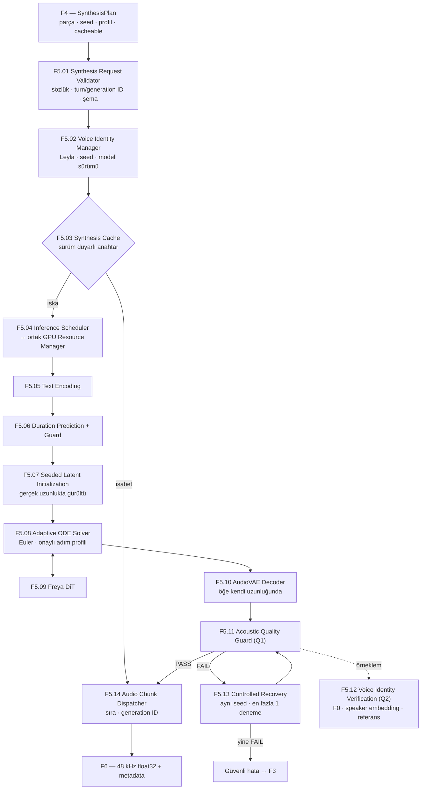
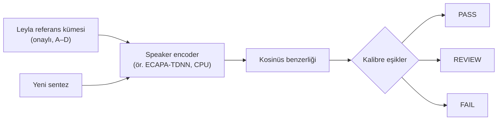

# F5 — Neural Speech Synthesis & Voice Identity Intelligence (Sinirsel Ses Sentezi ve Ses Kimliği)

| Alan | Değer |
| --- | --- |
| Aşama | F5 — Freya'nın akustik üretim merkezi |
| Yol haritası modülleri | AP08 GPU Resource Scheduler (ortak katmanla birlikte) · AP07 Prosody & Audio Stitching (sentez kısmı) · AP10 Audio Quality Evaluation (F5 kısmı) |
| Girdi | F4'ten değişmez `SynthesisPlan` (parça bazında `model_text`, seed, ses profili, prozodi hedefleri, `cacheable`) · F1'den iptal / turn ID olayları |
| Çıktı | `AudioChunk` → **F6** (48 kHz float32 ham ses + metadata; **sessizlik, fade ve telefon dönüşümü yok**) · telemetri |
| Kod | [`FreyaTTS_Automotive_PoC`](https://github.com/seydivakkas/FreyaTTS_Automotive_PoC) reposunda `backend/neural_synthesis/` + `backend/runtime_resources/` (ortak GPU yönetimi) + `config/voices/` |
| GPU bütçesi | Mevcut tek FreyaTTS (DiT + AudioVAE) örneği. **Model ikinci kez yüklenmez.** Konuşmacı gömüsü (speaker embedding) analizi CPU'da ve yalnızca laboratuvar/örneklem düzeyinde |
| İlgili belgeler | [`tasks.md`](tasks.md) · [`acceptance.md`](acceptance.md) · [`../F4-linguistic-frontend/spec.md`](../F4-linguistic-frontend/spec.md) §6 |

> **Yol kuralı:** `backend/`, `frontend/`, `tests/`, `scripts/`, `config/`, `data/`, `experimental/` ve `automotive_voice/` ile başlayan yollar **PoC reposundadır**. `docs/` ile başlayan yollar **bu plan reposundadır**.

---

## 1. Amaç

F5, F4'ün hazırladığı sentez planını gerçek ses dalgasına dönüştürür. Dört temel amacı vardır:
1. Türkçe telaffuz doğruluğu
2. Leyla ses kimliğinin korunması
3. Düşük sentez gecikmesi
4. GPU kaynaklarının verimli kullanılması

**F5 önceliği:** FreyaTTS modelini yeniden eğitmek değil, mevcut modelin çıkarım mekanizmasını **güvenilir ve ölçülebilir** hale getirmek. Önce seed tutarlılığı, süre tahmini, GPU zamanlaması ve sentez önbelleği; ardından ODE optimizasyonu ve akustik kimlik doğrulaması. LoRA ve fine-tuning en son, gerçek akustik problemler ayrıştırıldıktan sonra değerlendirilir.

**Değişmez kurallar:**
1. F5 metni dönüştürmez (normalizasyon, bölümleme, noktalama F4'ün işidir). Yalnızca model sözlüğüne uygunluğu **doğrular**.
2. F5 sessizlik, fade, comfort noise eklemez ve telefon bandına dönüştürmez (F6'nın işi).
3. Seed ve ses kimliği **hiçbir hata yolunda sessizce değişmez**.
4. Sahte sinüs, test sesi veya başarısız sentez hiçbir koşulda müşteriye oynatılmaz.
5. Kodda veya belgede ölçülmemiş performans iddiası kanıt olarak kullanılmaz.

## 2. Kapsam

**Kapsamda:**
- Sentez isteği doğrulama
- Ses kimliği yönetimi
- Önbellek ve ön ısıtma
- GPU zamanlama (ortak katmanla birlikte)
- Süre tahmini ve sınırları
- Seed yönetimi ve latent başlangıç
- ODE çözücü profilleri
- DiT ve AudioVAE çıkarımı
- Hızlı akustik kalite denetimi
- Kontrollü yeniden sentez
- Konuşmacı kimliği doğrulama
- F0/ritim analizi
- Cümlecik bazlı düşük gecikmeli akış
- Neural Synthesis Studio
- Benchmark ve kontrollü LoRA araştırması

**Kapsam dışı:**
- Metin hazırlama → F4
- Duraklama uygulama, birleştirme, WSOLA, EQ, 8 kHz dönüşüm, aktarım → F6
- Gerçek token/latent düzeyinde akışlı sentez → model mimarisi uygunluğu doğrulanana kadar ayrı bir araştırma konusu (§5.12)

## 3. PoC'taki mevcut durum (doğrulanmış)

### 3.1 Ölçülmüş performans

| Ölçüm | Değer | Not |
| --- | --- | --- |
| GPU tepe bellek | 7 478 / 8 188 MiB | **Ön ısıtmadan önce** ölçüldü; masaüstü uygulamaları (~1 770 MiB) dahil. Ön ısıtma sonrası ve eşzamanlı çıkarım sırasındaki tepe değeri bilinmiyor |
| Boş VRAM | 710 MiB | Aynı ölçüm |
| Önbellekteki karşılama | ~15 ms | Önceden sentezlenmiş ses |
| İlk soğuk sentez | ~10,7 s | `models._prewarm_tts` yorumu; bu yüzden yükleme sırasında ısıtılıyor |
| Otomotiv terim doğruluğu | %48,04 | TTS + telefon bandı + STT birleşik |
| **Ana kabul cümlesi** | **2 / 6 çalıştırma geçti** | `docs/measured-latency.json → acceptance_runs.main_sentence` (son 6 çalıştırma). Kısa araç cümlesi 4 / 4 |

Değerler 6 Kasım 2026 tarihli tek çalıştırma örnekleridir; p95 veya SLA değildir. Ana kabul cümlesinin 6 çalıştırmanın yalnızca 2'sinde geçmesi, uçtan uca hatta **tekrarlanabilirlik sorunu** olduğunu gösteriyor. Olası nedenler F2'deki sıcaklık geri dönüşü (F2 spec §3.2 S4) ve bu belgedeki seed/padding bulgularıdır; F5-T03 belirleyici testleri bu ayrımı yapar.

### 3.2 Sentez yolu

`batched_ode_enabled = True` varsayılan olduğu için canlı yol: `session.reply` → `models.synth` → `BatchedODEEngine.synthesize_clause` → kendi `normalize` / `clauses` / `prepare_tts_clause` çağrıları (F4 spec §3.2 L1) → `enqueue_clause` → 12 ms mikro-pencere → `_solve_ode_batch` → `_solve_pytorch_batch` (gerçek GPU yolu) veya `synth_fallback_fn` (`_synth_one`) yolu.

**GPU yolu adımları:** karakter indeksleri → `text_encode` → maskeli ortalama → `dur` (süre tahmini, log) → `clause_frame_count` sınırı → seed başına Gauss gürültü → 32 adım Euler (`x = x + v/steps`) → AudioVAE `decode` (25 Hz latent → 48 kHz, kare başına 1 920 örnek) → kırpma → NaN/sessizlik denetimi → `apply_fade_and_comfort_noise`.

### 3.3 Bulgular

| # | Bulgu | Kanıt | Etki |
| --- | --- | --- | --- |
| N1 | **Latent gürültü yığındaki en uzun öğeye göre üretiliyor** | `torch.randn(1, max_frames, 64, generator=gen)` | Aynı metin ve seed, yığın arkadaşına göre farklı başlangıç gürültüsü alabilir. CUDA üretecinde aynı seed'le farklı boyutta üretilen tensörün ilk kısmının aynı olması garanti değil (planın tespiti) |
| N2 | **AudioVAE dolgulu latent üzerinde çalışıyor** (plana eklendi) | `self.vae.decode(x…)` tüm yığın için `max_frames` uzunluğunda; kırpma decode'dan sonra. Euler güncellemesi maskeli karelere de uygulanıyor | Evrişimli kod çözücünün alıcı alanı, dolgu karelerini gerçek seslerin son örneklerine karıştırabilir. N1 düzeltilse bile parçanın sonu yığın koşuluna bağlı kalabilir. **Doğrulanmalı (T13)** |
| N3 | **Seed sessizce 9'a dönüyor** | (a) Yedek yolda fısıltı çökmesi algılanırsa `synth_fallback_fn(…, seed=LEYLA_SEED)`; (b) `models._guarded_synth` ve `session.reply` içinde geniş `except TypeError:` blokları seed'siz yeniden çağırıyor; (c) `models._cache_key` seed `None` ise 9 | A/B deneyinde seed 42 olan ses, hata yolunda Leyla 9'a dönüşür ve bu kaydedilmez |
| N4 | **Toplu yolda GPU çözümleri arasında kilit yok** | `_solve_ode_batch` `asyncio.to_thread` ile kilitsiz çalışıyor. Bir yığın çözülürken mikro-pencere dolan ikinci yığın aynı anda GPU'ya girebilir. STT'nin `stt_lock`'u ayrı | VRAM tepe değeri iki yığının toplamına çıkabilir; 710 MiB boşlukla OOM riski. Kuyruk sınırı da yok (tek yoldaki `pending >= 2` sınırı toplu yolda uygulanmıyor) |
| N5 | **İptal edilen parçalar yine sentezleniyor** | `_process_queue_now` kuyruktan öğeleri alırken `future.cancelled()` kontrolü yapmıyor; öğelerde turn/session kimliği yok | Barge-in sonrası eski turun parçaları GPU zamanı harcar ve yeni turun ilk sesini geciktirir |
| N6 | **Canlı GPU yolunda bozuk ama sessiz olmayan ses geçebilir** | GPU yolunda yalnızca NaN ve `max < 1e-5` denetimi. Yorum: pYIN analizi sentezden uzun sürüyor (2,1 s'ye karşı 1,5 s) ve kaldırıldı. Yedek yolda ise pYIN her öğede çalışıyor | Fısıltı çökmesi, tekrar ve aşırı süre canlıda yakalanmıyor; yedek yol ise çok yavaş |
| N7 | **F5 içinde sessizlik ve fade ekleniyor** | `_synth` ve `synthesize_clause` duraklama sıfırları ekliyor; her iki yol `apply_fade_and_comfort_noise` çağırıyor | F6 ile çakışma (F4 spec §6 sorumluluk tablosu) |
| N8 | **Önbellek anahtarı eksik** | `(normalize(prepare_tts_clause(text)), seed)`; en fazla 32 kayıt; yalnızca ön ısıtmada doluyor | Önbellek bellekte olduğu için model değişikliği yeniden başlatmayla temizleniyor. Asıl risk: çalışma sırasında sözlük, adım sayısı veya süre profili değişirse eski ses dönmesi ve önerilen kalıcı (disk) önbellek |
| N9 | **Ölçülmemiş performans iddiaları kodda** | `batched_ode.py` docstring: "RTX 4090 … 3.8 GB VRAM … RTF ≤ 0.015", "2.3 Hz F0 ses kararlılığı" | PoC'un kendi `ARCHITECTURE.md` kuralına aykırı; RTX 4070 kanıtı değildir |
| N10 | **`max_concurrent_calls = 50`** | `config.py`, `ConcurrentCallController(50)` | Yapılandırılmış sınır; 50 eşzamanlı görüşmenin desteklendiği anlamına gelmez. Gerçek kapasite ölçülmedi |
| N11 | **Kısa ifade süre sınırının kanıtı küçük bir örneklem** | `SHORT_CLAUSE_FRAMES_PER_CHAR = 1.8` yorumu: "17 kısa ifadenin 16'sı doğru tanındı" | Değer korunur ama daha geniş kümeyle kalibre edilmeli |

### 3.4 Korunacak mevcut bileşenler

- `clause_frame_count` ve kısa ifade süre sınırı (fazla süreyi uydurma sesle doldurma sorununun bilinen çözümü)
- Öğe başına ayrı `torch.Generator`
- Tek bozuk öğenin yığını düşürmemesi (öğe öğe yeniden deneme)
- `allow_sine_fallback = False` varsayılanı ve "yapay sinüs sesi üretilmez" hatası
- NaN ve sessiz çıktı denetimi
- TTS devre kesicisi (`breakers["tts"]`)
- Ön ısıtma: sabit karşılamalar, `PREWARM_PHRASES`, aktif A/B seed'leri
- `acoustic_evaluation.measure_f0` ve `scripts/acoustic_benchmark.py` (vendor commit'ini kaydediyor)

## 4. Hedef mimari



ODE çözücü DiT modelini tekrarlı olarak çağırır. Önbellek isabetinde akustik çıkarım atlanır.

## 5. Bileşenler

### 5.1 F5.01 — Synthesis Request Validator (`pipeline.py`, `contracts.py`)

- F4 `SynthesisPlan` şemasını ve `normalization_passes == 1` değerini doğrular.
- `model_text` içindeki her karakterin modelin gerçek `char_to_id` sözlüğünde olduğunu kontrol eder. Eksik karakter varsa **dönüştürmez**: isteği reddeder ve F4'e hata olayı gönderir. F4'ün adaptörü bu durumu zaten önlemelidir (F4 K10).
- `session_id`, `turn_id`, `generation_id` kontrolü: Eski generation için istek kuyruğa alınmaz.

### 5.2 F5.02 — Voice Identity Manager (`voice_registry.py`, `config/voices/leyla.json`)

**Ses kimliği** tek bir seed değil, şu bileşenlerin birleşimidir:
- Model ve checkpoint sürümü (hash)
- Seed ve RNG davranışı (cihaz, üretici türü)
- ODE çözücü yapılandırması
- Süre profili
- F4 normalizer ve sözlük sürümü
- Konuşmacı gömüsü referansı
- F0 ve konuşma ritmi dağılımları

```json
{
  "voice_id": "leyla",
  "canonical_seed": 9,
  "model_revision": "freya-tts@<vendor-commit>",
  "checkpoint_sha256": null,
  "solver_profile": "baseline_32",
  "duration_profile": "default_v1",
  "identity_baseline": "config/voices/identity_baseline.json",
  "status": "baseline_pending_approval"
}
```

- A/B deney sesleri (`ab_testing` `tts_seed`) ayrı ses profili olarak kaydedilir. Bir istek profilini açıkça taşır; profilsiz istek reddedilir. **Varsayılan 9'a düşme yoktur** (N3).

### 5.3 F5.03 — Synthesis Cache Manager (`audio_cache.py`, `prewarm_manager.py`, `config/voices/cache_policy.json`)

| Düzey | İçerik | Saklama |
| --- | --- | --- |
| L0 Hot | Çok sık kullanılan sabit cümleler (karşılama, bekleme cümlesi) | Bellek, ön ısıtmada |
| L1 RAM | Diğer onaylı, kişisel olmayan yanıtlar | Bellek, LRU |
| L2 Disk | Sürüm bilgili, önceden doğrulanmış sesler | Disk; yükleme sırasında sürüm kontrolü |
| L3 Session | Oturuma özel geçici ses | Oturum sonunda silinir |

**Önbellek anahtarı:**

```
SHA256(
    model_revision + checkpoint_sha256 + vocab_sha256
  + lexicon_version + normalizer_version
  + model_text + voice_id + seed
  + solver_type + ode_steps + duration_profile
  + prosody_profile + output_format
)
```

F4'ün `plan_id` değeri bu alanların F4 kısmını zaten kapsar. F5 kendi alanlarını ekler.

**Kurallar:**
- `cacheable = false` olan parçalar (F4: telefon, plaka, ad, fiyat gibi kişisel/değişken içerik) L0–L2'ye **yazılmaz**.
- Sözlük, model veya sentez profili değişince ilgili kayıtlar geçersiz olur. L2'de sürüm uyuşmazlığı olan kayıt yüklenmez.
- Ön ısıtma P6 önceliğiyle çalışır; canlı görüşmeleri geciktirmez.

### 5.4 F5.04 — Inference Scheduler (`batch_scheduler.py` + `backend/runtime_resources/`)

Bu bileşen F2 ve F3 ile ortak **Unified GPU Resource Manager**'ın F5 tarafıdır. Ortak katman `backend/runtime_resources/` altında (`gpu_scheduler.py`, `memory_budget.py`, `priority_queue.py`, `cancellation.py`) kurulur ve ortak katman belgesinde ayrıntılandırılır.

**Görev öncelikleri** (planın tablosu; F1/F2/F3 notlarıyla tutarlı):

| Öncelik | Görev |
| --- | --- |
| P0 | Aktif barge-in için gerekli STT |
| P1 | Final STT |
| P2 | İlk TTS cümleciği |
| P3 | Gerekli LLM çıkarımı |
| P4 | Sonraki TTS cümlecikleri |
| P5 | Kısmi STT |
| P6 | Önbellek ön ısıtma |
| P7 | Benchmark ve akustik analiz |

Öncelikler görev bağımlılıkları ve son teslim süresiyle (deadline) birlikte değerlendirilir. Örneğin F3 bitmeden F5'in ilk cevabı sentezlenemez; sonraki cümleciğin deadline'ı önceki cümleciğin oynatma bitişidir.

**F5 tarafı kuralları:**
- **Aynı anda en fazla bir TTS GPU yığını** (N4). Daha fazlası yalnızca VRAM ölçümüyle onaylanmış profilde açılır.
- **Kabul denetimi (admission):** Kuyruk ve VRAM bütçesi doluysa yeni iş reddedilmez, bekletilir; bekleme süresi telemetriye yazılır.
- **İptal (N5):** Yığına alınmadan önce iptal edilmiş veya generation'ı eskimiş parçalar kuyruktan çıkarılır. Başlamış CUDA işinin anında durduğu varsayılmaz; sonucu atılır ve bellek güvenle serbest bırakılır.

### 5.5 F5.05–F5.06 — Text Encoding, Duration Prediction ve Duration Guard (`text_encoder.py`, `duration_predictor.py`, `duration_guard.py`)

**Dönüşüm:** 25 latent kare/s; T_ses = N_kare / 25; N_örnek = 1 920 × N_kare (48 kHz).

Mevcut `clause_frame_count` korunur ve **Duration Guard**'a genişletilir:

| Durum | Kontrol |
| --- | --- |
| Çok kısa metin | En kısa ve en uzun süre sınırı (mevcut 1,8 kare/karakter + 2) |
| Uzun cümle | F4 parça sınırına (≤ 270 karakter) uyum |
| Sayı ve fiyat | **Hece sayısına** göre süre aralığı (F4 hece bilgisi) |
| Yabancı marka | Sözlük `synth_text` uzunluğu |
| Fısıltı çökmesi | Akustik anomali kontrolü (F5.11) |
| Sözcük tekrarı | Fazla süre + Q2 geri tanıma |
| Çok hızlı konuşma | En kısa anlaşılabilir süre (hece başına alt sınır) |

- F4'ten gelen hece sayısı yardımcı özellik olarak kullanılır: tahmin edilen süre `[hece × alt_sınır, hece × üst_sınır]` aralığına kırpılır. Sınırlar 2 000 girdilik kümede kalibre edilir (N11).
- `target_speed` (F4) modelde süre ölçeklemesiyle gerçekleştirilebilir mi? Tahmin edilen kare sayısını hızla bölmek modelin desteklediği bir yöntemdir; ancak ses kalitesine etkisi ölçülmeden canlıya alınmaz. Alternatif F6 WSOLA'dır (F4 spec §5.10).

### 5.6 F5.07 — Deterministic Seed Manager ve Latent Initialization (`seed_manager.py`, `latent_initializer.py`)

- Öğe başına ayrı üretici korunur.
- **Gürültü öğenin gerçek kare sayısıyla üretilir**, ardından sıfırla dolgulanır (N1). Cihaz ve yığın bağımsızlığı için gürültü CPU üreticisiyle üretilip GPU'ya taşınabilir. Seçim, determinizm testleriyle (T10–T14) yapılır.
- **AudioVAE her öğe için kendi uzunluğunda çalışır** veya dolgu karelerinin etkisizliği test edilir (N2).
- Seed değişmezleri:

| Senaryo | Beklenen davranış |
| --- | --- |
| Aynı metin, aynı seed | Tanımlı sayısal tolerans içinde tutarlılık |
| Yığın sırasının değişmesi | Kimlik korunur |
| Yığın uzunluğunun değişmesi | Dolgu kaynaklı anlamlı ses değişimi yok |
| Başka oturumun sentezi | Seed durumları karışmaz |
| A/B testinde seed 42 | Sessizce seed 9'a dönülmez |
| Sentez hatası | Yetkisiz ses değişimi yok |

Farklı GPU çekirdekleri ve yığın biçimleri nedeniyle bit düzeyinde eşitlik her zaman mümkün değildir. Tolerans **sayısal** (dalga formu SNR'ı) ve **akustik** (speaker similarity, Whisper geri tanıma) olarak birlikte tanımlanır.

### 5.7 F5.08–F5.10 — Adaptive ODE Solver, DiT ve AudioVAE (`ode_solver.py`, `solver_policy.py`, `freya_engine.py`, `vae_decoder.py`)

Euler güncellemesi: x_{k+1} = x_k + Δt · v_θ(x_k, t_k, c); Δt = 1/N.

**Profiller:**

| Profil | ODE adımı | Kullanım | Durum |
| --- | --- | --- | --- |
| Experimental Fast | 8 | Yalnızca laboratuvar | Kapalı |
| Fast | 16 | Kısa ve basit ifadeler | Ölçüm sonrası |
| Balanced | 24 | Standart bilgi yanıtları | Ölçüm sonrası |
| **Baseline** | **32** | **Mevcut referans; varsayılan** | Açık |
| High Quality | 48 | Zor telaffuzların deneysel testi | Laboratuvar |
| Recovery | Onaylı profil | Akustik hata sonrası yeniden sentez | Onaylı profile bağlı |

- 32 adım varsayılan kalır. Diğer profiller kalite (Whisper geri tanıma, speaker similarity, uzman dinlemesi) ve gecikme testlerinden sonra açılır.
- Daha fazla adım her zaman daha doğal ses veya daha doğru telaffuz anlamına gelmez; A7'de ölçülür.
- Model adaptörü (`freya_engine.py`) mevcut `models.tts` örneğini kullanır. `_solve_pytorch_batch` mantığı buraya taşınır.
- AudioVAE optimizasyonu: çözücü süresi ile kod çözücü süresi ayrı ölçülür; kod çözücü bir darboğazsa yarı hassasiyet veya parçalı decode denenir (kalite testiyle).

### 5.8 F5.11 — Acoustic Quality Guard (`quality_guard.py`)

**Q1 — Hızlı çalışma zamanı denetimi** (her parça; hedef ≤ 5 ms CPU):
- NaN/Inf
- Boş veya sessiz ses (RMS tabanı)
- Geçersiz genlik ve clipping (tepe ≥ 0,999 oranı)
- **Beklenen süre aralığı** (hece sayısına göre; Duration Guard ile aynı sınırlar)
- **Ucuz seslilik denetimi:** pYIN yerine sıfır geçiş oranı + spektral düzlük + kısa otokorelasyon tepe değeri. Fısıltı çökmesini düşük maliyetle işaretler (N6)
- Oturum ve generation ID doğrulaması

**Q2 — Derin akustik değerlendirme** (laboratuvar veya örneklem; canlı yolu bloklamaz):
- pYIN F0 ve seslilik
- Konuşmacı gömüsü karşılaştırması
- Whisper geri tanıma ve otomotiv terim doğruluğu
- Fonem/sözcük zaman hizalaması
- MOS / ABX (insan)

Canlıda Q2 isteğe bağlı olarak örneklem bazında (ör. her 50 parçadan biri) arka planda P7 önceliğiyle çalışabilir.

### 5.9 F5.13 — Controlled Recovery Engine (`recovery_engine.py`)

- Q1 FAIL → **aynı seed ve aynı ses profiliyle** kontrollü yeniden sentez. Değiştirilebilecekler:
  - Onaylı bir telaffuz alternatifi (sözlükte `approved` durumda)
  - Daha sıkı süre sınırı
  - Onaylı bir çözücü profili
- Canlı görüşmede **en fazla 1** ek deneme; daha fazlası gecikme bütçesine bağlıdır.
- İkinci deneme de FAIL ise güvenli hata: `f5.synthesis_failed` olayı F3'e gider. F3 güvenli bir önbellekli cümle (ör. "Kusura bakmayın, bir aksaklık oldu.") ve operatör/geri arama seçeneği sunar.
- **Asla:** başka seed'e geçmek, sinüs/test sesi, sessizlik dışında içerik uydurmak. `allow_sine_fallback` üretim yapılandırmasında `True` ise uygulama **başlamaz**.
- Geniş `except TypeError` seed düşürme yolları kaldırılır (N3).

### 5.10 F5.12 — Voice Identity Verification (`identity_guard.py`, `speaker_encoder.py`, `pitch_analyzer.py`)



- Evrensel bir eşik (ör. 0,95) **kullanılmaz**. Eşik, seçilen encoder ve Leyla referanslarının kendi içindeki benzerlik dağılımından kalibre edilir (ör. referanslar arası benzerliğin alt yüzdeliği).
- 48 kHz ve telefon bandı için **ayrı** referans dağılımları tutulur.
- Encoder ek bir modeldir: CPU'da, çevrimdışı ve yalnızca Q2'de çalışır. Lisansı ve çevrimdışı kurulabilirliği F5-T22'de doğrulanır.

**Drift metrikleri:** Median F0, F0 standart sapması, seslilik oranı, konuşma hızı (hece/s; F4 hece sayısıyla), RMS/loudness, speaker similarity, ABX ve MOS (insan).

### 5.11 Dynamic Batched Inference 2.0 (`batched_inference.py`, `batch_scheduler.py`)

**RTX 4070 başlangıç profilleri:**

| Profil | Batch | Micro-window | Durum |
| --- | --- | --- | --- |
| **Single Call** | 1 | 0 ms | **Varsayılan** |
| Low Latency | 2 | 4 ms | Ölçüm sonrası |
| Balanced | 2 | 8 ms | Ölçüm sonrası |
| Experimental Batch | 4 | 12 ms | Laboratuvar; VRAM doğrulanmadan canlıda yok |
| Stress Test | 8 | 12 ms | Laboratuvar |

- Mevcut varsayılan (`batch_size = 8`, `micro_window_ms = 12`) tek görüşmede ilk sese 12 ms bekleme ekler ve VRAM riski taşır. Varsayılan **Single Call** olur.
- Yığın oluştururken latent uzunluğuna göre gruplama yapılır (dolgu oranını azaltır).
- `max_concurrent_calls` değeri ölçülmüş kapasiteyle (T29, T37) belirlenir; o zamana kadar belgelerde "yapılandırılmış sınır" olarak anılır (N10).

### 5.12 Düşük gecikmeli cümlecik akışı (`chunk_dispatcher.py`)

- İlk cümlecik P2 önceliğiyle sentezlenir; sonraki cümleciklerin sentezi oynatmayla örtüşür (mevcut `session.reply` üretici-tüketici yapısı korunur ve F5'e taşınır).
- Bu, token düzeyinde akışlı TTS değildir; Freya'nın mimarisine uygun, cümlecik düzeyinde düşük gecikmeli akıştır.
- Native latent veya VAE akışı, model mimarisinin uygunluğu doğrulandıktan sonra ayrı bir araştırma konusudur (bu planın kapsamı dışında).
- **F5 TTFA:** T_kuyruk + T_kodlama + T_ODE + T_VAE + T_denetim. Uçtan uca TTFA (müşterinin konuşmayı bitirmesinden ilk sesin karşı uçta duyulmasına kadar) farklı bir metriktir ve ortak katmanda ölçülür.

## 6. F5–F6 veri sözleşmesi (`contracts.py`)

```json
{
  "schema_version": "f5.audio_chunk.v1",
  "session_id": "session-001",
  "turn_id": 8,
  "generation_id": 12,
  "plan_id": "sha256:…",
  "chunk_id": "chunk-001",
  "chunk_index": 0,
  "is_last": false,
  "voice_profile": "leyla",
  "seed": 9,
  "engine": "freya_dit",
  "model_revision": "freya-tts@<vendor-commit>",
  "solver": "euler",
  "ode_steps": 32,
  "sample_rate": 48000,
  "channels": 1,
  "encoding": "float32",
  "num_samples": 0,
  "post_pause_ms": 240,
  "target_speed": 0.93,
  "interruptible": true,
  "cache_hit": false,
  "recovery_attempts": 0,
  "metrics": {
    "queue_wait_ms": null,
    "encode_ms": null,
    "ode_ms": null,
    "decoder_ms": null,
    "guard_ms": null,
    "audio_duration_ms": null,
    "rtf": null,
    "speaker_similarity": null
  },
  "quality_status": "q1_pass"
}
```

- Ses verisi bu metadata ile ilişkilendirilmiş **ikili veri** olarak aktarılır.
- `post_pause_ms` ve `target_speed` F4'ten aynen geçer; **F5 uygulamaz**, F6 uygular.
- Ses **ham** olarak gider: fade, comfort noise, sessizlik ve 8 kHz dönüşümü yoktur (N7).
- Ölçülmeyen değerler `null` kalır.

## 7. SFT ve LoRA (en son aşama)

PoC'ta SFT/LoRA yapılandırma, corpus hazırlama ve benchmark API'leri var (`sft_leyla.py`, `/api/sft/lora/*`). Bunların varlığı, eğitilmiş ve doğrulanmış bir LoRA adaptörü olduğunu kanıtlamaz (`config/m10_adapter_dryrun.example.json` bir örnek dosyadır).

| Aşama | İçerik |
| --- | --- |
| SFT-0 Frozen Baseline | Orijinal checkpoint; ağırlık değişmez |
| SFT-1 Inference Optimization | Normalizasyon (F4), süre, seed, ODE optimizasyonu |
| SFT-2 Error Corpus | Doğrulanmış telaffuz hataları ve zor terimler |
| SFT-3 LoRA Experiment | Lisansı ve kullanımı uygun, kaliteli eşleştirilmiş ses-metin verisi; rank 4 / 8 / 16 karşılaştırması |
| SFT-4 Identity Preservation | Leyla kimliği, genel Türkçe ve otomotiv terim doğruluğu karşılaştırması |
| SFT-5 Model Acceptance | Ayrı test kümesi, geri dönüş planı, model onayı |

**Kurallar:**
- Yalnızca Freya'nın kendi hatalı seslerini kullanarak eğitim yapılmaz; mevcut hataları güçlendirir.
- RTX 4070'te eğitim kapasitesi ölçülmeden batch ve VRAM garantisi verilmez.
- Eğitim verisi F4 pipeline'ından geçer (F4 L7: eğitim/çıkarım normalizer birliği).
- LoRA adaptörü ayrı bir model sürümü olarak kaydedilir; base checkpoint'e geri dönüş her zaman mümkündür (T40).

## 8. Neural Synthesis Studio

### 8.1 Ana sayfa (`frontend/src/SynthesisStudioPanel.tsx`)

- Engine (DiT), Solver (Euler), Output (48 kHz)
- Sentez test metni
- Acoustic Signal Monitor: Waveform / Spectrogram / Pitch; simülasyon görünümü açıkça etiketli
- Voice Identity: Leyla — Canonical Seed 9; profil durumu
- ODE Solver Steps (16 / 24 / 32 / 48), GPU Batch Size (1 / 2 / 4 / 8), Micro-batching Window
- Synthesis Modules: Versioned Audio Cache, Voice Identity Guard, Acoustic Quality Guard, Adaptive Duration Control, Unified GPU Scheduler
- Runtime Performance: Inference Latency, Real-Time Factor, GPU Memory, Queue Wait, Speaker Similarity, F0 Drift, Cache Hit Rate, Synthesis Quality
- Sıfırla, Yapılandırmayı kopyala

### 8.2 Alt sayfalar

| Sayfa | İçerik |
| --- | --- |
| Neural Synthesis Monitor | Canlı sentez ve model olayları |
| Voice Identity Studio | Leyla ve A/B profilleri, seed yönetimi |
| ODE Solver Lab | Adım ve çözücü karşılaştırması |
| Duration Inspector | Latent kareleri, süre tahmini, Duration Guard kırpmaları |
| Latent Explorer | Latent tensör analizi |
| GPU Scheduler | VRAM, öncelikler, kuyruk (ortak katmandan) |
| Batch Manager | Dinamik yığınlama profilleri |
| Audio Cache Manager | Ön ısıtma, önbellek düzeyleri, geçersiz kılma |
| Acoustic Quality Lab | F0, seslilik, clipping, RTF |
| Speaker Verification | Gömü ve kimlik benzerliği, eşik kalibrasyonu |
| Synthesis A/B Lab | Model, seed, çözücü deneyleri |
| SFT & LoRA Lab | Kontrollü eğitim deneyleri |
| Model Registry | Checkpoint, hash, sürümler, onay durumu |
| Quality Gate | Akustik ve performans kabulü |

**Dürüstlük kuralı:** Simülasyon görünümleri "Simülasyon — gerçek sentez veya analiz yapılmadı" etiketi taşır. Studio'da ayarlanan deneysel profiller canlı görüşmelere ancak onay sonrası uygulanır.

## 9. Test altyapısı ve veri kümesi

**İki katmanlı test:**
1. **Taklit çıkarım adaptörü** (`tests/fakes/fake_freya_engine.py`): CPU'da, belirli girdiye belirli çıktı veren sahte model. Kuyruk, seed yönetimi, iptal, önbellek, hata yönetimi ve sözleşme testleri GPU olmadan ve hermetik çalışır.
2. **Gerçek model:** Aynı testler gerçek FreyaTTS ile `gpu` işaretli olarak yeniden çalışır.

İnsan dinleme deneyleri en sona bırakılır.

**2 000 sentez girdisi** (planın dağılımı):

| Kategori | Girdi |
| --- | --- |
| Otomotiv marka/model ifadeleri | 400 |
| Türkçe genel konuşma | 300 |
| Sayı, tarih, saat ve fiyat | 250 |
| Kısa cümlecikler | 250 |
| Uzun ve birleşik cümleler | 200 |
| Morfolojik olarak karmaşık kelimeler | 200 |
| Teknik terim ve kısaltmalar | 200 |
| Zorlayıcı ve geçersiz girdiler | 200 |

Girdiler F4 pipeline'ından geçirilmiş `SynthesisPlan` olarak saklanır; F5 testleri F4 değişikliklerinden etkilenmez.

**Leyla referans kümesi:**

| Küme | İçerik |
| --- | --- |
| Reference A | Genel Türkçe cümleler |
| Reference B | Otomotiv telaffuzları |
| Reference C | Sayı ve fiyat ifadeleri |
| Reference D | Telefon görüşmesi yanıtları |

Model optimizasyonlarından **önce** hazırlanır ve dinlenerek onaylanır. 48 kHz özgün ve 8 kHz telefon bandı karşılıkları ayrı tutulur. Yeni çözücü, seed ve model sürümleri bu referanslarla karşılaştırılır.

## 10. Deney matrisi

| Deney | Yapılandırma |
| --- | --- |
| A0 | Mevcut FreyaTTS tabanı |
| A1 | A0 + Tek F4 normalizasyon yolu |
| A2 | A1 + Duration Guard |
| A3 | A2 + Seed Isolation (gerçek uzunlukta gürültü + öğe başına VAE) |
| A4 | A3 + Sürüm duyarlı önbellek |
| A5 | A4 + GPU Scheduler |
| A6 | A5 + Adaptive Micro-Batching |
| A7 | A6 + ODE profil optimizasyonu |
| A8 | A7 + Acoustic Quality Guard |
| A9 | A8 + Voice Identity Verification |
| A10 | A9 + Controlled Recovery |
| A11 | Ayrı LoRA deney kolu |

Her deneyde ayrı raporlanır: önbellek isabeti/ıskası, soğuk/sıcak model, farklı metin uzunlukları, yığın boyutları, tüm modeller yüklü VRAM.

**Metrikler:**
- RTF = T_çıkarım / T_ses. Düşük RTF tek başına yüksek eşzamanlı çağrı kapasitesini kanıtlamaz; STT, LLM, GPU kuyrukları ve oynatma süreleri de hesaba katılır.
- F5 TTFA (§5.12).

## 11. PoC'tan taşıma

Mevcut `models.py` ve `batched_ode.py` yeniden yazılmak zorunda değildir. Önce işlevler adaptörlerle ayrıştırılır; model ikinci kez yüklenmez.

| PoC'taki öğe | Yeni konum | İşlem |
| --- | --- | --- |
| `models.synth`, `_synth`, `_guarded_synth` | `neural_synthesis/pipeline.py`, `freya_engine.py` | `SynthesisPlan` parçası alan arayüz; `models.synth(text)` uyumluluk sarmalayıcısı olarak kalır (F4 pipeline'ını çağırıp planı üretir) |
| `_synth` ve `synthesize_clause` içindeki `normalize` / `clauses` / `prepare_tts_clause` | Kaldırılır | F4 |
| Duraklama sıfırları, `apply_fade_and_comfort_noise` | Kaldırılır | F6 |
| `BatchedODEEngine` | `batched_inference.py` (adaptör) + `batch_scheduler.py` | N1, N2, N4, N5 düzeltmeleri; varsayılan Single Call |
| `_solve_pytorch_batch` | `freya_engine.py` + `latent_initializer.py` + `ode_solver.py` + `vae_decoder.py` | Mantık bölünerek taşınır |
| `clause_frame_count`, `SHORT_CLAUSE_FRAMES_PER_CHAR` | `duration_guard.py` | Korunur ve genişletilir |
| `check_voicedness` (pYIN) | `pitch_analyzer.py` (Q2) | Canlıda ucuz seslilik denetimi (Q1) |
| Yedek yoldaki seed 9 dönüşü, `except TypeError` seed düşürmeleri | Kaldırılır | N3 |
| `_synth_cache`, `_cache_key`, `_prewarm_targets`, `_prewarm_tts` | `audio_cache.py`, `prewarm_manager.py` | Sürüm duyarlı anahtar |
| `ConcurrentCallController(max_concurrent_calls)` | `runtime_resources/` kabul denetimi | Ölçülmüş kapasite |
| `stt_lock`, `lock`, `worker_lock` | `runtime_resources/gpu_scheduler.py` | Ortak yönetim |
| `gpu_health_circuit_breaker` (yalnızca panoda) | `runtime_resources/memory_budget.py` veri kaynağı | — |
| `acoustic_evaluation.measure_f0`, `scripts/acoustic_benchmark.py` | `benchmark.py`, `pitch_analyzer.py` | Genişletilir |
| `ab_testing` `tts_seed` | `voice_registry.py` | Açık profil |
| `sft_leyla.py`, `/api/sft/lora/*` | SFT & LoRA Lab | En son |
| `batched_ode.py` docstring'indeki RTX 4090 / RTF / F0 iddiaları | Kaldırılır veya "ölçülmedi" olarak etiketlenir | N9 |

**Korunması gereken mevcut testler:** `tests/test_batched_ode.py`, `test_short_clause_synthesis.py`, `test_ab_testing.py`, `test_p5_latency.py`, `test_isolation.py`, `test_gpu_health_circuit_breaker.py`, `test_sft_leyla.py`, `test_milestone_integration.py`, `test_voice_path_honesty.py`.

## 12. Riskler

| Risk | Önlem |
| --- | --- |
| Gürültü/VAE düzeltmesi Leyla sesini duyulur biçimde değiştirir | Referans kümeyle karşılaştırma; değişiklik bir model sürümü gibi onaylanır |
| Single Call varsayılanı eşzamanlı görüşmelerde verimi düşürür | Ölçümle Low Latency / Balanced profillerine geçiş |
| Ucuz seslilik denetimi yanlış alarm üretir | Eşikler 2 000 girdide kalibre edilir; yanlış alarm oranı raporlanır |
| ODE adımı azaltmak telaffuzu bozar | A7; Whisper geri tanıma + uzman dinlemesi |
| Speaker encoder lisansı/çevrimdışı kurulumu uygun değil | Alternatif encoder; F0/ritim metrikleri yedek |
| 500 ms TTFA hedefi tüm modeller yüklüyken gerçekçi değil | Benchmark sonucuna göre hedef güncellenir (gerekçesiyle) |

## 13. Açık sorular

1. Tüm modeller yüklü ve ön ısıtma sonrası VRAM tepe değeri nedir? (F5-T01, ortak katman)
2. Gürültü CPU üreticisinde mi, GPU üreticisinde mi üretilmeli? (T10–T14 sonucuna göre)
3. Speaker encoder olarak hangi model, hangi lisansla kullanılacak? (F5-T22)
4. Ana kabul cümlesinin 6 çalıştırmanın yalnızca 2'sinde geçmesinin nedeni TTS mi, STT mi, ikisi mi? (F5-T03 + F2-T02)
