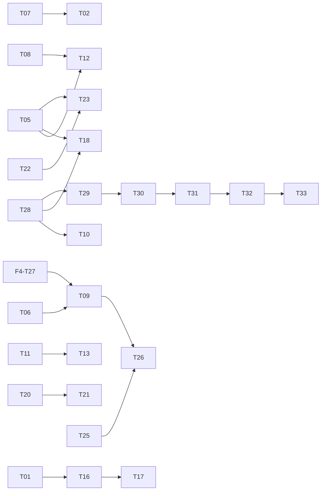

# F5 — Görevler

Her görevin bir kimliği (`F5-Txx`), sprinti (`F5-Sxx`), dosyaları, bağımlılıkları ve "bitti" tanımı vardır. Kodlama ajanı görevi almadan önce [`spec.md`](spec.md) dosyasının ilgili bölümünü okur.

**Boyut:** S = yarım gün veya daha az · M = 1–2 gün · L = 3 gün veya daha fazla

**Yol kuralı:** `backend/`, `frontend/`, `tests/`, `scripts/`, `config/`, `data/`, `experimental/`, `automotive_voice/` → PoC reposu ([`FreyaTTS_Automotive_PoC`](https://github.com/seydivakkas/FreyaTTS_Automotive_PoC)). `docs/` → bu plan reposu.

**Genel kurallar:**
- FreyaTTS ağırlıkları değiştirilmez (S26 hariç; o da ayrı model sürümü olarak).
- Model ikinci kez yüklenmez; tüm adaptörler `models.tts` örneğini kullanır.
- Yeni hat `f5_pipeline_v2` bayrağı arkasında geliştirilir.
- **İstisna — bayraktan bağımsız düzeltmeler:**
  - F5-T11: seed'in sessizce 9'a dönmesi
  - F5-T17'nin iptal filtresi: iptal edilen parçaların yine sentezlenmesi
- **Leyla referans kümesi (F5-T05) hiçbir optimizasyondan önce onaylanır.** Sesi değiştirebilecek her görev (T11, T12, T17, T18, T19) bu kümeye karşı ölçülür.
- Ölçülmemiş performans değeri belge veya koda kanıt olarak yazılmaz.

---

## F5-S01 — Model ve inference envanteri

### F5-T01 · VRAM ve çıkarım envanteri · M
- **Dosyalar:** `scripts/f5_vram_profile.py`, `data/f5/vram-<tarih>.json`
- **İş:** Masaüstü uygulamaları kapalı ve açık olarak ölç: Whisper, Qwen (Ollama), FreyaTTS + VAE yüklü; ön ısıtma sonrası; tek parça sentez sırasında; eşzamanlı STT + TTS sırasında. Model başına bellek ayrımı (`torch.cuda.max_memory_allocated` + `nvidia-smi`).
- **Bitti:** spec §13 soru 1 cevaplanır; sonuçlar ortak katmanın bellek bütçesine girdi olur.

### F5-T02 · Karakterizasyon testleri · M
- **Dosyalar:** `tests/neural_synthesis/test_poc_characterization.py`
- **Bağımlılık:** F5-T07 (sahte motor)
- **İş:** N3 (yedek yolda seed 9; `except TypeError` seed düşürme), N4 (eşzamanlı iki GPU yığını), N5 (iptal edilen öğenin işlenmesi), N7 (F5'in sessizlik/fade eklemesi) davranışlarını test olarak kaydet.
- **Bitti:** Testler mevcut kodla geçer; düzeltme görevleri bunları yeni beklenen davranışla günceller.

### F5-T03 · Belirleyicilik ve kabul cümlesi kararlılığı analizi · M
- **Dosyalar:** `scripts/f5_determinism_probe.py`, `data/f5/determinism-<tarih>.json`
- **İş:** (a) Aynı metin + seed ile TTS'i tek başına 10 kez çalıştır (yığın 1); (b) aynı sabit sesi STT'ye 10 kez ver (F2-T02 ile); (c) ana kabul cümlesini uçtan uca 10 kez çalıştır. Değişkenliğin kaynağını ayır.
- **Bitti:** spec §13 soru 4 cevaplanır.

### F5-T04 · Ölçülmemiş iddiaların temizlenmesi · S
- **Dosyalar:** `backend/batched_ode.py`
- **İş:** Docstring'deki RTX 4090 / RTF / F0 iddialarını kaldır veya "ölçülmedi" olarak etiketle.
- **Bitti:** `test_voice_path_honesty.py` kapsamına bu kural eklenir.

### F5-T05 · Leyla referans kümesi · M
- **Dosyalar:** `data/f5/leyla_reference/`, `config/voices/identity_baseline.json`
- **İş:** Reference A–D cümleleri mevcut (A0) yolla sentezlenir; uzman dinlemesiyle onaylanır; 48 kHz ve 8 kHz karşılıkları; F0, konuşma hızı, RMS dağılımları.
- **Bitti:** Onaylı küme ve taban dağılımları; onaylayan kişi ve tarih kaydı.

## F5-S02 — SynthesisRequest ve AudioChunk sözleşmeleri

### F5-T06 · Sözleşmeler · M
- **Dosyalar:** `backend/neural_synthesis/contracts.py`, `docs/01-architecture/interfaces.md` (F5 bölümü)
- **İş:** spec §6 `AudioChunk`; `SynthesisRequest` (F4 parçası + generation ID + öncelik + deadline).
- **Bitti:** Şema testleri; T02 ve T38 birim kısımları.

### F5-T07 · Sahte çıkarım motoru · M
- **Dosyalar:** `tests/fakes/fake_freya_engine.py`
- **İş:** Girdiye ve seed'e göre deterministik dalga döndüren, süre/hata/gecikme enjekte edilebilen sahte motor. **Yalnızca testlerde yüklenebilir** (üretim yapılandırmasında import edilirse hata).
- **Bitti:** Kuyruk, seed, iptal, önbellek testleri GPU olmadan çalışır.

## F5-S03 — Freya model adaptörü

### F5-T08 · Model adaptörü ve model kaydı · M
- **Dosyalar:** `backend/neural_synthesis/freya_engine.py`, `model_registry.py`, `config/voices/approved_models.json`
- **İş:** `models.tts` üzerinden encode/dur/DiT/VAE erişimi; checkpoint SHA-256; vendor commit; `char_to_id` hash; onaylı model listesi kontrolü.
- **Bitti:** T01 geçer; onaysız checkpoint ile başlatma uyarı verir.

## F5-S04 — Tek F4–F5 sentez yolu

### F5-T09 · F5'ten metin dönüşümünün ve sessizliğin kaldırılması · M
- **Dosyalar:** `backend/models.py`, `backend/batched_ode.py`, `backend/neural_synthesis/pipeline.py`
- **Bağımlılık:** F4-T07, F4-T27; F6'nın duraklama uygulayan görevi
- **İş:** `normalize` / `clauses` / `prepare_tts_clause` çağrıları, duraklama sıfırları ve `apply_fade_and_comfort_noise` F5'ten çıkarılır. `models.synth(text)` uyumluluk için F4 planını üretip yeni hattı çağırır.
- **Bitti:** T03 geçer; uçtan uca sessizlik süreleri plana eşit (F4 T34).

## F5-S05 — Duration Predictor ve Guard

### F5-T10 · Duration Guard · M
- **Dosyalar:** `backend/neural_synthesis/duration_guard.py`, `duration_predictor.py`, `config/voices/duration_profiles.json`
- **Bağımlılık:** F5-T28 (kalibrasyon kümesi)
- **İş:** `clause_frame_count` taşınır; hece tabanlı alt/üst sınırlar; 1,8 kare/karakter değerinin geniş kümeyle kalibrasyonu (N11).
- **Bitti:** T06–T09 geçer; kalibrasyon raporu.

## F5-S06 — Deterministic Seed Manager

### F5-T11 · Seed yöneticisi ve seed düşürmelerinin kaldırılması (hata düzeltmesi) · M
- **Dosyalar:** `backend/neural_synthesis/seed_manager.py`, `backend/models.py`, `backend/batched_ode.py`, `backend/session.py`
- **İş:** Yedek yoldaki `seed=LEYLA_SEED`; geniş `except TypeError` blokları; `_cache_key` içindeki `None → 9` varsayılanı. Seed her zaman ses profilinden gelir.
- **Bitti:** T11 geçer; seed değişimi yalnızca açık profil değişimiyle olur ve kaydedilir.

## F5-S07 — Batch bağımsız latent üretimi

### F5-T12 · Gerçek uzunlukta gürültü ve öğe başına VAE · M
- **Dosyalar:** `backend/neural_synthesis/latent_initializer.py`, `vae_decoder.py`
- **Bağımlılık:** F5-T05, F5-T08
- **İş:** N1 ve N2 düzeltmeleri; CPU/GPU üretici seçimi; yığın içi/dışı karşılaştırma.
- **Bitti:** T12–T14 geçer; referans kümeyle speaker similarity ve Whisper geri tanıma değişimi raporlanır.

## F5-S08 — Voice Identity Registry

### F5-T13 · Ses profilleri · S
- **Dosyalar:** `backend/neural_synthesis/voice_registry.py`, `config/voices/leyla.json`
- **İş:** Leyla ve A/B profilleri; `ab_testing` entegrasyonu; profilsiz isteğin reddi.
- **Bitti:** `test_ab_testing.py` geçer; T11.

## F5-S09 — Sürüm duyarlı ses önbelleği

### F5-T14 · Önbellek düzeyleri · M
- **Dosyalar:** `backend/neural_synthesis/audio_cache.py`, `config/voices/cache_policy.json`
- **İş:** L0–L3; spec §5.3 anahtarı; `cacheable=false` kuralı; sürüm uyuşmazlığında geçersiz kılma.
- **Bitti:** T25–T27 geçer.

## F5-S10 — Prewarm Manager

### F5-T15 · Ön ısıtma · S
- **Dosyalar:** `backend/neural_synthesis/prewarm_manager.py`
- **İş:** Mevcut hedefler (karşılamalar, `PREWARM_PHRASES`, A/B seed'leri) + bekleme cümlesi; P6 önceliği; L2'den yükleme.
- **Bitti:** İlk soğuk sentez yükleme sırasında tamamlanır; canlı görüşme sırasında ön ısıtma canlı işi geciktirmez.

## F5-S11 — Unified GPU Scheduler

### F5-T16 · Ortak GPU yöneticisi · L
- **Dosyalar:** `backend/runtime_resources/gpu_scheduler.py`, `memory_budget.py`, `priority_queue.py`, `cancellation.py`
- **Bağımlılık:** F5-T01; F2-T07; F3-T33
- **İş:** P0–P7 öncelikleri; bağımlılık ve deadline; VRAM bütçesi; kabul denetimi; iptal semantiği; mevcut `stt_lock` / `lock` / `worker_lock` yerine tek yönetim.
- **Bitti:** T28–T31 geçer; ortak katman belgesi güncellenir.

## F5-S12 — Batched Inference 2.0

### F5-T17 · Yığınlama ve iptal filtresi · M
- **Dosyalar:** `backend/neural_synthesis/batched_inference.py`, `batch_scheduler.py`, `backend/batched_ode.py`
- **Bağımlılık:** F5-T16
- **İş:**
  - **Hata düzeltmesi (bayraktan bağımsız):** İptal edilmiş veya eski generation'a ait öğeler yığına alınmadan çıkarılır (N5).
  - Aynı anda tek TTS yığını (N4).
  - Profiller; varsayılan Single Call; latent uzunluğuna göre gruplama.
- **Bitti:** T12, T32–T34 geçer.

## F5-S13 — Adaptive ODE Solver

### F5-T18 · ODE profil karşılaştırması · M
- **Dosyalar:** `backend/neural_synthesis/ode_solver.py`, `solver_policy.py`, `config/voices/solver_profiles.json`
- **Bağımlılık:** F5-T05, F5-T28
- **İş:** 16/24/32/48 adım; gecikme, Whisper geri tanıma, speaker similarity, uzman dinlemesi örneklemi.
- **Bitti:** T15; hangi profilin hangi kullanımda açılacağı kararı (ölçüme dayalı).

## F5-S14 — AudioVAE optimizasyonu

### F5-T19 · Kod çözücü ölçümü ve optimizasyonu · S
- **Dosyalar:** `backend/neural_synthesis/vae_decoder.py`
- **İş:** Çözücü ve kod çözücü sürelerinin ayrı ölçümü; gerekiyorsa yarı hassasiyet veya parçalı decode (kalite testiyle).
- **Bitti:** T16; ölçüm raporu.

## F5-S15 — Acoustic Quality Guard

### F5-T20 · Q1 hızlı denetim · M
- **Dosyalar:** `backend/neural_synthesis/quality_guard.py`
- **İş:** spec §5.8 Q1; ucuz seslilik denetimi; süre aralığı; eşik kalibrasyonu ve yanlış alarm oranı.
- **Bitti:** T17–T20 geçer; Q1 süresi p95 ≤ 5 ms.

## F5-S16 — Controlled Recovery Engine

### F5-T21 · Kontrollü yeniden sentez · M
- **Dosyalar:** `backend/neural_synthesis/recovery_engine.py`, `backend/main.py` (başlatma kontrolü)
- **Bağımlılık:** F5-T20
- **İş:** Aynı seed ile en fazla 1 deneme; güvenli hata olayı (F3'e); `allow_sine_fallback=True` iken üretimde başlamama.
- **Bitti:** T21, T35, T36 geçer.

## F5-S17 — Speaker Identity Verification

### F5-T22 · Speaker encoder seçimi ve lisansı · S
- **Dosyalar:** `docs/01-architecture/adr/ADR-F5-01-speaker-encoder.md`
- **İş:** Aday encoder'ların lisansı, çevrimdışı kurulumu, CPU süresi, Türkçe ve telefon bandı davranışı.
- **Bitti:** ADR.

### F5-T23 · Kimlik doğrulama ve eşik kalibrasyonu · M
- **Dosyalar:** `backend/neural_synthesis/speaker_encoder.py`, `identity_guard.py`
- **Bağımlılık:** F5-T05, F5-T22
- **İş:** Referans kümeden 48 kHz ve 8 kHz dağılımları; PASS / REVIEW / FAIL eşikleri.
- **Bitti:** T23 geçer; eşikler `identity_baseline.json`'da.

## F5-S18 — F0 ve ritim analizi

### F5-T24 · Drift analizörü · M
- **Dosyalar:** `backend/neural_synthesis/pitch_analyzer.py`
- **İş:** Median F0, F0 std, seslilik oranı, hece/s (F4 hece sayısıyla), RMS; referansa göre sapma.
- **Bitti:** T22 geçer.

## F5-S19 — Düşük gecikmeli cümlecik akışı

### F5-T25 · Chunk dispatcher · M
- **Dosyalar:** `backend/neural_synthesis/chunk_dispatcher.py`, `backend/session.py`
- **İş:** İlk parça P2; sonraki parçaların deadline'ı; sıralı teslim; generation kontrolü; F5 TTFA bileşenlerinin ölçümü.
- **Bitti:** T31 ve T33 geçer; F5 TTFA p50/p95 raporlanır.

## F5-S20 — F5–F6 entegrasyonu

### F5-T26 · F6'ya ham ses teslimi · M
- **Bağımlılık:** F5-T09, F5-T25; F6 planındaki ilgili görevler
- **Bitti:** T38 geçer; F6 duraklama/fade/telefon dönüşümünü tek başına yapar.

## F5-S21 — Neural Synthesis Studio arayüzü

### F5-T27 · API ve arayüz · L
- **Dosyalar:** `backend/routers/f5.py`, `frontend/src/SynthesisStudioPanel.tsx` ve alt sayfalar
- **Bitti:** spec §8; gerçek backend; dürüstlük kuralı; deneysel profiller onaysız canlıya uygulanamaz.

## F5-S22 — Sentetik test laboratuvarı

### F5-T28 · 2 000 girdilik küme · M
- **Dosyalar:** `data/f5/synthesis_set/`, `scripts/f5_build_set.py`
- **Bağımlılık:** F4-T07
- **İş:** spec §9 dağılımı; F4 planları olarak saklama; kalibrasyon ve test bölümleri.
- **Bitti:** Manifest ve hash'ler.

### F5-T29 · T01–T40 testleri · L
- **Dosyalar:** `tests/neural_synthesis/lab/test_t01_*.py` … `test_t40_*.py`
- **İş:** Önce sahte motorla (`unit`), sonra gerçek modelle (`gpu`).
- **Bitti:** Sonuçlar `data/f5/lab-report-*.json`.

## F5-S23 — Ablation ve GPU benchmark

### F5-T30 · A0–A10 ve kapasite ölçümü · L
- **İş:** spec §10 matrisi; 1, 2, 4 eşzamanlı görüşme; tüm modeller yüklü; gerçek kapasiteye göre `max_concurrent_calls` önerisi.
- **Bitti:** `docs/stages/F5-neural-synthesis/ablation-results.md` (yalnızca ölçülmüş değerler).

## F5-S24 — F0–F6 regresyon testleri

### F5-T31 · Uçtan uca regresyon · M
- **Bitti:** Mevcut testler kırılmaz; `legacy_320_cases.json` akustik regresyonu; uçtan uca TTFA karşılaştırması; ana kabul cümlesi kararlılığı (K22).

## F5-S25 — Gerçek akustik ve kimlik kabulü

### F5-T32 · İnsan değerlendirmesi · M
- **Dosyalar:** `docs/testing/f5-listening-protocol.md`
- **İş:** Kör MOS ve ABX (gerçek dinleyiciler, en az belirlenen sayıda); 48 kHz ve telefon bandı; ardından gerçek görüşme ve SIP kabulü.
- **Bitti:** `acceptance.md` AŞAMA 4 tablosu dolar.

## F5-S26 — İhtiyaç halinde ayrı LoRA araştırması

### F5-T33 · Kontrollü LoRA deneyi · L
- **Bağımlılık:** F5-T30, F5-T32 (gerçek akustik problemler ayrıştırıldıktan sonra)
- **İş:** spec §7 SFT-2 … SFT-5; lisanslı veri; rank 4 / 8 / 16; kimlik korunumu; geri dönüş.
- **Bitti:** T39 ve T40 geçer veya deney gerekçesiyle kapatılır.

---

## Bağımlılık özeti

