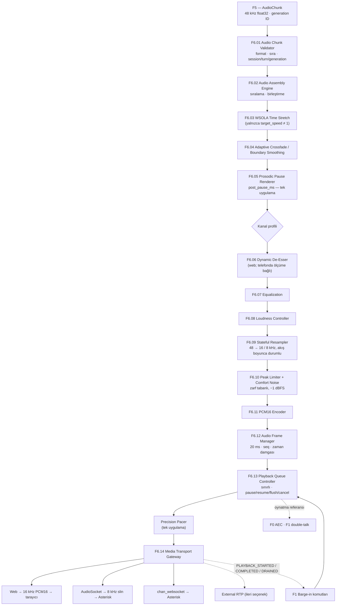

# F6 — Audio Rendering, DSP & Telephony Transport Intelligence (Ses İşleme, DSP ve Telefon Aktarımı)

| Alan | Değer |
| --- | --- |
| Aşama | F6 — hattın son katmanı: müşterinin gerçekten duyduğu ses |
| Yol haritası modülleri | AP07 Prosody & Audio Stitching (birleştirme kısmı) · AP09 Telephony Media Reliability · AP12 Human Voice & SIP Acceptance (F6 kısmı) |
| Girdi | F5'ten `AudioChunk` (48 kHz float32 ham ses + metadata; `post_pause_ms`, `target_speed`) · F1'den oynatma komutları (pause / resume / flush / cancel) |
| Çıktı | Web: 16 kHz PCM16 → tarayıcı · Telefon: 8 kHz PCM16 → Asterisk (AudioSocket veya chan_websocket) · Oynatma referansı → **F0 AEC** ve **F1 double-talk** · Oynatma makbuzları → **F1** · telemetri |
| Kod | [`FreyaTTS_Automotive_PoC`](https://github.com/seydivakkas/FreyaTTS_Automotive_PoC) reposunda `backend/audio_rendering/` + `backend/media_transport/` + `config/media/` |
| GPU bütçesi | **0 MB** — F6 tamamen CPU'da |
| İlgili belgeler | [`tasks.md`](tasks.md) · [`acceptance.md`](acceptance.md) · [`../F5-neural-synthesis/spec.md`](../F5-neural-synthesis/spec.md) §6 · [`../F1-voice-turn-detection/spec.md`](../F1-voice-turn-detection/spec.md) §5.9 |

> **Yol kuralı:** `backend/`, `frontend/`, `tests/`, `scripts/`, `config/`, `data/`, `contracts/`, `experimental/`, `automotive_voice/`, `asterisk/` ile başlayan yollar **PoC reposundadır**. `docs/` ile başlayan yollar **bu plan reposundadır**.

---

## 1. Amaç

F5 kaliteli ses üretse bile F6 doğru çalışmazsa müşteri kesik, gecikmeli, boğuk veya mekanik bir ses duyar.

**Hedefler:**
- Cümlecikler arasında doğal ve kesintisiz geçiş
- Leyla ses kimliğinin telefon bandında korunması
- Düşük gecikmeli ve kontrollü aktarım
- Barge-in sonrasında eski sesin oynatılmaması
- Asterisk, SIP ve medya bağlantılarının güvenilirliği
- **Müşterinin gerçekten duyduğu** ses kalitesinin ve zamanlamasının ölçülmesi

**F6 önceliği (P0):** Playback queue, pacing ve flush. Ardından tek rendering zinciri ve durumlu yeniden örnekleme.

**Değişmez kurallar:**
1. Her DSP işlemi **tek yerde ve tek kez** uygulanır. F5 ham ses verir, F6 duraklama/fade/EQ/limiter/dönüşümü yapar.
2. Eski generation'a ait hiçbir çerçeve gönderilmez.
3. Ağ yazması hiçbir zaman süresiz bloklamaz.
4. Sunucunun "gönderdim / flush ettim" demesi, müşterinin sesi duyduğu veya duymayı bıraktığı anlamına gelmez; bu ikisi ayrı ölçülür.

## 2. Kapsam

**Kapsamda:**
- Ses parçası doğrulama ve birleştirme
- Crossfade ve sınır yumuşatma
- WSOLA zaman ölçekleme
- Prozodik duraklama uygulama
- De-esser, EQ, loudness, limiter, comfort noise
- Durumlu yeniden örnekleme
- PCM kodlama ve codec laboratuvarı
- 20 ms çerçeveleme ve hassas zamanlama (pacing)
- Oynatma kuyruğu ve backpressure
- Barge-in köprüsü
- Transport adaptörleri: Web, AudioSocket, chan_websocket, ileride RTP
- Medya telemetrisi, AMI/ARI entegrasyonu, hata yönetimi
- Audio Transport Studio
- Asterisk/SIP kabul laboratuvarı

**Kapsam dışı:**
- Sentez → F5
- Barge-in **kararı** → F1 (F6 komutu uygular ve sonucunu bildirir)
- Arama iş akışı kararı (aktarım, geri arama) → F3 (F6 kanal ve medya durumunu doğrular)

## 3. PoC'taki mevcut durum (doğrulanmış)

Bu bölüm kod okumasıyla ve PoC'un DSP fonksiyonlarının doğrudan çalıştırılmasıyla hazırlandı. chan_websocket bilgileri Asterisk belgelerinden doğrulandı.

### 3.1 Canlı çıkış yolu

`session.play_wave(w, turn)`:
- **Telefon (8 kHz):** `dsp.apply_telephony_eq_and_downsample_8k(w)` → `audio.pace(...)` → `send_audio_frame` → AudioSocket `0x10` paketi
- **Web (16 kHz):** `pcm(resample(w, 48000, 16000))` → `play_wave` içindeki ayrı zamanlama döngüsü → WebSocket ikili çerçeve → tarayıcı

Her cümlecik dalgası ayrı bir `play_wave` çağrısıyla, **bağımsız olarak** işlenir.

### 3.2 Bulgular

| # | Bulgu | Kanıt | Etki |
| --- | --- | --- | --- |
| R1 | **Web ve telefon farklı DSP zincirinden geçiyor; üçüncü bir zincir yalnızca demoda** | Telefon: 80 Hz HPF + 3,2 kHz presence + polifaz 1/6 + `tanh`. Web: yalnızca `resample_poly` + `clip` (EQ ve limiter yok). `AutomotiveDSPChain` (de-esser, comfort noise) yalnızca `routers/text_speech.py` içinde | Web ve telefonda Leyla farklı duyulur; demo zincirinin özellikleri canlıda yok |
| R2 | **Durumsuz filtre ve yeniden örnekleme her parçada baştan başlıyor** | `sosfilt` başlangıç durumu olmadan, `lfilter` durumsuz, `resample_poly` parça başına. Ölçüm: 440 Hz sinüs iki parçada işlendiğinde, tek parça işlenmesine göre sınırın ±5 ms çevresinde **genliğin yaklaşık %29'u** kadar sapma; sınırdan uzakta sapma yok | Cümlecik sınırlarında tık ve faz süreksizliği. F5'in 10 ms fade'i bunu kısmen maskeliyor ama sesin başını da kısıyor |
| R3 | **"Soft limiter" aslında tüm sinyale uygulanan bir doygunlaştırıcı (waveshaper)** | `np.tanh(y * 1.15)` her örneğe. Ölçüm: −26 dBFS girişte +1,2 dB kazanç; −6 dBFS sinüste THD ≈ −32 dB (%2,5); −0,9 dBFS'de THD ≈ −24 dB (%6) ve tepe −2,2 dBFS | Yüksek sesli hecelerde harmonik bozulma; kazanç tüm seviyelerde değişiyor. Zarf (attack/release) yok |
| R4 | **Üç ayrı pacing uygulaması** | `audio.pace` (telefon), `play_wave` içindeki döngü (web), `AudioPacer` (her AudioSocket bağlantısında oluşturuluyor ama **gönderimde kullanılmıyor**) | Kod tekrarı; ölçümler yanlış nesneden okunabilir. Üçünde de saat geride kalınca paket yağmuru yapılmaması (deadline re-clamp) doğru, korunur |
| R5 | **F6 süresi oynatma süresini içeriyor** | `f6_ms`, `pace` döngüsünün bitişine kadar ölçülüyor | DSP maliyeti görünmüyor; F6 olayı aslında "ses süresi" |
| R6 | **Ağ yazmasında zaman aşımı yok** | `send_audio_frame`: `writer.write(packet); await writer.drain()` | Asterisk veya ağ okumayı durdurursa gönderim süresiz bloklar; barge-in flush'ı bekleyen gönderimi kesemez |
| R7 | **Tarayıcı oynatma makbuzu göndermiyor** | `useVoiceSession.ts`: oynatma AudioWorklet değil, 20 ms'lik her çerçeve için `AudioBufferSourceNode` ve 25 ms önden zamanlama. Pause = `AudioContext.suspend()` (anında), flush = kaynakları durdurma. İstemciden sunucuya oynatma olayı yok | F1'in "duyulabilir ses kesilmesi" ölçümü yapılamıyor. AudioWorklet yalnızca mikrofon yakalamada kullanılıyor |
| R8 | **chan_websocket adaptörü hedef Asterisk ayarıyla doğrulanmamış** | Canlı adaptör kontrol komutlarını **JSON** gönderiyor. Asterisk belgelerine göre düz metin kontrol mesajları kullanımdan kalkıyor ama hâlâ **varsayılan**; JSON biçimi yapılandırmayla açılıyor. Repodaki `asterisk/` klasöründe yalnızca AudioSocket dialplan'i var. Canlı adaptör `MEDIA_XOFF` / `MEDIA_XON` olaylarını işlemiyor. Deneysel modül `RESUME_MEDIA` kullanıyor; Asterisk komutu `CONTINUE_MEDIA` (canlı adaptör doğru) | Asterisk yapılandırılmadan komutlar etkisiz kalabilir. Asterisk kuyruğu yaklaşık 1 000 çerçeve (20 s) tutar ve ~900'de XOFF gönderir; flush yapılmazsa uzun eski ses birikebilir |
| R9 | **AudioSocket kimlik doğrulamasız ve TLS'siz** | Yalnızca 16 baytlık UUID el sıkışması; `audiosocket_host = 127.0.0.1`, dialplan `127.0.0.1:9092` | Aynı makinede güvenli. Planın topolojisinde Freya Windows'ta, Asterisk Linux'ta; bu durumda yalnızca özel ağ veya tünel üzerinden açılmalı |
| R10 | **De-esser telefon çıkışında etkisiz** | Demo zincirindeki de-esser 6,5 kHz civarında; 8 kHz çıkışın Nyquist sınırı 4 kHz | Planın tespitiyle aynı: bu bant zaten anti-aliasing filtresiyle kesilir |
| R11 | **`apply_fade_and_comfort_noise` gürültü eklemiyor** | Fonksiyon yalnızca 10 ms kosinüs fade uyguluyor | Ad yanıltıcı (planın tespiti); comfort noise canlı yolda yok |
| R12 | **Duraklamalar F5'te ekleniyor** | F5 spec §3.3 N7 | F6 duraklama planını bilmiyor (F4 L2) |

### 3.3 Korunacak mevcut bileşenler

- 48 kHz ham TTS çıkışı ve PCM16 little-endian kodlama
- 20 ms çerçeve sözleşmesi ve `media_format.expected_bytes` kontrolü
- Deadline re-clamp (paket yağmuru yapmama)
- Oynatma sırasında `turn == generation` kontrolü (eski turun çerçevesi gönderilmez)
- Tarayıcıda `AudioContext.suspend()` ile anında duraklatma
- AudioSocket: 64 KB paket sınırı, 5 s el sıkışma zaman aşımı, 16 bayt UUID kontrolü, kapasite kontrolü
- `audio.frames` son çerçeve dolgusu
- Tek kullanımlık web oturum bileti (`ticket_expired` / `line_busy` kapanış kodları)
- `experimental/prosody_wsola_streamer.WSOLATimeStretch` (25 ms pencere, 10 ms arama)

## 4. Hedef mimari



**Paralel denetim:** F1 barge-in geri bildirimi, ağ kalitesi izleme, oynatma makbuzları, ses kalitesi değerlendirmesi, transport hata kurtarma, medya saati senkronizasyonu.

**İşlem sırası notu:** Yeniden örnekleme ve limiter, **cümlecik bazında değil akış bazında** çalışır. Rendering zinciri bir görüşme boyunca tek bir durumlu nesnedir; her `AudioChunk` bu akışa eklenir (R2 çözümü).

## 5. Bileşenler

### 5.1 F6.01–F6.02 — Chunk Validator ve Audio Assembly (`chunk_validator.py`, `audio_assembler.py`)

- Her parça doğrulanır: `session_id`, `turn_id`, `generation_id`, `chunk_index`, `sample_rate = 48000`, `float32`, mono, NaN/Inf yok.
- **Eski generation** → atılır ve sayılır.
- **Yanlış sıra** → `chunk_index` beklenen değilse beklenen parça gelene kadar tutulur (sınırlı süre); süre aşılırsa eksik parça olayı yazılır ve sıradaki geçerli parçadan devam edilmez, F5'e yeniden istek gider.
- Birleştirme F4 planına göre yapılır: parça + duraklama + parça…

### 5.2 F6.04 — Adaptive Crossfade & Boundary Smoothing (`crossfade.py`)

- **Fade ve crossfade ayrı işlemlerdir.** Mevcut 10 ms kosinüs fade (F5'ten taşınır) yalnızca **sessizlikle komşu** sınırlarda kullanılır.
- **Crossfade** yalnızca iki parça arasında duraklama olmayan (`post_pause_ms = 0`) sınırlarda, eşit güç biçiminde uygulanır: y[n] = a[n]·cos(θ) + b[n]·sin(θ). Başlangıç süresi 12 ms.
- Planlanmış sessizlikler korunur. Sözcüklerin ilk/son fonemleri kesilmez: fade/crossfade bölgesi, parçanın başındaki/sonundaki **sessiz kısım** ölçülerek yerleştirilir (enerji eşiği).

### 5.3 F6.03 — WSOLA Time Stretch (`wsola.py`)

`experimental/prosody_wsola_streamer.WSOLATimeStretch` taşınır.

| Parametre | Değer |
| --- | --- |
| Pencere | 25 ms |
| Arama aralığı | 10 ms |
| Başlangıç hız aralığı | 0,94–1,06× |
| Örtüşme | %50 |
| Platform | CPU |

- Yalnızca `target_speed ≠ 1,00` olan parçalara uygulanır; varsayılan kapalı.
- F5 süre ölçeklemesiyle hızı zaten gerçekleştirdiyse (F5 spec §5.5), F6 tekrar uygulamaz. Hangi katmanın uygulayacağı ADR-F6-02'de kararlaştırılır; **ikisi birden uygulamaz**.
- WSOLA'nın perdeyi ve formantları kusursuz koruduğu varsayılmaz: F0 sapması ve speaker similarity ölçülür (T09, T10).

### 5.4 F6.05 — Prosodic Pause Renderer (`pause_renderer.py`)

F4'ün `post_pause_ms` değeri **yalnızca burada** uygulanır.

| Duraklama türü | Başlangıç aralığı |
| --- | --- |
| Mikro duraklama | 20–60 ms |
| Sözcük öbeği | 60–100 ms |
| Virgül | 100–160 ms |
| Noktalı virgül | 160–220 ms |
| Cümle sonu | 200–300 ms |
| Soru sonu | 240–350 ms |
| Fiyat ve kritik bilgi | 180–300 ms |

- F6 aralık dışı bir değer gelirse sınırlar ve uyarı yazar.
- Duraklama dijital sıfır değil, kanal profiline göre sıfır veya comfort noise'dur (§5.7).
- Parçanın kendi içindeki baştaki/sondaki sessizlik ölçülür ve duraklamadan düşülür (aksi halde duraklama F5'in ürettiği sessizlikle uzar).

### 5.5 F6.06–F6.08 — De-Esser, Equalization, Loudness (`de_esser.py`, `equalizer.py`, `loudness.py`)

**Kanal profilleri** (`config/media/rendering_profiles.json`):

| Parametre | Web | Telefon |
| --- | --- | --- |
| Çıkış örnekleme | 16 kHz | 8 kHz |
| HPF başlangıç | 60 Hz | 80 Hz (mevcut) |
| Presence EQ | Hafif | 0–2,8 dB (mevcut 3,2 kHz tepe) |
| De-esser | Adaptif | **Ölçüme bağlı** — 5,5–7,5 kHz bandı 8 kHz çıkışta zaten yok (R10); 4 kHz altı sibilans için ayrı değerlendirme |
| Comfort noise | Kapalı | Gerektiğinde (§5.7) |
| Peak ceiling | −1 dBFS | −1 dBFS |
| WSOLA | İsteğe bağlı | İsteğe bağlı |

- Tüm filtreler **durumludur** (R2): SOS `zi` ve IIR durumları görüşme boyunca korunur.
- **Loudness:** Parça bazında RMS (dBFS) ölçülür; hedef seviyeye yavaş zarfla yaklaştırılır. Parçalar arası seviye farkı sınırlanır (acceptance K-loudness).

### 5.6 F6.09 — Stateful Resampler (`resampler.py`)

- **Akış boyunca durumlu** dönüşüm: soxr `ResampleStream` (F0 ile aynı kütüphane) veya durumlu polifaz filtre. Seçim ADR-F6-01 ile yapılır (gecikme, anti-aliasing, CPU).
- Cümlecik sonunda örnek kaybı veya gereksiz dolgu oluşmaz. Toplam giriş/çıkış örnek sayısı oranı tam olarak korunur (T22).
- 48 → 16 kHz (oran 3) ve 48 → 8 kHz (oran 6) tam sayı oranlarıdır; anti-aliasing tepkisi frekans taramasıyla ölçülür (T21).

### 5.7 F6.10 — Peak Limiter ve Comfort Noise (`limiter.py`, `comfort_noise.py`)

**Limiter (R3 çözümü):**
- Zarf tabanlı: hızlı attack, yumuşak release, isteğe bağlı 1–3 ms look-ahead. Tavan **−1 dBFS**.
- Eşik altındaki sinyale **dokunmaz** (mevcut `tanh` tüm seviyelerde kazanç ve bozulma ekliyor).
- Kazanç düşürme miktarı telemetriye yazılır.
- F0'ın limiter'ı ile aynı algoritma ailesi kullanılır (ortak DSP yardımcıları).

**Comfort noise:**
- **Varsayılan kapalı.** Telefon profilinde yaklaşık −58 dBFS başlangıç seviyesiyle deneysel olarak sınanır.
- Asterisk veya codec zaten konfor gürültüsü üretiyorsa ikinci kez uygulanmaz.
- Comfort noise açıkken F0 AEC'ye ve F1 double-talk'a giden **oynatma referansına dahil edilir**; aksi halde Freya'nın kendi gürültüsü müşteri sesi sanılabilir.

### 5.8 F6.11 — PCM ve Codec (`codec.py`)

| Format | Örnekleme | Nominal veri hızı |
| --- | --- | --- |
| Float32 mono | 48 kHz | 1 536 kbps |
| PCM16 mono | 48 kHz | 768 kbps |
| PCM16 mono | 16 kHz | 256 kbps |
| PCM16 mono | 8 kHz | 128 kbps |
| G.711 A-law / μ-law | 8 kHz | 64 kbps |
| G.722 | Geniş bant | Genellikle 64 kbps |
| Opus | Yapılandırılabilir | Değişken |

(Ham ses veya codec yük hızları; protokol başlıkları hariç.)

- **AudioSocket G.711 veya RTP değildir.** Freya 8 kHz signed linear PCM gönderir; Asterisk SIP tarafında anlaşılan codec'e dönüştürür. Freya codec dönüşümü **yapmaz**; çift dönüşüm önlenir.
- **Codec laboratuvarı (çevrimdışı):** Freya çıkışı A-law ve μ-law gidiş-dönüşünden geçirilir; Whisper geri tanıma, terim doğruluğu ve uzman dinlemesiyle telefon codec'inin telaffuza etkisi ölçülür (T24, T25). PoC Python 3.11 kullanıyor; standart kütüphanedeki `audioop` 3.13'te kaldırıldığı için laboratuvar kendi numpy G.711 uygulamasını kullanır.

### 5.9 F6.12 — Audio Frame Manager (`frame_manager.py`)

- N_örnek = f_s × T_ms / 1000. Telefon: 160 örnek / 320 B; Web: 320 örnek / 640 B.
- AudioSocket paketi: tür (1 B, `0x10`) + uzunluk (2 B, `0x0140`) + 320 B PCM = **323 bayt** (TCP/IP başlıkları hariç).
- Her çerçeve: `session_id`, `generation_id`, `seq`, planlanan gönderim zamanı.
- Son çerçeve sıfırla doldurulur (mevcut davranış); dolgu miktarı kaydedilir.

### 5.10 Precision Pacer (`pacer.py`)

- **Tek uygulama** (R4): `audio.pace`, `play_wave` içindeki web döngüsü ve `AudioPacer` birleştirilir.
- Monotonic saat; gönderim zaman damgaları; geç kalan çerçeve sayacı; deadline re-clamp (paket yağmuru yok — korunur).
- **Gönderim zaman sapması** (planlanan − gerçekleşen) ölçülür.
- Cümlecikler arasında pacer yeniden başlamaz: görüşme boyunca tek medya saati; parça yoksa (sentez gecikti) kanal profiline göre sessizlik/comfort noise çerçevesi gönderilip gönderilmeyeceği ADR-F6-03 ile kararlaştırılır.

### 5.11 F6.13 — Playback Queue Controller ve Backpressure (`playback_queue.py`, `backpressure.py`, `bargein_bridge.py`)

**Üç tampon birbirinden ayrılır:**

| Tampon | Sorumluluk | Kontrol |
| --- | --- | --- |
| F6 Playback Queue | Freya'nın ürettiği, henüz gönderilmemiş çerçeveler | Tam kontrol: sınırlı, flush edilebilir |
| Tarayıcı oynatma tamponu | 25 ms önden zamanlanmış kaynaklar | Flush ve suspend komutu ile |
| Asterisk / RTP jitter tamponu | PBX ve telefon tarafı | AudioSocket'te yok; chan_websocket'te FLUSH_MEDIA |

**Oynatma olayları:**

| Olay | F6 davranışı |
| --- | --- |
| `PLAY` | İlgili generation sesini oynat |
| `SOFT_PAUSE` | Yeni gönderimi durdur; kuyruk korunur; oynatma konumu kaydedilir |
| `RESUME` | Aynı generation üzerinden devam (F1 kuralı: 1 s'den uzun duraklamada cümlecik başından) |
| `FLUSH` | Eski generation tamponunu temizle; transport'a flush komutu |
| `CANCEL` | Bekleyen eski sentez ve gönderimleri reddet (F5'e iptal) |
| `DRAINED` | Kuyruğun boşaldığını doğrula |
| `PLAYBACK_STARTED` | Gerçek oynatma başlangıcı (istemci/PBX makbuzuyla) |
| `PLAYBACK_COMPLETED` | Oynatma sonu |

**Kurallar:**
- Kuyruk sınırlıdır; dolarsa üretici (F5) bekletilir (backpressure), eski çerçeve atılmaz.
- **Ağ yazma zaman aşımı (R6):** Her `drain` için zaman aşımı (başlangıç: 3 çerçeve süresi). Aşılırsa görüşme kontrollü kapatma akışına girer ve olay yazılır.
- **Önden gönderim sınırı:** Transport'a en fazla N çerçeve önden gönderilir (AudioSocket'te pacer zaten gerçek zamanlı; chan_websocket'te Asterisk kuyruğu 20 s tutabildiği için önden gönderim sınırı **zorunlu**). Bu, barge-in sonrası duyulan eski ses miktarının üst sınırıdır.
- AudioSocket'te daha önce gönderilen ses geri alınamaz; bu yüzden önden gönderim sınırı küçük tutulur.

### 5.12 F6.14 — Media Transport Gateway (`backend/media_transport/`)

| Özellik | AudioSocket | chan_websocket | External RTP |
| --- | --- | --- | --- |
| Projedeki rol | **Ana telefon yolu** | Geliştirme adayı | İleri seçenek |
| Uygulama pacing | Gerekli | Asterisk büyük ölçüde yönetir (medya tamponlama modunda) | Gerekli |
| Medya kuyruğu kontrolü | Yok | FLUSH_MEDIA, PAUSE_MEDIA, CONTINUE_MEDIA, MARK_MEDIA, REPORT_QUEUE_DRAINED, MEDIA_XOFF/XON | Uygulama sorumluluğu |
| Oynatma konumu | Yok | `MARK_MEDIA` → `MEDIA_MARK_PROCESSED` | Uygulama |
| TLS | Yok | Var | SRTP ayrı |
| Karmaşıklık | Düşük | Orta | Yüksek |

**Strateji (planın kararı):** Önce AudioSocket yolu tamamlanır. Ardından chan_websocket alternatif transport olarak kabul testlerine alınır. Çalışan yol hemen kaldırılmaz.

**chan_websocket için ek gereksinimler (R8):**
- Hedef Asterisk sürümünün chan_websocket'i desteklediği doğrulanır (belgelere göre 20.16, 21.11, 22.6, 23.0 ve sonrası).
- Kontrol mesajı biçimi (düz metin / JSON) Asterisk yapılandırmasıyla eşleştirilir; yapılandırma dosyaları `asterisk/` klasörüne eklenir.
- `MEDIA_XOFF` / `MEDIA_XON` işlenir; XOFF'ta gönderim durur.
- **`MARK_MEDIA` her cümlecik sınırına konur** → `MEDIA_MARK_PROCESSED` olayları telefon kanalında oynatma makbuzu ve barge-in sonrası "nereye kadar duyuldu" bilgisini verir. Asterisk belgelerine göre bu olay kuyruğun işlendiğini gösterir; telefonun hoparlöründe çalındığını değil.
- Deneysel modüldeki `RESUME_MEDIA` kullanılmaz; doğru komut `CONTINUE_MEDIA`.

**Web:**
- Oynatma bugünkü gibi `AudioBufferSourceNode` ile devam edebilir veya AudioWorklet'e taşınır (ADR-F6-04; ölçüm: kesinti, gecikme, CPU).
- **Oynatma makbuzları (R7):** İstemci `playback_started`, `playback_completed`, `paused_at` (AudioContext zamanı ve çerçeve seq'i) olaylarını sunucuya gönderir. F1'in duyulabilir kesilme ölçümü bununla yapılır.

**Güvenlik (R9):**
- AudioSocket yalnızca güvenilir özel ağda veya güvenli tünel üzerinden; internete açılmaz. Bağlanan IP izin listesiyle sınırlanır.
- Web: mevcut tek kullanımlık oturum bileti korunur; uzaktan erişimde HTTPS/WSS.
- chan_websocket: TLS ve kimlik bilgileri (`websocket_client` yapılandırması).

### 5.13 Asterisk AMI / ARI entegrasyonu (`media_transport/`, mevcut `ami.py`, `telephony.py`, `transfer.py`, `sip_trunk_failover.py`)

| Bileşen | Görevi |
| --- | --- |
| AMI | Giden arama, çağrı olayları, aktarım |
| ARI | Kanal ve bridge yaşam döngüsü, medya kontrolü |
| AudioSocket | Çift yönlü ses aktarımı |
| chan_websocket | Medya aktarımı ve kuyruk yönetimi |
| PJSIP | SIP oturumları ve trunk yönetimi |
| RTP/SRTP | Telefon tarafındaki medya |
| RTCP | Medya kalitesi ve oturum istatistikleri |

- **Gerçek arama ve aktarım başarısı API isteğinin başarılı dönmesiyle ölçülmez.** Kanal oluşturulması, karşı tarafın cevap vermesi ve medya bağlantısı ayrı ayrı doğrulanır (F3 Policy: "AMI yoksa aktarıldınız deme").
- Mock / gerçek mod ayrımı (`is_real_ami`) korunur ve Studio'da açıkça gösterilir.

### 5.14 Hata yönetimi (`fault_recovery.py`)

| Hata | Beklenen davranış |
| --- | --- |
| TCP bağlantısı kesildi | İlgili görüşmeyi güvenli sonlandır, F3'e bildir |
| Geçersiz UUID | Bağlantıyı reddet (mevcut) |
| Bozuk PCM formatı | Çerçeveyi reddet ve kaydet |
| PBX bağlantısı yok | Telefon hizmetini hazır gösterme |
| SIP trunk kullanılamıyor | Yeni çağrıyı güvenli reddet/yönlendir (`sip_trunk_failover.py`) |
| Playback queue taşması | Backpressure uygula |
| Eski generation geldi | Oynatmadan at |
| DTMF iki kez algılandı | Olay tekilleştirme (F0 spec §5.11 ile ortak) |
| Ağ yazması zaman aşımına uğradı | Kontrollü kapanış (R6) |
| Codec uyumsuzluğu | Görüşme hazırlık kontrolünde belirle |

### 5.15 Oynatma referansı (F0 ve F1 için)

Pacer'ın transport'a yazdığı **son hali** (limiter ve comfort noise sonrası, kanal örnekleme hızında) zaman damgasıyla bir halka tampona yazılır. F0 AEC (F0 spec §5.2) ve F1 double-talk algılayıcısı (F1 spec §5.5) bu tampondan okur. Referans, müşteriye gönderilen sesle birebir aynıdır.

## 6. Gecikme ölçümü

Bugün F6 olay süresine oynatma süresi dahil (R5). Ölçüm noktaları ayrıştırılır:

| Nokta | Olay |
| --- | --- |
| T1 | F5 sesinin hazır olması |
| T2 | DSP ve yeniden örneklemenin tamamlanması |
| T3 | İlk paketin sunucudan gönderilmesi |
| T4 | Paketin istemci/PBX tarafından alınması |
| T5 | Sesin müşteride oynatılmaya başlaması |
| T6 | Oynatmanın tamamlanması |

| Metrik | Tanım |
| --- | --- |
| DSP süresi | T2 − T1 |
| Gönderim hazırlığı | T3 − T2 |
| Aktarım ve oynatma gecikmesi | T5 − T3 |
| Duyulabilir ses süresi | T6 − T5 |

- Web: T4/T5/T6 istemci makbuzlarından (AudioContext zamanı; saat farkı ping ölçümüyle düzeltilir).
- Telefon: T5 için **loopback ölçüm düzeneği**: Asterisk'te giden kanal kaydı (MixMonitor) veya softphone kaydı; ses başlangıcı kayıttan bulunur. Farklı cihaz saatleri karşılaştırılırken ortak loopback kullanılır.

## 7. Veri sözleşmeleri (`contracts.py`)

```python
@dataclass(frozen=True, slots=True)
class RenderedFrame:
    session_id: str
    generation_id: int
    turn_id: int
    seq: int
    chunk_id: str
    sample_rate: int            # 16000 | 8000
    pcm16: bytes                # 640 B (web) | 320 B (telefon)
    planned_send_ns: int
    is_padding: bool            # son çerçeve dolgusu veya comfort noise

@dataclass(frozen=True, slots=True)
class PlaybackEvent:
    session_id: str
    generation_id: int
    kind: Literal["PLAY", "SOFT_PAUSE", "RESUME", "FLUSH", "CANCEL", "DRAINED",
                  "PLAYBACK_STARTED", "PLAYBACK_COMPLETED", "MARK_PROCESSED"]
    at_ns: int                  # sunucu saatinde
    source: Literal["server", "browser", "asterisk"]
    position_frames: int | None # oynatılan son çerçeve (biliniyorsa)
    details: dict
```

Girdi `AudioChunk` sözleşmesi F5 spec §6'dadır. Tipler `docs/01-architecture/interfaces.md` dosyasında birleştirilir.

## 8. Audio Rendering & Telephony Studio

### 8.1 Ana sayfa: F6 / Audio Transport Studio (`frontend/src/TransportStudioPanel.tsx`)

- Transport Channel (Web / AudioSocket / Chan WS), Master Input (48 kHz), Output (16 / 8 kHz), Frame Size (640 / 320 B)
- Audio Signal Monitor: Waveform / Spectrum / Packet Flow (temsili görünüm açıkça etiketli)
- Playback Control: Play / Pause / Flush ve durum
- DSP Rendering Modules: WSOLA, Adaptive Crossfade, Prosodic Pause Renderer, Dynamic De-Esser, Channel Equalizer, Loudness Control, Stateful Resampler, Peak Limiter, Precision Pacing, Comfort Noise
- Rendering Configuration: Speech Speed, Fade Duration, Post Pause, Target Playout Buffer, Output Gain
- Media Quality Metrics: DSP Latency, Playback Buffer, Packet Jitter, Packet Loss, Audio Underruns, Audible Barge-in, Output Peak, Transport RTT
- Sıfırla, Yapılandırmayı kopyala

### 8.2 Alt sayfalar

| Sayfa | İçerik |
| --- | --- |
| Audio Rendering Monitor | Ham ve işlenmiş sinyaller (48 kHz / kanal çıkışı) |
| DSP Studio | EQ, de-esser, gain, limiter |
| WSOLA Laboratory | Konuşma hızı ve perde analizi |
| Crossfade Editor | Cümlecik geçişleri |
| Pause Timeline | Planlanan ve uygulanan duraklamalar |
| Codec Laboratory | PCM, G.711 gidiş-dönüşleri |
| Resampling Inspector | 48 / 16 / 8 kHz dönüşümleri, frekans taraması |
| Packet Flow Monitor | Çerçeve ve paket zamanlaması, gönderim sapması |
| Playback Queue | Pause, resume, flush, backlog |
| Barge-in Analyzer | Kontrol sinyali ve duyulabilir kesilme (F1 ile) |
| Network Quality | Jitter, RTT, medya kayıpları |
| Asterisk Console | PBX, AMI, ARI, bağlantılar; mock/gerçek mod |
| SIP Trunk Manager | Hat sağlığı |
| Call Flow Inspector | Gelen/giden arama yaşam döngüsü |
| Audio Quality Lab | Kanal bazlı değerlendirme |
| Quality Gate | Kabul kriterleri |

**Dürüstlük kuralı:** Simülasyon görünümleri etiketlenir. AMI/SIP "bağlı" durumu yalnızca gerçek bağlantıyla gösterilir.

## 9. Deney matrisi

| Deney | Yapılandırma |
| --- | --- |
| A0 | Mevcut canlı DSP tabanı |
| A1 | A0 + Merkezi Audio Assembly |
| A2 | A1 + Adaptive Crossfade |
| A3 | A2 + Prosodic Pause Renderer |
| A4 | A3 + WSOLA |
| A5 | A4 + Dynamic EQ ve De-Esser |
| A6 | A5 + Loudness ve Peak Limiter |
| A7 | A6 + Stateful Resampling |
| A8 | A7 + Precision Pacing |
| A9 | A8 + Playback Queue Controller |
| A10 | A9 + Backpressure ve Barge-in |
| A11 | AudioSocket / chan_websocket karşılaştırması |

Her deneyde ayrı kaydedilir: ham 48 kHz, işlenmiş 48 kHz, 16 kHz web çıkışı, 8 kHz PCM, codec gidiş-dönüşü sonrası ses.

## 10. Asterisk ve SIP kabul laboratuvarı

| Seviye | İçerik |
| --- | --- |
| L0 Offline DSP | Dosya tabanlı sentetik sesler ve codec dönüşümleri |
| L1 Local Loopback | Yerel gönderim/alım ve ses sürekliliği |
| L2 Browser Acceptance | Gerçek FreyaTTS ve sanal mikrofon |
| L3 Synthetic PBX | Taklit telefon medya bağlantıları (mevcut sentetik AudioSocket istemcisi) |
| L4 Real Asterisk | Gerçek PBX ve softphone görüşmesi |
| L5 SIP Trunk | Gerçek gelen/giden arama ve aktarım |
| L6 Human Acceptance | İnsan sesi, telaffuz ve görüşme kalitesi |

Mevcut doğrulama raporunda gerçek SIP hattı, insan sesi ve gerçek operatör aktarımı henüz kabul edilmemiştir (HOLD). Bu durum yalnızca yeni ölçüm kanıtlarıyla değiştirilir.

## 11. PoC'tan taşıma

Mevcut `dsp.py`, `audio.py`, `audiosocket_server.py`, `telephony.py` ve AMI özellikleri silinmez. Yeni paketler bu işlevleri ortak adaptörler üzerinden kullanır.

| PoC'taki öğe | Yeni konum | İşlem |
| --- | --- | --- |
| `dsp.apply_telephony_eq_and_downsample_8k` | `audio_rendering/equalizer.py` + `resampler.py` + `limiter.py` | Durumlu; `tanh` yerine zarf tabanlı limiter; eski fonksiyon uyumluluk sarmalayıcısı |
| `dsp.apply_fade_and_comfort_noise` | `audio_rendering/crossfade.py` | Adı düzeltilir (`apply_edge_fade`); eski ad takma ad |
| `audio.resample`, `audio.pcm`, `audio.frames` | `resampler.py`, `codec.py`, `frame_manager.py` | — |
| `audio.pace`, `play_wave` web döngüsü, `AudioPacer` | `audio_rendering/pacer.py` | Tek pacer; deadline re-clamp korunur |
| `session.play_wave` | `audio_rendering/pipeline.py` + `playback_queue.py` | Session yalnızca F5 parçalarını pipeline'a verir |
| `AutomotiveDSPChain` (demo) | `de_esser.py`, `comfort_noise.py` | Canlı zincire profil olarak; demo router yeni zinciri çağırır |
| `experimental/prosody_wsola_streamer.WSOLATimeStretch` | `audio_rendering/wsola.py` | Testleriyle taşınır |
| `experimental/...ModelHashAndSeedGuard.get_conditioned_noise_seed` | — | **Taşınmaz:** denemeye göre seed değiştiriyor; F5 kurtarma kuralına aykırı |
| `experimental/five_cuts_bargein_controller.AsteriskMediaBridge` (XOFF/XON) | `chan_websocket_adapter.py` | Fikir alınır; `RESUME_MEDIA` → `CONTINUE_MEDIA` |
| `automotive_voice/audio/queue.MediaBuffer` (oturum başına sınırlı kuyruk, sıra ve generation kapıları, `MediaReceipt`) | `playback_queue.py` | **Temel olarak kullanılır** — milestone paketinde hazır ve test edilmiş, canlı yolda bağlı değil. Yerel kuyruk temizliğinin "PBX onayı değildir" ayrımı korunur |
| `automotive_voice/telephony/transport.py` (`TransportPort`, `FakeTransport` XOFF/XON, `FlushAck` onayı, `AsteriskCommandEncoder`) | `media_transport/gateway.py` + testlerde sahte transport | Arayüz ve sahte transport alınır; `contracts/m06_flush_request` / `m06_flush_ack` şemaları korunur |
| `audiosocket_server.AudioSocketOrchestrator` | `media_transport/audiosocket_adapter.py` | Yazma zaman aşımı; IP izin listesi |
| `websocket_adapter.ChanWebSocketAdapter` | `media_transport/chan_websocket_adapter.py` | XOFF/XON, MARK_MEDIA, mesaj biçimi |
| `ami.py`, `telephony.py`, `transfer.py`, `sip_trunk_failover.py` | `media_transport/` üzerinden | Mock/gerçek ayrımı korunur |
| `frontend/src/useVoiceSession.ts` oynatma | Aynı dosya | Oynatma makbuzları; AudioWorklet kararı (ADR-F6-04) |
| `asterisk/extensions.conf` | Aynı klasör + chan_websocket yapılandırması | — |

**Korunması gereken mevcut testler:** `tests/test_audiosocket_server.py`, `test_chan_websocket.py`, `test_transfer.py`, `test_outbound.py`, `test_outbound_dialer.py`, `test_dtmf.py`, `test_session.py`, `test_p5_latency.py`, `test_isolation.py`, `test_automotive_frontend.py`, `experimental/tests/test_prosody_wsola_streamer.py`, `experimental/tests/test_five_cuts_bargein_controller.py`.

## 12. Riskler

| Risk | Önlem |
| --- | --- |
| Durumlu zincir eski davranışa göre Leyla'nın tınısını değiştirir | F5 referans kümesiyle kanal bazlı karşılaştırma; uzman dinlemesi |
| `tanh` kaldırılınca ses daha yumuşak/sessiz duyulur | Loudness hedefiyle telafi; A6 ölçümü |
| Önden gönderim sınırı küçükken ağ dalgalanması kesinti yapar | Underrun ölçümü; profil bazlı ayar |
| chan_websocket sürüm/yapılandırma uyumsuzluğu | AudioSocket ana yol kalır; chan_websocket ayrı kabul |
| Oynatma makbuzları istemci saatine bağlı | Ping tabanlı saat farkı; loopback düzeneği |
| Comfort noise STT/barge-in'i bozar | Varsayılan kapalı; referansa dahil |

## 13. Açık sorular

1. Akış boyunca yeniden örnekleme için soxr mu, durumlu polifaz mı? (ADR-F6-01)
2. Hız değişimini F5 mi (süre ölçekleme), F6 mı (WSOLA) uygulayacak? (ADR-F6-02)
3. Sentez geciktiğinde telefon kanalına sessizlik çerçevesi gönderilecek mi? (ADR-F6-03)
4. Web oynatma AudioWorklet'e taşınacak mı? (ADR-F6-04)
5. ~~Üretim topolojisi~~ — **Karar verildi** ([ADR-X-01](../../01-architecture/adr/ADR-X-01-asterisk-dagitim.md)): pilot ve geliştirmede aynı makine (WSL2/VM, loopback); üretimde ayrı sunucular, AudioSocket trafiği özel ağ veya şifreli tünelde.
