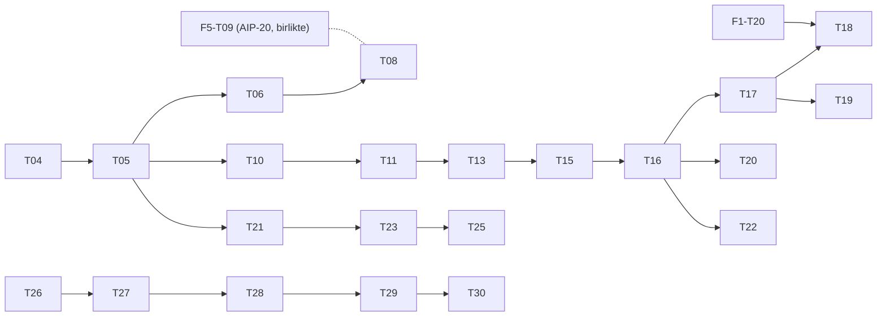

# F6 — Görevler

> **Yürütme notu (25.11.2026):** Bu dosya teknik görev ayrıntısıdır; **yürütme birimi değildir**. Ajan iş olarak paket alır ([yürütme planı](../../execution/README.md)). Bu aşamanın görevlerinin uygulandığı paketler: [H01](../../execution/packages/W0/H01-guvenli-zemin.md), [M01](../../execution/packages/W1/M01-cekirdek-sozlesmeler.md), [M08](../../execution/packages/W1/M08-test-altyapisi.md), [F6-A](../../execution/packages/W2/F6-A-render-aktarim.md), [F6-B](../../execution/packages/W3/F6-B-oynatma-kuyrugu.md), [F6-C](../../execution/packages/W4/F6-C-birlestirme-dsp.md), [F6-D](../../execution/packages/W5/F6-D-chan-websocket.md), [G3](../../execution/stages/G3-arayuz.md), [G4](../../execution/stages/G4-sentetik-kabul.md), [G5](../../execution/stages/G5-gercek-insan-sip.md). Görev başına eşleme: [legacy-mapping.md](../../execution/legacy-mapping.md). Bu dosyadaki AIP, faz ve sprint atıfları eski plana aittir.

Her görevin bir kimliği (`F6-Txx`), sprinti (`F6-Sxx`), dosyaları, bağımlılıkları ve "bitti" tanımı vardır. Kodlama ajanı görevi almadan önce [`spec.md`](spec.md) dosyasının ilgili bölümünü okur.

**Boyut:** S = yarım gün veya daha az · M = 1–2 gün · L = 3 gün veya daha fazla

**Yol kuralı:** `backend/`, `frontend/`, `tests/`, `scripts/`, `config/`, `data/`, `contracts/`, `experimental/`, `automotive_voice/`, `asterisk/` → PoC reposu ([`FreyaTTS_Automotive_PoC`](https://github.com/seydivakkas/FreyaTTS_Automotive_PoC)). `docs/` → bu plan reposu.

**Genel kurallar:**
- Yeni hat `f6_pipeline_v2` bayrağı arkasında geliştirilir. Mevcut çalışan AudioSocket yolu kaldırılmaz.
- **İstisna — bayraktan bağımsız düzeltme:** F6-T03 (ağ yazmasında zaman aşımı yok). Bloklanan gönderim barge-in'i de bloklar.
- Her kanal için ham 48 kHz, işlenmiş 48 kHz, kanal çıkışı ve (telefon için) codec gidiş-dönüşü sesleri ayrı kaydedilir.
- Gerçek SIP, insan sesi ve operatör aktarımı kabulü yalnızca yeni ölçüm kanıtıyla HOLD durumundan çıkar.

---

## F6-S01 — DSP ve transport envanteri

### F6-T01 · Karakterizasyon testleri · M
- **Dosyalar:** `tests/audio_rendering/test_poc_characterization.py`
- **İş:** R2 (parça sınırı sapması), R3 (`tanh` kazancı ve THD), R4 (üç pacer, `AudioPacer`'ın kullanılmaması), R5 (F6 süresinin oynatma süresine eşit olması), R6 (drain zaman aşımı olmaması) test olarak kaydedilir.
- **Bitti:** Testler mevcut kodla geçer; düzeltme görevleri bunları yeni beklenen davranışla günceller.

### F6-T02 · Taban ölçüm (A0) · M
- **Dosyalar:** `scripts/f6_baseline.py`, `data/f6/baseline-<tarih>.json`
- **İş:** F5 referans kümesi (F5-T05) üzerinde mevcut zincirle web ve telefon çıkışları; tepe, RMS, THD, sınır süreksizliği, Whisper geri tanıma.
- **Bitti:** Sonuçlar `docs/00-overview/current-state.md` dosyasına.

### F6-T03 · Ağ yazma zaman aşımı (hata düzeltmesi) · S
- **Dosyalar:** `backend/audiosocket_server.py`, `backend/websocket_adapter.py`, `backend/main.py`
- **İş:** Her `drain` / `send` için zaman aşımı; aşılınca kontrollü kapanış ve olay kaydı.
- **Bitti:** T32 geçer; okumayı durduran sahte istemciyle test edilir.

## F6-S02 — F5–F6 AudioChunk sözleşmesi

### F6-T04 · Sözleşmeler · S
- **Dosyalar:** `backend/audio_rendering/contracts.py`, `docs/01-architecture/interfaces.md` (F6 bölümü)
- **İş:** `RenderedFrame`, `PlaybackEvent`; F5 `AudioChunk` girişi.
- **Bitti:** T46 birim kısmı.

## F6-S03 — Merkezi Audio Rendering Pipeline

### F6-T05 · Durumlu rendering iskeleti · M
- **Dosyalar:** `backend/audio_rendering/pipeline.py`, `chunk_validator.py`, `backend/session.py`
- **Bağımlılık:** F6-T04
- **İş:** Görüşme başına tek durumlu zincir; kanal profili; doğrulama; `session.play_wave` yerine pipeline (bayrak arkasında).
- **Bitti:** T01–T05; web ve telefon aynı pipeline'dan geçer.

## F6-S04 — Audio Assembly ve Crossfade

### F6-T06 · Birleştirme ve sınır yumuşatma · M
- **Dosyalar:** `audio_assembler.py`, `crossfade.py`
- **İş:** spec §5.1–5.2; fade yalnızca sessizlik komşusu sınırlarda, eşit güç crossfade duraklamasız sınırlarda.
- **Bitti:** T06–T08.

## F6-S05 — WSOLA entegrasyonu

### F6-T07 · WSOLA · M
- **Dosyalar:** `wsola.py`, `docs/01-architecture/adr/ADR-F6-02-speed-control.md`
- **Bağımlılık:** F5-T10 (süre ölçekleme denemesi)
- **İş:** Deneysel sınıfın taşınması; F5/F6 hız sorumluluğu kararı.
- **Bitti:** T09, T10; ADR.

## F6-S06 — Prosodic Pause Renderer

### F6-T08 · Duraklama uygulama · S
- **Dosyalar:** `pause_renderer.py`
- **Bağımlılık:** F6-T05. **F4-T27 ve F5-T09 ile karşılıklı bağımlıdır; üçü AIP-20'de birlikte birleştirilir** (F5 sessizlik eklemeyi bıraktığı anda F6 duraklamayı uygulamaya başlamalı).
- **İş:** spec §5.4; parça içi sessizliğin düşülmesi.
- **Bitti:** T11, T12.

## F6-S07 — Dynamic De-Esser

### F6-T09 · De-esser · S
- **Dosyalar:** `de_esser.py`
- **İş:** Web profilinde adaptif; telefonda 4 kHz altı sibilans için ölçüme dayalı karar.
- **Bitti:** T15; telefon kararının gerekçesi raporlanır.

## F6-S08 — Kanal bazlı EQ

### F6-T10 · Durumlu EQ · S
- **Dosyalar:** `equalizer.py`, `config/media/rendering_profiles.json`
- **Bitti:** T13, T14.

## F6-S09 — Loudness ve Limiter

### F6-T11 · Loudness ve zarf tabanlı limiter · M
- **Dosyalar:** `loudness.py`, `limiter.py`
- **Bağımlılık:** F0-T16 (ortak limiter çekirdeği `backend/dsp_common/`)
- **İş:** spec §5.5 ve §5.7; `tanh` doygunlaştırıcısının kaldırılması (R3); limiter F0 ile aynı çekirdeği kullanır, yalnızca kanal profili farklıdır.
- **Bitti:** T16, T17.

## F6-S10 — Comfort Noise

### F6-T12 · Comfort noise · S
- **Dosyalar:** `comfort_noise.py`
- **İş:** Varsayılan kapalı; telefon profilinde deneysel; oynatma referansına dahil.
- **Bitti:** T18.

## F6-S11 — Stateful Resampling

### F6-T13 · Akış boyunca durumlu yeniden örnekleme · M
- **Dosyalar:** `resampler.py`, `docs/01-architecture/adr/ADR-F6-01-output-resampler.md`
- **Bağımlılık:** F0-T21 (ortak durumlu çekirdek `backend/dsp_common/`)
- **İş:** soxr ve durumlu polifaz karşılaştırması; seçim. Seçilen yöntem F0 ile ortak çekirdekte uygulanır.
- **Bitti:** T19–T22; ADR.

## F6-S12 — PCM ve codec laboratuvarı

### F6-T14 · Codec laboratuvarı · M
- **Dosyalar:** `codec.py`, `scripts/f6_codec_lab.py`
- **İş:** PCM16 LE; numpy G.711 A-law / μ-law gidiş-dönüşü; Whisper geri tanıma ve terim doğruluğu (F2 metriği).
- **Bitti:** T23–T25; codec'in telaffuza etkisi raporlanır.

## F6-S13 — Audio Frame Manager

### F6-T15 · Çerçeve yöneticisi · S
- **Dosyalar:** `frame_manager.py`
- **Bitti:** T26, T27.

## F6-S14 — Precision Pacing

### F6-T16 · Tek pacer · M
- **Dosyalar:** `pacer.py`, `backend/audio.py`, `backend/audiosocket_server.py`
- **İş:** Üç uygulamanın birleşmesi; gönderim sapması; görüşme boyunca tek medya saati; sentez gecikmesinde sessizlik çerçevesi kararı (ADR-F6-03).
- **Bitti:** T28, T29; ADR.

## F6-S15 — Playback Queue Controller

### F6-T17 · Oynatma kuyruğu · M
- **Dosyalar:** `playback_queue.py`, `backpressure.py`
- **İş:** spec §5.11; sınırlı kuyruk; önden gönderim sınırı; olaylar.
- **Bitti:** T31, T33, T34.

## F6-S16 — F1 Barge-in entegrasyonu

### F6-T18 · Barge-in köprüsü · M
- **Dosyalar:** `bargein_bridge.py`
- **Bağımlılık:** F6-T17, F1-T20
- **İş:** SOFT_PAUSE / RESUME (konum kaydı) / FLUSH / CANCEL; F5'e iptal; transport komutları.
- **Bitti:** T35–T38.

## F6-S17 — Backpressure ve hata yönetimi

### F6-T19 · Hata yönetimi · M
- **Dosyalar:** `media_transport/fault_recovery.py`
- **İş:** spec §5.14 tablosu.
- **Bitti:** T30, T40, T41, T42.

## F6-S18 — AudioSocket adaptörü

### F6-T20 · AudioSocket adaptörü ve güvenlik · M
- **Dosyalar:** `media_transport/gateway.py`, `audiosocket_adapter.py`, `backend/audiosocket_server.py`
- **İş:** Ortak gateway arayüzü; IP izin listesi; topoloji kararı (spec §13 soru 5); DTMF tekilleştirme (F0-T24 ile).
- **Bitti:** T39, T40, T45; mevcut AudioSocket testleri geçer.

## F6-S19 — Web AudioWorklet iyileştirmeleri

### F6-T21 · Tarayıcı oynatma makbuzları · M
- **Dosyalar:** `frontend/src/useVoiceSession.ts`, `media_transport/websocket_adapter.py`, `playback_receipt.py`, `docs/01-architecture/adr/ADR-F6-04-web-playback.md`
- **İş:** `playback_started`, `playback_completed`, `paused_at` olayları; saat farkı düzeltmesi; AudioWorklet kararı.
- **Bitti:** F1 K07 (duyulabilir kesilme) web kanalında ölçülebilir.

## F6-S20 — Chan WebSocket adaptörü

### F6-T22 · chan_websocket · L
- **Dosyalar:** `media_transport/chan_websocket_adapter.py`, `asterisk/` yapılandırmaları
- **İş:** Sürüm ve mesaj biçimi doğrulaması; XOFF/XON; `MARK_MEDIA` her cümlecik sınırında; önden gönderim sınırı; TLS.
- **Bitti:** T44; telefon kanalında oynatma konumu `MEDIA_MARK_PROCESSED` ile izlenir.

## F6-S21 — Ağ ve medya telemetrisi

### F6-T23 · Telemetri ve gecikme ayrıştırması · M
- **Dosyalar:** `audio_rendering/telemetry.py`, `media_transport/network_monitor.py`, `jitter_monitor.py`, `media_clock.py`
- **İş:** T1–T6 ölçüm noktaları; DSP süresi ayrı (R5); jitter, RTT, underrun; loopback düzeneği (MixMonitor).
- **Bitti:** Studio metrikleri gerçek veriden beslenir.

## F6-S22 — AMI/ARI entegrasyonu

### F6-T24 · AMI/ARI ve doğrulanmış aktarım · M
- **Dosyalar:** `media_transport/`, `backend/ami.py`, `backend/transfer.py`, `backend/sip_trunk_failover.py`
- **İş:** Kanal oluşturma, cevap ve medya bağlantısının ayrı doğrulanması; mock/gerçek ayrımı.
- **Bitti:** T43; F3 T26 (AMI yokken "aktarıldı" denmemesi) ile tutarlı.

## F6-S23 — Audio Transport Studio arayüzü

### F6-T25 · API ve arayüz · L
- **Dosyalar:** `backend/routers/f6.py`, `frontend/src/TransportStudioPanel.tsx` ve alt sayfalar
- **Bitti:** spec §8; gerçek backend; dürüstlük kuralı.

## F6-S24 — Sentetik test laboratuvarı

### F6-T26 · T01–T48 testleri · L
- **Dosyalar:** `tests/audio_rendering/lab/`, `tests/media_transport/lab/`
- **Bitti:** Sonuçlar `data/f6/lab-report-*.json`.

## F6-S25 — Codec ve DSP ablation deneyleri

### F6-T27 · A0–A11 · L
- **Bitti:** `docs/stages/F6-rendering-transport/ablation-results.md` (yalnızca ölçülmüş değerler).

## F6-S26 — F0–F6 uçtan uca regresyon

### F6-T28 · Sentetik görüşme regresyonu · M
- **Bitti:** T47, T48; mevcut testler; uçtan uca TTFA ve barge-in ölçümleri.

## F6-S27 — Gerçek Asterisk ve SIP kabulü

### F6-T29 · L0–L5 kabul laboratuvarı · L
- **Dosyalar:** `docs/testing/f6-sip-acceptance.md`
- **İş:** spec §10 seviyeleri sırayla; her seviyenin kanıtı.
- **Bitti:** `acceptance.md` AŞAMA 4 tablosu L0–L5 için dolu.

## F6-S28 — İnsan dinleme ve görüşme kabulü

### F6-T30 · L6 · M
- **İş:** Telefon bandı MOS (gerçek dinleyiciler), Leyla kimliği (kanal bazlı referans), kritik bilgi anlaşılırlığı, gerçek görüşmeler.
- **Bitti:** AŞAMA 4 L6 satırı dolu; VERIFICATION HOLD kalemleri kanıtla güncellenir.

---

## Bağımlılık özeti

